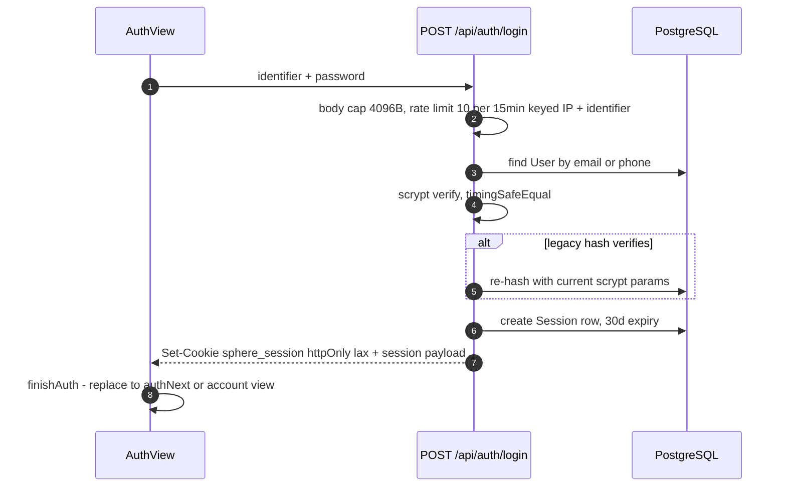
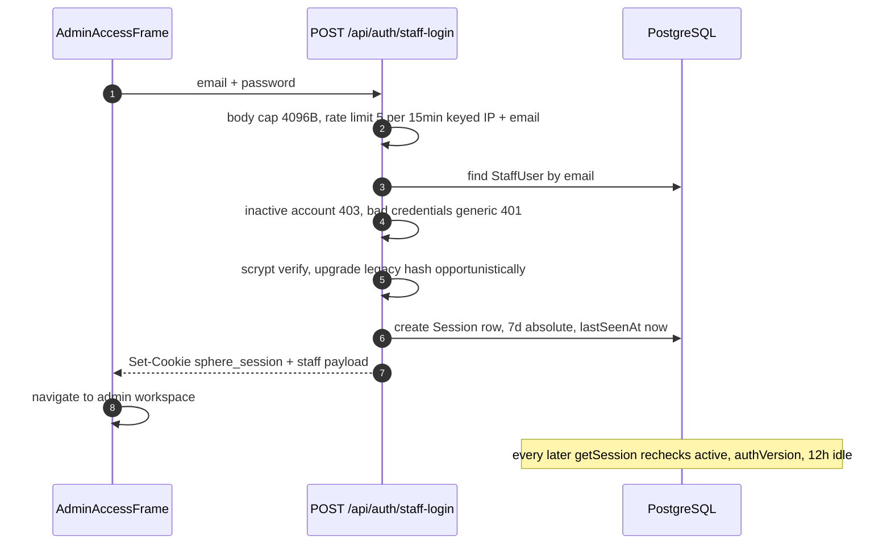
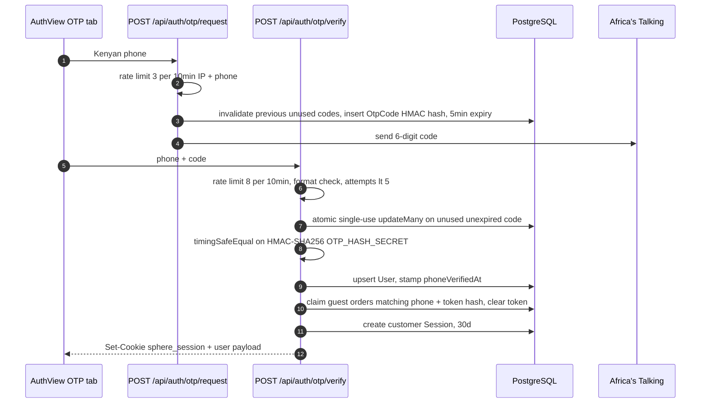

# Sphere Pharmacy — Authentication & Session Management

This document specifies how Sphere Pharmacy authenticates users and staff: the database-backed opaque session mechanism behind the `sphere_session` cookie, the registration / login / staff-login / OTP flows, password hashing with scrypt (including the legacy-hash upgrade path), HMAC-hashed OTP codes, and the one-time guest order access tokens. It also lists the known limitations that are documented but intentionally not yet fixed. The route→role authorization matrix is in [../security/access-control.md](../security/access-control.md); the client-side session store is covered in [state-management.md](state-management.md).

| Audience | Status | Verified |
| --- | --- | --- |
| Engineers, AI coding agents | Implemented — verified against code | November 2026 |

## 1. Session mechanism

There are no JWTs and no NextAuth (`next-auth` is declared but never imported — scaffold legacy). Sessions are opaque random tokens backed by the `Session` table.

| Property | Value |
| --- | --- |
| Cookie | `sphere_session` — `httpOnly`, `sameSite: "lax"`, `secure` in production, `path: "/"`; cookie `expires` mirrors the DB `expiresAt` |
| Token | 32 random bytes, hex (64 chars); stored **raw** in `Session.token` (not hashed at rest — see §8) |
| Customer lifetime | 30 days (`SESSION_DAYS=30`) |
| Staff lifetime | 7 days absolute **plus** a 12-hour idle timeout (`STAFF_IDLE_MS`); `lastSeenAt` refresh is throttled to every 5 minutes |
| Invalidation on read | `getSession()` deletes the row and returns null when: expired · staff `active=false` · `Session.authVersion ≠ StaffUser.authVersion` · staff `lastSeenAt` older than 12h |
| Revocation paths | `destroySession()` on logout · `revokeStaffSessions(staffId)` (deletes all rows) whenever an admin changes a staff member's role, active flag, or password (each change also bumps `authVersion`) |
| Resolved payload | `ResolvedSession`: `role: "CUSTOMER"` (with `user` DTO) or a staff role (with `staff` DTO) — the basis for `requireCustomer` / `requireStaff(roles)` / `requireAuth` |
| Client bootstrap | `useAuthStore.refresh()` → `GET /api/auth/me` (`no-store`); anonymous → `{ ok: true, role: null }` |

### Session lifecycle at a glance

| Event | Customer | Staff |
| --- | --- | --- |
| Created | register / login / OTP verify → 30 days | staff-login → 7 days absolute, `lastSeenAt = now` |
| Touched | expiry only | `lastSeenAt` refreshed at most every 5 minutes |
| Invalidated on read | expiry | expiry · inactive account · `authVersion` mismatch · idle > 12h |
| Revoked explicitly | `destroySession()` on logout | logout, or admin changes role/active/password → `authVersion++` + `revokeStaffSessions` |
| Cleared client-side | `useAuthStore.logout()` clears state + push token | same; client navigates out of `/admin` |

### Secrets and configuration (names only — never commit values)

| Variable | Purpose | Constraint |
| --- | --- | --- |
| `SESSION_SECRET` | Fallback key for OTP/TOKEN hash secrets | effective secret ≥32 chars or startup throws |
| `OTP_HASH_SECRET` | HMAC key for `OtpCode.codeHash` | ≥32 chars (falls back to `SESSION_SECRET`) |
| `TOKEN_HASH_SECRET` | HMAC key for guest order `tokenHash` + promotion identity hashes | ≥32 chars; **do not rotate casually** (promotion HMACs must stay comparable) |
| `AFRICAS_TALKING_USERNAME` / `AFRICAS_TALKING_API_KEY` / `AFRICAS_TALKING_SENDER_ID` | OTP SMS delivery | **Environment-dependent** |

Session lifetimes are **code constants** in `src/lib/session.ts`, not environment variables: `SESSION_DAYS = 30` (customers), `STAFF_SESSION_DAYS = 7`, `STAFF_IDLE_MS = 12h`.

## 2. Registration and customer login

**`POST /api/auth/register`** — body ≤8,192B; rate limit 5/30min/IP. Validation: name ≥2 chars; email **or** phone required (email regex; Kenyan phone `/^(?:\+?254|0)?(7\d{8}|1\d{8})$/` normalized to `+254XXXXXXXXX`); 409 on duplicate email/phone; scrypt hash (§5); best-effort `NotificationPref` creation; session created. **No email verification step** — classification: **Planned or not shipped**.

**`POST /api/auth/login`** — body ≤4,096B; 10/15min keyed IP + lowercased identifier; matches email or phone; **generic 401** on failure (no account enumeration); opportunistic scrypt re-hash upgrade when a legacy hash verifies.

**`PATCH /api/auth/profile`** (`requireCustomer`) — name/avatar/email/phone with 409 clash checks; password change requires `currentPassword` and re-validates the policy.

## 3. Staff login

**`POST /api/auth/staff-login`** — body ≤4,096B; 5/15min keyed IP + email; 403 if the staff account is inactive. A deliberate, test-codified trade-off (`tests/security-static.test.mjs`): a **legacy-password hash may be upgraded even when the password fails the current policy**, so long-tenured staff are not locked out; the policy applies to new/changed passwords. Successful staff login lands the client on the `admin` view. Role, active, or password changes by an admin bump `authVersion` and purge sessions via `revokeStaffSessions`.

## 4. OTP phone sign-in (with guest order claiming)

OTP is the only passwordless path and the mechanism by which a guest order becomes an account-owned order.

**`POST /api/auth/otp/request`** — body ≤4,096B; 3/10min IP+phone; generates a 6-digit code with `randomInt`; **invalidates previous unused codes** for that phone; stores `OtpCode.codeHash = HMAC-SHA256(OTP_HASH_SECRET, phone + ":" + code)` with a **5-minute expiry**; sends the SMS via Africa's Talking (`AFRICAS_TALKING_USERNAME`/`API_KEY`/`SENDER_ID`). There is **no demo/backdoor code path** (statically tested).

**`POST /api/auth/otp/verify`** — 8/10min IP+phone; code must match `/^\d{6}$/`; `attempts < 5`; single-use is enforced **atomically** (`updateMany` flips `used` only for an unused, unexpired, under-attempt row); the hash comparison uses `timingSafeEqual` on the HMAC. On success: auto-creates the `User` if absent (stamping `phoneVerifiedAt`), stamps it on existing accounts, **claims guest orders** whose `guestPhone` and `guestAccessTokenHash` match and are unexpired (then clears the token), and creates a customer session.

## 5. Password hashing (`src/lib/hash.ts`)

| Aspect | Detail |
| --- | --- |
| Algorithm | Node `crypto.scrypt` — `N=16384, r=8, p=1`, 64-byte key, 16-byte salt, `maxmem` 64MB |
| Stored format | `scrypt$v=1$N=16384,r=8,p=1$<salt hex>$<hash hex>` |
| Legacy fallback | old `salt:hash` format still verifiable via `timingSafeEqual`; upgraded on successful login |
| Comparison | `timingSafeEqual` on both formats; inputs >128 characters rejected outright |
| Policy (`validatePassword`) | length 10–128, at least 1 letter and 1 digit |

Supporting utilities in the same module: `newOpaqueToken` (32 bytes base64url — guest order tokens), `tokenHash` = HMAC-SHA256 keyed by `TOKEN_HASH_SECRET`, order reference `"SPH-" + 12 hex`, 8-digit pickup codes, `safeEqualHex`, and `requiredSecret` — `OTP_HASH_SECRET` and `TOKEN_HASH_SECRET` fall back to `SESSION_SECRET`, and the effective value must be ≥32 chars or the process throws. `.env.example` warns never to rotate `TOKEN_HASH_SECRET` casually: promotion HMAC identifiers (`ipHash`/`browserHash`) must stay comparable.

## 6. Guest order tokens

| Aspect | Detail |
| --- | --- |
| Issuance | `POST /api/orders` (guest checkout, OTC only) returns an opaque 32-byte base64url token **once**, in the response body and a `#access=` URL fragment |
| Storage | Only `tokenHash` (HMAC-SHA256, `TOKEN_HASH_SECRET`) on `Order.guestAccessTokenHash`; 7-day `guestAccessExpiresAt` |
| Client keeping | sessionStorage `sphere_order_access_<orderId>` |
| Presentation | `x-order-access-token` header (≤256 chars) or `accessToken` body field |
| Honored by | order GET/cancel, M-Pesa + IntaSend initiate, M-Pesa query |
| Cleared | on OTP-verify claim (§4) |

## 7. Logout

`POST /api/auth/logout` — if the body carries a push `token` that belongs to the caller, the `PushToken` row is deregistered; the session row is deleted and the cookie cleared. The client (`useAuthStore.logout()`) sends the token from localStorage `sphere_device_token` and clears local session state.

## 8. Known limitations

These are documented in the code audit and **intentionally not fixed** at the time of writing; do not silently "fix" them without a security review, and do not assume protections that are not there:

| # | Limitation | Classification |
| --- | --- | --- |
| 1 | **Session tokens are stored plaintext at rest** in `Session.token` (contrast: guest tokens are stored only as HMAC hashes) — a DB read is a session theft | **Implemented** (known risk) |
| 2 | **No CSRF tokens or origin checks** — cross-site mutation protection relies entirely on the cookie's `sameSite: "lax"` | **Implemented** (known risk) |
| 3 | `clientIp` trusts the spoofable `x-forwarded-for` header, which feeds rate-limit identity and per-IP promotion limits | **Implemented** (known risk) |
| 4 | No email verification on registration; OTP is the only verified channel (phone) | **Planned or not shipped** |
| 5 | CSP allows `'unsafe-inline'` scripts/styles (constrains, but does not eliminate, XSS impact) | See [../security/security-architecture.md](../security/security-architecture.md) |

## 9. Related documentation

- [../security/access-control.md](../security/access-control.md) — the authoritative route→role matrix, ownership checks, and rider model
- [../security/security-architecture.md](../security/security-architecture.md) — headers/CSP, webhook and cron authentication, upload security
- [../security/ai-access-and-authorized-sessions.md](../security/ai-access-and-authorized-sessions.md) — why the assistant route never reads the session cookie
- [api-architecture.md](api-architecture.md) — guard idiom, rate limiting, guest token presentation
- [state-management.md](state-management.md) — `useAuthStore` bootstrap, `finishAuth`, and `authNext` intent
