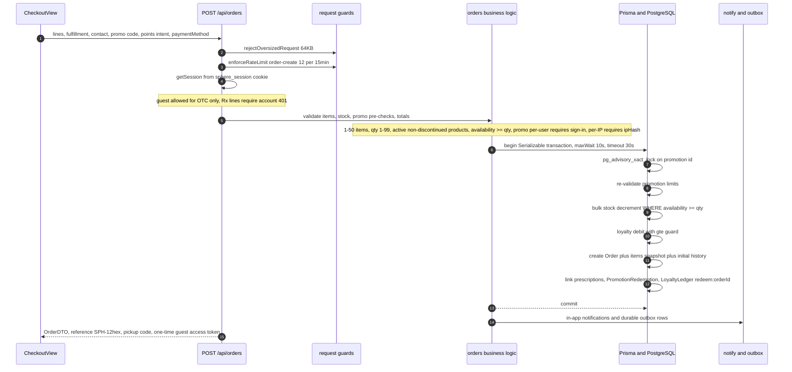

# Sphere Pharmacy — Backend Architecture

This document describes the server side: the API route layer in `src/app/api`, the business-logic services in `src/lib`, the database connection strategy in `src/lib/db.ts`, the DTO conversion layer, the shared type contracts, and the transaction / idempotency / concurrency patterns that keep money and stock correct. Request-surface organization, guards, and rate limiting are covered separately in [api-architecture.md](api-architecture.md); this doc focuses on how handlers are built and how state changes are made safe.

| Audience | Status | Verified |
| --- | --- | --- |
| Engineers, AI coding agents | Implemented — verified against code | November 2026 |

## 1. Route layer: `src/app/api`

The API tree contains **87 `route.ts` modules exporting 116 HTTP method handlers** (verified count). One module — the bare `src/app/api/route.ts` returning a placeholder `GET /api` greeting — is scaffold residue. Handlers are deliberately thin and follow a common shape:

1. `rejectOversizedRequest(request, maxBytes)` — 413 via `Content-Length`.
2. `enforceRateLimit(request, scope, limit, windowMs, identity?)` — 429 fixed window.
3. `requireCustomer()` / `requireStaff(roles?)` / `requireAuth()` — 401/403 with an error `Response` to return early.
4. Field-level validation (hand-rolled; zod is used for assistant intents).
5. Delegation to `src/lib` services and `db` for state changes.
6. JSON response with `Cache-Control: no-store` (session-scoped data).

## 2. Service layer: `src/lib`

| Module | Responsibility |
| --- | --- |
| `session.ts` | Opaque DB-backed sessions, `getSession`/`requireCustomer`/`requireStaff`/`requireAuth`, `destroySession`, `revokeStaffSessions`, user/staff DTO builders |
| `security/request.ts` | `clientIp`, `enforceRateLimit`, `rejectOversizedRequest`, `isUniqueConstraintError`, `publicError`, `escapeHtml` |
| `security/order-workflow.ts` | Authoritative staff/rider order transition map + PATCH guards (`canTransitionOrder`) |
| `security/payment-attempt.ts` | `reservePaymentAttempt` — Serializable reservation of a payment attempt before network I/O; `PAYMENT_ATTEMPT_EXISTS` / `PAYMENT_NOT_PAYABLE` → 409 |
| `security/payment.ts` | Money helpers (`money`, `sameMoney`), phone normalization, `paymentMatchesExpected` |
| `security/file.ts` | Upload magic-byte sniffing, MIME/extension match |
| `security/service.ts` | `managedImage` validation (only `/images/...` site paths or HTTPS `R2_PUBLIC_URL`-host URLs) |
| `inventory-guard.ts` | `getAvailableStock` availability formula, physical deduct/restore, expired-reservation cleanup (45 min default, also invoked by BandaGo sync) |
| `loyalty.ts` | Sphere Points engine: quoting, earn/redeem, `LoyaltyLedger` idempotent event writes |
| `promotions.ts` | Promotion validation, identity hashing (`ipHash`/`browserHash` HMAC via `TOKEN_HASH_SECRET`), limit enforcement |
| `settings.ts` | `Setting` JSON keys (pharmacy/delivery/compliance), `computeDeliveryFee` (free-over / flat / distance bands / zone match) |
| `mpesa/daraja.ts` | Daraja OAuth (cached token), STK push, STK query, phone formatting, result-code mapping |
| `intasend/client.ts` | Hosted checkout sessions, invoice status, refunds, webhook verification |
| `r2.ts` | S3-compatible R2 client, presigned GET/PUT (expiry clamped 30–300s) |
| `notify.ts` | In-app notifications + `audit()` AuditLog writer |
| `notifications/delivery.ts` | Durable outbox: `NotificationDelivery` lease, attempts, backoff, dispatch |
| `notifications/payment.ts` | Payment outcome notifications (in tx) |
| `crm/bandago-crm.ts` | BandaGo/iDempiere CRM reconciliation (customers, loyalty deltas) |
| `bandago-normalizer.ts` | POS product/batch normalization, duplicate batch aggregation, expired-flagging, FEFO sellable stock, `nearestExpiryDate`, `<90d` near-expiry |
| `assistant/contracts.ts`, `assistant/payment-review.ts` | Assistant intent schema (zod), payables review |
| `sms.ts`, `email/resend.ts`, `email/templates.ts`, `firebase/admin.ts`, `firebase/client.ts` | Africa's Talking SMS, Resend email + templates, FCM push |
| `hash.ts` | scrypt hashing, `newOpaqueToken`, `tokenHash` (HMAC-SHA256 with `TOKEN_HASH_SECRET`), order reference / pickup code generation, `safeEqualHex`, `requiredSecret` |
| `medicine-requests.ts`, `medicine-request-dto.ts` | Medicine request creation/DTOs |

## 3. Database connection: `src/lib/db.ts`

- **URL resolution order:** `DATABASE_URL` → `sphere_pharmacy_PRISMA_DATABASE_URL` → `sphere_pharmacy_DATABASE_URL` → `sphere_pharmacy_POSTGRES_URL`; throws if none is set.
- **Neon pooler fix:** if the hostname contains `-pooler.` (PgBouncer), `statement_cache_size=0` is appended unless already present — this prevents PostgreSQL error `0A000` ("cached plan must not change result type") after schema changes on pooled endpoints.
- **Singleton:** the `PrismaClient` instance is cached on `globalThis` (survives dev hot reload), `log: ["warn","error"]`. Exports `db` and `prisma` (same instance).
- **Blueprint compatibility:** a `db.productCategory` getter aliases `db.category`.

Schema facts that shape the backend: 39 models, cuid ids (natural string keys for `Setting.key`, `RateLimitBucket.key`, `EmailSuppression.email`, `EmailDeliveryEvent.id`, `ScheduledJobDelivery.key`), `Decimal(12,2)` money, snake_case `@@map` in the BandaGo block, cascade deletes for children while `Order.user`, `Order.prescriptions`, `Product.category`, `Prescription.user/order` deliberately do **not** cascade (orphan-preserving). Details: [../database/](../database/) and `prisma/schema.prisma`.

## 4. Contracts: `dto.ts`, `types.ts`, `api-client.ts`

- **`src/lib/dto.ts`** converts Prisma rows to wire DTOs: `moneyNumber()` coerces `Decimal` → `Number`; nullable money → `null`; `DateTime` → ISO strings; statuses are cast (no runtime validation). `ORDER_INCLUDE` is the shared order include; `attachRatings()` computes `avgRating`/`reviewCount` from PUBLISHED reviews via `groupBy`; `toReviewDTO` masks the author as "First L."; `toPrescriptionDTO` hardcodes `fileUrl: null` and `storageKey: null` so storage keys never reach the client (presigned URLs are substituted per-request).
- **`src/lib/types.ts`** is the single DTO contract shared by frontend and backend.
- **`src/lib/api-client.ts`** (~500 lines) is the typed client: `req<T>()` same-origin relative fetch, JSON, `cache: "no-store"` (catalog products use `"default"`), `ApiError(message, status)` extracting the server error string; uploads via XHR with progress (`storageApi.uploadFile`, 120s) or base64. Namespaces: `authApi`, `addressesApi` (15s AbortController + friendly 408), `catalogApi`, `ordersApi` (incl. dispatch scopes, guest `x-order-access-token`), `prescriptionsApi`, `notificationsApi`, `assistantApi`, `storageApi`, `paymentsApi`, `adminApi`, `promotionsApi`, `settingsApi`, `servicesApi`, `servicesAdminApi`, `serviceBookingsApi`, `serviceStaffApi`, `adminServiceBookingsApi`, `servicePaymentsApi`, `serviceReviewsApi`, `serviceAnalyticsApi`, `medicineRequestsApi`. The full endpoint catalogue is in [../api/api-reference.md](../api/api-reference.md); the machine-readable contract is [../../openapi/sphere-api.yaml](../../openapi/sphere-api.yaml).

## 5. Transactions, idempotency, concurrency

| Mechanism | Where | Effect |
| --- | --- | --- |
| `Serializable` isolation | Order creation (maxWait 10s, timeout 30s), M-Pesa callback, IntaSend webhook, cash-confirm, refund finalization, `reservePaymentAttempt`, prescription refills | Anomalies surface as serialization errors instead of silent corruption |
| `Order.version` optimistic lock | Every order status/inventory mutation via `updateMany` with version + status in `WHERE` | Concurrent edits → 0 rows updated → 409 "order changed"; cancel retries 3× with backoff |
| `Payment.idempotencyKey` (unique) | `order:{id}:mpesa\|intasend:{clientKey}`, `staff:{orderId}:mpesa:{key}`, `service:{id}:mpesa\|intasend:{key}`, `cash:{orderId}` | Replay returns the original attempt ("Payment request already sent.") |
| `PaymentWebhookEvent.eventId` (unique) | `mpesa:{checkoutRequestId}:{resultCode}:{receipt\|none}`, `intasend:{event_id\|invoice:state:tracking}` (and `mpesa-service:` prefix for bookings) | Benign webhook replays are acked; conflicting replays → 409 |
| `LoyaltyLedger.eventKey` (unique) | `earn:` / `reverse:` / `expire:` / `redeem:` / `cancel:` / `refund-earn:` / `refund-redeem:` + orderId | Points can never double-apply or double-claw-back |
| `PromotionRedemption.orderId` (unique) | One redemption per order; indexes back per-user/per-IP/per-browser limit checks | Exactly one promo per order, no stacking |
| `pg_advisory_xact_lock(hashtext(promotion.id))` | Inside the order-create transaction | Serializes limit counting across concurrent checkouts of the same promo |
| Loyalty debit guard | `updateMany` with `loyaltyPoints: { gte: points }` | Balance changed mid-checkout → `POINTS_CHANGED` 409 |
| Stock decrement guard | Bulk SQL `UPDATE ... WHERE availability ≥ qty` | Insufficient stock → 409 "<name> does not have enough stock." + rollback |
| `reservePaymentAttempt` | Before any provider network I/O | One active attempt per order; rejects duplicates/payability violations with 409 |
| Durable outbox lease | `NotificationDelivery.lockedUntil`/`lockToken` | Cron dispatch is crash-safe; ≤8 attempts with exponential backoff |

## 6. Webhook callback verification model

Webhooks are treated as untrusted triggers; state changes require server-side re-verification.

| Provider | Authentication | Re-verification before trusting |
| --- | --- | --- |
| M-Pesa (`/api/payments/mpesa/callback`, `/service-callback`) | `?token=` query vs `MPESA_CALLBACK_TOKEN` (≥24 chars), `timingSafeEqual` | `ResultCode 0` triggers a fresh `queryStkPush` which must be SUCCESS, plus `paymentMatchesExpected` (amount `sameMoney`, KES, normalized phone, receipt format) |
| IntaSend (`/api/payments/intasend/webhook`) | `INTASEND_WEBHOOK_SECRET` (≥24): timing-safe body challenge, `x-intasend-signature`/`x-webhook-signature` HMAC-SHA256 over the raw body (`sha256=` prefix stripped), or `x-intasend-webhook-secret` header | **Always** re-fetches the invoice server-to-server (`getIntaSendInvoice`); webhook body is only a trigger; `COMPLETE` state required |
| Resend (`/api/notifications/email-webhook`) | `RESEND_WEBHOOK_SECRET` (`whsec_…`), svix `id` + `timestamp` (±300s) + HMAC-SHA256 over `id.timestamp.rawBody`, timing-safe `v1` signature compare | Persists `EmailDeliveryEvent` before acknowledging; maps delivered/bounced/complained/failed; payload ≤65,536B |

All webhook flows run their state changes in Serializable transactions and record `PaymentWebhookEvent` rows (with `payloadHash` = sha256 of the raw body). Unknown payment references → 404.

## 7. Cron endpoints

All five are `GET` with `Authorization: Bearer CRON_SECRET` (≥32 chars). `/api/cron/notifications` uses `authorizedJob()` with a timing-safe compare (maxDuration 300, dispatches ≤10 per run); the other four use an inline plain `===` comparison (known limitation — non-constant-time).

| Endpoint | Job | Guard rails |
| --- | --- | --- |
| `/api/cron/notifications` | Outbox dispatch (email/push) with leases | `authorizedJob()` timing-safe |
| `/api/cron/order-reservations` | Cancel stale reservations, restore stock, re-credit points, fail dangling payments; batch 100 | Requires `ORDER_RESERVATION_TTL_MINUTES` (15–10080) else 503 |
| `/api/cron/prescription-retention` | Retention/soft-delete policy | Requires `PRESCRIPTION_RETENTION_DAYS` (30–36500) else 503 |
| `/api/cron/chronic-refills` | Chronic-patient refill prompts | Bearer check |
| `/api/cron/service-booking-reminders` | Upcoming booking reminders | Bearer check |

Scheduling itself is external — these endpoints are **Implemented** but the schedule is **Requires live verification** in a given deployment.

## 8. Error handling conventions

- **`publicError(message, status)`** — returns `{ error, errorId }` where `errorId` is a random UUID; the same id is written to a structured server-side log line (`console.error(JSON.stringify({level, errorId, message}))`). Clients can quote the errorId in support conversations without leaking internals.
- **Status vocabulary:** 400 field validation; 401 unauthenticated/customer-sign-in-required; 403 role/ownership; 404 missing or deliberately non-disclosing (e.g. non-owner prescription refill → 404, not 403); 409 business-state conflicts (order changed, insufficient stock, payment attempt exists, promotion limits, points changed, duplicate email/phone); 410 expired promotion; 413 body too large; 429 rate limited (+ `Retry-After`); 503 provider-uncertain or infrastructure failure (never mislabels a valid code as invalid — promotion infra failures 503 with errorId).
- Responses carry `Cache-Control: no-store` (or `private, no-store`) on anything session-scoped; `/api/admin/live-changes` additionally sets `Vary: Cookie`.
- Provider fetches use `AbortSignal.timeout(12–15s)`; the assistant LLM uses 15s.

## 9. Order creation — sequence diagram

The canonical example of the backend patterns working together (`POST /api/orders`, guest or customer, see [../workflows/order-lifecycle.md](../workflows/order-lifecycle.md)):

Post-creation, payment capture is always webhook-driven (M-Pesa callback / IntaSend webhook / cash-confirm), never client-asserted — see [../workflows/payment-lifecycle.md](../workflows/payment-lifecycle.md).

## 10. Inventory authority

`getAvailableStock = max(0, min(stock, stockQty) − safetyStockBuffer(default 2) − max(0, virtualReservedStock))`, falling back `stock ?? stockQty ?? 0`. The primary order flow physically decrements `stockQty` and `stock` (COALESCE, clamped) and recomputes `in_stock`/`stockStatus` — `stockQty` is the effective authority. Release paths (cancel endpoint, expiry cron) restore stock and set `inventoryReleasedAt` to prevent double-release. Expired batches are excluded from `stockQty` at POS ingestion (Kenya PPB rule), so expired stock can never appear as online availability. The legacy virtual-reservation path (`reserveStockForCheckout`/`releaseReservation`/`commitReservation`) is dormant — only `getAvailableStock` and the 45-minute cleanup are invoked today. FEFO applies at ingestion/sellable-stock computation; batch-level deduction at order time is **Planned or not shipped**. See [../workflows/inventory-lifecycle.md](../workflows/inventory-lifecycle.md).

## 11. Related documentation

- [system-architecture.md](system-architecture.md) · [api-architecture.md](api-architecture.md) · [authentication.md](authentication.md) · [state-management.md](state-management.md)
- [../security/security-architecture.md](../security/security-architecture.md) (headers, CSP, webhook secrets) · [../security/file-storage-security.md](../security/file-storage-security.md) (R2 key layout, presigned URLs)
- Integration deep dives: [../integrations/mpesa-daraja.md](../integrations/mpesa-daraja.md) · [../integrations/intasend.md](../integrations/intasend.md) · [../integrations/bandago-pos-crm.md](../integrations/bandago-pos-crm.md) · [../integrations/resend.md](../integrations/resend.md) · [../integrations/firebase.md](../integrations/firebase.md) · [../integrations/cloudflare-r2.md](../integrations/cloudflare-r2.md)
- Commerce behavior: [../features/orders-and-fulfillment.md](../features/orders-and-fulfillment.md) · [../features/payments-and-refunds.md](../features/payments-and-refunds.md) · [../features/loyalty-and-promotions.md](../features/loyalty-and-promotions.md)
