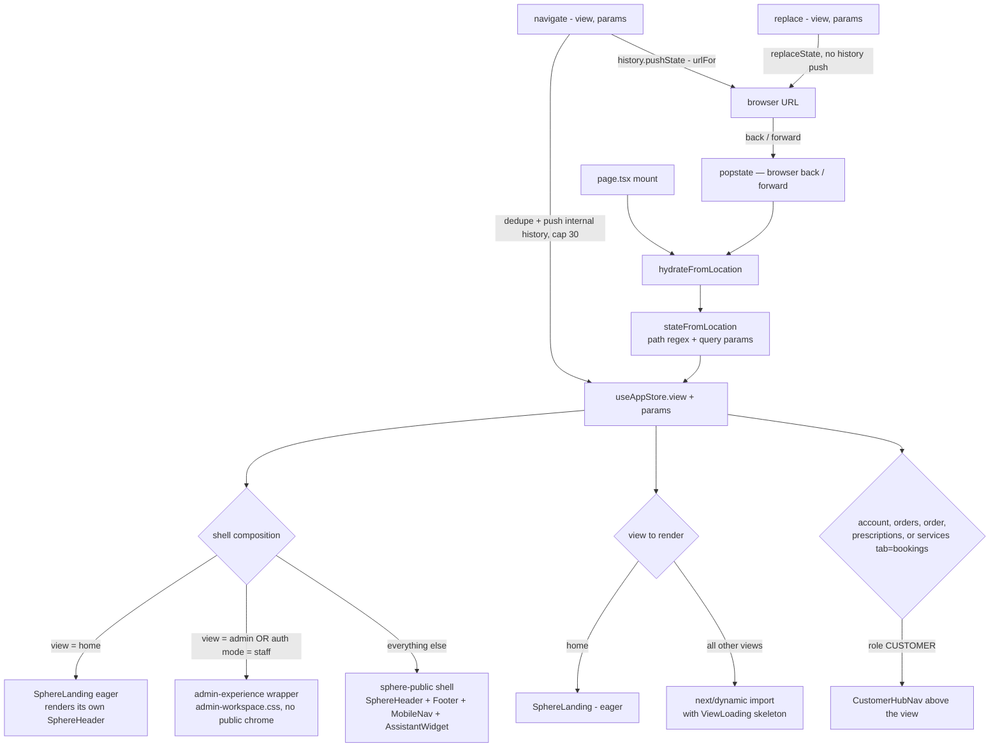

# Sphere Pharmacy — Frontend Architecture

This document describes the client side of Sphere Pharmacy: how a single-page application implements its own router on top of one Next.js page, how views and shells are composed, the complete customer view and admin section inventories, theming, the shadcn/ui component base, and the loading/error/empty-state/accessibility conventions every view follows. It is grounded in `src/app/page.tsx`, `src/store/use-app-store.ts`, `src/components/views/**`, and `src/components/**`. For how client state is owned and re-verified, read [state-management.md](state-management.md); for the server side, [backend-architecture.md](backend-architecture.md).

| Audience | Status | Verified |
| --- | --- | --- |
| Engineers, AI coding agents | Implemented — verified against code | November 2026 |

## 1. The SPA shell

`src/app/page.tsx` is a `"use client"` component that renders the whole application. `src/app/[...route]/page.tsx` re-exports it (`export { default } from "../page"`), so **every URL serves the same shell** — there are no other pages in the app (only `robots.ts` and `sitemap.ts` sit alongside). `layout.tsx` provides metadata (title "Sphere Pharmacy — Your community pharmacy on Lumumba Drive, Roysambu", OpenGraph, canonical `/`, robots index/follow), `themeColor #0f766e`, `ThemeProvider` (next-themes), the sonner `Toaster` (bottom-left, richColors, closeButton), and `<html lang="en" suppressHydrationWarning>`.

On mount, `page.tsx` runs three effects:

1. `hydrateFromLocation()` + a `popstate` listener (removed on unmount) — the router is location-driven, so browser back/forward is fully supported.
2. `refresh()` — session bootstrap via `GET /api/auth/me` (see [authentication.md](authentication.md)).
3. `setupForegroundNotificationListener()`; additionally, whenever a session exists, push permission is granted, and `sphere_device_token` is present, `enablePushNotifications()` runs (firebase/messaging is dynamically imported).

**Dynamic imports:** every view except home is loaded with `next/dynamic` and a shared `ViewLoading` pulse-skeleton: `ServicesView`, `CatalogView`, `OffersView`, `ProductView`, `CartView`, `CheckoutView`, `AuthView`, `OrdersView`, `OrderDetailView`, `PrescriptionsView`, `AccountView`, `AdminView`, and `AssistantWidget`. Home is `SphereLanding`, imported eagerly. CSS layers are imported from `page.tsx`: `reference-home.css`, `reference-home-dark.css`, `ambient-background.css`, `services-showcase.css`, `premium-landing.css`, `app-experience.css`, `sphere-public.css` (contains `sphere-ai-*`), `admin-workspace.css`.

## 2. The view router (`src/store/use-app-store.ts`)

The router is a Zustand store, not the Next.js router. Its contract:

- **`ViewName` union (13 views):** `"home" | "catalog" | "offers" | "product" | "services" | "cart" | "checkout" | "auth" | "orders" | "order" | "prescriptions" | "account" | "admin"`.
- **`AuthMode`:** `"login" | "register" | "otp" | "staff"`. **`ViewParams`:** `productId?`, `orderId?`, `mode?`, `next?` plus an open string map (`[key: string]: string | undefined`).
- **Other state:** `assistantOpen`, `catalogFilters` (`search`, `category`, `rx: any|yes|no`, `availability: any|in|low|out`, `sort: popular|price-asc|price-desc|name|newest`), an internal back-stack `history` (capped at 30 entries), and auth intent (`authMode`, `authNext`, `authNextParams`, `authMessage`). Mirrors `selectedProductId` / `selectedOrderId` are kept for convenience.

### URL ↔ view mapping

Bidirectional mapping via `urlFor(view, params)` and `stateFromLocation()`. Trailing slashes are normalized; unknown paths fall back to `home`; `product` and `order` use path regexes.

| URL | View | Notable params |
| --- | --- | --- |
| `/` | `home` | — |
| `/catalog` | `catalog` | query string feeds `catalogFilters` |
| `/offers` | `offers` | — |
| `/services` | `services` | `?tab=bookings`, `?serviceId=` deep link, `?previewServiceId=` opens detail dialog |
| `/products/:productId` | `product` | regex `^/products/([^/]+)$`, `productId` decoded |
| `/cart` | `cart` | — |
| `/checkout` | `checkout` | `?promo=CODE` seeds offer intent |
| `/auth` | `auth` | `?mode=login\|register\|otp\|staff`, `?next=` |
| `/orders` | `orders` | — |
| `/orders/:orderId` | `order` | regex `^/orders/([^/]+)$` |
| `/prescriptions` | `prescriptions` | — |
| `/account` | `account` | — |
| `/admin` | `admin` | `?section=<AdminSectionKey>` plus `?status`, `?search`, `?stock` |
| anything else | `home` (fallback) | — |

### Navigation API

- **`navigate(view, params)`** — dedupes identical (view, params); appends the previous entry to the internal history (cap 30); `history.pushState` with `urlFor(...)`; scrolls to top. Navigating to `auth` with `params.mode` also sets `authMode`/`authNext`.
- **`replace(view, params)`** — `history.replaceState` without pushing; used after login to land on `authNext`.
- **`goBack()`** — `window.history.back()` when `history.length > 1`, else pops the internal stack, else falls back to `home`.
- **`hydrateFromLocation()`** — re-derives `{view, params}` from `window.location`; runs on mount and on every `popstate`; preselects `authMode` when the location is `/auth?mode=…`.
- **`openAuth(mode?, next?, message?, nextParams?)`** — sets auth intent and navigates to the auth view in one call.

## 3. Shell composition rules

| Condition | Chrome |
| --- | --- |
| `view === "home"` | No `SphereHeader`/`Footer` — `SphereLanding` brings its own `SphereHeader`; CSS module scoped |
| `view === "admin"` **or** (`view === "auth"` and `authMode === "staff"`) | No public chrome; wrapped in `admin-experience` + `admin-workspace.css`; `AssistantWidget` and `MobileNav` not rendered |
| Everything else | `sphere-public` shell: `SphereHeader` + `Footer` + `MobileNav` + `AssistantWidget` |
| `account`, `orders`, `order`, `prescriptions`, or `services?tab=bookings` (role `CUSTOMER`) | `CustomerHubNav` rendered above the view |

A skip-to-content link to `#main-content` is always rendered first.

## 4. Customer view inventory (`src/components/views/`)

All views are client components that read stores and call `api-client.ts` namespaces. Approximate line counts are listed to convey scope.

| View | File | ~LOC | Highlights |
| --- | --- | --- | --- |
| Home (landing) | `components/home/sphere-landing.tsx` | 537 | Hero, search, category cards, care-service previews, trust/CTA; own `SphereHeader`; CSS module |
| Catalog | `catalog-view.tsx` | 703 | Search, category ribbon, filters, grid/list toggle, infinite-scroll **or** paged mode (`HighPerformancePagination`), medicine-request CTA |
| Product | `product-view.tsx` | 750 | Gallery, stock/Rx badges, qty picker, add-to-cart, wishlist, reviews + write, stock-alert bell, related products, tracks recently viewed |
| Offers | `offers-view.tsx` | 167 | Active promo codes; copy or *Activate* (writes offer intent → checkout) |
| Services | `services-view.tsx` | 1841 | Tabs: services (catalog, filter, search, detail dialog, booking dialog with live slots) + bookings (my appointments, status, M-Pesa/card/pay-at-pharmacy, review, `.ics` download, reference copy) |
| Cart | `cart-view.tsx` | 296 | Qty edit/remove, promo apply (server-validated), suggested offers, Rx-line notice, guest sign-in gate |
| Checkout | `checkout-view.tsx` | 1852 | 4-step stepper (fulfillment → details → payment → confirm); Rx uploads ≤10MB; promo + Sphere Points redemption; idempotent order creation |
| Auth | `auth-view.tsx` | 479 | Tabs login/register/OTP/staff (`AdminAccessFrame`); KE phone normalization; `authNext` return |
| Orders | `orders-view.tsx` | 396 | Tabs all/active/completed/rx, search, reorder, pay entry, member intro |
| Order detail | `order-detail-view.tsx` | 1104 | Timeline/history, items, payments (M-Pesa query, card session, cash), prescriptions, cancel, reorder, invoice download, rider info |
| Prescriptions | `prescriptions-view.tsx` | 754 | Upload, status tracking, refills, download, order link |
| Account | `account-view.tsx` | 1516 | Profile + avatar, addresses CRUD + geo, notification prefs, stock-alert watchlist, Sphere Points summary + history, sign-out |

Supporting components: `components/catalog/` (`high-performance-pagination`, `luxury-category-ribbon`, medicine-request dialog), `components/shared/` (`product-card` + `ProductCardCompact` + `StarRow`, `product-image`, `logo`, `empty-state` + `SectionHeader` + `LoadingGrid`, status badges — `OrderStatusBadge`/`PaymentStatusBadge`/`RxStatusBadge`/`RxFlagBadge`/`OtcBadge`/`StockStatusBadge`, `premium-popular-card`, `use-current-location-button`), and `components/member/member-intro.tsx` (4 variants + assistant CTA "A little help from Sphere" → `setAssistantOpen(true)`). The AI assistant widget and its action cards live in `components/assistant/` — see [../features/ai-assistant.md](../features/ai-assistant.md).

## 5. Admin workspace (`src/components/views/admin/`)

`admin-view.tsx` (~549 lines) guards on staff roles (`STAFF_ROLES = ADMIN/PHARMACIST/STAFF/RIDER`; non-staff visitors get a `StaffGate` offering `openAuth("staff", "admin")`). It renders a collapsible sidebar (state persisted to localStorage `sphere-admin-sidebar-collapsed`), a mobile `Sheet` nav, a Cmd/Ctrl+K command palette, and a topbar (theme toggle, push enable, date, store link, sign-out). A `refreshKey` pattern drives cross-section refreshes. **Live changes:** polls `GET /api/admin/live-changes` every 15s (ADMIN/PHARMACIST/STAFF), also on `visibilitychange`/`focus`/`online` and service-worker `PUSH_NOTIFICATION`, surfacing "New order received"/"New care appointment" toasts. Section routing reads `params.section`; sections the caller cannot access render `EmptyState`.

`admin-shared.tsx` defines the `AdminSectionKey` union (16 sections), `SectionProps {refreshKey, onRefresh, onNavigateSection}`, `useDebounced`, `apiErrorMessage`, `SectionError`, `AdminSectionHeader`, `KpiCard`, `KpiSkeletonGrid`, `TableSkeleton`, `downloadCsv` (Blob + BOM), `waHref`/`telHref`, and `CHART_COLORS`.

### Section inventory (16 sections, by nav group)

| Nav group | Section (`AdminSectionKey`) | Roles | Highlights (~LOC) |
| --- | --- | --- | --- |
| Workspace | `overview` | ADMIN | KPIs, 14-day recharts, top products, Rx vs OTC, status breakdown, recent audit |
| Workspace | `orders` | ADMIN / PHARMACIST / STAFF | Queue/all tabs, search, filters, focus lanes (review/pack/handoff/collect), transitions, batch prepare/ready, cash confirm, rider assign (1509) |
| Workspace | `dispatch` | RIDER → `dispatch-section` (personal board, 725); other staff → `dispatch-control-room` (600) | Rider: start/complete own drops, call/WhatsApp. Control room (non-RIDER staff): all/unassigned/handoff/on-road/completed, rider assignment, maps links, cash collection, 2h triage |
| Patient care | `prescriptions` | ADMIN / PHARMACIST | Approve/reject/clarify, refills, validity (983) |
| Patient care | `medicine-requests` | ADMIN / PHARMACIST / STAFF | Photos + follow-up |
| Patient care | `service-bookings` | staff | Queue/upcoming/history/all, reschedule, status, assignment, overview (452) |
| Patient care | `services` | staff | Create/edit/publish, imagery, availability (279) |
| Business | `catalogue` | ADMIN / PHARMACIST / STAFF | Product CRUD, pricing, stock, CSV bulk import; delete is admin-only (1109) |
| Business | `promotions` | ADMIN / STAFF | Banners, codes, campaigns (373) |
| Business | `reviews` | ADMIN / PHARMACIST | Moderate publish/hide (285) |
| Business | `reports` | ADMIN | Sales/product/funnel + CSV (319) |
| Business | `service-analytics` | ADMIN | Service metrics (43) |
| Management | `staff` | ADMIN | Team, roles, access, deactivate (465) |
| Management | `compliance` | ADMIN / PHARMACIST | PPB licence + superintendent record (363) |
| Management | `settings` | ADMIN | Pharmacy profile, delivery fees (zone/distance), demo data (836) |
| Management | `pos-sync` | ADMIN / PHARMACIST | BandaGo hub: telemetry, stock-sync ledger, lot/expiry compliance, manual CSV import (306) |

`admin-access.tsx` provides the `AdminAccessFrame` used by the staff sign-in tab. Role enforcement is duplicated server-side — the UI hiding is never the security boundary (see [../security/access-control.md](../security/access-control.md)).

## 6. Theming

- `ThemeProvider` (next-themes): `attribute="class"`, `defaultTheme="light"`, `enableSystem={false}`, `disableTransitionOnChange`. **Light is the default; dark is opt-in; the only active toggle lives in the admin topbar** (Sun/Moon). The storefront does not offer a theme switch.
- `globals.css` uses Tailwind 4 (`@import "tailwindcss"`, `tw-animate-css`, `@custom-variant dark`) with `@theme inline` oklch variables — a teal/emerald primary: light `oklch(0.385 0.09 165)`, dark `oklch(0.78 0.12 170)`; `--radius 0.8rem`; chart and sidebar variables included.

## 7. UI library

46 shadcn/ui components in `src/components/ui/`: accordion, alert, alert-dialog, aspect-ratio, avatar, badge, breadcrumb, button, calendar, carousel, chart, checkbox, collapsible, command, context-menu, dialog, drawer, dropdown-menu, form, hover-card, input, input-otp, label, menubar, navigation-menu, pagination, popover, progress, radio-group, resizable, scroll-area, select, separator, sheet, sidebar, skeleton, slider, sonner, switch, table, tabs, textarea, toast, toaster, toggle, toggle-group, tooltip. Supporting libraries: recharts (admin charts), embla (carousel), vaul (drawer), input-otp, react-markdown (assistant replies), lucide-react (icons).

> **Note:** `toast`/`toaster` plus `src/hooks/use-toast.ts` are a legacy notification system still referenced only by `pos-sync-section.tsx`; everything else uses sonner. Prefer sonner in new code.

## 8. Loading, error, empty-state, and a11y patterns

| Concern | Pattern |
| --- | --- |
| View loading | `ViewLoading` pulse skeleton for dynamic imports; `Skeleton`/`LoadingGrid` shimmer; `KpiSkeletonGrid`/`TableSkeleton` in admin |
| Spinner semantics | `Loader2` marked `aria-hidden` with a `role="status"` wrapper |
| API errors | `ApiError` surfaces status-specific messages (401 session expired, 403 role, 404 backend pending); `SectionError` = `Alert` + Retry button |
| Empty states | `EmptyState` component (shared `components/shared/empty-state.tsx`); restricted admin sections render it too |
| Form errors | `role="alert"` on error text |
| Toasts | sonner, bottom-left |
| A11y | Skip-to-content link; `aria-current="page"`; `aria-label` on icon buttons; assistant panel is `role="dialog"` with `role="log" aria-live="polite"` conversation, Escape-to-close with focus return; admin section refocus after navigation; KPI cards keyboard-activatable; `fieldset disabled` + `aria-busy` during submits; `prefers-reduced-motion` respected; mobile nav safe-area insets; `<time dateTime>`; WhatsApp/tel links carry `rel="noreferrer"` |

## 9. Legacy / unused — do not document as live

The following exist in the tree but are **not part of the live app**. Do not wire new features to them, and do not cite them as current behavior:

- `src/components/views/home-view.tsx` — superseded by `components/home/sphere-landing.tsx`.
- `components/home/luxury-categories-showcase.tsx`, `priority-products-section.tsx`, `reference-home-hero.tsx`, and the lazy `services-showcase` import — unreachable landing experiments.
- `components/layout/header.tsx` `Header` — only its `WishSheet` export is referenced, and only by the unused hero.
- Declared-but-unused npm dependencies (scaffold legacy): `next-auth`, `@tanstack/react-query`, `@tanstack/react-table`, `next-intl`, `@mdxeditor/editor`, `z-ai-web-dev-sdk`. See [system-architecture.md](system-architecture.md#8-scaffold-legacy--do-not-build-on-these).

## 10. Member, guest, and staff surfaces

- **Guests** can browse, hold a persisted cart, submit medicine requests (phone-only), start checkout (redirected to sign-in with the cart preserved via `openAuth("login","checkout","Sign in to review your checkout. Your bag is saved.")`), use public assistant intents (private panels gate on "Sign in to continue securely"), and track guest orders via access token.
- **Members (customers)** get the `CustomerHubNav` ("My Sphere — Hi, {firstName}"), `MemberIntro` heroes, orders/prescriptions/bookings, account management, assistant private panels, and the notification center inbox.
- **Staff** reach `/admin` (role-filtered workspace with live-change toasts, push alerts, theme toggle, Cmd+K) via the staff sign-in tab; riders get the personal dispatch board. See [../security/access-control.md](../security/access-control.md) for the authoritative route→role matrix.

## 11. Related documentation

- [system-architecture.md](system-architecture.md) · [backend-architecture.md](backend-architecture.md) · [api-architecture.md](api-architecture.md) · [authentication.md](authentication.md) · [state-management.md](state-management.md)
- Features: [../features/storefront-and-catalogue.md](../features/storefront-and-catalogue.md) · [../features/ai-assistant.md](../features/ai-assistant.md) · [../features/notifications.md](../features/notifications.md)
- Frontend environment: `NEXT_PUBLIC_APP_URL` (metadataBase, default `https://spherepharmacy.co.ke`), `GROQ_API_KEY`/`GROQ_MODEL`, `NEXT_PUBLIC_FIREBASE_*` + `VAPID_KEY`; assistant limits: body ≤20,000B, 40 req/h/IP, 8-message context, 1800-char messages, 15s LLM timeout, 650 max tokens.
