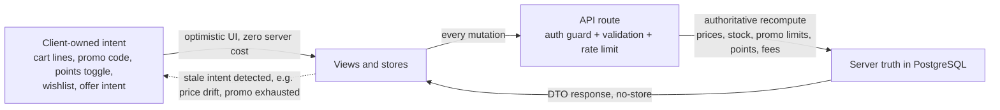

# Sphere Pharmacy — Client State Management

This document specifies every piece of client-side state in Sphere Pharmacy: the four Zustand stores (view router, session, cart, wishlist/recently-viewed), the browser persistence keys, the sessionStorage offer-intent flow, the hydration-safe gate that prevents SSR flicker on persisted stores, and — most importantly — the boundary between client-owned state and server-authoritative state. The governing pattern: **intents are stored client-side and cheaply re-verified; every mutation goes through an authenticated, validated API route.**

| Audience | Status | Verified |
| --- | --- | --- |
| Engineers, AI coding agents | Implemented — verified against code | November 2026 |

## 1. Store inventory

All stores live in `src/store/` and are plain Zustand `create()` stores; only cart, wishlist, and recently-viewed use the `persist` middleware.

| Store | File | Persisted? | Owns |
| --- | --- | --- | --- |
| `useAppStore` | `use-app-store.ts` | No (memory) | View router: `view`, `params`, `selectedProductId`/`selectedOrderId` mirrors, internal `history` (cap 30), `assistantOpen`, `catalogFilters`, auth intent (`authMode`, `authNext`, `authNextParams`, `authMessage`) |
| `useAuthStore` | `use-auth-store.ts` | No (memory; identity lives in the `sphere_session` cookie) | `session: SessionPayload \| null`, `loading` (starts `true`), `refresh()`, `finishAuth()`, `logout()` |
| `useCartStore` | `use-cart-store.ts` | Yes — localStorage `sphere-cart` (`partialize`: `lines`, `appliedPromo`) | Cart lines + promo intent |
| `useWishStore` / `useRecentStore` | `use-wish-store.ts` | Yes — localStorage `sphere-wishlist` / `sphere-recent` | Wishlist (cap 100) and last-12 recently viewed |

`SessionPayload = { role: Role \| "CUSTOMER"; user?: UserDTO; staff?: StaffDTO }` — the same DTOs the API returns.

## 2. `useAppStore` — the view router

The full router contract (URL mapping table, `navigate`/`replace`/`goBack`/`hydrateFromLocation`, `popstate`) is specified in [frontend-architecture.md](frontend-architecture.md#2-the-view-router-srcstoreuse-app-storets). From a state-management perspective, note:

- Navigation state is **never persisted** — a reload re-derives `{view, params}` from `window.location` via `hydrateFromLocation()`, so the URL is the only durable navigation state.
- `catalogFilters` (`search`, `category`, `rx: any|yes|no`, `availability: any|in|low|out`, `sort: popular|price-asc|price-desc|name|newest`) is filter *intent*: the catalog view feeds it to `catalogApi.products`, and the server applies the real filtering.
- `assistantOpen` is a boolean the member-intro CTA ("A little help from Sphere") sets to open the AI widget.
- Auth intent (`authMode`/`authNext`/`authNextParams`/`authMessage`) is set by `openAuth(...)` and consumed once by `finishAuth()` — the store equivalent of a redirect query parameter.

### Zustand conventions used throughout

- **No context providers.** Stores are module-level `create()` singletons consumed via hook selectors (`useAppStore((s) => s.view)`); components subscribe to slices, not whole stores.
- **Store-per-concern.** Routing, session, cart, and wishlist/recents are separate stores; cross-store flows (login → `finishAuth` → `replace(authNext)`) call actions across stores explicitly rather than merging state.
- **`persist` middleware only where reload-survival is a product requirement**, and always with `partialize` so functions and derived values are never serialized.
- **Type unions live with the store** (`ViewName`, `AuthMode`, `CatalogFilters`) so views and the router cannot drift.
- Server data is **not** cached in stores — views fetch fresh (`no-store`) through `api-client.ts`; there is no React Query cache (the dependency is declared but unused; see [system-architecture.md](system-architecture.md#8-scaffold-legacy--do-not-build-on-these)).

## 3. `useAuthStore` — session bootstrap

- `refresh()` → `GET /api/auth/me` with `cache: "no-store"`; anonymous responses yield `role: null`. `loading` starts `true` so views can render skeletons instead of flashing signed-out UI.
- `finishAuth()` — staff sessions navigate to the `admin` view; customers `replace()` to `authNext ?? "account"` (the `replace` avoids polluting the back-stack with the auth view).
- `logout()` → `POST /api/auth/logout` with the push token from localStorage `sphere_device_token` (best-effort deregister), removes the local token, and clears `session`.
- The store holds **no credentials and no token** — the httpOnly `sphere_session` cookie is the session; see [authentication.md](authentication.md).

## 4. `useCartStore` — cart with promo intent only

- **`CartLine`:** `productId`, `name`, `price`, `image`, `requiresPrescription`, `packSize`, `stockStatus`, `qty` (clamped ≤99 on `add` and `setQty`; `qty ≤ 0` removes the line).
- **`AppliedCartPromo` = `{ code, minimumSpend | null }` — intent only.** The code must match `^[A-Z0-9_-]{3,32}$`; the discount is *always* re-validated by the server (see §7).
- `eligiblePromo()` auto-drops the applied promo when the line total falls below `minimumSpend` (or the cart empties). `forgetOffer()` (offer intent, §6) is called whenever the cart becomes empty or is cleared.
- Helpers: `count()`, `subtotal()`, `rxLines()`, `otcLines()` — the checkout splits Rx vs OTC lines for the prescription-upload step.
- Persistence uses `partialize` so only `lines` + `appliedPromo` survive reload; nothing derived is stored.

| Action | Behavior | Server call? |
| --- | --- | --- |
| `add(line, qty?)` | Merge by `productId`, clamp total ≤99, re-check promo eligibility | No |
| `setQty(productId, qty)` | `qty ≤ 0` removes; empty cart also forgets the offer intent | No |
| `remove(productId)` | Filter out; empty cart also forgets the offer intent | No |
| `clear()` | Empty lines + promo + offer intent (post-order) | No |
| `setAppliedPromo(promo)` | Normalize/validate code format, store intent with `minimumSpend` | No |
| `clearAppliedPromo()` | Drop the intent | No |

The only server interactions the cart triggers are *validations* on demand (`promotionsApi.validate` in cart/checkout) and the final `ordersApi.create` — which is deliberately the moment the server takes ownership of every number.

## 5. `useWishStore` / `useRecentStore` — local-only conveniences

- `useWishStore` stores `WishItem` snapshots (`productId`, `name`, `price`, `image`, `requiresPrescription`, `packSize`, `brand`, `savedAt`) — newest-first, hard-capped at **100 items**. Works identically for guests and customers; it is **local-only and never synced** to the server.
- `useRecentStore` tracks the **last 12** `{ productId, at }` product-page visits (deduped, newest-first), powering the home page "pick up where you left off" row.

## 6. Persistence keys

| Key | Storage | Writer | Contents / cap |
| --- | --- | --- | --- |
| `sphere-cart` | localStorage | `useCartStore` (persist, partialized) | `lines`, `appliedPromo` (code + minimumSpend intent) |
| `sphere-wishlist` | localStorage | `useWishStore` (persist) | WishItem snapshots, cap 100 |
| `sphere-recent` | localStorage | `useRecentStore` (persist) | Last 12 `{ productId, at }` |
| `sphere_checkout_offer` | sessionStorage | `src/lib/offer-intent.ts` | Pending promo code (validated against `^[A-Z0-9_-]{3,32}$` before write/read) |
| `sphere_order_access_<orderId>` | sessionStorage | Guest checkout flow | One-time guest order access token (7-day server-side expiry) |
| `sphere_device_token` | localStorage | Push registration (`firebase/client.ts`) | FCM device token, sent on logout for deregistration |
| `sphere-admin-sidebar-collapsed` | localStorage | Admin workspace | Sidebar collapse preference |
| `sphere_promo_device` | cookie (httpOnly, `SameSite=Lax`, 1 year) | **Server-set** by `POST /api/promotions/validate` | Random 24-byte base64url browser identity for per-browser promo limits |

### Offer-intent flow (sessionStorage)

The offers view's *Activate* writes the code via `rememberOffer()`; checkout resolves the candidate promo as **`params.promo` ‖ URL query `?promo=` ‖ `pendingOffer()`**. The code is then validated through `promotionsApi.validate`, and a discount is only *displayed* when `validatedSubtotal === current subtotal` **and** `validatedUserId === current user` **and** the cart's applied code matches — otherwise the UI shows a "needs review" state and withholds the discount. A `promoRequestId` race guard discards stale validation responses; invalid or exhausted codes are forgotten. This is the canonical example of the intent pattern: the code survives browsing (cheap), the *value* never does.

## 7. Hydration-safe gate

Persisted Zustand stores rehydrate **after** the first render, so naive reads flash empty carts on load. The codebase gates persisted-store-dependent UI on `useCartStore.persist.onFinishHydration` consumed via `useSyncExternalStore` — a hydration-safe subscription that avoids SSR/client mismatch and flicker. Views that need cart data render a neutral/empty state until hydration finishes. (`useAppStore`/`useAuthStore` need no gate: they start with in-memory defaults and bootstrap from the URL/`/api/auth/me`.)

## 8. Client-owned vs server-authoritative boundary

| Client-owned (persisted or memory, re-derived freely) | Server-authoritative (revalidated on every use) |
| --- | --- |
| Cart lines + applied promo **intent** | Session and role |
| Wishlist, recently viewed | Prices and stock (assistant "Add one pack" re-fetches; blocks price drift, `OUT_OF_STOCK`/`DISCONTINUED`, insufficient stock vs cart) |
| Offer intent (`sphere_checkout_offer`) | Promo discounts (re-quoted per subtotal **and** user) |
| Assistant conversation (memory only; reset on reload, never persisted server-side) | Delivery fees (zone/distance rules from `Setting`) |
| Navigation/view state, push token, sidebar preference | Orders and statuses; payments incl. idempotency |
| — | Prescription review outcomes; service slots/bookings (`expectedPrice` re-verified); loyalty points |

## 9. The pattern

Concretely:

1. **Intents are stored client-side and cheaply re-verified.** The cart may hold yesterday's price and a promo code; the checkout (and any assistant action) re-validates both against live server state before anything is charged.
2. **Every mutation goes through an authenticated/validated API route.** There is no client-side path that writes server state — no optimistic server writes, no direct database access, no trusted client totals.
3. **Failures are loud and typed.** Stale intents surface as 409s ("order changed", "POINTS_CHANGED", promotion-limit errors) or withheld UI ("needs review"), never as silently wrong money.

This is the same property as "server-authoritative state" in [system-architecture.md](system-architecture.md#5-key-architectural-properties); the frontend never needs cache invalidation logic because it holds nothing authoritative to invalidate.

### Worked example: one cart's journey

1. A guest adds a pack on the product view — `useCartStore.add()` writes a `CartLine` (price snapshot, `stockStatus` snapshot) to `sphere-cart`. No server call.
2. They activate a promo on the offers view — `rememberOffer("SAVE10")` writes `sphere_checkout_offer`; nothing else happens yet.
3. At checkout, the code (plus any `?promo=` query) is resolved and sent to `POST /api/promotions/validate`. The server re-prices against the *live* subtotal; if the subtotal changed since validation, the discount is withheld as "needs review".
4. `POST /api/orders` sends only product ids, quantities, the promo **code**, the points-redemption toggle, fulfillment, and contact — the server recomputes subtotal, discount, delivery fee, points, and total inside a Serializable transaction.
5. After success the cart is cleared (`clear()` also calls `forgetOffer()`); the order, its status, and its payments are henceforth server-authoritative and read through `ordersApi`.

## 10. Store consumers

| Store | Primary consumers |
| --- | --- |
| `useAppStore` | `page.tsx` (view switch + shell composition), `SphereHeader`/`Footer`/`MobileNav` (navigation), product cards (`navigate`), assistant actions (navigate/search intents), member-intro CTA (`setAssistantOpen`) |
| `useAuthStore` | `page.tsx` (bootstrap + push enable), `AuthView` (`finishAuth`), admin role gate, customer-hub nav, assistant private panels (`session?.user` gate) |
| `useCartStore` | cart view, checkout view, product view (add-to-cart), assistant "Add one pack" action, header/cart badges |
| `useWishStore` / `useRecentStore` | product view (heart toggle, `track`), home "pick up where you left off" row, header wishlist surface |

## 11. Rules for adding new client state

1. **Default to "no".** If the value can be derived from a URL, a DTO, or an API response, it does not need a store.
2. **Intent, never truth.** If it must be stored client-side (pre-checkout convenience), store the minimal intent (a code, an id, a boolean) and let the server re-verify before any effect.
3. **Pick the right persistence.** Memory for ephemeral UI state; `sessionStorage` for per-tab intents (`sphere_checkout_offer`, guest order tokens); `localStorage` only for things that should survive reloads and are cheap to re-verify or purely local (cart, wishlist, recents, preferences).
4. **Gate on hydration.** Anything persisted with the `persist` middleware must be consumed behind the `onFinishHydration` + `useSyncExternalStore` gate (§7) if it affects first paint.
5. **No server writes from stores.** Stores call `api-client.ts` namespaces; they never `fetch` directly and never hold credentials — the httpOnly session cookie is the only secret the browser keeps (see [authentication.md](authentication.md)).

## 12. Related documentation

- [frontend-architecture.md](frontend-architecture.md) — views that consume these stores; dynamic-import boundaries
- [api-architecture.md](api-architecture.md) — the routes the stores call; [backend-architecture.md](backend-architecture.md) — what happens inside them
- [authentication.md](authentication.md) — the cookie behind `useAuthStore`
- [../features/storefront-and-catalogue.md](../features/storefront-and-catalogue.md) · [../features/loyalty-and-promotions.md](../features/loyalty-and-promotions.md) — feature behavior built on these stores
