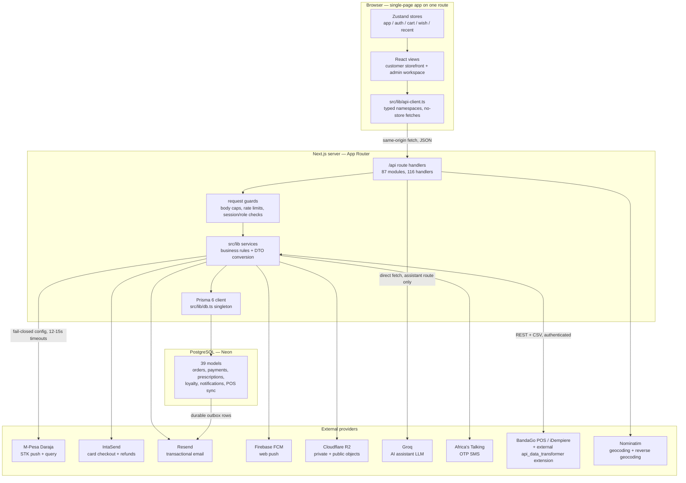

# Sphere Pharmacy — System Architecture

This is the top-level map of Sphere Pharmacy, a full-stack retail pharmacy operations platform for a community pharmacy on Lumumba Drive, Roysambu, Nairobi. The whole product ships as a single-page application served from one Next.js route, backed by an in-process API tree that owns all state transitions in PostgreSQL. This document explains the topology, the layer map, the canonical request lifecycle, and the architectural properties every change must preserve; the deeper dives live in [frontend-architecture.md](frontend-architecture.md), [backend-architecture.md](backend-architecture.md), [api-architecture.md](api-architecture.md), [authentication.md](authentication.md), and [state-management.md](state-management.md).

| Audience | Status | Verified |
| --- | --- | --- |
| Engineers, AI coding agents | Implemented — verified against code | November 2026 |

## 1. Topology: one route, one client shell, one API tree

The app is an SPA-on-one-route. There is exactly one page component:

- `src/app/page.tsx` — a `"use client"` root that renders the entire application from Zustand view state (`useAppStore.view`), including the storefront, customer account hub, and the admin workspace.
- `src/app/[...route]/page.tsx` — a one-line catch-all (`export { default } from "../page"`) so that **every URL renders the same client shell**. Deep links such as `/products/<id>` or `/admin?section=orders` are resolved client-side by `hydrateFromLocation()` on mount and on every `popstate` event.
- The only other files in `src/app/` are `layout.tsx` (metadata, `ThemeProvider`, sonner `Toaster`), `robots.ts`, `sitemap.ts`, and imported CSS layers. All CSS is imported from `page.tsx` (landing, public, and admin-workspace layers).

All real routing — view selection, URL synchronization, back/forward support — is implemented in the client store, not by the Next.js router. See [frontend-architecture.md](frontend-architecture.md) for the full view-router contract.

The server side is a classic App Router API tree: `src/app/api/**/route.ts` contains **87 route modules exporting 116 HTTP method handlers** (verified count, including one scaffold `GET /api` stub that returns a placeholder greeting). Handlers stay thin; business rules live in `src/lib` services.

## 2. Layer map

Every mutation flows through the same five layers, in order. Nothing skips a layer, and no layer reaches around the one below it except the explicitly listed external providers.

| # | Layer | Location | Responsibility |
| --- | --- | --- | --- |
| 1 | Zustand views & stores | `src/store/*`, `src/components/views/**` | View state, navigation, client-owned intents (cart lines, promo intent, wishlist, recently viewed) |
| 2 | Typed API client | `src/lib/api-client.ts` (~500 lines) | The single fetch contract for all frontend code: same-origin relative requests, JSON, `cache: "no-store"` (catalog reads use `"default"`), `ApiError` with server error string, XHR uploads with progress |
| 3 | Next.js API routes | `src/app/api/**` | Body caps, rate limiting, session/role guards, payload validation, orchestration |
| 4 | Service layer | `src/lib/*` | Business rules: `session`, `security/*`, `inventory-guard`, `loyalty`, `promotions`, `settings`, `mpesa/daraja`, `intasend/client`, `r2`, `notify`, `notifications/*`, `crm/bandago-crm`, `bandago-normalizer`, `assistant/*` |
| 5 | Prisma 6 → PostgreSQL | `src/lib/db.ts`, `prisma/schema.prisma` | 39 models, Serializable transactions, unique-constraint idempotency |

Shared contracts: `src/lib/types.ts` defines every DTO ("the contract between frontend & backend"); `src/lib/dto.ts` converts Prisma rows to those DTOs; `src/lib/constants.ts` enumerates roles, statuses, and pharmacy profile facts. The API client and API routes both import the same types, so drift is a compile error.

## 3. System flowchart

Provider call sites: M-Pesa (`src/lib/mpesa/daraja.ts`), IntaSend (`src/lib/intasend/client.ts`), Resend (`src/lib/email/resend.ts`), FCM (`src/lib/firebase/admin.ts` server + `client.ts` browser), R2 (`src/lib/r2.ts` via `@aws-sdk/client-s3`), Groq (direct fetch inside `src/app/api/assistant/route.ts`), Africa's Talking (`src/lib/sms.ts`), BandaGo POS/iDempiere (`src/lib/crm/bandago-crm.ts`, `src/lib/bandago-normalizer.ts`, `/api/integrations/bandago/*`), Nominatim (`/api/location/*`). Per-domain integration notes live under [../integrations/](../integrations/) (bandago-pos-crm, mpesa-daraja, intasend, cloudflare-r2, firebase, resend, ai-provider).

## 4. The request lifecycle (8 steps)

Every mutating request — order creation, payment initiation, prescription review, booking, staff actions — follows the same eight steps. This is the canonical mental model; the concrete order-creation sequence diagram is in [backend-architecture.md](backend-architecture.md).

1. **Frontend submits.** A view action calls a typed namespace in `api-client.ts` (e.g. `ordersApi.create`). Requests are same-origin, JSON, `no-store`; uploads use XHR with progress or presigned PUT. The client may submit *intents* (cart lines, a promo code, a points toggle) but never authoritative values.
2. **API route validates.** `rejectOversizedRequest` enforces per-route body caps via `Content-Length` (e.g. orders ≤64KB, auth ≤4–8KB, assistant ≤20,000B); `enforceRateLimit` applies the per-route fixed-window bucket; payload shape and field-level rules are checked (qty ranges, phone normalization, code formats).
3. **Auth checks.** `getSession()` resolves the opaque `sphere_session` cookie against the DB; guards `requireCustomer` / `requireStaff(roles)` / `requireAuth` return 401/403 error responses; ownership checks (`userId` scoping, guest access tokens, rider assignment) follow. See [authentication.md](authentication.md) and [../security/access-control.md](../security/access-control.md).
4. **Business rules.** `src/lib` services enforce domain invariants: `security/order-workflow.ts` transition maps, `promotions.ts` limit re-validation, `loyalty.ts` redemption quotes, `inventory-guard.ts` availability math, `security/payment-attempt.ts` payability.
5. **Prisma / PostgreSQL.** State changes run inside transactions — `Serializable` isolation for order creation, payment callbacks, cash confirmation, refunds, payment-attempt reservation, and refills. Optimistic concurrency (`Order.version` guarded `updateMany`) and unique constraints (`Payment.idempotencyKey`, `LoyaltyLedger.eventKey`, `PromotionRedemption.orderId`, `PaymentWebhookEvent.eventId`) turn replays and races into clean 409s.
6. **External integrations.** Providers are called only after in-transaction state is reserved (`reservePaymentAttempt` creates a `PROCESSING` row *before* network I/O). All provider configs fail closed; provider fetches use 12–15s abort timeouts; uncertain responses leave payments `PROCESSING` with a reconcile note and 503.
7. **Notifications, audit, and status events.** In-app notifications and durable outbox rows (`NotificationDelivery` with lease, ≤8 attempts, exponential backoff) are written in or right after the transaction; `AuditLog` entries record staff/admin actions; `OrderStatusHistory` / `ServiceBookingStatusHistory` record every transition with an actor.
8. **Typed response.** Rows are converted by `dto.ts` into `types.ts` DTOs (money → `Number`, dates → ISO strings, prescription storage keys stripped) and returned as JSON with `Cache-Control: no-store` on anything session-scoped. Errors are `{ error: string }` + status code; unexpected failures go through `publicError()` which attaches a random `errorId` and logs server-side only.

## 5. Key architectural properties

These properties are load-bearing. Any change that weakens one of them is a regression, not a refactor.

| Property | Mechanism | Where it matters most |
| --- | --- | --- |
| **Server-authoritative state** | The client stores intents only. Prices, stock, promo discounts, delivery fees, points balances, slot availability, and order/payment status are always recomputed server-side at mutation time ("Add one pack" in the assistant re-fetches and rejects price drift). | Orders, promotions, loyalty, service bookings, assistant actions |
| **Optimistic concurrency** | `Order.version` column; every status/inventory mutation uses `updateMany` with `version` + status in the `WHERE` clause and retries (cancel: 3 attempts with backoff); mismatch → 409 "order changed". | Order transitions, rider assignment, reservation expiry claims |
| **Serializable transactions** | `prisma.$transaction(..., { isolationLevel: "Serializable" })` — order creation (maxWait 10s, timeout 30s), M-Pesa/IntaSend callbacks, cash-confirm, refunds, `reservePaymentAttempt`, prescription refills. | Anything that moves money or stock |
| **Idempotency ledgers** | Unique keys make replays safe: `Payment.idempotencyKey`, `PaymentWebhookEvent.eventId`, `LoyaltyLedger.eventKey` (`earn:`/`redeem:`/`expire:`/`cancel:`/`refund-*:` prefixes + orderId), `PromotionRedemption.orderId`, `pg_advisory_xact_lock(hashtext(promotion.id))` to serialize limit counting. | Payments, webhooks, loyalty, promotions |
| **Durable notification outbox** | Email/push deliveries are rows in `NotificationDelivery` (`PENDING` → `SENT` means provider accepted; lease via `lockedUntil`/`lockToken`; ≤8 attempts; backoff `min(3600, 60×2^(attempts-1))`s) dispatched by `GET /api/cron/notifications`. | Order/payment confirmations, booking reminders |
| **Fail-closed external config** | Missing/short secrets throw at startup or per-call (M-Pesa, IntaSend, OTP/TOKEN hash secrets ≥32 chars, webhook secrets ≥24 chars); cron routes 503 when required TTL env vars are absent. | All integrations |
| **Webhook zero-trust** | Callbacks are authenticated (HMAC/timing-safe token) *and* re-verified server-to-server (IntaSend invoice re-fetch, M-Pesa STK re-query) before any state change; webhook bodies are only a trigger. | Payment capture |
| **Physical stock reservation** | Orders deduct real `stockQty`/`stock` inside the create transaction and restore on cancel/expiry (with `inventoryReleasedAt` guard); no long-lived virtual counters in the primary flow. | Inventory integrity |

## 6. Tech stack

| Concern | Choice | Notes |
| --- | --- | --- |
| Framework | Next.js ^16.4.3 (App Router) | One client page + API routes; `build` script runs `prisma generate` first |
| UI runtime | React ^19 | Client components throughout |
| Language | TypeScript 5 (strict) | `npm run typecheck` = `tsc --noEmit` |
| Styling | Tailwind CSS 4 (`@theme inline` oklch tokens) + shadcn/ui | 46 shadcn components; teal/emerald palette; see [frontend-architecture.md](frontend-architecture.md) |
| Client state | Zustand ^5 (+ `persist` middleware) | 4 stores; see [state-management.md](state-management.md) |
| Database | PostgreSQL (Neon) via Prisma ^6.11 | 39 models, 10 migrations (2026); see `prisma/schema.prisma` |
| Auth | Hand-rolled DB-backed opaque sessions | httpOnly cookie; no JWT; see [authentication.md](authentication.md) |
| Payments | M-Pesa Daraja STK, IntaSend hosted card checkout, cash | KES only; webhook-driven capture |
| Object storage | Cloudflare R2 (S3 API + presigner) | Private prescriptions, public product/service imagery |
| Notifications | In-app + Resend email + Firebase FCM push + Africa's Talking SMS (OTP only) | Durable outbox for email/push |
| AI | Groq OpenAI-compatible API (model `GROQ_MODEL` or `openai/gpt-oss-20b`) | Deterministic-first with hard fallback; see [../features/ai-assistant.md](../features/ai-assistant.md) |
| POS/CRM | BandaGo (iDempiere) + external `api_data_transformer` extension | Product/batch sync, CRM reconciliation, CSV fallback |
| Validation | zod ^4 (assistant intents), hand-rolled field checks elsewhere | — |
| Testing | `node --test tests/*.test.mjs` + `bun test tests/assistant.test.ts` | Static security tests codify invariants; see [../testing/testing-strategy.md](../testing/testing-strategy.md) |
| Runtime scripts | `dev` on port 3000, `start:standalone` via bun | `bun.lock` and `package-lock.json` both present |

## 7. Subsystem status classification

| Subsystem | Classification | Notes |
| --- | --- | --- |
| Storefront, catalogue, orders, prescriptions, loyalty, promotions, notifications, admin workspace, state management | **Implemented** | Verified against code; exercised by static tests |
| M-Pesa Daraja, IntaSend, BandaGo sync/CRM | **Environment-dependent** + **Requires live verification** | Code paths complete and fail-closed, but end-to-end behavior depends on provider credentials (`MPESA_*`, `INTASEND_*`, `BANDAGO_*`); sandbox values in `.env.example` are examples only |
| Email (Resend), web push (FCM), OTP SMS (Africa's Talking), AI assistant (Groq) | **Environment-dependent** | Degrade gracefully: assistant falls back to deterministic intents; delivery retries via outbox |
| Cron jobs (notifications dispatch, order-reservation expiry, prescription retention, chronic refills, service-booking reminders) | **Implemented** endpoints; **Requires live verification** for scheduling | All `GET` with `Authorization: Bearer CRON_SECRET`; an external scheduler must call them |
| Batch-level FEFO deduction at order time | **Planned or not shipped** | FEFO runs at POS ingestion/sellable-stock computation only |
| Refund initiation from admin UI | **Planned or not shipped** | `paymentsApi.refund` endpoint exists; no admin screen calls it |

## 8. Scaffold legacy — do not build on these

`package.json` declares dependencies that are **never imported** by the codebase. They are leftovers from the project scaffold and should not be used as evidence of an architecture, nor as a foundation for new code:

- `next-auth` — auth is hand-rolled DB-backed sessions (`src/lib/session.ts`), not NextAuth.
- `@tanstack/react-query` and `@tanstack/react-table` — all data fetching is direct typed-fetch via `api-client.ts`; tables are hand-built on shadcn/ui `table`.
- `z-ai-web-dev-sdk` — the AI assistant calls Groq directly via `fetch`; older documents that describe a z-ai-based assistant are outdated.
- `next-intl`, `@mdxeditor/editor` — unused (the app is English-only; content is rendered with ReactMarkdown where needed).

The bare `src/app/api/route.ts` (`GET /api` → placeholder greeting) is also scaffold residue.

## 9. Related documentation

- Root entry points: [../../README.md](../../README.md), [../../AGENTS.md](../../AGENTS.md), docs index at [../README.md](../README.md)
- Deep dives: [frontend-architecture.md](frontend-architecture.md) · [backend-architecture.md](backend-architecture.md) · [api-architecture.md](api-architecture.md) · [authentication.md](authentication.md) · [state-management.md](state-management.md)
- Lifecycle workflows: [../workflows/order-lifecycle.md](../workflows/order-lifecycle.md) · [../workflows/payment-lifecycle.md](../workflows/payment-lifecycle.md) · [../workflows/prescription-lifecycle.md](../workflows/prescription-lifecycle.md) · [../workflows/inventory-lifecycle.md](../workflows/inventory-lifecycle.md) · [../workflows/service-bookings.md](../workflows/service-bookings.md)
- Security: [../security/security-architecture.md](../security/security-architecture.md) · [../security/access-control.md](../security/access-control.md)
