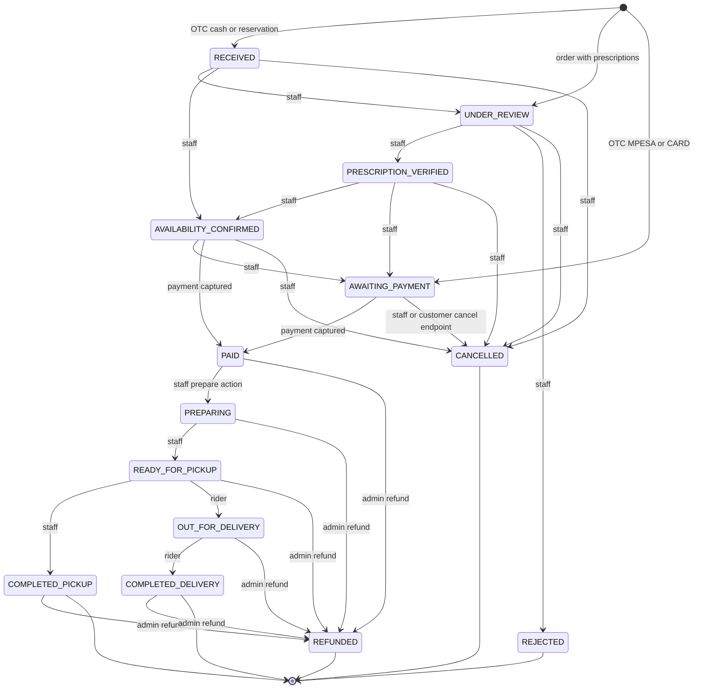
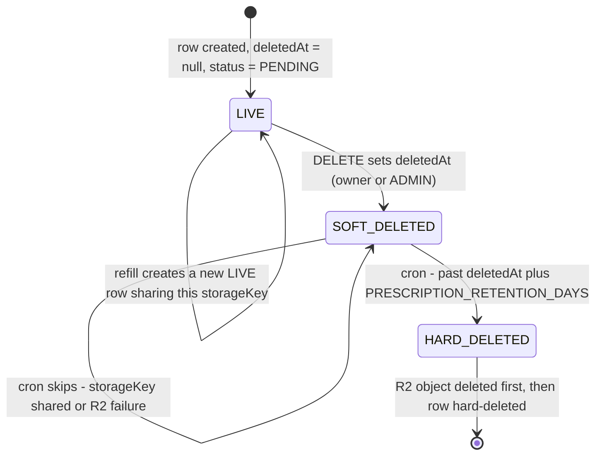
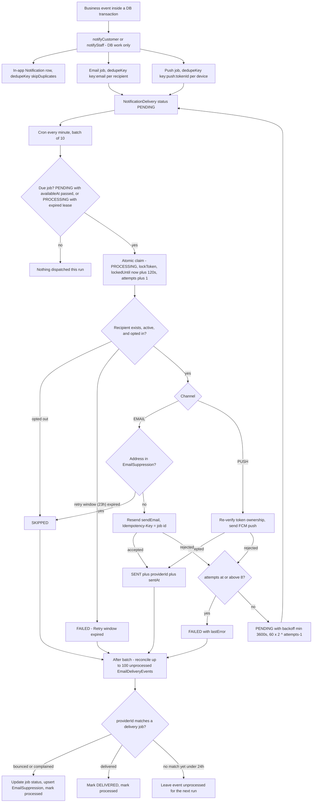

# Data Lifecycle

This document describes how each class of data is born, moves through its states, and dies (or deliberately never dies) in the Sphere Pharmacy database: orders, payments, prescriptions, inventory, notifications, loyalty events, audit logs, sessions/OTPs, guest tokens, medicine requests and service bookings. Retention knobs (`PRESCRIPTION_RETENTION_DAYS`, `ORDER_RESERVATION_TTL_MINUTES`) and the cron jobs that drive expiry are called out per class. Field references are exact — see [data-dictionary.md](data-dictionary.md) for definitions.

| Audience | Status | Verified |
| --- | --- | --- |
| Engineers, AI coding agents | Implemented — verified against code | November 2026 |

## Orders

**Creation → reservation → payment → fulfillment → terminal.**

1. **Creation** — `POST /api/orders` (body ≤64KB, `order-create` 12/15min, 1–50 items, qty 1–99 per line and aggregate). Inside a Serializable transaction (maxWait 10s, timeout 30s), with `pg_advisory_xact_lock(hashtext(promotion.id))` when a promotion applies and limits re-validated:
   - Bulk SQL decrements `Product.stockQty` and `stock` (COALESCE, clamped) where the availability formula covers the requested qty; a missing row → `OUT_OF_STOCK` → 409 and rollback. `inventoryReservedAt` is set to now.
   - Loyalty debit runs as a guarded `updateMany` (balance ≥ redeem) → `POINTS_CHANGED` 409 on race.
   - The `Order` row is created with `reference` `SPH-`+12 hex, item snapshots, initial status `hasRx ? UNDER_REVIEW : (MPESA|CARD) ? AWAITING_PAYMENT : RECEIVED`, and type `hasRx ? (all-Rx ? PRESCRIPTION : MIXED) : (reservation ? RESERVATION : OTC)`; the first `OrderStatusHistory` row is written, prescriptions are linked, `PromotionRedemption` is inserted, and `LoyaltyLedger redeem:{orderId}` records the debit.
2. **Reservation** — physical deduct-and-restore (not virtual counters). See [Inventory](#inventory).
3. **Payment** — see [Payments](#payments). A captured payment moves the order to `PAID` (from `AWAITING_PAYMENT`/`AVAILABILITY_CONFIRMED`/`PRESCRIPTION_VERIFIED`) in the same Serializable transaction as the loyalty award.
4. **Fulfillment** — staff `prepare` action → `PREPARING` (requires `inventoryReservedAt` set and not released, Rx approved, paid or eligible-cash) → `READY_FOR_PICKUP` → rider assignment (DELIVERY orders in dispatch statuses; history "Rider assigned/reassigned") → `OUT_FOR_DELIVERY` → `COMPLETED_DELIVERY` (the latter two rider-settable) or `COMPLETED_PICKUP` (pickup orders with a `SUCCESS` payment).
5. **Terminal** — `COMPLETED_PICKUP`, `COMPLETED_DELIVERY`, `REJECTED`, `CANCELLED`, `REFUNDED`. `CANCELLED` only via the cancel endpoint (refuses when a `SUCCESS` payment exists: 409); it restores stock, sets `inventoryReleasedAt`, re-credits redeemed points (`cancel:{orderId}`), fails dangling `PENDING`/`PROCESSING` payments and writes history (actor SYSTEM). `REFUNDED` is ADMIN-only, via the refund endpoint.

**Status history** — every transition writes an `OrderStatusHistory` row plus an `AuditLog` `ORDER_STATUS_<STATUS>` entry, guarded by optimistic concurrency (`updateMany` on `version`+`status` → 409 "order changed"). The authoritative transition map (`STAFF_TRANSITIONS` in `src/lib/security/order-workflow.ts`) is:

**Expiry (unpaid reservations).** Two mechanisms restore stock for orders that never pay:

- `/api/cron/order-reservations` — TTL-driven: `ORDER_RESERVATION_TTL_MINUTES` (15–10,080; **required, else 503**; not in `.env.example`). Targets `[RECEIVED, UNDER_REVIEW, PRESCRIPTION_VERIFIED, AVAILABILITY_CONFIRMED, AWAITING_PAYMENT]` with `inventoryReservedAt ≤ cutoff` and no `SUCCESS` payment; claims orders via a `version` guard; batch of 100 per run; writes `expire:{orderId}` loyalty re-credit (`RESERVATION_EXPIRED`), fails dangling payments and records history (actor SYSTEM, "Inventory reservation expired before payment.").
- Legacy `cleanupExpiredReservations` (default 45 min, invoked from the BandaGo sync) — same restore behavior for `[RECEIVED, UNDER_REVIEW, PRESCRIPTION_VERIFIED, AVAILABILITY_CONFIRMED, legacy 'PENDING']` with no `SUCCESS` payment.

**Retention** — orders, items and status history are permanent financial records. **No deletion job exists**; guest PII (`guestName`/`guestPhone`/`guestEmail`) is retained on the order rows. Scheduling details: [../operations/scheduled-jobs.md](../operations/scheduled-jobs.md).

## Payments

**Attempts → webhook events → refunds.**

- **Attempt creation** — `reservePaymentAttempt` runs Serializable **before any network I/O**: rejects duplicate `idempotencyKey`, rejects a second active attempt (any payment in `PENDING`/`PROCESSING`/`SUCCESS`/`REFUND_PENDING`/`REFUNDED`), verifies payability, then creates a `PROCESSING` `Payment` (or `ServicePayment`). Keys: `order:{id}:mpesa|intasend:{clientKey}`, `staff:{orderId}:mpesa:{key}`, `service:{id}:mpesa|intasend:{key}`, `cash:{orderId}`.
- **Provider resolution** — M-Pesa STK callback (token `timingSafeEqual`, then a re-query plus `paymentMatchesExpected`: amount, currency, normalized phone, well-formed receipt); IntaSend webhook (signature-verified, then a server-to-server invoice re-fetch — the webhook body is only a trigger; success state is exactly `COMPLETE`); cash confirmation (staff endpoint creating a `SUCCESS` `CASH` payment). Each resolution writes its `PaymentWebhookEvent` ledger row (unique `eventId`, `payloadHash` = sha256 of the raw body) **inside the same transaction** as the payment update — benign replays are acknowledged, conflicting payloads 409.
- **Success** — payment → `SUCCESS` (+`providerReference`), order → `PAID` (+`version` bump + history), loyalty award `earn:{orderId}` (floor of amount/100 points; guests earn nothing).
- **Refunds** — ADMIN-only `POST /api/payments/refund`: M-Pesa `SUCCESS` is refused (manual B2C portal process); cash needs explicit confirmation plus a till reference (`refundReference CASH:<ref>`); IntaSend creates a refund → payment `REFUND_PENDING` with `refundReference = refund.id` → polling `getIntaSendRefund` until `COMPLETED` → `finalizeRefund` (Serializable): payment `REFUNDED`, order `REFUNDED` + history, loyalty clawback `refund-earn:{orderId}` (clamped to balance) and re-credit `refund-redeem:{orderId}`, refund notice in-app + email. Note: no admin UI currently calls the refund endpoint, and captured payments are **never** auto-refunded on cancel despite a customer-facing toast that implies otherwise.
- **Retention** — payments and webhook events are kept indefinitely (audit/financial record).

## Prescriptions

**Upload → review → refills → soft delete → hard delete.**

- **Upload** — customer-only (10/hour per user; ≤10MB; png/jpeg/jpg/webp/heic/pdf). The binary goes to private R2 first (`POST /api/upload`, key `prescriptions/{userId}/{uuid}{ext}` with owner metadata) or via base64 fallback with magic-byte validation; the `Prescription` row is created with `fileData`/`fileUrl` null and `storageKey` set. If linked to an order, `OrderStatusHistory` records `UNDER_REVIEW` ("Prescription uploaded — queued for pharmacist review").
- **Review** — pharmacist/admin `PATCH`: status ∈ `RX_STATUSES`, `reviewNotes` (≤2000) required unless approved, `refillsAllowed` 0–6, `validDays` ∈ {30,60,90,180} → `validUntil` set only when approved. Linked-order aggregation moves the order to `PRESCRIPTION_VERIFIED` (all approved/partially), `REJECTED` (any rejected), or keeps `UNDER_REVIEW`.
- **Refills** — customer `POST .../refill` (5/24h): eligibility (owned, not deleted, approved/partially-approved, `refillsUsed < refillsAllowed`, `validUntil ≥ now`, source order has Rx items with live stock). Serializable tx: optimistic `refillsUsed+1` claim, per-line conditional stock decrement, **new order** (type `PRESCRIPTION`, `UNDER_REVIEW`, current prices, fresh `pickupCode`) and a **new `Prescription` row sharing the same `storageKey`** with status `PENDING` — every refill use is re-verified by a pharmacist.
- **Access** — every owner/staff fetch writes `PrescriptionAccessLog` (`VIEW`/`DOWNLOAD`); the DTO never exposes `storageKey`/`fileData`, and `fileUrl` is a presigned R2 URL (300s).
- **Retention** — soft delete (`DELETE` owner/admin; order-linked → 409 for non-admin) sets `deletedAt`. The retention cron (`GET /api/cron/prescription-retention`, Bearer `CRON_SECRET` ≥32) hard-deletes in batches of 100 where `now − PRESCRIPTION_RETENTION_DAYS ≥ deletedAt` (30–36,500 days, else 503; the blueprint cites 2 years per Kenya PPB Cap 244; CI uses 365). It deletes the R2 object **first**, then the row; rows whose `storageKey` is shared with another row (refill copies) are skipped, as are rows whose R2 deletion fails. **Environment-dependent** — the effective retention window is whatever `PRESCRIPTION_RETENTION_DAYS` is set to per deployment.

Deletion policy detail: [../security/retention-and-deletion.md](../security/retention-and-deletion.md).

## Inventory

**BandaGo sync → batches → FEFO sellable stock → reservation → commit/release.**

- **Sync in** — BandaGo/iDempiere feeds arrive via `EXTENSION_STREAM`, `BACKGROUND_POLL`, `CSV_IMPORT` or `MANUAL_RECONCILE` (`/api/integrations/bandago/*`). The normalizer aggregates duplicate `batchNumber`s, flags `isExpired` (expiry ≤ now), **excludes expired lots from sellable stock** (Kenya PPB rule), tracks `nearestExpiryDate` and near-expiry (<90d). Products upsert by `externalPosId`; lots land in `ProductBatch`; every run writes a `PosSyncLog` row (items received/upserted/failed, details capped at 50 entries).
- **FEFO** — first-expiry-first-out applies at POS ingestion / sellable-stock computation only. **Batch-level deduction at order time is not implemented** — orders decrement the aggregate `stockQty`/`stock`.
- **Reservation** — physical deduct-and-restore: order creation decrements `stockQty` + `stock` and recomputes `inStock`/`stockStatus` (`stockQty` is the effective authority); cancel/expiry restores them, sets `inventoryReleasedAt`, recomputes status. The availability formula (`max(0, min(stock, stockQty) − safetyStockBuffer − max(0, virtualReservedStock))`) gates both listing and reservation `WHERE` clauses.
- **Cleanup** — the legacy `cleanupExpiredReservations` (45 min, called from the BandaGo sync) and the TTL cron described under [Orders](#orders) release stale reservations.

## Notifications

Two distinct record families plus email-safety state:

- **Inbox rows** — `Notification` (channel `IN_APP`) written transactionally by `notifyCustomer`/`notifyStaff` with `dedupeKey` `skipDuplicates`; read via `GET /api/notifications` (last 100) and marked read per-row or all. No retention job — inbox rows persist.
- **Delivery outbox** — `NotificationDelivery` jobs (channel `EMAIL` or `PUSH`): one email job per recipient (`{key}:email`) and one push job per registered device (`{key}:push:{tokenId}`). Dispatched by `GET /api/cron/notifications` (every minute, batch of 10, `CRON_SECRET` ≥32). "SENT means provider accepted."
- **Email safety** — `EmailDeliveryEvent` rows are persisted by the Svix-verified webhook **before** acknowledging (events can precede the send response); the dispatcher later reconciles them by `providerId` and upserts `EmailSuppression` on `BOUNCED`/`COMPLAINED`.

Reconciliation never overwrites `BOUNCED`/`COMPLAINED`. `ScheduledJobDelivery` is vestigial and unused. Admin observability: `GET /api/admin/notification-health` aggregates `(channel, status)` counts without exposing message bodies, addresses or tokens.

## Loyalty ledger events

Every points movement is an idempotent `LoyaltyLedger` row keyed by `eventKey` (unique). The families, all suffixed with the orderId:

| `eventKey` family | `reason` | Delta | Written by |
| --- | --- | --- | --- |
| `earn:{orderId}` | `PAYMENT_CAPTURED` | +`floor(amount/100)` | M-Pesa callback, IntaSend webhook, cash-confirm (inside the capture transaction) |
| `redeem:{orderId}` | `ORDER_REDEMPTION` | −points redeemed | Order creation transaction |
| `cancel:{orderId}` | `ORDER_CANCELLED` | +`pointsRedeemed` re-credit | Cancel endpoint |
| `expire:{orderId}` | `RESERVATION_EXPIRED` | +`pointsRedeemed` re-credit | Order-reservations cron / legacy cleanup |
| `refund-earn:{orderId}` | `PAYMENT_REFUNDED` | −clawback (clamped to balance) | Refund finalization |
| `refund-redeem:{orderId}` | `PAYMENT_REFUNDED` | +`pointsRedeemed` re-credit | Refund finalization |
| `reverse:{orderId}` | — | ± | Generic reversal helper — exists in code, currently uncalled |

`User.loyaltyPoints` is the materialized web balance; `loyaltyPointsBalance` is the POS-synced counter (see [schema-overview.md](schema-overview.md#2-loyaltypoints-vs-loyaltypointsbalance)). Ledger rows cascade only with their user/order.

## Audit logs

`AuditLog` rows are written by the `audit()` helper inside staff-action transactions: `ORDER_STATUS_<STATUS>`, `ORDER_CANCELLED`, `ORDER_PREPARATION_STARTED`, `CASH_CONFIRMED`, `REFUND_REQUESTED`, `PAYMENT_REQUESTED`, `RIDER_ASSIGNED`, `RX_<STATUS>`, `RX_REFILL_REQUESTED`, `PROMOTION_ARCHIVED`, `UPDATE_MEDICINE_REQUEST`, `NOTIFICATION_TEST`. `entity`/`entityId` are plain strings (often the human reference). **No retention** — the audit trail is permanent and indexed by `createdAt` and `(entity, entityId, createdAt)`.

## Sessions and OTP codes

- **Sessions** — created at login (cookie `sphere_session`): customer 30 days, staff 7 days. `lastSeenAt` is refreshed at most every 5 minutes; a staff session idle >12h is invalid, as is any `authVersion` mismatch or an inactive staff account — invalid sessions are **deleted lazily** on the next `getSession()` read. Logout deletes the row; `revokeStaffSessions` purges on staff password/role change; the dev seed's admin update purges that admin's sessions. No scheduled sweeper exists.
- **OTP codes** — `OtpCode` rows expire after **5 minutes**; verification allows at most **5 attempts** (`attempts < 5`), consumes the code with a conditional `updateMany` (a replayed code → 409 "already used"), and each new request marks the phone's prior unused codes `used`. Rate limits: `otp-request` 3/10min, `otp-verify` 8/10min. Expired/used rows are not swept — lookups filter on `(phone, used, expiresAt, createdAt)`.

## Guest access tokens

Guest checkout (OTC only) receives a one-time opaque 32-byte base64url token in the `POST /api/orders` response. Only its HMAC hash is stored (`Order.guestAccessTokenHash`) with `guestAccessExpiresAt` = now + **7 days**. The client keeps it in `sessionStorage` (`sphere_order_access_<orderId>`) and sends it via the `x-order-access-token` header for order view/cancel and payment initiation. **On claim** — when the guest verifies an OTP for the same phone with the token — matching unclaimed orders get `userId` attached and `guestAccessTokenHash`/`guestAccessExpiresAt` set to null (token cleared). Expired or cleared tokens simply stop matching.

## Medicine requests

Guests create `MedicineRequest` rows without an account (10/hour per IP; name 2–200 chars; Kenyan phone normalized `+254…`; optional photo ≤3MB, magic-byte validated, stored at private R2 `medicine-requests/{uuid}.{ext}` — the orphan object is deleted if row creation fails). Staff work the queue `NEW → CONTACTED / FULFILLED / UNAVAILABLE` with `staffNotes`, each update audited as `UPDATE_MEDICINE_REQUEST` with previous/new status; photos are streamed to staff inline from private R2 (never presigned). **No notifications and no automated retention** — rows persist until manually removed.

## Service bookings

- **Creation** — customer `POST /api/service-bookings` (8/hour): validates service active, price/duration match the service exactly, future slot within 180 days on a Nairobi weekday inside an enabled availability window, no conflicting booking (409 "That slot was just booked"; capacity strictly 1 per slot). Row: `reference` `SPB-`+12 hex, status `PENDING`, `paymentStatus` `UNPAID`, price snapshot, history actor `CUSTOMER`.
- **Staff transitions** (`PATCH /api/admin/service-bookings`): `PENDING→[CONFIRMED, CANCELLED, REJECTED, RESCHEDULED]`; `CONFIRMED→[ARRIVED, CANCELLED, RESCHEDULED]`; `ARRIVED→[IN_PROGRESS, NO_SHOW]`; `IN_PROGRESS→[COMPLETED]`; `RESCHEDULED→[CONFIRMED, CANCELLED]`; terminal states have no exits. Rescheduling sets `RESCHEDULED` with new schedule; assignment (`/assign`) sets `assignedStaffId` (null clears). Every transition writes `ServiceBookingStatusHistory`.
- **Payments** — `ServicePayment` attempts mirror order payments: `pay-at-pharmacy` records intent (`paymentStatus = PAY_AT_PHARMACY`, `IN_STORE` PENDING payment — **Planned or not shipped**: no cash-settlement endpoint exists to complete in-store payments); card/M-Pesa webhooks set `paymentStatus = PAID`. Payment-status polling is read-only local state.
- **Reminders** — `/api/cron/service-booking-reminders` (≥ every 15 min): 24h and 2h windows for `PENDING`/`CONFIRMED`/`RESCHEDULED`, deduped by the stable key `${event}:${bookingId}:${scheduledStart ISO}`.
- **Reviews** — after `COMPLETED`, one `ServiceReview` per (booking, user), crediting the assigned staff.
- **Retention** — none defined; bookings and their history persist.

## Retention summary

| Data class | Created by | Removed by | Automated retention |
| --- | --- | --- | --- |
| `Order` + items + status history | Checkout | Nothing (cascade children only if an order were ever deleted) | None — permanent financial record |
| `Payment` / `ServicePayment` / `PaymentWebhookEvent` | Payment attempts, provider webhooks | Cascade with parent order/booking | None |
| `Prescription` | Upload / refill | Soft delete → retention cron hard-delete + R2 object | **`PRESCRIPTION_RETENTION_DAYS`** (30–36,500) measured from `deletedAt`; shared `storageKey`s skipped |
| `PrescriptionAccessLog` | Every file access | Cascade with prescription | None |
| `Notification` (inbox) | Enqueue | Nothing | None |
| `NotificationDelivery` | Enqueue | Nothing (terminal statuses persist) | None |
| `EmailSuppression` / `EmailDeliveryEvent` | Bounce/complaint, email webhook | Nothing | None (events get `processed` flag) |
| `Session` | Login | Lazy delete on invalid read, logout, revoke | Time-based invalidation (30d/7d/12h idle) |
| `OtpCode` | OTP request | Nothing (filtered by `used`/`expiresAt`/`attempts`) | 5-minute effective expiry |
| Guest access token (on `Order`) | Guest checkout | 7-day expiry or account claim clears it | Inline with order |
| `MedicineRequest` | Guest form | Nothing | None |
| `ServiceBooking` + history + payments + reviews | Booking flow | Nothing | None |
| `LoyaltyLedger` | Points events | Cascade with user/order | None |
| `AuditLog` | Staff actions | Nothing | None |
| `RateLimitBucket` | Rate limiter | Nothing (windows reset via `windowEnds`) | Counter semantics only |
| `PushToken` | Device registration | Delete/unsubscribe; pruned when FCM reports invalid | Prune-on-invalid |
| `PosSyncLog` | POS sync runs | Nothing | None |

## Related documents

- [schema-overview.md](schema-overview.md) — fields and design decisions referenced throughout.
- [data-dictionary.md](data-dictionary.md) — exact field definitions.
- [migrations.md](migrations.md) — DDL history behind these lifecycles.
- [../operations/scheduled-jobs.md](../operations/scheduled-jobs.md) — the five cron endpoints that drive expiry, retention, reminders and dispatch.
- [../security/retention-and-deletion.md](../security/retention-and-deletion.md) — the deletion policy behind prescription retention.
- Workflow walkthroughs live under `../workflows/`; the API surface that creates and mutates these records is documented in [../api/api-reference.md](../api/api-reference.md).
- [../../README.md](../../README.md) — project root.
