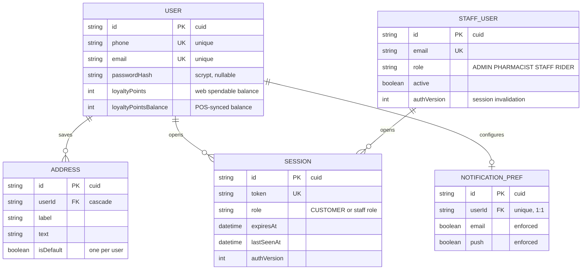
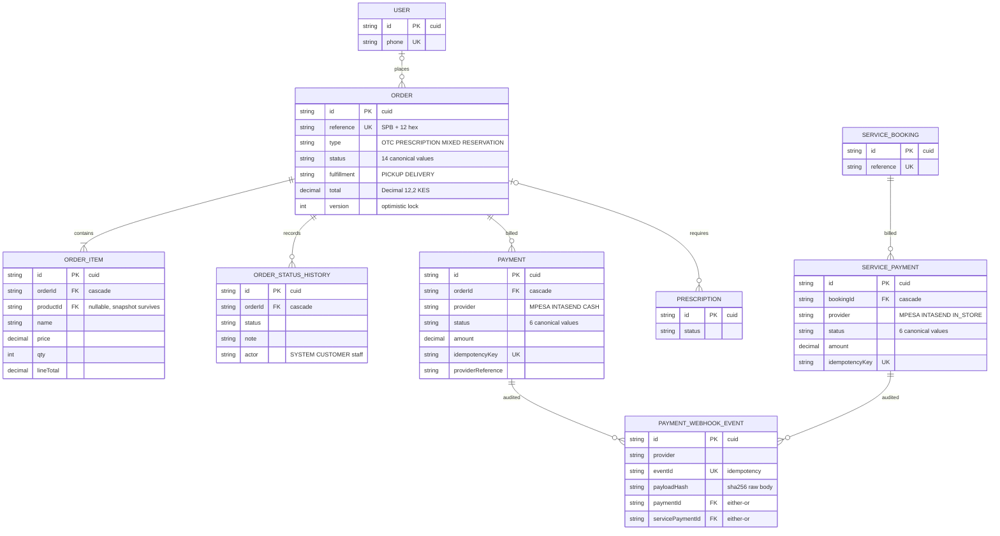
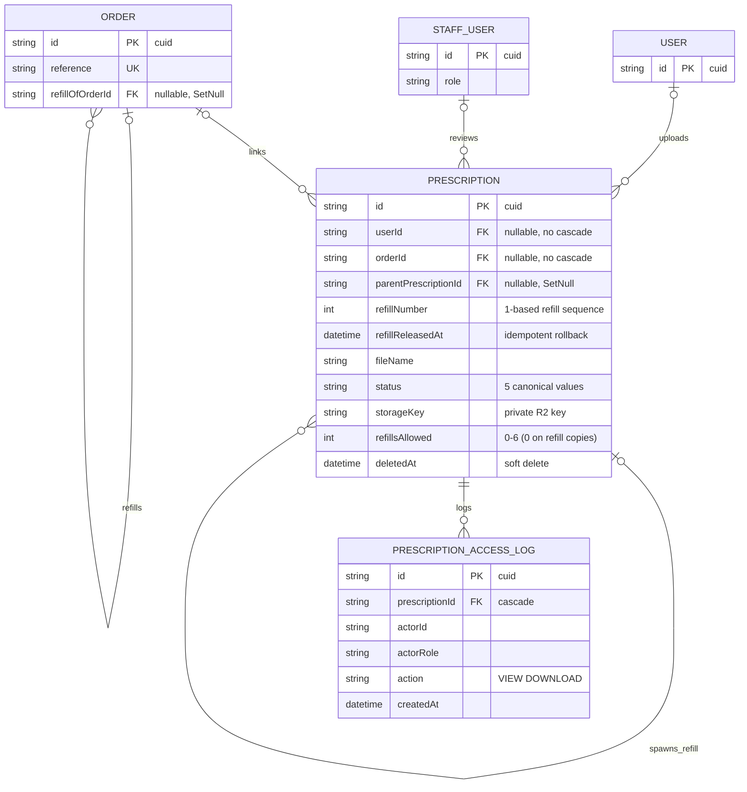
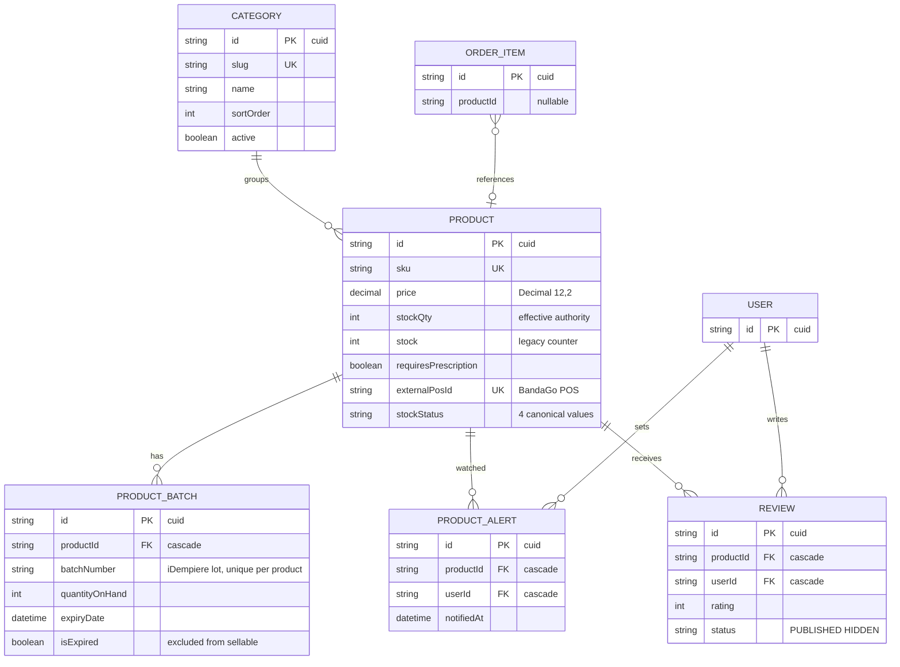
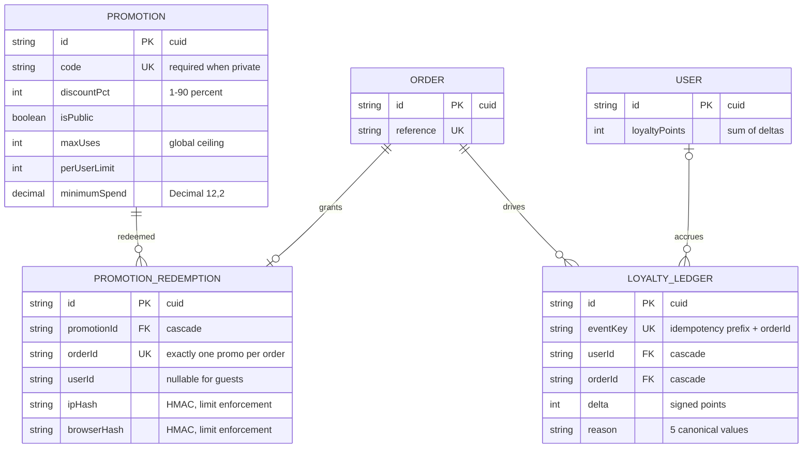
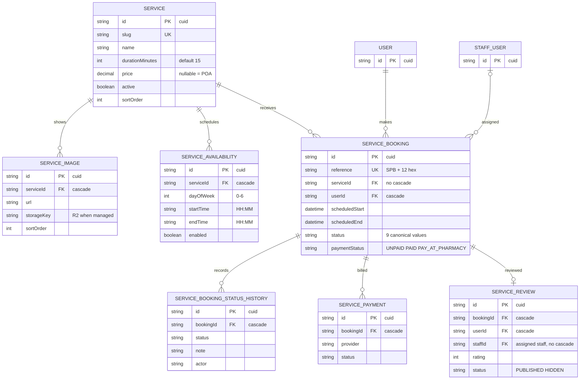
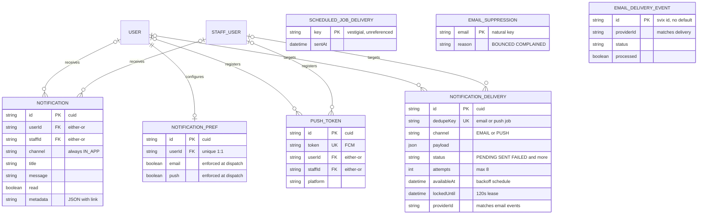
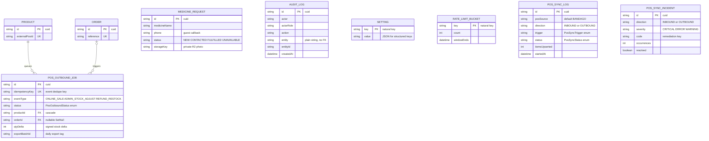

# Entity Relationship Diagram

This document maps the Sphere Pharmacy database as Mermaid ER diagrams, one block per domain, followed by a prose walkthrough of the core relationships. Entities are trimmed to ~5–8 key attributes for readability — the complete field set for every model is in [data-dictionary.md](data-dictionary.md). Crow's-foot notation: `||--o{` = exactly one to zero-or-many, `|o--o{` = zero-or-one to zero-or-many, `||--o|` = one to zero-or-one, `||--||` = one to exactly one.

| Audience | Status | Verified |
| --- | --- | --- |
| Engineers, AI coding agents | Implemented — verified against code | November 2026 |

## Identity / auth

`OtpCode` is standalone (keyed by `phone`, no FK). Deleting a `User` cascades sessions, addresses, prefs and tokens, but **not** orders or prescriptions (see walkthrough).

## Commerce

`Order.riderId` is a plain string snapshot of a `StaffUser` id — there is **no** foreign key. `PAYMENT_WEBHOOK_EVENT` is the shared ledger for both payment tables; exactly one of `paymentId` / `servicePaymentId` is set per row.

## Prescriptions

`Prescription.reviewedById` → `StaffUser` uses the named relation `"RxReviewer"`. `Prescription.parentPrescriptionId` → `Prescription` (`"PrescriptionRefills"`) and `Order.refillOfOrderId` → `Order` (`"OrderRefills"`) capture refill lineage structurally: refills create a **new** `Prescription` row sharing the same `storageKey` (with `refillsAllowed = 0` and parent validity inherited) and a new `Order` pointing back to its source order. The file bytes never live in Postgres — `storageKey` points at a private R2 object `prescriptions/{userId}/{uuid}{ext}`.

## Products / inventory

`Product.categoryId` → `Category` is a nullable, **non-cascading** FK (products survive category deletion). `REVIEW` is documented under the Reviews domain in [data-dictionary.md](data-dictionary.md#6-reviews); it is drawn here because its parent is `Product`.

## Promotions / loyalty

`perIpLimit` / `perBrowserLimit` on `PROMOTION` (not drawn) pair with the hashed columns on `PROMOTION_REDEMPTION` — each limit check is backed by its own index.

## Services

`ServiceBooking.assignedStaffId` → `StaffUser` uses the named relation `"ServiceAssignedStaff"` and does not cascade (unassigning happens logically). A PostgreSQL exclusion constraint (`ServiceBooking_no_overlap`, gist on service + time range for live statuses) additionally prevents overlapping bookings at the database level — see [data-dictionary.md](data-dictionary.md#servicebooking).

## Notifications

`NOTIFICATION_DELIVERY.userId` / `staffId` are **not** foreign keys (soft targeting); `EMAIL_SUPPRESSION` and `EMAIL_DELIVERY_EVENT` have no FK relations at all — the dispatcher matches `EmailDeliveryEvent.providerId` to `NotificationDelivery.providerId` logically during reconciliation. See [data-lifecycle.md](data-lifecycle.md#notifications) for the delivery flow.

## Operations

These models keep operational state, POS reconciliation jobs, and telemetry. `PosOutboundJob` carries foreign keys to `Product` (cascade) and `Order` (SetNull), whereas `MedicineRequest`, `AuditLog`, `Setting`, `RateLimitBucket`, `PosSyncLog`, and `PosSyncIncident` have **no foreign keys**.

## Core relationship walkthrough

**User → Orders → Items → Products.** A signed-in customer owns orders via `Order.userId` (nullable for guest checkout, and deliberately **non-cascading** so order history survives account deletion). Each `Order` contains 1–50 `OrderItem` rows (cascading) that snapshot `name`, `price` and `lineTotal`; `OrderItem.productId` is nullable and only points at `Product` when the product still exists — deleted or custom items keep their snapshot. Products optionally belong to a `Category` (nullable FK, no cascade). `Product.stockQty` is the authoritative sellable count that order placement decrements.

**Order → Payments → PaymentWebhookEvent.** An `Order` accumulates `Payment` attempts (cascade), one active attempt at a time, enforced by unique `idempotencyKey` and the `(provider, providerReference)` / `(provider, checkoutRequestId)` uniques. Providers confirm asynchronously: every verified callback/webhook first upserts a `PaymentWebhookEvent` (unique `eventId`, `payloadHash` for replay detection) pointing at the resolved `Payment` (or `ServicePayment`), then updates the payment inside a Serializable transaction. The ledger is the audit trail of exactly which provider events moved money.

**Prescription → Order + PrescriptionAccessLog.** At checkout, owned, unused, non-deleted prescriptions are attached by setting `Prescription.orderId` (non-cascading) and the order moves to `UNDER_REVIEW`. A pharmacist (`reviewedById` → `StaffUser`) decides each Rx; aggregated outcomes drive the order status (`PRESCRIPTION_VERIFIED` / `REJECTED`). Every owner-or-staff fetch of a prescription file writes a `PrescriptionAccessLog` row (`VIEW`/`DOWNLOAD`) — a write-only compliance record.

**User → LoyaltyLedger.** All Sphere Points movement is journalled: each row is `(eventKey unique, userId, orderId, signed delta, reason)`. Earn on payment capture, debit at redemption, and reversals on cancel/expiry/refund all land here; `User.loyaltyPoints` is the materialized sum the app spends against. `loyaltyPointsBalance` is the separate POS-synced counter (see [schema-overview.md](schema-overview.md#2-loyaltypoints-vs-loyaltypointsbalance)).

**ServiceBooking → ServicePayment.** A booking is billed by `ServicePayment` attempts mirroring the order-payment model (M-Pesa, IntaSend hosted checkout, or `IN_STORE` pay-at-pharmacy intent). Successful webhooks set both the payment row (`SUCCESS`) and `ServiceBooking.paymentStatus` (`PAID`); the shared `PaymentWebhookEvent` table records the provider events with the `mpesa-service:` id prefix.

**Product → ProductBatch.** Each product owns per-lot rows unique on `(productId, batchNumber)` with `expiryDate` from iDempiere. The BandaGo normalizer aggregates lots, flags `isExpired`, and computes sellable `stockQty` excluding expired lots (FEFO, PPB-compliant); `nearestExpiryDate` on the product tracks the earliest live expiry.

**User → PushToken / NotificationDelivery.** A user (or staff member) registers device tokens (`PushToken.token` unique; either `userId` or `staffId`). Enqueueing a notification writes the in-app `Notification` row plus one `NotificationDelivery` job per channel target — `{key}:email` for the recipient and `{key}:push:{tokenId}` per registered device — keyed unique by `dedupeKey`. Dispatch, retries, leases and reconciliation are covered in [data-lifecycle.md](data-lifecycle.md#notifications).

**Product / Order → PosOutboundJob.** Whenever an online order is paid or prepared (`enqueueOrderPosDeduction`) or staff edit `stockQty` (`enqueueAdminStockEdit`), an idempotent `PosOutboundJob` row (`idempotencyKey` unique, deterministic UUIDv4-formatted `externalInventoryUU`) records the signed `qtyDelta` so inbound POS syncs protect unreconciled sales from stale-POS resurrection (`computeReconciledStock`) and either Daily Sales Export or opt-in `AUTO_SYNC` can reconcile BandaGo. Order cancellation/rejection/refund/expiry calls `cancelOrderPosDeduction` to cancel unsynced jobs or queue a compensating `REFUND_RESTOCK` job. Deleting a `Product` cascades its outbound jobs; deleting an `Order` nulls `orderId` (`SetNull`).

## Reading notes

- Relationship lines reflect **foreign-key reality**, including where FKs are absent (`Order.riderId`, `NotificationDelivery.userId/staffId`, `AuditLog.entity*`).
- Cascade behavior matters: children of `Order`/`Product`/`ServiceBooking` cascade; the orphan-preserving exceptions (`Order.user`, `Order.prescriptions`, `Product.category`, `Prescription.user`, `Prescription.order`, `ServiceBooking.service`, `ServiceBooking.assignedStaff`) are listed in [schema-overview.md](schema-overview.md#5-orphan-preserving-non-cascade-relations).
- Status value sets shown in entity comments are abbreviated; the canonical tables live in [schema-overview.md](schema-overview.md#3-string-statuses-canonical-values-in-srclibconstants-ts).
