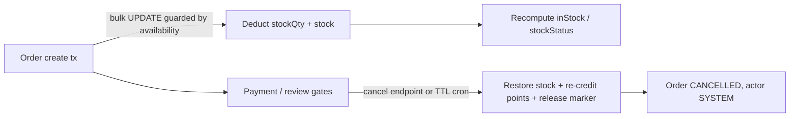

# Inventory and stock

Inventory is the authoritative stock model behind the storefront and order pipeline: which fields count as sellable stock, how reservations physically deduct and restore quantities, how the BandaGo POS keeps the catalogue current, and how batches and expiry (Kenya PPB rules) are tracked. Sellable stock is a computed, safety-buffered quantity — never a raw column.

| Audience | Status | Verified |
| --- | --- | --- |
| Engineers, AI coding agents | **Implemented** | November 2026 |

> Honest-scope note: FEFO batch data drives sellable-stock computation and compliance views only; online orders deduct aggregate quantities, not specific batches.

## 1. Purpose

Guarantee that (a) online available stock can never exceed what the pharmacy can legally sell (expired stock excluded per PPB), (b) placing an order atomically deducts stock, and (c) cancelled/expired/unpaid orders restore it. The catalogue is BandaGo-driven: product data flows in from the POS via stream sync or CSV import, with the web app as the enforcement point for online sellability.

## 2. Users

- **Customers:** see live stock status (`IN_STOCK`/`LOW_STOCK`/`OUT_OF_STOCK`) and back-in-stock alerts; never see raw counts.
- **Staff (ADMIN/PHARMACIST):** product CRUD, CSV bulk import, stock and pricing edits, POS-sync hub.
- **ADMIN only:** product delete/discontinue.
- **Riders:** no inventory surface (delivery board only).
- **BandaGo POS (system):** pushes catalogue and stock updates; consumes cleanup of stale reservations.

Compliance framing: the PPB-aligned rules (expired stock never sellable online, FEFO visibility) are enforced here rather than trusted from the POS.

## 3. Screens

- **Storefront** — stock badges on `ProductView`/`ProductCard` (`StockStatusBadge`), quantity clamping to availability, back-in-stock alert bell.
- **Admin → Catalogue** — `catalogue-section.tsx` (1109 ln; ADMIN/PHARMACIST/STAFF): product CRUD, pricing, stock fields, low-stock threshold, CSV bulk import; delete is admin-only.
- **Admin → POS sync** — `pos-sync-section.tsx` (~1630 ln; ADMIN/PHARMACIST): BandaGo 4-workspace hub with Overview & Policy (`MANUAL_EXPORT` vs `AUTO_SYNC`, stagnant-POS drift protection, tenant pinning, extension heartbeat, key-hygiene alerts), Sales Export & Reconciliation (Zero-PHI A4 PDF/CSV/JSON exports, `Confirm Entered in BandaGo POS`, Live Stock Variance Inspector, baseline cutover), Error Console (`PosSyncIncident` triage), and Synchronization Audit Trail + staff-cookie CSV import.
- **Admin → Orders** — focus lanes and the prepare flow depend on `inventoryReservedAt` (see [orders-and-fulfillment.md](orders-and-fulfillment.md)); the live-changes poll surfaces stock-relevant edits within 15s.
- **Account** — stock-alert watchlist management (`account-view.tsx`).

## 4. Frontend implementation

- Product detail (`product-view.tsx`) renders `stockStatus` + Rx badges and the alert bell (`ProductAlert` subscribe when out of stock); `account-view.tsx` lists the watchlist.
- Admin `catalogue-section.tsx` calls `adminApi.productUpsert/update/delete/importCsv` (typed client in `src/lib/api-client.ts`); CSV import uploads through the admin API, not the generic upload route. `downloadCsv` (Blob + BOM) powers exports of filtered views.
- `pos-sync-section.tsx` reads `/api/admin/pos-status`, `/api/admin/pos-sync/policy`, `/api/admin/pos-sync/reconcile`, and downloads exports from `/api/admin/pos-sync/sales-export` (migrated to `sonner` toasts in `061e923`).
- Catalogue admin list uses the same `GET /api/products?admin=yes` surface as the storefront, with `stockStatus`/`oldest`/`stock-asc|desc` sorts reserved for staff.
- KPI skeletons (`KpiSkeletonGrid`, `TableSkeleton`) and `SectionError` (Alert + Retry) cover telemetry load states.

## 5. Backend implementation

### Stock field semantics

| Column | Meaning |
| --- | --- |
| `stockQty` | Effective authority — recomputed status and the primary decrement target |
| `stock` | Legacy mirror kept in lockstep by the bulk SQL (COALESCE, clamped ≥ 0) |
| `safetyStockBuffer` | Subtracted from sellable availability (default 2) |
| `virtualReservedStock` | Legacy virtual counter (effectively 0 in the live flow) |
| `inStock` / `stockStatus` | Derived flags rewritten on every mutation |
| `lowStockThreshold` | LOW_STOCK boundary (default 5) |

### Reservation lifecycle

- **Availability** — `src/lib/inventory-guard.ts` `getAvailableStock = max(0, min(stock, stockQty) − safetyStockBuffer (default 2) − max(0, virtualReservedStock))`, falling back `stock ?? stockQty ?? 0`. Comment of record: "Enforces Kenya PPB regulatory rules so expired stock (excluded from stockQty) can never contribute to online available stock."
- **Deduct-and-restore (live path)** — `POST /api/orders` runs a bulk SQL `UPDATE` inside the Serializable creation transaction: decrements `stockQty` and `stock` (COALESCE, clamped ≥ 0), sets `in_stock`/`stockStatus`, guarded by `WHERE availability formula ≥ qty`; a missing row means OUT_OF_STOCK → 409 + rollback (see [orders-and-fulfillment.md](orders-and-fulfillment.md)). `stockQty` is the effective authority for status recompute: `≤0 → OUT_OF_STOCK`, `≤ lowStockThreshold (default 5) → LOW_STOCK`, else `IN_STOCK`.
- **Release paths** — `POST /api/orders/[id]/cancel` and `GET /api/cron/order-reservations` restore `stockQty`/`stock`, recompute status, set `inventoryReleasedAt`, re-credit redeemed points, fail dangling PENDING/PROCESSING payments, and write `OrderStatusHistory` actor SYSTEM.
- **Legacy virtual path** — `InventoryGuard` reserve/release/commit reservation methods and `cleanupExpiredReservations` (45 min) are mostly legacy; only `getAvailableStock` and the 45-minute cleanup (invoked from the BandaGo sync) still run.
- **BandaGo ingestion & drift protection** — `/api/integrations/bandago/sync` (trigger enum: EXTENSION_STREAM / BACKGROUND_POLL / CSV_IMPORT / MANUAL_RECONCILE) and `/api/integrations/bandago/csv-import`, both normalized through `src/lib/bandago-normalizer.ts` (`BandaGoNormalizer`, `parseCsv`, `normalizeKenyaPhone`):
  - Slugs are url-safe and prefixed with the external POS id tail (e.g. `panadol-extra-500mg-20s-bp-001`) so re-syncs upsert rather than duplicate.
  - **Rx classification is OR'd and never downgraded:** `requiresPrescription = existing || POS flag` — a web-side Rx flag survives any POS row that omits it.
  - **Image preservation:** existing web images/URLs are kept on upsert; the normalizer never blanks imagery the POS does not know about.
  - `processBatches` aggregates duplicate batch numbers per product, respects `policy.minShelfLifeDays`, and recomputes the FEFO-derived fields.
  - **Stagnant-POS drift protection (`computeReconciledStock`):** subtracts unreconciled `PosOutboundJob` offsets (`getUnreconciledOffsetsByProduct`) and unpaid order holds from incoming `lastPosStock`/`lastPosSellableStock` snapshots so stale POS reads never overwrite online sales back up. Single-tenant pinning (`expectedTenantUU` → `403 TENANT_MISMATCH`) and `policy.inboundEnabled` pause are also enforced.
  - Every run writes a `PosSyncLog` row (`direction: INBOUND` / `OUTBOUND`, status SUCCESS/PARTIAL/FAILED, item counters, error stacks capped at 50) and deduplicates per-item or drift warnings into `PosSyncIncident`.
- **Outbound POS reconciliation (`src/lib/pos-reconciliation.ts`)** — payment capture (`mpesa/callback`, `intasend/webhook`, `cash-confirm`) and `prepare` enqueue `ONLINE_SALE` `PosOutboundJob` rows via `enqueueOrderPosDeduction`; `PATCH /api/products/[id]` stock edits mirror `stock`/`inStock` and queue `ADMIN_STOCK_ADJUST` via `enqueueAdminStockEdit`; order cancellations/rejections/refunds/expiries invoke `cancelOrderPosDeduction` (cancelling open jobs or creating compensating `REFUND_RESTOCK` jobs). Jobs resolve either via Daily Sales Export (`/api/admin/pos-sync/sales-export` + `MARK_RECONCILED`) or opt-in `AUTO_SYNC` writeback (`/api/integrations/bandago/outbound` + `/outbound/ack`).
- **Telemetry** — `GET /api/admin/pos-status` (ADMIN/PHARMACIST/STAFF) exposes recent 25 `PosSyncLog` runs (with `direction`), active `PosSyncPolicy`, `PosBridgeHeartbeat` (from `/api/integrations/bandago/telemetry`), outbound counts, open incident counts, and key configuration health flags.

## 6. Database

- **Product** (stock & POS block, snake_case-mapped): `stockQty Int` (effective), `stock Int?`, `virtualReservedStock Int @default(0)`, `safetyStockBuffer Int @default(2)`, `inStock Boolean`, `lowStockThreshold Int @default(5)`, `stockStatus String`, `externalPosId? @unique`, `posSource @default("BANDAGO")`, `lastSyncedAt?`, `lastPosStock?`, `lastPosSellableStock?`, `externalWarehouseId?`, `externalLocatorId?`, `externalOrgId?`, `externalClientId?`. Raw SQL in the order flow quotes `"virtual_reserved_stock"`, `"in_stock"`, `"stockStatus"`, `"lowStockThreshold"`.
- **ProductBatch** (`product_batches`): `batchNumber` (iDempiere Lot/Batch), `quantityOnHand Int`, `expiryDate` (iDempiere `M_AttributeSetInstance.GuaranteeDate`), `externalBatchId?`, `isExpired @default(false)`; unique `[productId, batchNumber]`, index `[productId, expiryDate]`.
- **ProductAlert**: `productId`, `userId`, `notifiedAt?`; unique `[productId, userId]`.
- **PosSyncLog**: `posSource`, `direction` (`INBOUND`/`OUTBOUND`), `trigger` (`EXTENSION_STREAM`/`BACKGROUND_POLL`/`CSV_IMPORT`/`MANUAL_RECONCILE`/`OUTBOUND_WRITEBACK`/`MANUAL_EXPORT_RECONCILE`/`BRIDGE_ERROR`), `status` (SUCCESS/PARTIAL/FAILED), `itemsReceived/itemsUpserted/itemsFailed`, `details Json` (error stacks, capped 50), `startedAt/completedAt/durationMs`; indexes `[startedAt]`, `[status]`.
- **PosOutboundJob** (`pos_outbound_jobs`) & **PosSyncIncident** (`pos_sync_incidents`): durable outbound reconciliation ledger and deduplicated Zero-PHI error console. `Setting` keys `posSync` and `posBridgeHeartbeat` store policy and extension heartbeat.
- Audit events written from this domain: `PRODUCT_CREATED/UPDATED/DISCONTINUED/DELETED` (entityId = SKU), `STOCK_UPDATE`, `CSV_IMPORT`, `POS_SYNC_POLICY_UPDATED`, `POS_DAILY_SALES_EXPORTED`, `POS_JOBS_*`, `POS_INCIDENT*`, `POS_MANUAL_STOCK_PUSH_QUEUED`, `POS_RECONCILIATION_BASELINE_SET`.
- See [../database/data-dictionary.md](../database/data-dictionary.md).

## 7. Workflow

1. **Ingestion:** BandaGo pushes products/stock (extension stream, background poll, manual reconcile, or CSV import) → the normalizer maps POS rows, merges batches, computes sellable stock, and preserves web-only fields.
2. **Display:** storefront badges and quantity clamps read the derived `stockStatus`/availability — never raw counts.
3. **Reservation:** customer order creation physically deducts within the create transaction; the admin orders queue shows reservation state (focus lanes key off it).
4. **Release:** cancel (customer/staff) or TTL expiry (cron) restores quantities, re-credits points, and marks `inventoryReleasedAt`.
5. **Restock:** when availability recovers, subscribed customers get a one-shot back-in-stock notice.
6. Deep dive: [../workflows/inventory-lifecycle.md](../workflows/inventory-lifecycle.md) and [../integrations/bandago-pos-crm.md](../integrations/bandago-pos-crm.md).

## 8. Permissions

- Product `POST`/`PATCH` and bulk import: ADMIN/PHARMACIST. Product `DELETE`/discontinue: **ADMIN only**.
- `GET /api/admin/pos-status`, `GET /api/admin/pos-sync/policy`, `GET /api/admin/pos-sync/reconcile`: any staff (ADMIN/PHARMACIST/STAFF).
- `PUT /api/admin/pos-sync/policy` and `SET_BASELINE_NOW` on `/api/admin/pos-sync/reconcile`: **ADMIN only**.
- `GET /api/admin/pos-sync/sales-export` and all other `/api/admin/pos-sync/reconcile` actions: ADMIN/PHARMACIST.
- BandaGo integration routes (`/api/integrations/bandago/sync`, `csv-import`, `crm`, `outbound`, `outbound/ack`, `telemetry`) use dual-mode auth: timing-safe, fail-closed `Authorization: Bearer <BANDAGO_SYNC_API_KEY>` (`verifyBandagoBearerHeader`) or an active ADMIN/PHARMACIST session (CRM GET adds STAFF; H1 browser secret remediated in `061e923`).
- Stock-alert subscribe/list: customer session only.
- The admin catalogue section hides the delete action for non-admin staff; the API remains the enforcement point (`requireStaff(["ADMIN"])` on the delete route).

## 9. Integrations

- **BandaGo POS/CRM (iDempiere)** — the catalogue's system of record: [../integrations/bandago-pos-crm.md](../integrations/bandago-pos-crm.md). Product images live in public R2/site assets; the normalizer preserves existing web images on re-sync.

## 10. Validation and business rules

- Availability formula always subtracts the safety buffer (2) and any virtual reserved stock; display and order checks both use it.
- `stockStatus` is recomputed from `stockQty` on every mutation: `≤0 → OUT_OF_STOCK`, `≤ lowStockThreshold (default 5) → LOW_STOCK`, else `IN_STOCK`; `DISCONTINUED` is a deliberate staff state, not derived.
- Staff product writes validate: name 2–160, price 0–10,000,000, non-negative integer stock values, SKU `^[A-Z0-9._-]{3,64}$` (auto-generated `SPH-<hex>` fallback, 409 on clash), compare-at price > sale price, boolean flags, managed-image validation for `image`.
- **Rx classification is OR'd and never downgraded:** a product that `requiresPrescription` on the web stays Rx even if the POS row says otherwise.
- **FEFO** applies at ingestion only: expired batches are excluded from sellable stock (PPB), `nearestExpiryDate` and `hasNearExpiry` (< 90 days) are tracked for compliance. Per-batch deduction at order time is **not** implemented — online deduction is aggregate-level.
- Back-in-stock notifications fire once per `ProductAlert` row (`notifiedAt` guard), via the notification outbox (IN_APP + email `backInStockTemplate`).
- Uploads used for product imagery go through `/api/upload` folders `products` (ADMIN/PHARMACIST only) with managed-image validation (`/images/...` site paths or HTTPS `R2_PUBLIC_URL` hosts) — arbitrary external image URLs are rejected.
- Admin edits to stock fields re-derive `stockStatus` unless a staff member explicitly supplies one from `STOCK_STATUSES`.

## 11. Failure handling

- Insufficient stock at order time → 409 `"<name> does not have enough stock."` and full transaction rollback (no partial deduction).
- Failed sync runs are recorded as PARTIAL/FAILED `PosSyncLog` rows with capped error stacks; nothing is silently dropped.
- Reservation-expiry cron requires `ORDER_RESERVATION_TTL_MINUTES` (15–10080) and fails closed with 503 when unset; batches of 100 per run with optimistic claims via `version` guards prevent double-release.
- R2/public-image failures do not block stock sync (images preserved as-is).
- Concurrent admin edits and POS upserts converge on last-writer-wins for descriptive fields; the Rx flag and images are monotonic (never downgraded/blanked).
- CSV import reports per-row failures in its response and the `PosSyncLog` details; partially imported files are visible as PARTIAL.
- Back-in-stock notification failures degrade to the outbox's bounded-retry model — restock itself is never blocked by a notification problem.

## 12. Testing

- `tests/bandago-pos-crm-integration.test.mjs` — normalizer (slug generation with POS-id prefix, `normalizeKenyaPhone` E.164 canonicalization, CSV parsing, Rx OR logic, batch aggregation/expiry flags).
- `tests/bandago-bidirectional-sync.test.mjs` — stagnant-POS drift protection (`computeReconciledStock`), policy normalization, deterministic UUIDv4 generation, A4 Daily Sales PDF generation, timing-safe fail-closed Bearer helper & legacy default detection, and H1 remediation + auth-guard static contracts.
- `tests/order-dispatch-promotion-workflow.test.mjs` and `tests/dispatch-readiness.test.mjs` — order-side stock reservation invariants (schema + SQL shape).
- `tests/security-static.test.mjs` — admin product view requires staff; security-hardening migration expectations.
- See [../testing/testing-strategy.md](../testing/testing-strategy.md).

## 13. Operational requirements

- Cron `GET /api/cron/order-reservations` (Bearer `CRON_SECRET` ≥ 32) on a schedule matching the reservation TTL; requires `ORDER_RESERVATION_TTL_MINUTES` (15–10080) — **not in `.env.example`**.
- BandaGo credential `BANDAGO_SYNC_API_KEY` (strong random server-only secret — never the retired placeholder; see [../operations/environment-variables.md](../operations/environment-variables.md) and [../operations/scheduled-jobs.md](../operations/scheduled-jobs.md)).
- Sync cadence is POS-driven (extension stream / background poll); the admin POS-sync hub also offers Daily Sales Export (PDF/CSV/JSON), reconciliation controls, and authenticated CSV import fallbacks.
- Monitor `PosSyncLog` and `PosSyncIncident` for PARTIAL/FAILED runs via `/api/admin/pos-status` and `/api/admin/pos-sync/reconcile`; treat prolonged failures as a catalogue-staleness incident.

## 14. Known limitations

- No per-batch (FEFO) deduction at order time — batch data informs sellable stock and compliance views only; aggregate `stockQty` is decremented.
- Legacy `InventoryGuard` virtual-reservation methods remain in code (only `getAvailableStock` + 45-min cleanup are live); `virtualReservedStock` is effectively zero in the live flow.
- Historical H1 security debt (`NEXT_PUBLIC_POS_SYNC_SECRET` and hardcoded CSV-import fallback) was remediated in `061e923`; deployed environments must still ensure `BANDAGO_SYNC_API_KEY` is rotated away from any legacy default.
- Opt-in `AUTO_SYNC` outbound writeback executes via an open authenticated `go.bandahealth.org` Chrome tab; when no POS tab is open, jobs stay queued (`RELEASE`) until the dispensary workstation is online or reconciled manually via Daily Sales Export.
- The 45-minute legacy cleanup runs only when a BandaGo sync triggers it — the TTL cron is the dependable sweeper.
- Stock alerts notify on restock but there is no customer-facing threshold preference — one size fits all.
- `lowStockThreshold` is per-product (default 5) with no global override in the admin UI beyond editing each product.
- Virtual-reservation cleanup only targets legacy statuses [RECEIVED, UNDER_REVIEW, PRESCRIPTION_VERIFIED, AVAILABILITY_CONFIRMED, legacy 'PENDING'] — it is belt-and-braces behind the TTL cron, not the primary sweeper.
