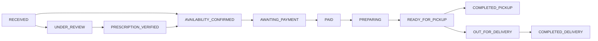

# Orders and fulfillment

Orders are the transactional core of the platform: a local cart becomes a server-validated order under a Serializable transaction that reserves stock, locks promotion counting, and debits loyalty points. Fulfillment then walks a guarded status machine from review to pickup or rider delivery, with guest access tokens, pickup codes, and staff tooling at every step.

| Audience | Status | Verified |
| --- | --- | --- |
| Engineers, AI coding agents | **Implemented** | November 2026 |

## 1. Purpose

Convert a customer's cart into a durable, auditable order — OTC, prescription, mixed, or reservation — and drive it through pharmacist/stock/payment gates to hand-off (pickup code) or dispatch (rider), while keeping stock, promotions, and loyalty consistent under concurrency.

## 2. Users

- **Guests:** OTC checkout only, with a 7-day access token for tracking/paying/cancelling their order.
- **Customers:** full checkout incl. Rx, reorder, invoice download, cancellation before payment capture.
- **Staff (ADMIN/PHARMACIST/STAFF):** order queue, focus lanes, transitions, prepare flow, cash confirmation, rider assignment, dispatch control room.
- **Riders:** personal delivery board with a deliberately restricted transition set.
- **System:** reservation-expiry cron and payment callbacks drive automatic transitions.

Status groups (constants): ACTIVE = the first nine statuses; TERMINAL = REJECTED/CANCELLED/REFUNDED + completions; DISPATCH_STATUSES = PAID/PREPARING/READY_FOR_PICKUP/OUT_FOR_DELIVERY.

## 3. Screens

- **Cart** — `cart-view.tsx`: qty edit/remove, server-validated promo apply, suggested offers, Rx-line notice, guest sign-in gate.
- **Checkout** — `checkout-view.tsx` (1852 ln), 4-step stepper: **Fulfillment** (PICKUP/DELIVERY + zone) → **Details** (guest contact / address book + GPS) → **Payment** (M-Pesa STK, IntaSend card, cash, pay-later; Rx uploads ≤10MB) → **Confirm**. Promo + Sphere Points redemption; idempotent order creation.
- **Orders** — `orders-view.tsx`: tabs all/active/completed/rx, search, reorder, pay entry, `Refill` badge on refill orders.
- **Order detail** — `order-detail-view.tsx`: timeline/history, items, payments (M-Pesa query, card session, cash), prescriptions with presigned R2 viewer & refill confirmation dialog (including "Request next refill" on completed refill orders), refill lineage link to the original order, cancel, reorder, rider info.
- **Admin → Orders** — `orders-section.tsx`: queue/all tabs, search, filters, focus lanes `review/pack/handoff/collect`, transitions, batch prepare/ready (≤25), cash confirm, rider assign, `Refill` badge on table/cards + refill lineage banner with "Find source order" jump in the order detail sheet.
- **Admin → Dispatch** — `dispatch-control-room.tsx` (600 ln; non-RIDER staff; views all/unassigned/handoff/on-road/completed, rider assignment, maps links, cash collection, 2h triage) vs `dispatch-section.tsx` (725 ln; RIDER personal board; start/complete own drops, call/WhatsApp).
- **Admin workspace chrome** — live-changes polling (`/api/admin/live-changes` every 15s + visibility/focus/online + service-worker push) toasts "New order received"; Cmd/Ctrl+K palette jumps between sections.

## 4. Frontend implementation

- **Cart store** (`use-cart-store`, localStorage `sphere-cart`): lines + `appliedPromo` intent (`{code, minimumSpend}`) — the server always re-validates; auto-drops below `minimumSpend`. CartLine qty ≤99.
- **Offer intent** (`src/lib/offer-intent.ts`, sessionStorage `sphere_checkout_offer`) + `?promo=CODE` URL param; checkout validates via `promotionsApi.validate` and withholds the displayed discount unless `validatedSubtotal === current subtotal`, `validatedUserId === current user`, and the cart code matches (`promoRequestId` race guard).
- `ordersApi` typed client: `myOrders/allOrders/dispatchBoard/dispatchHistory/dispatchRiders/myDeliveries/loyalty/get/create/updateStatus/startPreparing/cancel/markPaidCash/assignRider`, plus guest `x-order-access-token` header support.
- Payment starters: `startMpesa` (initiate + poll query every 2.5s, backoff ×1.5 cap 10s, 2-minute deadline), `startCard` (IntaSend hosted redirect), `startCash`/`startLater`. "Change method" best-effort cancels the unpaid order and re-places it.
- **Reorder** re-hydrates a past order's lines into the cart and re-validates against current catalogue state; unavailable lines surface as errors before placement.
- **Guest tracking** — the access token is stored in sessionStorage per order id and attached as `x-order-access-token`; guests can view, pay, and cancel within the 7-day window without an account.

## 5. Backend implementation

- **`POST /api/orders`** — body ≤64KB; `order-create` 12/15min; 1–50 items; qty 1–99 per line and aggregate; products active, not DISCONTINUED, availability ≥ qty (409 `"<name> does not have enough stock."`). Guest: OTC only (Rx → 401), name ≥2, Kenyan phone, optional email, one-time `guestAccessToken` (opaque 32B base64url; only the HMAC hash is stored; 7-day expiry; client keeps it in sessionStorage `sphere_order_access_<orderId>` and sends `x-order-access-token`). Rx lines require owned, unlinked, non-soft-deleted prescriptions, linked inside the create transaction. Type derivation: `hasRx ? (all Rx ? PRESCRIPTION : MIXED) : (reservation ? RESERVATION : OTC)`. Initial status: `hasRx ? UNDER_REVIEW : (MPESA|CARD) ? AWAITING_PAYMENT : RECEIVED`.
- **Create transaction (Serializable, maxWait 10s, timeout 30s):** `pg_advisory_xact_lock(hashtext(promotion.id))` + promo re-validation; bulk stock UPDATE (see [inventory-and-stock.md](inventory-and-stock.md)); loyalty debit (`updateMany` gte guard); `Order.create` (reference `SPH-<12hex>`, `inventoryReservedAt=now`, item snapshots, initial history); prescription linking; `PromotionRedemption`; `LoyaltyLedger redeem:<orderId>`; post-transaction notifications. When payment captures (`mpesa/callback`, `intasend/webhook`, `cash-confirm`) or staff run `prepare`, `enqueueOrderPosDeduction` idempotently queues `PosOutboundJob` (`ONLINE_SALE`) rows for BandaGo reconciliation; cancellations, rejections, refunds, and reservation expiries invoke `cancelOrderPosDeduction`.
- **Delivery fee** (`src/lib/settings.ts` `computeDeliveryFee`): `freeOver` (pre-discount subtotal, default 3000) → 0; mode `flat` → flatFee; `distance` → haversine bands; else zone match (case-insensitive, fallback last zone, else flatFee). Defaults: mode zone, flat 200, zones below. Quote: `GET /api/settings/delivery-fee?area&lat&lon&subtotal`.

  | Zone | Fee (KES) |
  | --- | --- |
  | Roysambu / TRM | 150 |
  | Kasarani | 200 |
  | Githurai 44 | 250 |
  | Ruaraka / Baba Dogo | 250 |
  | Nairobi CBD | 400 |
  | Other Nairobi | 500 |

  Free delivery applies when the pre-discount subtotal meets `freeOver` (default KSh 3,000).
- **Totals:** `subtotal = Σ price×qty`; `discount = min(subtotal, subtotal×pct/100)` (delivery never discounted); points via `redemptionQuote(subtotal−discount, balance)`; `total = max(0, subtotal − discount + deliveryFee − points)`.
- **Status transitions** (`src/lib/security/order-workflow.ts`): staff map `RECEIVED→[UNDER_REVIEW, AVAILABILITY_CONFIRMED, CANCELLED]` … `PAID→[PREPARING]→[READY_FOR_PICKUP]→[COMPLETED_PICKUP|OUT_FOR_DELIVERY]→[COMPLETED_DELIVERY]`. Riders can only set `READY_FOR_PICKUP→OUT_FOR_DELIVERY` and `OUT_FOR_DELIVERY→COMPLETED_DELIVERY`. PATCH guards: PAID needs a SUCCESS payment; READY_FOR_PICKUP needs all Rx APPROVED/PARTIALLY_APPROVED; COMPLETED_PICKUP needs PICKUP+SUCCESS; COMPLETED_DELIVERY needs DELIVERY+SUCCESS+rider; OUT_FOR_DELIVERY needs DELIVERY+rider. Optimistic `version` guard → 409 "order changed"; every transition writes `OrderStatusHistory` + audit `ORDER_STATUS_<STATUS>`. Moving an order to `REJECTED` runs `releaseOrderResourcesOnReject` (restores reserved stock, re-credits redeemed points, fails dangling payments, cancels POS deductions, and idempotently releases any claimed refill slots).
- **Cancel `POST /api/orders/[id]/cancel`** — owner/staff(non-rider)/guest token; statuses RECEIVED…AWAITING_PAYMENT; **blocked if a SUCCESS payment exists** (409); restores stock, re-credits points (`cancel:<orderId>`), fails dangling payments, idempotently releases claimed refill slots (`releaseRefillSlotsForOrder`), and cancels POS deductions; 3 retries with backoff.
- **Prepare `POST /api/orders/[id]/prepare`** — ADMIN/PHARMACIST/STAFF; eligible when (PAID + SUCCESS payment) or a cash order in [RECEIVED, PRESCRIPTION_VERIFIED, AVAILABILITY_CONFIRMED, AWAITING_PAYMENT]; requires reservation intact + Rx approved; audit `ORDER_PREPARATION_STARTED`; customer notified.
- **Riders** — `GET /api/orders/riders` (staff), assign `POST /api/orders/[id]/assign` (DELIVERY in DISPATCH_STATUSES, idempotent same rider, version guard, audit `RIDER_ASSIGNED`, customer + rider notified); scopes `?scope=dispatch|dispatch-history|myDeliveries`.

## 6. Database

- **Order** — `reference @unique`, guest fields + `guestAccessTokenHash @unique`/`guestAccessExpiresAt`, `type`, `status`, `fulfillment`, `paymentMethod?`, delivery fields + `deliveryFee`, `subtotal/discountAmount/total Decimal(12,2)`, `pickupCode? @unique` (8-digit), `riderId?/riderName?`, `pointsEarned/pointsRedeemed`, `inventoryReservedAt?/inventoryReleasedAt?`, `refillOfOrderId?` (self-FK `"OrderRefills"`, SetNull), `version` (optimistic lock). Relations: items/statusHistory/payments cascade; prescriptions and user do **not** cascade (orphan-preserving).
- **OrderItem** — snapshot `name`/`price`/`requiresPrescription`; `productId?` nullable (deleted products survive).
- **OrderStatusHistory** — `status`, `note?`, `actor` (SYSTEM/CUSTOMER/staff name).
- See [../database/data-dictionary.md](../database/data-dictionary.md); payments in [payments-and-refunds.md](payments-and-refunds.md).

## 7. Workflow

Checkout stepper detail:

| Step | Customer chooses | Server enforces |
| --- | --- | --- |
| 1 Fulfillment | PICKUP or DELIVERY + zone | zone → fee quote; delivery requires address later |
| 2 Details | guest contact or saved address + GPS | Kenyan phone; address ownership |
| 3 Payment | M-Pesa / card / cash / pay-later (+ Rx uploads) | Rx requires account; method mapped to stored form |
| 4 Confirm | review totals + points | create transaction with all guards |

- Cart → 4 checkout steps → create transaction → (Rx review →) payment capture → prepare → pickup code or rider dispatch → completion; cancellation and TTL expiry release reservations.
- Initial status: `hasRx ? UNDER_REVIEW : (MPESA|CARD) ? AWAITING_PAYMENT : RECEIVED` — cash and pay-later orders start unconfirmed; online-payment intents start awaiting payment.
- Cancellation is available RECEIVED…AWAITING_PAYMENT and always blocked once a payment is captured.
- **Deep dive with diagrams: [../workflows/order-lifecycle.md](../workflows/order-lifecycle.md).**

## 8. Permissions

- `POST /api/orders` public (guest) with OTC-only constraint; everything reading/mutating an order requires owner, staff, or a valid guest token (`x-order-access-token` ≤256 chars, tokenHash match, unexpired).
- Riders: only their assigned DELIVERY orders; cannot cancel or set REJECTED/REFUNDED; excluded from staff scopes.
- REFUNDED is ADMIN-only via the refund endpoint; STAFF cannot set REFUNDED/REJECTED directly.
- Staff request-payment and cash-confirm include riders under narrow conditions (see [payments-and-refunds.md](payments-and-refunds.md)).
- Audit events from this domain: `ORDER_STATUS_<STATUS>`, `ORDER_CANCELLED`, `ORDER_PREPARATION_STARTED`, `RIDER_ASSIGNED`, `CASH_CONFIRMED`, `PAYMENT_REQUESTED` — every mutation leaves a trace readable in the admin audit log (ADMIN-only, latest 200).

## 9. Integrations

- Payment providers (M-Pesa Daraja, IntaSend) are invoked from order payment endpoints — see [payments-and-refunds.md](payments-and-refunds.md) and [../integrations/mpesa-daraja.md](../integrations/mpesa-daraja.md), [../integrations/intasend.md](../integrations/intasend.md).
- BandaGo POS/CRM reconciles online order sales via `PosOutboundJob` (`enqueueOrderPosDeduction` / `cancelOrderPosDeduction`) and consumes order history for customer mapping and chronic-patient detection: [customer-crm.md](customer-crm.md), [../integrations/bandago-pos-crm.md](../integrations/bandago-pos-crm.md).

## 10. Validation and business rules

- 1–50 items, qty 1–99 (per line and aggregate), ≤64KB body, products must be active and available; `order-create` 12/15min.
- Exactly one promo per order; discount applies to subtotal only; loyalty redemption happens after promo discount and is capped (see [loyalty-and-promotions.md](loyalty-and-promotions.md)).
- Rx requires an account; order type is derived, never client-asserted. Guest identity: name ≥2, Kenyan phone, optional email.
- `NEXT_STATUS` map in constants is UI suggestion only — `STAFF_TRANSITIONS` is authoritative; every PATCH re-checks contextual guards (payments, Rx, rider, fulfillment).
- Delivery fee modes (zone/flat/distance) and `freeOver 3000` are settings-driven; the quote endpoint is the single source of truth for the checkout display.
- Pickup codes are unique 8-digit values regenerated on refill; invoice download exists on order detail.
- Batch admin actions capped at 25 orders; dispatch scopes: `?scope=dispatch` (DELIVERY in DISPATCH_STATUSES), `?scope=dispatch-history` (COMPLETED_DELIVERY within 7 days), searchable by reference/name/phone/area.
- Rider assignment is idempotent for the same rider, requires DELIVERY + DISPATCH_STATUSES, and records assign/reassign history notes ("Rider assigned: X" / "Rider reassigned: A → B").

## 11. Failure handling

- Stock shortfalls → 409 with product name + rollback; no partial reservations.
- Optimistic concurrency → 409 "order changed" (version+status `updateMany` guard); cancel retries 3× with backoff.
- Guest token loss → order becomes untrackable (only the token holder can act); OTP claiming later attaches guest orders to the account (see [customer-crm.md](customer-crm.md)).
- Reservation TTL expiry (cron) cancels stale unpaid orders and restores everything with actor SYSTEM history entries.
- Uncertain payment outcomes never auto-cancel orders (see [payments-and-refunds.md](payments-and-refunds.md)).
- Create-transaction contention (Serializable, maxWait 10s) surfaces as a retryable error — the idempotent client submit makes retries safe.
- REJECTED orders notify ADMIN/PHARMACIST so rejections are never silent.

## 12. Testing

- `tests/order-dispatch-promotion-workflow.test.mjs` — fulfillment choice, zone handling, order DTO shape, workflow guard regexes.
- `tests/dispatch-readiness.test.mjs` — physical-preparation-before-dispatch and rider/payment guards.
- `tests/order-operations-ux.test.mjs` — payment-method persistence through the DTO, migration coverage.
- `tests/offer-workflow.test.mjs` — checkout promo/stale-subtotal protections.
- `tests/checkout-points-contrast.test.mjs` — redemption panel UI contract.
- `tests/admin-live-sync.test.mjs` — live-changes cursor endpoint contract (staff-only, metadata-only).

## 13. Operational requirements

- Cron `GET /api/cron/order-reservations` on a TTL-appropriate schedule (`ORDER_RESERVATION_TTL_MINUTES` 15–10080 required, else the route 503s) — [../operations/scheduled-jobs.md](../operations/scheduled-jobs.md).
- Delivery fees/zones live in the `Setting` JSON (`pharmacy/delivery`) and are editable in admin settings; defaults ship Roysambu-centric zones.
- Provider env for online payments (see [payments-and-refunds.md](payments-and-refunds.md) §13); the notification outbox for order emails (see [notifications.md](notifications.md) §13).
- No order-specific cron beyond reservations; everything else is request/callback driven.

## 14. Known limitations

- `READY_FOR_PICKUP` requires *all* linked Rx approved — a single CLARIFICATION_REQUESTED Rx blocks packing.
- Guest token is the only recovery path for guest orders; there is no support tool to re-issue it (OTP claim is the customer-side path).
- Reorder re-validates against current stock/prices; unavailable lines are surfaced as errors, not partially placed.
- The customer cancel toast promises automatic refunds, which contradicts server behavior — captured payments are never auto-refunded on cancel (see [payments-and-refunds.md](payments-and-refunds.md) §14).
- Focus lanes and batch actions are UX accelerators only — each transition still runs the full guard set; a failed guard in a batch leaves prior successes applied.
- Dispatch history is limited to 7 days; longer rider history must come from reports.
- The 2h triage window in the control room is a display heuristic, not an SLA timer.
