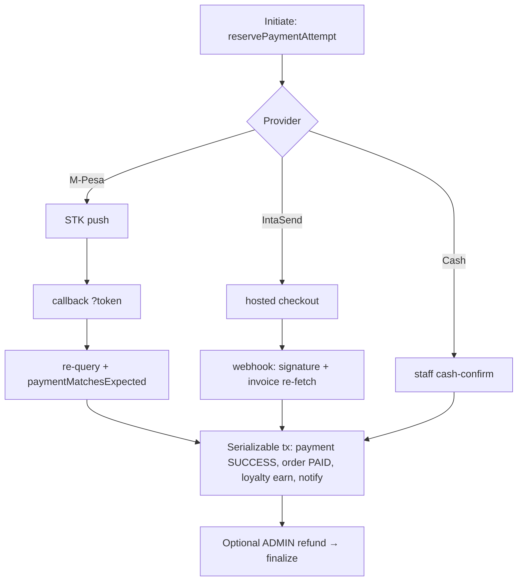

# Payments and refunds

Payments cover the four checkout methods (M-Pesa STK push, IntaSend hosted card checkout, cash on pickup/delivery, and pay-later reservation), the one-active-attempt concurrency model that guards them, callback-driven verification, and the ADMIN-only refund flow. The codebase is real-provider capable but has never been live-certified — sandbox credentials and manual verification steps dominate the current state.

| Audience | Status | Verified |
| --- | --- | --- |
| Engineers, AI coding agents | **Environment-dependent** (real-provider capable, not live-certified) | November 2026 |

## 1. Purpose

Move money for orders (and service bookings) with provider-verified state transitions: initiation reserves a single active attempt, callbacks re-query providers before trusting them, money-relevant mutations run in Serializable transactions, and refunds are deliberate, audited, staff-authorized operations — never automatic.

## 2. Users

- **Customers / guests (with order access token):** initiate M-Pesa or card payment, poll read-only status, pay cash on pickup/delivery, or choose pay-later.
- **Staff incl. riders:** cash confirmation and remote payment requests under fulfillment-stage rules.
- **ADMIN only:** refunds (all providers) and refund finalization.
- **Providers (system):** M-Pesa Daraja and IntaSend call back into webhooks — the only paths that can mark a payment SUCCESS.

Money ground rules: KES hardcoded; `Decimal(12,2)` columns; `money()` 2dp rounding; `sameMoney()` 2dp comparison; M-Pesa amounts must be whole-KSh positive integers; IntaSend uses `amount.toFixed(2)`.

## 3. Screens

- **Checkout step 3** (`checkout-view.tsx`) — method choice; `startMpesa`/`startCard`/`startCash`/`startLater` flows.
- **Order detail** (`order-detail-view.tsx`) — payments panel: M-Pesa query polling, card session return, cash badge, invoice download.
- **Services bookings tab** (`services-view.tsx`) — M-Pesa/card/pay-at-pharmacy for bookings (summary in §10; details in [services-and-bookings.md](services-and-bookings.md)).
- **AI assistant payment panel** — private, session-gated M-Pesa flow (see [ai-assistant.md](ai-assistant.md)).
- **Admin** — orders-section cash confirm; no admin UI currently calls the refund endpoint (endpoint-only).

## 4. Frontend implementation

- `paymentsApi` (typed client): `mpesaInitiate/mpesaQuery/cardCheckoutSession/requestPayment/refund`.
- M-Pesa UX: initiate with a `crypto.randomUUID()` idempotency key → poll `mpesaQuery` every 2.5s (backoff ×1.5, cap 10s, 2-minute deadline).
- Card UX: `cardCheckoutSession` → redirect to IntaSend's **hosted** page; returning from checkout never establishes success — only the webhook does.
- "Change method" cancels the unpaid order best-effort and re-places it.

## 5. Backend implementation

- **`reservePaymentAttempt`** (`src/lib/security/payment-attempt.ts`) — Serializable, executed **before** any network I/O: rejects duplicate idempotency keys; rejects any existing payment in [PENDING, PROCESSING, SUCCESS, REFUND_PENDING, REFUNDED] (one active attempt per order); verifies payability (customer flow: order exactly `AWAITING_PAYMENT`, total>0, no SUCCESS payment, Rx approved; staff flow: the PAYABLE set); verifies `sameMoney(order.total, amount)`; creates the PROCESSING row. Errors `PAYMENT_ATTEMPT_EXISTS` / `PAYMENT_NOT_PAYABLE` → 409.
- **Idempotency keys** — `order:{id}:mpesa|intasend:{clientKey}`, `staff:{id}:mpesa:{key}`, `service:{id}:mpesa|intasend:{key}`, `cash:{orderId}`. Client keys `^[a-zA-Z0-9_-]{16,100}$`.

### M-Pesa Daraja (`src/lib/mpesa/daraja.ts`)

- Config fail-closed: consumer key/secret/passkey/shortcode + `MPESA_CALLBACK_TOKEN` ≥24; production requires `MPESA_ENVIRONMENT=production` and HTTPS callbacks. OAuth token is module-cached and refreshed within 60s of expiry (Basic auth, 12s timeout).
- `initiateStkPush`: `Password = base64(shortcode+passkey+timestamp)`, `Amount = Math.round`, `PartyA` = phone formatted `2547/2541XXXXXXXX`, `AccountReference = ref.slice(0,12)`, 15s timeout; callback URL always appends `?token=MPESA_CALLBACK_TOKEN`.
- Result-code semantics from `queryStkPush`: 0 → SUCCESS; 1032 user cancel, 1037 timeout, 1 insufficient balance, 2001 bad PIN, 1019 → FAILED; anything else stays PENDING.

### IntaSend (`src/lib/intasend/client.ts`)

- Config fail-closed: publishable + secret keys + webhook secret ≥24; production requires `INTASEND_ENVIRONMENT=production`.
- `createIntaSendCheckoutSession`: POST `/checkout/` with `{public_key, first_name, last_name, email, phone_number, host=NEXT_PUBLIC_APP_URL, amount.toFixed(2), currency KES, api_ref=payment.id, redirect_url=/orders/<orderId>, method CARD-PAYMENT, card_tarrif BUSINESS-PAYS}`; 15s timeout; checkout URL hostname must be `payment/sandbox/checkout.intasend.com`.
- `getIntaSendInvoice`: POST `/payment/status/`; success state is exactly `COMPLETE`; `FAILED`/`CANCELLED` handled explicitly.
- Webhook verification accepts a timing-safe body challenge, HMAC-SHA256 over the raw body (`x-intasend-signature`/`x-webhook-signature`), or the secret header — then **always re-fetches the invoice server-to-server** before trusting state.

### Routes

- **M-Pesa initiate** (`POST /api/payments/mpesa/initiate`) — owner/staff/guest-token; order exactly AWAITING_PAYMENT; whole-KSh integer amount; replay returns "Payment request already sent."; blocks a PROCESSING payment <15 min old. **Callback** (`?token=MPESA_CALLBACK_TOKEN`, timingSafeEqual): parses `stkCallback`, matches payment by (MPESA, checkoutRequestId), eventId `mpesa:{checkoutRequestId}:{resultCode}:{receipt|none}`; ResultCode 0 → **re-query** `queryStkPush` + `paymentMatchesExpected` (amount sameMoney, KES, normalized phone, well-formed receipt) → Serializable tx: webhook event, payment SUCCESS, order PAID + version + history, loyalty award (`earn:<orderId>`), notifications in-tx. Non-zero → FAILED + notification.
- **IntaSend initiate** (`POST /api/payments/intasend/initiate`) — checkout mode only ("Card details must be entered only on IntaSend's hosted checkout."); retry while PROCESSING reuses the stored https checkout URL; webhook verifies the signature (timing-safe challenge, HMAC-SHA256, or secret header) and **always re-fetches the invoice server-to-server**; COMPLETE → SUCCESS + PAID + loyalty; FAILED/CANCELLED → FAILED.
- **Cash confirm** (`POST /api/orders/[id]/cash-confirm`) — any staff (riders only assigned CASH_ON_DELIVERY DELIVERY OUT_FOR_DELIVERY); CASH_ALLOWED statuses AVAILABILITY_CONFIRMED/AWAITING_PAYMENT/READY_FOR_PICKUP/OUT_FOR_DELIVERY; all Rx approved; no SUCCESS payment; 20/15min; Serializable re-check; Payment {provider CASH, SUCCESS, key `cash:<orderId>`, providerReference `CASH-<ref>`}; moves AVAILABILITY_CONFIRMED/AWAITING_PAYMENT → PAID; audit `CASH_CONFIRMED`; loyalty award.
- **Staff request-payment** (`POST /api/orders/[id]/request-payment`) — PAYABLE = PRESCRIPTION_VERIFIED/AVAILABILITY_CONFIRMED/AWAITING_PAYMENT/READY_FOR_PICKUP/OUT_FOR_DELIVERY; all Rx approved; phone fallback guestPhone→user.phone; key `staff:{orderId}:mpesa:{key}`; moves order to AWAITING_PAYMENT; audit `PAYMENT_REQUESTED`.
- **Refunds** (`POST /api/payments/refund`) — ADMIN only; 10/h; body ≤16KB (`paymentId`, reason ≤100, details ≤500):
  - M-Pesa SUCCESS → **refused 409**: "M-Pesa Express refunds must be completed and verified in the M-PESA organisation portal before recording them here" (manual B2C).
  - CASH SUCCESS → explicit `cashConfirmed=true` + till reference (6–100 chars); refundReference `CASH:<ref>`.
  - INTASEND SUCCESS → `createIntaSendRefund` (validates invoiceId + amount ±0.001) → REFUND_PENDING with refund.id.
  - INTASEND REFUND_PENDING → `getIntaSendRefund`; COMPLETED → `finalizeRefund`.
  - `finalizeRefund` (Serializable): payment REFUNDED; order REFUNDED + version + history; loyalty clawback earned (`refund-earn:<orderId>`, clamped to balance) + re-credit redeemed (`refund-redeem:<orderId>`); in-app + email notice.
- **Read-only polling** — `GET /api/payments/mpesa/query` (40/10min; owner/assigned rider/guest token): returns **local DB state only**; "Provider reconciliation is performed only by authenticated callbacks/jobs."

## 6. Database

- **Payment** — `orderId`, `provider` (MPESA/INTASEND/CASH), `method` (STK_PUSH/HOSTED_CHECKOUT/CASH_ON_DELIVERY/CASH_ON_PICKUP), `status` (PENDING/PROCESSING/SUCCESS/FAILED/REFUND_PENDING/REFUNDED), `amount Decimal(12,2)`, `currency @default("KES")`, `phone?`, `providerReference?`, `checkoutRequestId?`, `idempotencyKey? @unique`, `eventId? @unique`, `refundReference? @unique`, `failureReason?`; uniques `(provider, providerReference)`, `(provider, checkoutRequestId)`. `cardLast4` declared but never populated.
- **PaymentWebhookEvent** — idempotency ledger for both providers; `payloadHash` sha256 of raw body; benign replays acked, conflicts → 409.
- **ServicePayment** — mirror model for bookings.
- See [../database/data-dictionary.md](../database/data-dictionary.md).

## 7. Workflow

- Initiate (reserved attempt) → provider interaction → callback → provider re-verification → Serializable state transition → notifications + loyalty. Deep dive: [../workflows/payment-lifecycle.md](../workflows/payment-lifecycle.md).

## 8. Permissions

- Initiate/status/query: owner, staff, or guest token (else 403 "You can only pay for your own order.").
- Staff request-payment: any staff role including riders (PAYABLE stage rules).
- Cash confirm: any staff; riders restricted to their assigned CASH_ON_DELIVERY OUT_FOR_DELIVERY orders.
- Refunds: **ADMIN only**. Money states are never client-asserted.

## 9. Integrations

- M-Pesa Daraja (Safaricom STK push + query): [../integrations/mpesa-daraja.md](../integrations/mpesa-daraja.md).
- IntaSend (hosted card checkout, refunds): [../integrations/intasend.md](../integrations/intasend.md).
- Historical audit with remaining release blockers: [../payment-notification-audit.md](../payment-notification-audit.md).

## 10. Validation and business rules

- One active attempt per order at a time; duplicate idempotency keys rejected.
- M-Pesa amounts are whole-KSh positive integers; IntaSend uses `amount.toFixed(2)`; all money 2dp (`money()`/`sameMoney()`); currency defaults to KES.
- Callbacks only trust provider state after re-query (M-Pesa) or invoice re-fetch (IntaSend) plus `paymentMatchesExpected` (amount, currency, normalized `+254…` phone, receipt `^[A-Z0-9-]{6,64}$/i`).
- Cash confirmation is a deliberate staff action with explicit reference recording; riders restricted to assigned CASH_ON_DELIVERY OUT_FOR_DELIVERY.
- Staff request-payment PAYABLE set: PRESCRIPTION_VERIFIED, AVAILABILITY_CONFIRMED, AWAITING_PAYMENT, READY_FOR_PICKUP, OUT_FOR_DELIVERY — with all Rx approved.
- **Service booking payments (summary):** pay-at-pharmacy records intent only (IN_STORE/PAY_AT_PHARMACY, PENDING — no cash-settlement endpoint exists); card/M-Pesa mirror order flows with `service:` keys and their own callbacks; `payment-status` polling is read-only.
- Loyalty awards happen in the same Serializable transaction as capture; guests earn nothing.

## 11. Failure handling

- **Uncertain-outcome policy:** a provider response that cannot be classified leaves the payment PROCESSING with `failureReason "Provider response uncertain; reconcile before another attempt"` and returns 503 — the system never claims failure (and never resets the row) on a timeout.
- Callback replays are idempotent via eventIds; conflicting replays → 409.
- Terminal states can't be flipped back by repeated callbacks.
- Refund uncertainty (IntaSend) stays REFUND_PENDING until a COMPLETED provider state is observed.
- Missing-callback recovery is a known gap (see Limitations) — status endpoints do not reconcile.

## 12. Testing

- `tests/order-dispatch-promotion-workflow.test.mjs`, `tests/order-operations-ux.test.mjs` — payment-intent persistence and DTO contract.
- `tests/security-static.test.mjs` — webhook auth functions present.
- No live-provider test suite; the 2026 payment audit ([../payment-notification-audit.md](../payment-notification-audit.md)) is the source of truth for certification status.
- Rate limits exercised in design: mpesa-initiate 5/15min (orderId:phone), intasend-initiate 8/15min, mpesa-status 40/10min, cash-confirm 20/15min, refund 10/h.

## 13. Operational requirements

- **M-Pesa:** `MPESA_CONSUMER_KEY/SECRET/PASSKEY/SHORTCODE`, `MPESA_CALLBACK_TOKEN` ≥24; `MPESA_ENVIRONMENT=production` (HTTPS callbacks enforced in production).
- **IntaSend:** `INTASEND_PUBLISHABLE_KEY/SECRET_KEY/WEBHOOK_SECRET` ≥24; `INTASEND_ENVIRONMENT=production`; hosted-redirect URLs require `NEXT_PUBLIC_APP_URL` (HTTPS in prod).
- Register both provider webhooks; Resend/email not required for payments but notify outcomes (see [notifications.md](notifications.md)).
- No cron is payment-specific; reconciliation is callback/job-side only.

## 14. Known limitations

- **Not live-certified:** sandbox-era audit; production merchant credentials, shortcode/transaction type, and monitored callbacks are unverified.
- **Missing-callback recovery gap:** local status polling never reconciles with providers; late/missing callbacks need a staff exception path.
- M-Pesa refunds are manual (organisation portal) — this app only records them.
- No admin UI invokes the refund endpoint yet (endpoint-only).
- Service `PAY_AT_PHARMACY` has no cash-settlement endpoint — intent only.
- Customer cancel toast promising automatic refunds is inaccurate: captured payments are never auto-refunded on cancel.
- `cardLast4` is dead schema; legacy IntaSend invoice-id/checkouts-id duality needs separate reconciliation.
- Concurrent admin refund requests are not reserved before network I/O — duplicate external refund requests remain possible per the audit's open items.
