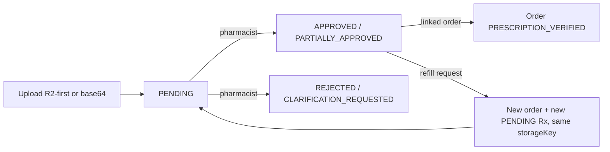

# Prescriptions

Prescriptions let customers upload Rx documents to private R2 storage, have a pharmacist review them, and link them to orders. Every refill creates a brand-new PENDING prescription that must be re-verified — approval is per-use, never a standing authorization. All file access is presigned, logged, and owner-scoped.

| Audience | Status | Verified |
| --- | --- | --- |
| Engineers, AI coding agents | **Implemented** | November 2026 |

## 1. Purpose

Digitize the Rx intake and pharmacist-review workflow required before prescription medicines can be dispensed: upload → review (approve/reject/clarify/partially approve) → linked-order verification → refills under a pharmacist-set validity window → retention/destruction per Kenya PPB Cap 244 record-keeping expectations.

## 2. Users

- **Customers (members only):** upload prescriptions, track status, download their files, request refills. Guests cannot upload (Rx checkout also requires an account).
- **Pharmacists (PHARMACIST) and ADMIN:** review queue, decisions, refill/validity settings — the only roles that can change Rx status.
- **Riders:** no prescription surface; delivery boards show Rx context only through the order.
- **System (cron):** retention enforcement (destruction of expired soft-deleted records).

Regulatory framing: this feature operationalizes pharmacist verification before dispensing (Kenya PPB expectations) and record retention per PPB Cap 244 guidance cited in the integration blueprint. Every file access is logged for compliance.

## 3. Screens

- **Prescriptions** — `prescriptions-view.tsx`: upload, status tracking, refill badges/lineage, refill confirmation dialog (`src/components/shared/refill-request-dialog.tsx`), download, order link. Rx statuses render via `RxStatusBadge`/`RxFlagBadge`.
- **Checkout step 3** — `checkout-view.tsx` attaches Rx uploads (≤10MB images/PDF) to the order being placed; an Rx line in the cart shows a notice and blocks guest checkout.
- **Admin → Prescriptions** — `prescriptions-section.tsx` (ADMIN/PHARMACIST): approve/reject/clarify, refills, validity, refill re-verification banner with locked allowance/expiry controls for refill copies, inspect/re-review action on reviewed history cards. The active review queue excludes cancelled/rejected/refunded orders and is client re-sorted by priority PENDING < CLARIFICATION_REQUESTED < PARTIALLY_APPROVED < APPROVED < REJECTED.
- **Order detail** — `order-detail-view.tsx` shows linked prescriptions, presigned R2 image/PDF preview & `?download=1` download, refill lineage back to the original order, and a "Request refill" / "Request next refill" dialog (even on completed refill orders, resolving to the parent prescription).
- Deep links: `/admin?section=prescriptions` is the canonical staff notification target (with `/admin/prescriptions` and `/#admin-prescriptions` also supported by `use-app-store.ts`); customers arrive via `/prescriptions` (CustomerHubNav area).

## 4. Frontend implementation

- `prescriptionsApi` (typed client): `mine/queue/upload/get/review/requestRefill` (accepting optional `RequestRefillPayload` overrides and returning `RequestRefillResponse`); `storageApi.uploadFile` performs the multipart upload via XHR with progress and a 120-second timeout, with a base64 fallback path.
- Upload dialog supports the two backend paths transparently: binary-first (multipart to `/api/upload`, then register with `storageKey`) with a base64 fallback.
- Status tracking, refill request, and presigned download all go through authenticated routes; the view never handles raw storage keys (the DTO hard-codes `storageKey: null`, `fileUrl: null` in lists).
- Downloads use `?download=1` (302 to a presigned attachment URL); plain views stream inline with a 300-second lease in both `prescriptions-view.tsx` and `order-detail-view.tsx`.
- Refill eligibility is computed via `evaluateRefillEligibility` (`src/lib/prescriptions/refill-core.ts`) across both `prescriptions-view.tsx` and `order-detail-view.tsx` — allowing `APPROVED` and `PARTIALLY_APPROVED` prescriptions with a linked non-cancelled/non-rejected order, unexpired `validUntil`, remaining refills, and no active in-progress refill order. Clicking "Request refill" opens `RefillRequestDialog` to confirm fulfillment (pickup/delivery), saved address, payment preference, and optional pharmacist note, then navigates directly to the created refill order.

## 5. Backend implementation

- **Upload `POST /api/prescriptions`** — `requireCustomer`; 10/hour per user; `fileName ≤120`; `fileType png/jpeg/jpg/webp/heic/pdf`; ≤10MB. Two paths:
  1. **R2-first:** client uploads binary via `POST /api/upload` (multipart, folder `prescriptions`) → private key `prescriptions/{userId}/{uuid}{ext}` with metadata `{ownerid, originalname, category: "prescriptions"}` → register with `{fileName, fileType, storageKey, notes}`; the route verifies key prefix + `HeadObject` metadata + size before creating the row.
  2. **base64 fallback:** magic-byte validation → `uploadBase64ToR2`.
  - Row created with `fileData`/`fileUrl` null and `storageKey` set. If linked to an order at creation, an `OrderStatusHistory` UNDER_REVIEW entry (actor System) is written. After-commit notifications: customer IN_APP+email "Prescription received" (`/prescriptions`); staff PHARMACIST+ADMIN `NEW_PRESCRIPTION` → `/admin?section=prescriptions`.
- **Listing `GET /api/prescriptions`** — filters `deletedAt: null` on both scopes using `PRESCRIPTION_INCLUDE` (parent/child refill lineage + linked `orderStatus`): own list (limit 1–100, default 50); `?scope=queue` (PHARMACIST/ADMIN) returns non-deleted rows for review/history.
- **Review `PATCH /api/prescriptions/[id]`** (PHARMACIST/ADMIN) — rejects soft-deleted rows (404) and prescriptions on `CANCELLED`/`REFUNDED` orders (409). Sets status, `reviewNotes` (required unless `APPROVED`, ≤2000), `refillsAllowed` 0–6 (cannot drop below `refillsUsed` on original prescriptions), `validDays ∈ {30,60,90,180}` (default 90). On **refill dispense copies** (`parentPrescriptionId != null`), `refillsAllowed` is forced to `0`, `validUntil` inherits the parent's `validUntil`, and approval is rejected (409) if the parent is expired or no longer approved — preventing infinite refills. Writes `reviewedById/reviewedAt`, audit `RX_${status}`, and notifies the customer (IN_APP + email).
- **Linked-order aggregation** (inside the review transaction) — all Rx APPROVED/PARTIALLY_APPROVED → order `PRESCRIPTION_VERIFIED`; all decided with any REJECTED → order `REJECTED` (invokes `releaseOrderResourcesOnReject` in `src/lib/prescriptions/refill-server.ts` to restore reserved stock, re-credit redeemed loyalty points, fail dangling payments, cancel outbound POS deductions, and idempotently return any claimed refill slot; ADMIN/PHARMACIST notified at `/admin?section=orders`); else `UNDER_REVIEW` (only if currently UNDER_REVIEW). Each aggregation writes version bump + history + in-app notice.
- **Refill `POST /api/prescriptions/[id]/refill`** (customer; 5/24h per `userId`) — transparently resolves child refill dispense IDs to their root `parentPrescriptionId`; optional JSON body `{ fulfillment?, paymentMethod?, addressId?, deliveryAddress?, deliveryArea?, deliveryNotes?, deliveryLatitude?, deliveryLongitude?, notes? }` overrides or inherits from the source order (normalizing cash choices to `CASH_ON_PICKUP`/`CASH_ON_DELIVERY`). Eligibility: owned, not deleted, parent APPROVED/PARTIALLY_APPROVED, `refillsUsed < refillsAllowed`, `validUntil ≥ now`, source order present and not `CANCELLED`/`REJECTED`/`REFUNDED`, no other active (non-terminal) refill order in progress for the parent, and all Rx items active/not DISCONTINUED with available stock ≥ qty (honoring `safetyStockBuffer` + `virtualReservedStock`). Re-prices at **current** product prices and computes `deliveryFee` via `computeDeliveryFee` for delivery refills. Serializable transaction: re-checks active refills (`ACTIVE_REFILL_CONFLICT`), optimistic claim `refillsUsed+1` (`REFILL_CONFLICT`), per-line conditional stock decrement (`STOCK_CONFLICT`), creates a **new order** (`type: PRESCRIPTION`, `status: UNDER_REVIEW`, `refillOfOrderId`, `paymentMethod`, `deliveryFee`, copied/chosen delivery address+notes+coordinates, fresh `pickupCode`, `inventoryReservedAt=now`) and a **new `PENDING` child `Prescription` row** (`parentPrescriptionId`, `refillNumber`, `refillsAllowed: 0`, parent `validUntil`, same `storageKey`) — every refill use is re-verified by a pharmacist. Returns `{ orderId, reference, refillNumber, refillsRemaining, subtotal, deliveryFee, total }`. Audit `RX_REFILL_REQUESTED` (actor System); customer + staff notified (`/admin?section=prescriptions`).
- **Refill-slot rollback (`releaseRefillSlotsForOrder`)** — cancelling (`POST /api/orders/[id]/cancel`), rejecting (`PATCH /api/prescriptions/[id]`, `PATCH /api/orders/[id]`), or expiring (`GET /api/cron/order-reservations`, `InventoryGuard.cleanupExpiredReservations`) a refill order atomically stamps `Prescription.refillReleasedAt` and decrements `parentPrescription.refillsUsed` (clamped `>= 0`) so unfulfilled refills never burn a customer's refill allowance.
- **Access `GET /api/prescriptions/[id]`** — owner or ADMIN/PHARMACIST; every access writes `PrescriptionAccessLog` VIEW/DOWNLOAD; returns a presigned R2 URL (300s, `private no-store`, optional attachment; `?download=1` → 302) plus parent/child refill metadata.
- **Delete `DELETE /api/prescriptions/[id]`** — owner or ADMIN; order-linked → 409 for non-admin; soft delete (`deletedAt`).
- **Retention `GET /api/cron/prescription-retention`** — Bearer `CRON_SECRET`; requires `PRESCRIPTION_RETENTION_DAYS` (30–36,500) else 503; cutoff measured from soft-delete time; batch 100; skips storage keys shared by another row (refill copies); deletes from R2 then hard-deletes the row; R2 failure skips the row.

## 6. Database

- **Prescription** — `fileName`, `fileType`, `storageKey?` (private R2 key), `notes? ≤1000`, `status` default `PENDING` (`PENDING/APPROVED/REJECTED/CLARIFICATION_REQUESTED/PARTIALLY_APPROVED`), `reviewNotes? ≤2000`, `reviewedById → StaffUser`, `reviewedAt?`, `refillsAllowed @default(0)` (always 0 on refill copies), `refillsUsed @default(0)`, `validUntil?`, `parentPrescriptionId?` (self-FK `"PrescriptionRefills"`, SetNull), `refillNumber?`, `refillReleasedAt?`, `deletedAt?` (soft delete); `fileData`/`fileUrl` are legacy and always null now. Indexes `[userId, createdAt]`, `[orderId, status]`, `[status, createdAt]`, `[parentPrescriptionId]`.
- **Order refill lineage** — `Order.refillOfOrderId?` (self-FK `"OrderRefills"`, SetNull, indexed) points refill orders back to their original prescription order.
- **PrescriptionAccessLog** — `prescriptionId`, `actorId`, `actorRole`, `action (VIEW/DOWNLOAD)`, `createdAt`; write-only compliance record (no API reads it).
- Relation notes: `Prescription.user` and `Prescription.order` do **not** cascade — deleting a user or order never destroys Rx records (orphan-preserving by design).
- DTO guarantees: `toPrescriptionDTO` hard-codes `fileUrl: null` and `storageKey: null`; list responses never expose storage; only the detail route substitutes a presigned URL. `ORDER_INCLUDE` filters `prescriptions` to `deletedAt: null` and preserves `reviewedAt`.
- See [../database/data-dictionary.md](../database/data-dictionary.md).

## 7. Workflow

- **Upload:** customer picks a file (png/jpeg/jpg/webp/heic/pdf ≤10MB) → binary multipart to `/api/upload` (folder `prescriptions`, per-user key) or base64 fallback → register via `POST /api/prescriptions` which verifies prefix + HeadObject metadata + size before insert. Queue+customer notifications fire after commit (`NEW_PRESCRIPTION` for PHARMACIST/ADMIN).
- **Review:** pharmacist decides with notes, refills (0–6), and validity days ({30,60,90,180}); the linked order aggregates to PRESCRIPTION_VERIFIED / REJECTED / UNDER_REVIEW.
- **Refill:** customer requests → server checks eligibility → new UNDER_REVIEW order at current prices + new PENDING prescription sharing the file → pharmacist re-verifies.
- **Retention:** soft-deleted rows older than `PRESCRIPTION_RETENTION_DAYS` are destroyed (R2 + row) by the cron, skipping shared keys.

### Notification events raised

| Event | Audience | Channels |
| --- | --- | --- |
| Prescription received | customer | IN_APP + email |
| `NEW_PRESCRIPTION` | PHARMACIST + ADMIN | IN_APP (staff email only when supplied) |
| Prescription status (`prescriptionStatusTemplate`) | customer | IN_APP + email |
| Refill requested | customer + staff | IN_APP |

- Deep dive: [../workflows/prescription-lifecycle.md](../workflows/prescription-lifecycle.md).

## 8. Permissions

- Upload/list/refill/download: customer session; **guests are blocked** (401). Rx items in checkout likewise require an account.
- Queue + review PATCH: PHARMACIST/ADMIN only.
- Detail GET: owner or ADMIN/PHARMACIST (403 otherwise; 404 for missing/soft-deleted — no existence disclosure).
- DELETE: owner or ADMIN; order-linked rows protected (409) for non-admins.
- Refill on a non-owned prescription returns 404 (avoids disclosure).
- Storage layer: private R2 keys under `prescriptions/{userId}/`; only the registration route can verify `HeadObject` metadata; the generic upload route restricts the `prescriptions` folder to customers; presigned GETs clamp expiry to 30–300s and send `private no-store`.
- Every detail access (view or download) writes a `PrescriptionAccessLog` row — a compliance trail, not an audit you can query today.
- File-storage deep dive: [../security/file-storage-security.md](../security/file-storage-security.md).

## 9. Integrations

- **Cloudflare R2 (S3-compatible)** — private prescription objects, presigned GETs, HeadObject verification: [../security/file-storage-security.md](../security/file-storage-security.md).
- **Notifications** — receipt + status emails/in-app via the outbox: [notifications.md](notifications.md). Events raised: `NEW_PRESCRIPTION` (staff), prescription-received and prescription-status (customer, IN_APP + email `prescriptionStatusTemplate`).
- **BandaGo CRM** — prescription-only orders feed the chronic-patient heuristic in [customer-crm.md](customer-crm.md); refill reminders for chronic patients are time-based campaign emails from the `chronic-refills` cron and never infer dosage: [../operations/scheduled-jobs.md](../operations/scheduled-jobs.md).

## 10. Validation and business rules

- Uploads: type allowlist (png/jpeg/jpg/webp/heic/pdf), ≤10MB, magic-byte sniffing on base64 path, per-user key prefix and metadata verification on the R2-first path; `fileName ≤120`; rate limit 10/hour per user.
- `refillsAllowed` capped 0–6 on original prescriptions (and never lowered below `refillsUsed`); `validDays` restricted to {30, 60, 90, 180}; `validUntil` set only on approval-family statuses (else refills reset to 0 / null). On refill dispense copies (`parentPrescriptionId != null`), `refillsAllowed` is always `0` and `validUntil` inherits the parent's expiry — approving a refill never spawns extra refills or extends expiry.
- `reviewNotes` mandatory for REJECTED/CLARIFICATION_REQUESTED/PARTIALLY_APPROVED decisions, ≤2000 chars; `notes` on upload ≤1000.
- Refill orders always re-price at current product prices, calculate applicable delivery fees (`computeDeliveryFee`), inherit or apply validated fulfillment/address/payment choices, block duplicate active refills for the same parent prescription, and re-enter pharmacist review — approval never carries over; refill requests are limited to 5 per 24h per user.
- Cancelling, rejecting, or expiring a refill order idempotently restores the claimed refill slot (`refillReleasedAt`) alongside stock and loyalty points.
- Retention skips storage keys shared with surviving rows (refill chains share files).
- Listing caps: own list limit 1–100 (default 50, `deletedAt: null`); the staff queue returns non-deleted rows (`deletedAt: null`), excludes cancelled/rejected/refunded orders from the active review queue (and dashboard pending KPI), and relies on the client priority sort.
- Linked-order aggregation only transitions an order that is currently UNDER_REVIEW — a verified order is never re-litigated by later edits.

## 11. Failure handling

- Presign failure → 503 (no URL minted); R2 retention failures skip the row (retry next run).
- Refill concurrency conflicts return typed 409s (`ACTIVE_REFILL_CONFLICT`, `REFILL_CONFLICT`, `STOCK_CONFLICT`) without partial stock or refill-count changes (Serializable tx).
- Uploads that fail row creation leave no orphan references (R2-first path verifies before insert; base64 path uploads only after validation).
- Unknown/foreign/soft-deleted prescription ids → 404; every failure path avoids leaking existence or ownership.
- Reviewing a prescription on a `CANCELLED`/`REFUNDED` order or approving a refill whose parent prescription expired returns 409.
- Review of an already-reviewed non-approved prescription is a normal PATCH (accessible from the Reviewed tab's "Inspect / re-review" action) — the last decision wins, with audit trail and customer notification each time.
- Customer-facing failures (upload type/size, review-note rules, invalid delivery address) return specific 400 messages so the UI can correct input rather than retry blindly.
- If the linked order was already cancelled/expired, review refuses mutation (409) and the queue keeps it out of active review; no zombie order transitions occur.

## 12. Testing

- `tests/prescription-refills.test.mjs` — unit tests for `evaluateRefillEligibility`, `normalizeRefillPaymentMethod`, and `computeRefillOrderTotals` plus schema/migration/API/UI contract checks across customer, pharmacist, and admin order refill paths.
- `tests/security-static.test.mjs` — codifies private prescription storage, metadata verification, and DTO non-exposure of storage keys.
- `tests/order-dispatch-promotion-workflow.test.mjs` — adjacent invariants around Rx-gated order transitions (READY_FOR_PICKUP requires completed review).
- `tests/bandago-pos-crm-integration.test.mjs` — enforces `InventoryGuard.getAvailableStock` pre-checks and stock-status sync on refills and chronic-refill reminders.
- Retention behavior has no automated test — it depends on `PRESCRIPTION_RETENTION_DAYS` (CI uses 365) and must be verified against the blueprint's 2-year PPB expectation before production.
- Rate limits (upload 10/h user, refill 5/24h user) are enforced by the shared fixed-window limiter; there is no dedicated prescription rate-limit test.

## 13. Operational requirements

- `R2_*` credentials for the private bucket; `CRON_SECRET` ≥ 32; `PRESCRIPTION_RETENTION_DAYS` (30–36,500) — blueprint cites 2 years per Kenya PPB Cap 244 (CI uses 365).
- Schedule `GET /api/cron/prescription-retention` (external scheduler; no in-repo vercel.json) — batches of 100 per run.
- Prescription status emails ride the notification outbox (every-minute cron): [notifications.md](notifications.md).
- Upload route limits: 20/15min per principal (`/api/upload`), 10/hour per user on registration — size your reverse-proxy body cap at ≥10MB plus overhead.
- `OTP_HASH_SECRET`/`TOKEN_HASH_SECRET` are not used here, but the presign path depends on valid R2 credentials with `s3:GetObject` (and `HeadObject` for verification).

## 14. Known limitations

- `PrescriptionAccessLog` is write-only — there is no UI/API to review access history yet.
- Refills re-price at current prices (plus any applicable delivery fee) and re-verify — intentional, and surfaced in `RefillRequestDialog` before submission, though customers may see different totals than the original order.
- Retention measures from soft-delete time; the 30-day minimum is enforced by config validation, not by policy automation.
- PARTIALLY_APPROVED prescriptions still block order packing until every linked Rx is in the approval family — partial approvals require explicit follow-up.
- `fileData`/`fileUrl` columns are legacy nulls kept for schema compatibility; new code must use `storageKey` + presigned URLs only.
- There is no bulk pharmacist action (e.g., approve-all) — each prescription is decided individually by design.
