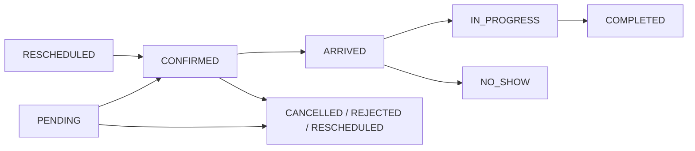

# Services and bookings

Clinical services (medication reviews, screenings, consultations) are a bookable catalogue with weekly availability rules, computed 30-minute-aware slots in Nairobi time, and a guarded booking status machine. Payments support pay-at-pharmacy intent plus online M-Pesa/card, and completed visits can be reviewed.

| Audience | Status | Verified |
| --- | --- | --- |
| Engineers, AI coding agents | **Implemented** | November 2026 |

## 1. Purpose

Let customers discover care services and book a specific time slot with exact-price agreement, and let staff confirm, reschedule, assign, and complete those appointments — with reminder notifications and analytics. Slot integrity (no double-booking, capacity 1) and price integrity (`expectedPrice` must match) are enforced server-side.

## 2. Users

- **Customers (members):** browse services, book slots, pay (or choose pay-at-pharmacy), reschedule indirectly via staff, review completed visits, download `.ics`.
- **Staff (ADMIN/PHARMACIST/STAFF):** service CRUD, availability editing, booking transitions/reschedule/assignment.
- **ADMIN:** service analytics.
- **System (cron):** 24h/2h reminders.

## 3. Screens

- **Services** — `services-view.tsx` (1841 ln): tabs **services** (catalog, filter, search, detail dialog, booking dialog with live slots) and **bookings** (my appointments, status, M-Pesa/card/pay-at-pharmacy, review, `.ics` download, reference copy). Deep links `?serviceId=`, dialog via `?previewServiceId=`.
- **Home** — care-service previews on `SphereLanding`.
- **Admin → Services** — `services-section.tsx`: create/edit/publish, imagery, availability.
- **Admin → Service bookings** — `service-bookings-section.tsx` (452 ln): queue/upcoming/history/all views, reschedule, status, assignment, overview.
- **Admin → Service analytics** — `service-analytics-section.tsx` (ADMIN).

## 4. Frontend implementation

- `servicesApi`, `servicesAdminApi`, `serviceBookingsApi (slots/mine/create)`, `serviceStaffApi`, `adminServiceBookingsApi`, `servicePaymentsApi`, `serviceReviewsApi`, `serviceAnalyticsApi` — all typed through `src/lib/api-client.ts`.
- Booking dialog computes live slots for a picked date and re-verifies `expectedPrice` at submit; payment methods mirror order checkout (M-Pesa polling, IntaSend redirect).
- `.ics` download and reference copy live on the bookings tab.

## 5. Backend implementation

- **Catalogue** — `GET /api/services` (public active-only; `?includeInactive=true` staff), `POST/PATCH` (ADMIN/PHARMACIST/STAFF; slug auto-generated with `-timestamp` suffix on collision; DELETE = soft deactivate), `GET /api/services/[id]` (public if active), availability `GET` public / `PUT` replaces the rule set (deleteMany + create enabled only). `GET /api/services/[id]/reviews` returns `{average 1-decimal, count, reviews[]}` anonymized "First …".
- **Slots** — `GET /api/services/[id]/slots?date=YYYY-MM-DD`: per enabled rule, steps by `durationMinutes` while it fits; rejects past slots and overlapping bookings (status NOT IN CANCELLED/REJECTED/NO_SHOW); **capacity 1 per slot**; Nairobi fixed UTC+3 (`Date.UTC(y,m,d,hour−3,min)`); labels via `toLocaleTimeString en-KE Africa/Nairobi`.
- **Booking creation** — `POST /api/service-bookings`: `requireCustomer`; ≤16,384B; 8/hour per user. Validation: service active; **`expectedPrice` must equal current price exactly** (409 "price changed"); **duration must equal `durationMinutes` exactly**; future; ≤180 days ahead; same Nairobi weekday; fits one enabled rule; no conflicting booking (409 "That slot was just booked"); `customerNotes ≤1000`. Creates reference `SPB-<12hex uppercase>`, status PENDING, price snapshot, paymentStatus UNPAID, history actor CUSTOMER; notifications to customer + staff.
- **Staff management** — `PATCH /api/admin/service-bookings` (status machine below; reschedule via same PATCH with new `scheduledStart/scheduledEnd`: future, duration match, one Nairobi day + availability window, no overlap, from PENDING/CONFIRMED/RESCHEDULED → sets RESCHEDULED + history + notify). Assignment `PATCH /api/admin/service-bookings/[id]/assign` (staffId null clears; target active ADMIN/PHARMACIST/STAFF; `SERVICE_ASSIGNED` notify). `GET /api/admin/service-staff` lists active staff for dropdowns.
- **Admin list** — `GET /api/admin/service-bookings`: scopes `overview` (pendingCount, upcomingCount, pendingPreview 4, nextBooking), `manage` (queue/upcoming/history/all; status/date-range/staff incl. unassigned/search ≤120; page ≤100000, pageSize 5–50 default 20), `detail` (latest 100 history desc).
- **Payments** — see [payments-and-refunds.md](payments-and-refunds.md) §10; `pay-at-pharmacy` records intent (paymentStatus `PAY_AT_PHARMACY` + upsert ServicePayment {IN_STORE, PAY_AT_PHARMACY, PENDING, key `service:{id}:pay-at-pharmacy`}); card/M-Pesa mirror order flows with `service:` idempotency keys and dedicated callbacks (`/api/payments/mpesa/service-callback`, IntaSend service path); `GET /api/service-bookings/[id]/payment-status` is customer-only, read-only (40/10min).
- **Reminders** — `GET /api/cron/service-booking-reminders` (Bearer CRON_SECRET; ≥ every 15 min): 24h window (23.5–24.5h) and 2h window (1.5–2.5h) events for PENDING/CONFIRMED/RESCHEDULED bookings; stable dedupeKey `${event}:${bookingId}:${scheduledStart ISO}` (retry-safe); fail-fast 503 on first queueing error.
- **Analytics** — `GET /api/admin/service-analytics` (ADMIN): from/to default 30d; totalBookings, completed, cancelled (CANCELLED+REJECTED+NO_SHOW), revenue (sum of completed prices), completionRate, byService.

## 6. Database

- **Service** — `durationMinutes @default(15)` (5–480), `price? Decimal(12,2)` (null = free/POA), `priceLabel?`, `heroImage?` (managed image), `featured/active/sortOrder`, `slug @unique`; images ≤10 via **ServiceImage**.
- **ServiceAvailability** — `dayOfWeek 0–6`, `startTime/endTime "HH:MM"`, `enabled`; unique `[serviceId, dayOfWeek, startTime, endTime]`; ≤35 rules, same-day non-overlap, end > start.
- **ServiceBooking** — `reference @unique ("SPB-"+12hex)`, `scheduledStart/scheduledEnd`, `status @default("PENDING")`, `price?` snapshot, `paymentStatus @default("UNPAID")`, `assignedStaffId → StaffUser`, `customerNotes?/staffNotes?`; 8 indexes incl. overlap `[serviceId, scheduledStart, scheduledEnd]`.
- **ServiceBookingStatusHistory**, **ServiceReview** (unique `[bookingId, userId]`, rating, comment ≤1000, `staffId=assignedStaffId`), **ServicePayment**.
- See [../database/data-dictionary.md](../database/data-dictionary.md).

## 7. Workflow

Active = PENDING/CONFIRMED/RESCHEDULED/ARRIVED/IN_PROGRESS; terminal states have no outgoing transitions; invalid moves → 409. Deep dive: [../workflows/service-bookings.md](../workflows/service-bookings.md).

## 8. Permissions

- Catalogue/slots/reviews reads: public. Booking creation, payment methods, review, `.ics`, payment-status: customer session.
- Service CRUD, availability PUT, booking PATCH/assign, admin lists: staff (ADMIN/PHARMACIST/STAFF).
- Service analytics: ADMIN only.
- Ownership checks return 404 for foreign bookings (no disclosure).

## 9. Integrations

- M-Pesa Daraja and IntaSend for online service payments (service-scoped callbacks): [../integrations/mpesa-daraja.md](../integrations/mpesa-daraja.md), [../integrations/intasend.md](../integrations/intasend.md).
- Reminders ride the notification outbox: [notifications.md](notifications.md).

## 10. Validation and business rules

- Availability: ≤35 rules, same-day non-overlap, end > start; enabled-only rules create slots.
- Slots: capacity 1, past slots rejected, overlapping active bookings excluded, Nairobi hard-coded UTC+3.
- Bookings: exact `expectedPrice` and exact duration match; ≤180 days ahead; one Nairobi day; ≤16KB body; 8/hour.
- Reviews: only COMPLETED bookings, one per (booking, user), created PUBLISHED.
- Reschedule: only from PENDING/CONFIRMED/RESCHEDULED, to a valid future slot.
- Pay-at-pharmacy is an **intent marker** — no service cash-settlement endpoint exists.

## 11. Failure handling

- Slot races → 409 "That slot was just booked" (overlap check at create).
- Price drift between slot pick and submit → 409 "price changed"; the UI re-fetches.
- Reminder queueing failure → 503 "Could not queue all reminders. Retry this job." (fail-fast, retry-safe dedupe keys).
- Payment uncertainty mirrors orders: PROCESSING holds with reconcile notes, read-only polling.

## 12. Testing

- No dedicated service-booking unit suite in `tests/`; behavior is covered by the payment suites and the static security tests. See [../testing/testing-strategy.md](../testing/testing-strategy.md).

## 13. Operational requirements

- Cron `GET /api/cron/service-booking-reminders` at least every 15 minutes (Bearer `CRON_SECRET` ≥ 32) — [../operations/scheduled-jobs.md](../operations/scheduled-jobs.md).
- Provider env for online payments (see [payments-and-refunds.md](payments-and-refunds.md) §13).
- No timezone configuration: Nairobi UTC+3 is compiled into slot math.

## 14. Known limitations

- Slot capacity is strictly 1 — no group sessions.
- `PAY_AT_PHARMACY` has no settlement/receipt endpoint (documented gap; audit lists it as a release blocker for in-store service settlement).
- Payment-status endpoints are read-only; no provider reconciliation from them (missing-callback gap shared with orders).
- `/api/admin/service-staff` checks `s.role` rather than `staffRole` (functionally equivalent today).
- Reminders depend on scheduler uptime; outages longer than a window need a catch-up policy.
