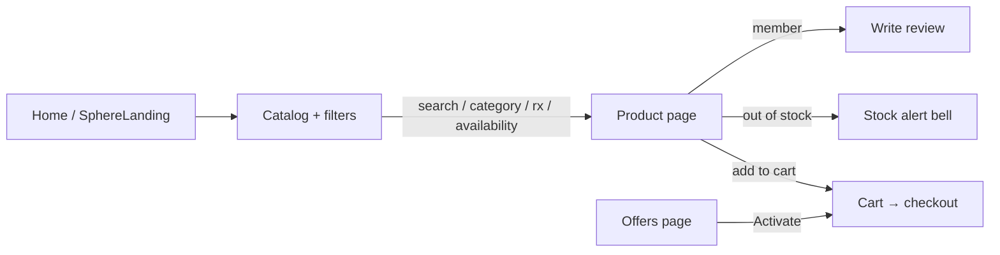

# Storefront and catalogue

The storefront is the public shopping surface of Sphere Pharmacy: the landing page on Lumumba Drive, Roysambu, the searchable/filterable product catalogue, the product detail page with reviews and stock alerts, and the offers page that surfaces active promotion codes. It is the entry point for every customer journey (cart, checkout, prescriptions, medicine requests) and is intentionally usable while signed out.

| Audience | Status | Verified |
| --- | --- | --- |
| Engineers, AI coding agents | **Implemented** | November 2026 |

## 1. Purpose

Present the pharmacy's active catalogue (KES prices, stock status, prescription flags) to guests and members, and route customers toward the cart/checkout, prescription upload, or medicine-request flows. Catalogue data originates from the BandaGo POS sync (see [inventory](inventory-and-stock.md)) but this feature is read-only presentation plus customer reviews and stock alerts.

## 2. Users

- **Guests (no account):** browse, search, filter, view products and reviews, wishlist, recently-viewed, offers, and the medicine-request CTA. No session is required for any read.
- **Customers (members):** everything above, plus writing reviews, subscribing to back-in-stock alerts, and seeing personalized care-service previews.
- **Staff (ADMIN/PHARMACIST/STAFF):** the same API with `?admin=yes` scope for the admin catalogue section (see [inventory](inventory-and-stock.md)); this doc covers the public surface.
- **Riders:** no storefront-specific surface; they see the admin dispatch board only.

Persona context: a Roysambu neighbour browsing on a phone (MobileNav + safe-area insets), a returning member on desktop, and staff spot-checking a product between tasks.

## 3. Screens

- **Home** — `SphereLanding` (`src/components/home/sphere-landing.tsx`, rendered eagerly; owns its `SphereHeader`): hero, search entry, category cards, care-service previews, trust/CTA sections. Styled with a CSS module.
- **Catalog** — `CatalogView` (`src/components/views/catalog-view.tsx`, 703 ln): search box, category ribbon (`luxury-category-ribbon.tsx`), filters (Rx `any|yes|no`, availability `any|in|low|out`, sort `popular|price-asc|price-desc|name|newest`), grid/list toggle, infinite-scroll **or** paged mode via `HighPerformancePagination`, and the medicine-request CTA dialog.
- **Product** — `ProductView` (`src/components/views/product-view.tsx`, 750 ln): gallery, stock/Rx badges, quantity picker, add-to-cart, wishlist toggle, reviews list + write form, back-in-stock alert bell, related products, recently-viewed tracking (`sphere-recent`, last 12).
- **Offers** — `OffersView` (`src/components/views/offers-view.tsx`, 167 ln): active public promo codes with copy-to-clipboard or **Activate** (stores offer intent, navigates to checkout).
- **Shell** — `SphereHeader`, `Footer`, `MobileNav`, `CustomerHubNav` (member areas), `AssistantWidget`.
- Supporting: `product-card.tsx` (+ `ProductCardCompact`, `StarRow`), `product-image.tsx`, `empty-state.tsx` (+ `SectionHeader`, `LoadingGrid`), `status-badges.tsx` (`StockStatusBadge`, `RxFlagBadge`, `OtcBadge`), `premium-popular-card.tsx`.
- `src/components/views/home-view.tsx` is **legacy/unused** — the live home is `SphereLanding`. Do not document or build on `home-view.tsx`.
- A static `public/robots.txt` also exists alongside the `robots.ts` route; the route is the authoritative, environment-aware source.

### URL surface (SPA view router)

The app is one client shell (`src/app/page.tsx` "use client"; `[...route]/page.tsx` re-exports it), routed by `use-app-store`:

| URL | View | Notes |
| --- | --- | --- |
| `/` | home | `SphereLanding` eager |
| `/catalog` | catalog | query carries filters |
| `/offers` | offers | active promo codes |
| `/products/:productId` | product | regex `^/products/([^/]+)$` |
| `/services` | services | `?tab=bookings`, `?serviceId=`, `?previewServiceId=` |
| `/cart`, `/checkout` | cart, checkout | `?promo=CODE` on checkout |

`navigate()` dedupes and pushes an internal history (cap 30) + `history.pushState`; `hydrateFromLocation()` re-derives state on mount and every `popstate`, so browser back/forward is fully supported. Trailing slashes are normalized.

## 4. Frontend implementation

- **Stores:** `use-app-store` (view routing: `home|catalog|offers|product|…`; `catalogFilters {search, category, rx, availability, sort}`; history back-stack cap 30), `use-cart-store` (localStorage `sphere-cart`), `use-wish-store` (localStorage `sphere-wishlist`, snapshot items, cap 100, guests OK — local-only, never synced), recently viewed (localStorage `sphere-recent`, last 12 `{productId, at}`).
- **Offer intent:** `src/lib/offer-intent.ts` — sessionStorage `sphere_checkout_offer`; the offers page's Activate button stores the code, checkout consumes it (see [orders](orders-and-fulfillment.md)).
- **API client:** `catalogApi` and `promotionsApi` from `src/lib/api-client.ts`. `catalogApi.products` is the only client call using browser default caching instead of `no-store`.
- All views except home load via `next/dynamic` with a `ViewLoading` skeleton; product deep links map to `/products/:productId`.
- Cart hydration uses a `useSyncExternalStore` gate (`use-cart-store` `persist.onFinishHydration`) to avoid SSR flicker.
- **Dynamic imports:** every view except home loads via `next/dynamic` + `ViewLoading` skeleton — catalog, offers, product, services, cart, checkout, auth, orders, order detail, prescriptions, account, admin, and the assistant widget itself.
- **Shell composition:** home renders standalone (own header); admin and staff-auth render without public chrome (admin-experience + `admin-workspace.css`); everything else gets `SphereHeader` + `Footer` + `MobileNav` + `AssistantWidget`. Member areas (`account|orders|order|prescriptions` + services bookings tab) additionally get `CustomerHubNav`.
- **Member vs guest:** guests browse, hold a persisted cart, use the offers page, and hit a sign-in gate only at checkout (`openAuth("login","checkout", …)` — the bag is preserved); members get the hub nav, intro heroes, and the notification inbox.

## 5. Backend implementation

- `GET /api/categories` — public; active categories for the ribbon/landing cards.
- `GET /api/products` — public list; `where active: true` unless `?admin=yes` (staff session required, else 403). Supports `search` (multi-word, case-insensitive terms over name/brand/sku/description/packSize/usageInfo/warnings/category), `category` (id **or** slug), `rx`, `availability`, `stockStatus` (admin only), `sort` (incl. `popular` = OrderItem qty ranking, top 500, with recency fallback), `page`, `pageSize` (clamp 1–100, default 12), `ids` (≤50). Popular responses send `Cache-Control: public, s-maxage=60, stale-while-revalidate=300`.
  - **Popular sort:** ranks products by lifetime `OrderItem` quantity sold (top 500) and pads pages with newest unranked products, so a fresh catalogue never looks empty.
  - **Search:** each whitespace-separated term is lower-cased and stripped of non-alphanumerics, then AND-ed across name/brand/sku/description/packSize/usageInfo/warnings/category-name — "PANADOL extra", "Panadol EXTRA", and "panadol extra" behave alike regardless of PostgreSQL collation.
  - **Category:** accepts either the category id or slug; an unknown category yields an empty result set (sentinel), never a 500.
- `GET /api/products/[id]` — product detail (public if active).
- `GET/POST /api/products/[id]/reviews` — list/write reviews.
- `POST /api/products/[id]/stock-alert` + `GET /api/products/stock-alerts` — back-in-stock watchlist (see [notifications](notifications.md) for the notify path; the `backInStockTemplate` email fires once per subscription via the `notifiedAt` guard).
- `GET /api/promotions` — public: active + `isPublic` + within window + not exhausted, take 100 (feeds OffersView).
- DTO layer: `attachRatings()` computes `avgRating`/`reviewCount` per product via `groupBy` over `status: "PUBLISHED"` reviews; `toProductDTO` and `toReviewDTO` (masks reviewer name to `First L.` initial form) in `src/lib/dto.ts`.

## 6. Database

- **Product** — `price Decimal(12,2)`, `compareAtPrice?`, `stockStatus`, `stockQty`, `inStock`, `requiresPrescription`, `packSize`, `brand`, `image`/`images[]`, `active`, `slug?`, `sku` unique, `externalPosId?` (BandaGo). Indexes `[inStock, stock]`, `[categoryId]`.
- **Category** — `name`, `slug` unique, `icon`, `sortOrder`, `active`.
- **Review** — `productId`, `userId`, `rating Int`, `comment?`, `status` default `PUBLISHED`; unique `[productId, userId]`; index `[productId, status, createdAt]`.
- **ProductAlert** — `productId`, `userId`, `notifiedAt?`; unique `[productId, userId]`.
- See [../database/data-dictionary.md](../database/data-dictionary.md).

## 7. Workflow

1. Customer lands on home (SphereLanding) or `/catalog`; filters/search hit `GET /api/products`.
2. Product page: gallery, badges, qty → add to cart (cart store), wishlist toggle, or stock-alert bell when out of stock; review form for members; the visit is recorded in recently-viewed.
3. Offers page: copy code or Activate → offer intent → `/checkout?promo=CODE`.
4. Deep dive: [../workflows/order-lifecycle.md](../workflows/order-lifecycle.md) and [../workflows/inventory-lifecycle.md](../workflows/inventory-lifecycle.md).

## 8. Permissions

- Catalogue `GET`s are public (active products only). `?admin=yes` requires a staff session (ADMIN/PHARMACIST/STAFF) — server returns 403 otherwise; the public query shape is never trusted for admin scoping.
- Review **write** and stock alerts require a customer session (`requireCustomer` → 401).
- Review moderation (publish/hide) is staff-only (ADMIN/PHARMACIST) through `/api/admin/reviews*`; product creation/editing is documented under [inventory-and-stock.md](inventory-and-stock.md).
- The public promotions list intentionally hides private codes — only `isPublic` promotions appear on the offers page; private codes must be typed and validated at checkout ([loyalty-and-promotions.md](loyalty-and-promotions.md)).
- Route-by-role matrix for every endpoint: [../api/api-reference.md](../api/api-reference.md).

## 9. Integrations

- No direct third-party calls at runtime. Product images come from `/images/...` site assets or public R2 URLs (CSP `img-src` allows `*.r2.dev` / `*.cloudflarestorage.com`). Catalogue *data* originates from BandaGo POS sync: [../integrations/bandago-pos-crm.md](../integrations/bandago-pos-crm.md).

## 10. Validation and business rules

- Public catalogue only ever returns `active: true` products; admin scope returns everything.
- `pageSize` clamped 1–100 (default 12); `ids` deduped and capped at 50; search terms are lower-cased, non-alphanumeric stripped per term.
- Reviews: rating 1–5, one per (product, user), created `PUBLISHED`; `avgRating`/`reviewCount` count only `PUBLISHED` reviews; reviewer names masked (`First L.`).
- Wishlist is a local snapshot (cap 100) and recently viewed keeps the last 12 — prices/stock in these snapshots are **not** live; cart and checkout always re-verify server-side.
- Offers list: only active, public, in-window, non-exhausted promotions; promo codes are re-validated at checkout ([loyalty-and-promotions.md](loyalty-and-promotions.md)).
- Catalog filters are advisory query params — the server re-applies every constraint; the client's `catalogFilters` state is never trusted as authorization or as a stock promise.
- Cart-line snapshots (price, `requiresPrescription`, `stockStatus`) are intent only: order creation re-validates price, activity, availability, and Rx rules server-side (see [orders-and-fulfillment.md](orders-and-fulfillment.md)).

## 11. Failure handling

- API errors surface via `ApiError` with status-specific messages (401 session expired, 403 role, 404 backend pending); lists fall back to `EmptyState`; skeletons (`ViewLoading`, `LoadingGrid`) cover load latency.
- Loading/error/a11y house style on these views: `Loader2` spinners with `role=status`, `role=alert` form errors, sonner toasts, skip-to-content link, `aria-current=page`, labelled icon buttons, `prefers-reduced-motion` support.
- Out-of-stock products remain listed (availability filter `out`) but add-to-cart is rejected server-side — the UI never promises stock the API would refuse.
- `addressesApi`-style friendly timeouts (15s AbortController + 408 copy) are the pattern for user-facing fetches; catalogue reads rely on the default browser cache instead.
- Popular-sort failure path: if ranked products can't fill a page, remaining slots come from newest products not in the ranking set.
- Cart persistence is tolerant of hydration gaps (gated rehydration); stale wishlist/recently-viewed entries are silently dropped if the product no longer resolves.

## 12. Testing

- `tests/offer-workflow.test.mjs` — offers navigation, landing no longer embeds promotions, offer intent → checkout wiring, stale-subtotal discount withholding.
- `tests/checkout-points-contrast.test.mjs` — adjacent checkout-UI contract (points panel contrast) that guards the theming surface.
- No dedicated unit suite for catalog/product views; regressions are caught by the static source tests above and manual QA. See [../testing/testing-strategy.md](../testing/testing-strategy.md).

## 13. Operational requirements

- `NEXT_PUBLIC_APP_URL` — metadata base, robots and sitemap URLs.
- SEO surface: `layout.tsx` metadata (title "Sphere Pharmacy — Your community pharmacy on Lumumba Drive, Roysambu", OpenGraph, canonical `/`, robots index/follow, `themeColor #0f766e`), `src/app/robots.ts` (allow all except `/admin` and `/api`, sitemap link), `src/app/sitemap.ts` (home, `/catalog`, `/services` with daily/weekly changeFrequency). Because the app is a single client-rendered shell, these are the only crawler-facing surfaces.
- Theming: `next-themes` with `attribute="class"`, default **light**, system matching disabled; dark is opt-in via the admin topbar toggle. Teal/emerald palette via Tailwind 4 `@theme inline` oklch variables (light primary oklch(0.385 0.09 165), dark oklch(0.78 0.12 170); `--radius 0.8rem`). CSS layers are composed in `page.tsx` (reference-home, reference-home-dark, ambient-background, services-showcase, premium-landing, app-experience, `sphere-public.css`, `admin-workspace.css`).
- 46 shadcn/ui primitives under `src/components/ui/` back these views (dialog, sheet, tabs, command, sonner, carousel, chart, …) plus recharts/embla/vaul/input-otp/react-markdown.

## 14. Known limitations

- SPA architecture: per-route `<head>` metadata, product-level SEO meta, and structured data are not per-product; deep links render the same client shell. The sitemap lists only three routes.
- Infinite-scroll mode and paged mode are both supported; the switch is client-side and both ultimately page the same API (`page`/`pageSize`).
- `home-view.tsx` (and `layout/header.tsx`'s `Header`) are dead code kept in-tree — do not treat them as live surfaces.
- Ratings are computed on read (`attachRatings`) rather than materialized — every catalogue page pays a `groupBy`.
- Popular sort ranks from at most the top-500 sold product ids.
- Wishlist and recently-viewed never sync across devices by design.
- The medicine-request CTA on the catalog page is the overflow valve for unlisted products — see [medicine-requests.md](medicine-requests.md).
- Declared-but-unused dependencies in `package.json` (`@tanstack/react-query`, `@tanstack/react-table`, `next-intl`, `@mdxeditor/editor`, `next-auth`, `z-ai-web-dev-sdk`) must not be assumed to be part of this feature.
