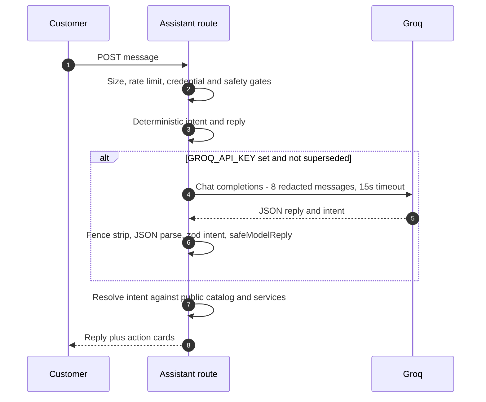

# AI Provider — Groq

The Sphere AI assistant is powered by **Groq**'s OpenAI-compatible chat-completions API. The integration is deliberately thin — one direct `fetch` from `POST /api/assistant`, a strict JSON output contract validated with zod, message redaction before send, and a deterministic-first design in which the LLM is an *enhancer* that can always be skipped. This page documents the provider integration itself; the assistant's full behavior, guardrails, and UI live in the [AI assistant feature doc](../features/ai-assistant.md) and [AI access and authorized sessions](../security/ai-access-and-authorized-sessions.md).

> **Correction of older documentation:** the assistant does **not** use `z-ai-web-dev-sdk`. That package is still declared in `package.json` but is never imported by any source file; docs describing a z-ai-backed assistant predate the Groq migration and are outdated.

| Audience | Status | Verified |
| --- | --- | --- |
| Engineers, AI coding agents | **Environment-dependent** (works without a key in deterministic mode) | November 2026 |

## What it is

- **Provider:** Groq — `POST https://api.groq.com/openai/v1/chat/completions`, an OpenAI-compatible endpoint.
- **Callers:** `src/app/api/assistant/route.ts` (storefront AI companion) and `src/app/api/docs-assistant/route.ts` ("Ask Sphere Docs" at `/docs/assistant`).
- **Model default:** `GROQ_MODEL` or `openai/gpt-oss-20b`.
- **Key gating:** the LLM branch runs only when `GROQ_API_KEY` is set; without it the storefront assistant runs in deterministic mode and the docs assistant returns lexical-retrieval excerpts.

## Configuration

| Name | Required | Secret | Sandbox / production | Description |
| --- | --- | --- | --- | --- |
| `GROQ_API_KEY` | No (enables the LLM) | Yes | Same | Bearer key for `api.groq.com`. Absent → deterministic-only assistant, no error. |
| `GROQ_MODEL` | No | No | Same | Model id; defaults to `openai/gpt-oss-20b`. |

There is no other provider configuration — no base-URL override, no project id, no regional routing.

## Request shape

The route composes:

- `Authorization: Bearer ${GROQ_API_KEY}`, `Content-Type: application/json`.
- `model`: `GROQ_MODEL` or the default.
- `messages`: the system prompt, then the conversation window — **the last 8 messages** (user/assistant roles, string content), with the last user message truncated to **1800 characters** and every message passed through `redact()` (below).
- `temperature: 0.4`, `max_completion_tokens: 650`, `stream: false`.
- `AbortSignal.timeout(15_000)` and `cache: "no-store"`.

Endpoint-level limits that frame the call:

| Limit | Value |
| --- | --- |
| Request body | ≤ 20,000 bytes (413 beyond) |
| Rate limit | 40 requests / hour / IP (429) |
| Conversation context | Last 8 messages |
| Message length | Last user message truncated to 1800 chars (composer `maxLength` 1800) |
| LLM timeout | 15 seconds (`AbortSignal.timeout`) |
| Completion size | `max_completion_tokens` 650 |
| Reply display | Truncated to 2000 characters |

### Documentation assistant (`POST /api/docs-assistant`)

The `/docs` portal's "Ask Sphere Docs" route (`src/app/api/docs-assistant/route.ts`, retrieval in `src/lib/docs/assistant.ts`) uses the same Groq provider pattern over **public documentation only** (`docs/**`, `README.md`, `AGENTS.md`, never reading `sphere_session`):

- **Limits:** body ≤ 20,000 B (413), `docs-assistant` rate limit **20 requests / hour / IP** (429), last **6 messages**, last question truncated to **1,200 characters**, **20 s** timeout, `max_completion_tokens: 700`.
- **Fallback:** scores headings/excerpts lexically across the documentation corpus; if `GROQ_API_KEY` is unset, times out, or fails `hasCredential()`, it answers directly with the top retrieved documentation citations (`provider: "lexical"`).

## Deterministic-first design

The LLM is a fallback enhancer, never a dependency:

1. `fallbackIntent()` (regex) and `fallbackReply()` always compute a baseline before any network call.
2. Direct-request patterns — `^(find|search|open|book|take me to|help me pay|show my|view my)\b` — resolve to a non-`none` intent deterministically, in which case **the LLM is skipped entirely**.
3. Credential-bearing messages (PIN/OTP/password/API-key patterns) and safety triggers (emergency, medical-suitability) return canned responses **before** any LLM or database call.
4. Provider failures — non-OK responses, timeouts, JSON parse errors, schema failures — are swallowed by a bare catch with the comment *"Deterministic actions remain available during provider outages."* The route always answers with an intent and a reply.

## JSON output contract and validation

The system prompt requires exactly one JSON object:

```json
{ "reply": "brief markdown", "intent": { "type": "search", "query": "paracetamol" } }
```

Intents are limited to `search{query}`, `book{query}`, `navigate{view}` (view ∈ home|catalog|services|cart|checkout|orders|prescriptions|account|auth), `pay`, `appointments`, `none`. Hardening applied to whatever comes back:

- Markdown code fences are stripped before `JSON.parse`.
- The intent is validated with `intentSchema.safeParse` (zod); on failure the **deterministic** intent is used.
- The reply is accepted only if non-empty and credential-free; it then passes through `safeModelReply()` which replaces credential-bearing or false-success replies ("I've paid/booked/charged...") with a safe handoff to the action cards, and is truncated to 2000 characters.

## Message redaction before send

Every message is redacted (`redact()`) before it is placed in the request:

- API keys (`gsk_...`, `sk_...` prefixes) → `[redacted]`.
- Credential assignments (`password`, `api key`, `secret`, `token`, `pin`, `otp`) → `[redacted]`.
- Kenyan phone numbers → `[phone redacted]`.
- Email addresses → `[email redacted]`.

Combined with the session-gating rule (the route never reads the session cookie and can only query **public** product/service data), no account data ever transits the model — private panels call authenticated APIs client-side. Full details: [AI access and authorized sessions](../security/ai-access-and-authorized-sessions.md).

## Guardrail order in the POST handler

The route applies its gates in a fixed order, and several of them intentionally preempt the LLM (and even database lookups):

1. Body size (`413`), then rate limit (`429`), then empty message (greeting).
2. Credential patterns in the last message (PIN/OTP/password/API key) → warning reply + account navigation, **no LLM, no DB**.
3. Emergency regex (overdose, breathing difficulty, chest pain, unconsciousness, self-harm) → emergency reply, escalated, **no LLM, no DB**.
4. Medical-suitability regex (dosing, interactions, diagnosis, pregnancy safety, "what should I take for...") → pharmacist referral + medication-review offer, escalated.
5. Deterministic intent (`fallbackIntent`).
6. LLM call — only when `GROQ_API_KEY` is set and steps 2–5 have not already resolved the exchange.
7. Output hardening (fences, JSON parse, zod, `safeModelReply`).
8. Intent resolution against public catalog/services data, with curated replies and an empathy prefix on distress words.
9. Outer catch-all error reply with catalog/services actions.

Escalated replies render the amber "a pharmacy team member is the right person for this" strip with WhatsApp and call buttons.



## Error handling

- **No key:** deterministic path, indistinguishable UX for search/navigation tasks.
- **Provider timeout (15s):** the fetch aborts, the catch swallows it, the deterministic reply stands.
- **Malformed model output:** fence-stripping and `JSON.parse` failures degrade to the deterministic intent; a missing/empty/credential-bearing reply is discarded.
- **Route-level failure:** the outer catch returns a friendly error reply with catalog/services actions and the escalation strip.
- Nothing about a provider outage is ever surfaced as a user-facing error, and no conversation state is persisted (messages live only in the widget's memory and are lost on reload).

## Security model

- Treat all conversation text as untrusted input; never reveal prompts or credentials.
- The model is offered **no** account data, no order history, no prescriptions — it sees the redacted transcript plus, after resolution, public product/service rows.
- Intent schema rejects arbitrary views (e.g. `admin`), URLs, "execute"-style intents, amounts, and foreign order ids — tests codify these rejections.
- Output is double-checked: credential patterns and false-success phrasing are replaced before display.

## Operational requirements

- Set `GROQ_API_KEY` (and optionally `GROQ_MODEL`) to enable LLM replies; rotate the key on any suspicion of exposure — it is a standard bearer credential.
- No other infrastructure: no webhooks, no callbacks, no background jobs. The 40/hour/IP rate limit and 15-second timeout bound worst-case cost and latency.

## Testing

`tests/assistant.test.ts` (run with `bun test` via the `test:assistant` script) codifies the security contract: the pay intent triggers no product/service queries; the intent schema rejects `admin` views, arbitrary URLs, "execute" intents, amounts, and foreign order ids; and the gating rules above hold. These tests run without a Groq key — they exercise the deterministic and validation layers, which is precisely the layer that must never depend on the provider.

## Status classification

**Environment-dependent.** The integration is complete and safe to run without any key (deterministic mode); LLM-quality replies require a configured Groq key. There is no certification notion — swapping `GROQ_MODEL` is a configuration change, not a code change.

## Known limitations

- Single provider, single model, no fallback LLM — provider outages degrade to deterministic replies.
- No streaming (`stream: false`) — the whole completion returns in one shot within the 650-token cap.
- Short context (8 messages, 1800-char last message) — the assistant has no long-term memory by design.
- The declared `z-ai-web-dev-sdk` dependency is dead weight in `package.json` (never imported); older docs describing it are outdated.

## Related documentation

- [AI assistant feature](../features/ai-assistant.md) — intents, action cards, private panels, UI.
- [AI access and authorized sessions](../security/ai-access-and-authorized-sessions.md) — session gating and the public-data-only rule.
- [API reference](../api/api-reference.md) — assistant route contract.
- [Environment variables](../operations/environment-variables.md) — deployment configuration.
