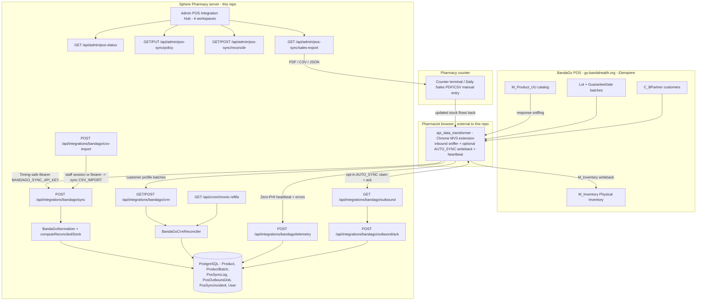
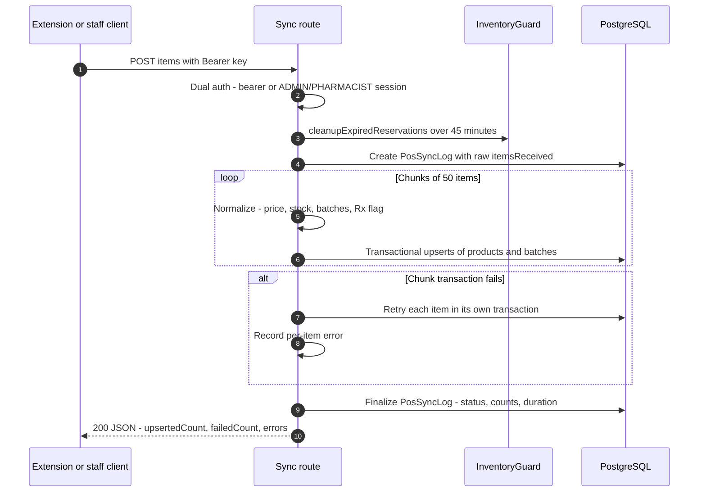
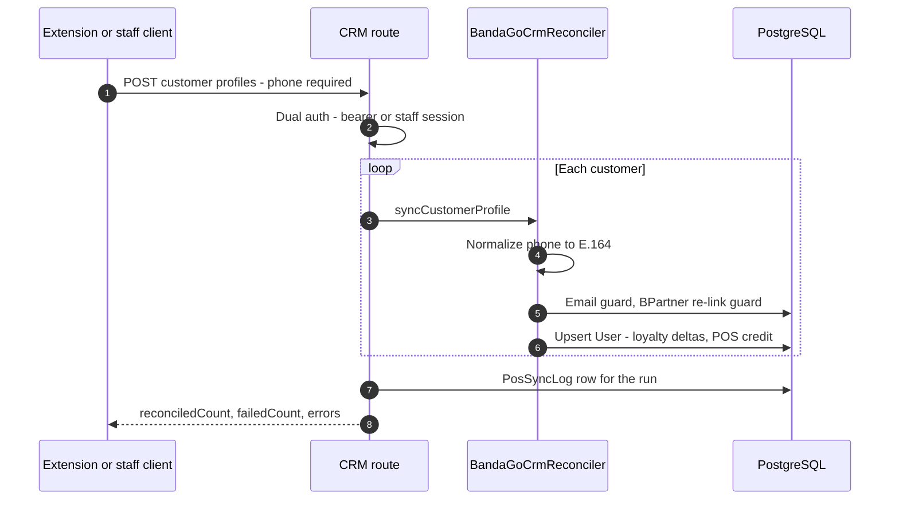

# BandaGo POS & CRM Integration

The physical pharmacy in Roysambu runs its counter sales, stock, and customer records in **BandaGo**, an iDempiere-based POS/CRM hosted at `go.bandahealth.org`. This repository contains the **server-side bi-directional integration** layer: six `/api/integrations/bandago/*` endpoints, three `/api/admin/pos-sync/*` policy/reconciliation/export endpoints, `GET /api/admin/pos-status`, a hardened data normalizer, stagnant-POS drift protection (`computeReconciledStock`), an outbound job ledger (`PosOutboundJob`), a Zero-PHI Daily Sales Export generator (`PDF`/`CSV`/`JSON`), a deduplicated error console (`PosSyncIncident`), a CRM reconciler, an inventory guard, a chronic-refill cron job, and a 4-workspace admin "BandaGo POS Integration Hub". The browser-side bridge — the `api_data_transformer` Chrome MV3 extension running on the dispensary workstation — is **external to this repo** (see [Blueprint: implemented here vs external](#blueprint-implemented-here-vs-external)).

| Audience | Status | Verified |
| --- | --- | --- |
| Engineers, AI coding agents | **Implemented** (server side; H1 security remediation verified; extension bridge **Requires live verification**) | November 2026 |

## What it is

BandaGo is built on iDempiere, so the integration is expressed in iDempiere vocabulary:

- **`M_Product_UU`** — the POS's globally unique product identifier; stored locally as `Product.externalPosId`.
- **`C_BPartner`** — the POS's business-partner (customer) record; stored locally as `User.externalBPartnerId`.
- **Lot / `GuaranteeDate`** — batch numbers and expiry dates; stored locally as `ProductBatch` rows.
- **`BH_SellPrice`** — the POS selling price, accepted as a column alias by CSV import.
- **`AD_Client_UU` / Warehouse / Locator / Org** — tenant and inventory coordinates (`Product.externalClientId`, `externalWarehouseId`, `externalLocatorId`, `externalOrgId`) supporting single-tenant pinning (`expectedTenantUU`).

Data flows **bi-directionally** under an explicit, policy-governed reconciliation model:

- **Inbound (POS → Website):** products, prices, batches, and customer profiles flow from BandaGo into Sphere (`EXTENSION_STREAM`, `BACKGROUND_POLL`, `CSV_IMPORT`, `MANUAL_RECONCILE`). Before committing stock, `computeReconciledStock` subtracts unreconciled outbound sales deltas and unpaid order holds (`protectUnreconciledSales`) so stagnant POS snapshots never resurrect units sold online.
- **Outbound (Website → POS):** paid/prepared orders (`enqueueOrderPosDeduction`), staff stock edits (`enqueueAdminStockEdit`), and cancellations/refunds/expiries (`cancelOrderPosDeduction`) write idempotent `PosOutboundJob` ledger rows. By default (`MANUAL_EXPORT`), pharmacists download Zero-PHI Daily Sales sheets (A4 PDF with sign-off, CSV, or JSON) and click **Confirm Entered in BandaGo POS**; optionally (`AUTO_SYNC`), an `ADMIN` can allow the Chrome bridge to claim jobs (`GET /api/integrations/bandago/outbound?claim=1`) and execute idempotent `M_Inventory` Physical Inventory documents inside the open BandaGo tab.

## Architecture



The chronic-refill cron closes the care loop: 30 days after a prescription order completes, patients are reminded (with a 7-day per-patient throttle) to re-order.

### API surface

| Endpoint | Methods | Auth | Purpose |
| --- | --- | --- | --- |
| `/api/integrations/bandago/sync` | `POST` | Timing-safe Bearer or `ADMIN`/`PHARMACIST` session | Product, price, stock, and batch ingestion with stagnant-POS drift protection. |
| `/api/integrations/bandago/csv-import` | `POST` | Timing-safe Bearer or `ADMIN`/`PHARMACIST` session | CSV bulk upload (multipart), delegates internally to sync. |
| `/api/integrations/bandago/crm` | `POST`, `GET` | Timing-safe Bearer or staff (`POST` `ADMIN`/`PHARMACIST`; `GET` adds `STAFF`) | Customer profile reconciliation and lookup. |
| `/api/integrations/bandago/outbound` | `GET` | Timing-safe Bearer or `ADMIN`/`PHARMACIST` session | Claim pending Website → POS deduction/adjustment jobs (`?claim=1`). |
| `/api/integrations/bandago/outbound/ack` | `POST` | Timing-safe Bearer or `ADMIN`/`PHARMACIST` session | Acknowledge POS writebacks (`SYNCED`, `RELEASE`, `FAILED`) & update POS baseline. |
| `/api/integrations/bandago/telemetry` | `POST` | Timing-safe Bearer or `ADMIN`/`PHARMACIST` session | Ingest extension Zero-PHI heartbeat & deduplicated error incidents. |
| `/api/admin/pos-sync/policy` | `GET`, `PUT` | `GET`: Staff; `PUT`: `ADMIN` | Read / update `OutboundSyncMode`, drift guard, tenant pin, FEFO threshold. |
| `/api/admin/pos-sync/reconcile` | `GET`, `POST` | `GET`: Staff; `POST`: `ADMIN`/`PHARMACIST` | Reconcile exported sheets, retry failed jobs, queue stock push, resolve incidents. |
| `/api/admin/pos-sync/sales-export` | `GET` | `ADMIN`/`PHARMACIST` | Export daily Zero-PHI sales sheets (`pdf`, `csv`, `json`). |
| `/api/cron/chronic-refills` | `GET` | Bearer `CRON_SECRET` | Refill eligibility + reminder dispatch. |
| `/api/admin/pos-status` | `GET` | `ADMIN`/`PHARMACIST`/`STAFF` | Telemetry, heartbeat, policy, and audit logs for the admin hub. |

Key source files: `src/app/api/integrations/bandago/*`, `src/app/api/admin/pos-status/route.ts`, `src/app/api/admin/pos-sync/*`, `src/lib/bandago-normalizer.ts`, `src/lib/pos-reconciliation.ts`, `src/lib/pos-reconciliation-core.ts`, `src/lib/pdf/daily-sales-pdf.ts`, `src/lib/security/bandago-auth.ts`, `src/lib/security/bandago-bearer.ts`, `src/lib/crm/bandago-crm.ts`, `src/lib/inventory-guard.ts`, `src/components/views/admin/sections/pos-sync-section.tsx`, `prisma/migrations/20261104200000_add_bandago_pos_support/`, `prisma/migrations/20261119120000_add_bandago_bidirectional_sync/`.

## Configuration

| Name | Required | Secret | Sandbox / production | Description |
| --- | --- | --- | --- | --- |
| `BANDAGO_SYNC_API_KEY` | Yes (machine auth) | Yes | Unique strong random secret per env | Server-only Bearer secret accepted (timing-safe, fail-closed) across all `/api/integrations/bandago/*` endpoints. Unset in `.env.example`; `isUsingInsecureDefaultBandagoKey()` alerts admins in the POS Hub if unset or equal to the retired placeholder. |
| `NEXT_PUBLIC_POS_SYNC_SECRET` | **Removed (`061e923`)** | — | — | Retired browser-exposed variable (H1). Deleted from `.env.example` and `pos-sync-section.tsx`; the admin hub authenticates strictly via the `sphere_session` cookie. Never reintroduce. |
| `CRON_SECRET` | Yes | Yes | Same value both | Bearer secret (≥32 chars) required by `GET /api/cron/chronic-refills`. |
| `NEXT_PUBLIC_APP_URL` | Yes | No | Production HTTPS | Base URL used to build refill reminder and critical POS alert links (defaults to `https://spherepharmacy.co.ke`). |

## POST /api/integrations/bandago/sync

The primary ingestion endpoint (`src/app/api/integrations/bandago/sync/route.ts`).

**Authentication is dual-mode:**

1. `Authorization: Bearer <BANDAGO_SYNC_API_KEY>` (machine-to-machine, verified timing-safe via `timingSafeEqualStrings`, failing closed if `BANDAGO_SYNC_API_KEY` is unset), **or**
2. an active staff session with role `ADMIN` or `PHARMACIST` (used by browser flows).

If neither passes, the route answers `401` with `Unauthorized: Invalid POS Sync Credentials`.

Before committing items, the route loads `PosSyncPolicy` (`getPosSyncPolicy()`):
- **Single-tenant pinning:** if `policy.expectedTenantUU` is configured and `payload.tenantUU` disagrees, the route rejects the packet with `403` (`TENANT_MISMATCH`), logs a `FAILED` `PosSyncLog`, and records a `CRITICAL` `PosSyncIncident`.
- **Inbound pause:** if `policy.inboundEnabled` is `false` (except `MANUAL_RECONCILE`), the route returns `{ success: true, paused: true, upsertedCount: 0 }`.
- **Stagnant-POS drift protection:** pre-fetches `getUnreconciledOffsetsByProduct()` and applies `computeReconciledStock()` per item so stale POS counts cannot overwrite unreconciled online sales or unpaid holds back up. When `isActive === false` or `discontinued === true`, the item is clamped to `stockQty: 0`, `active: false`, `stockStatus: DISCONTINUED`.
- **Minimum shelf life:** passes `policy.minShelfLifeDays` to `BandaGoNormalizer.processBatches()` to exclude batches expiring within that buffer from sellable stock.

**Payload shape** (strings shown for price/stock to illustrate tolerant parsing):

```json
{
  "trigger": "EXTENSION_STREAM",
  "items": [
    {
      "externalPosId": "<M_Product_UU>",
      "name": "Panadol Extra 500mg",
      "sku": "PAN-500",
      "slug": "optional-custom-slug",
      "categorySlug": "pain-fever",
      "price": "1,250.50",
      "costPrice": "KSh 900",
      "stock": "42",
      "requiresPrescription": false,
      "imageUrl": "https://example/panadol.webp",
      "nearestExpiryDate": "2027-05-31",
      "dosageForm": "Tablet",
      "strength": "500mg",
      "batches": [
        { "batchNumber": "LOT-A21", "qtyOnHand": 20, "expiryDate": "2027-05-31", "externalBatchId": "..." }
      ]
    }
  ]
}
```

- `trigger` must be one of `EXTENSION_STREAM`, `BACKGROUND_POLL`, `CSV_IMPORT`, `MANUAL_RECONCILE` (`CDP_INTERCEPT` maps to `EXTENSION_STREAM`); anything else silently defaults to `EXTENSION_STREAM`.
- Each item's identifier is resolved as `externalPosId ?? id ?? uu ?? M_Product_UU`. Items missing an identifier **or** a name are pushed onto `errors[]` and skipped — one bad item never crashes the batch.
- Before processing, `InventoryGuard.cleanupExpiredReservations(45)` releases virtual reservations older than 45 minutes (calling `cancelOrderPosDeduction` for expired holds; warnings are non-fatal).

**Processing** is chunked: items are upserted in chunks of **50** inside `prisma.$transaction` (`maxWait` 10s, `timeout` 30s). If a whole chunk transaction fails, the route falls back to **per-item isolated transactions**, so one poisoned item only fails itself. Failures accumulate in `errors[]` keyed by `externalPosId` + `name` + error message, and also record deduplicated `INBOUND_ITEM_FAILED` / `POSSIBLE_MANUAL_RECONCILE` `PosSyncIncident` rows.

**Statuses and response.** The final `PosSyncLog.status` is `SUCCESS` (zero errors), `PARTIAL` (some), or `FAILED` (every item failed). The HTTP response is **200 even for partial failure** — callers must inspect the body:

```json
{ "success": true, "upsertedCount": 48, "failedCount": 2, "reconciledProtectedCount": 3, "durationMs": 1840, "timestamp": "...", "policySummary": { ... }, "errors": [ ... up to 20 ... ] }
```

A truly fatal pipeline error returns `500` with `POS Sync pipeline encountered an unrecoverable failure`.

**PosSyncLog telemetry.** A `PosSyncLog` row is created at the start of every run with `itemsReceived` set to the **raw** item count (before validation), then finalized with `itemsUpserted`, `itemsFailed`, `durationMs`, `completedAt`, and a `details` JSON in which error entries are **capped at 50**. Special cases: an empty packet logs `SUCCESS` with `Zero items provided in synchronization packet`; a packet where every item was invalid logs `FAILED` with `All items provided were invalid or lacked required identifiers`.



## Normalization rules (`src/lib/bandago-normalizer.ts`)

- **Number parsing.** `parseNumber` strips everything except `[0-9.-]`, so `"1,250.50"`, `"KSh 3,400"`, and `"KES 150"` all parse. `parseInteger` additionally clamps to `max(0, floor(...))`. Prices are stored as `Prisma.Decimal`.
- **Categories.** Slugs are normalized to lowercase kebab-case with a default of `otc`. Unknown categories are **auto-created** (Title Case name, `Pill` icon), cached in memory, and upserted inside the transaction.
- **Slugs.** `slugify(name, externalPosId)` produces `name-slug` plus a first-6-characters suffix of the external ID. Collisions with a slug owned by a different product are disambiguated with an 8-character externalPosId-derived suffix, then a random 4-character suffix if still taken.
- **Product matching order.** (1) exact `externalPosId` unique lookup; (2) otherwise `externalPosId` **or** `slug` (with/without suffix) **or** case-insensitive name match limited to legacy products with `externalPosId = null`. A legacy product matched this way gets **linked** (its `externalPosId` is set) and **keeps its slug**.
- **SKU pre-linking.** If an incoming SKU already belongs to a *different* product, the old product's SKU is re-suffixed with `-{id.slice(0,6)}` (or its `externalPosId` is re-pointed) so the incoming product can claim the clean SKU.
- **Image preservation.** Existing custom local images under `/images/products/*` (anything other than the `generic-medicine.webp` placeholder) are **never overwritten** by sync. New products get `item.imageUrl` or the generic placeholder.
- **Rx classification (Kenya PPB).** `classifyRequiresPrescription(name, categorySlug, rawFlag)` returns true if the raw flag is true/`"true"`/`"1"`/`"yes"`, **or** the category matches `\b(prescription|rx|pom)\b`, **or** the name matches `\b(pom|rx)\b` with word boundaries (so "pomegranate" stays OTC), **or** the name contains one of a ~30-item keyword list of prescription-only medicines (amoxicillin, azithromycin, ciprofloxacin, metronidazole, insulin, metformin, losartan, atorvastatin, tramadol, codeine, diazepam, ...). The result is **OR'd with the existing flag** — a sync can add the Rx requirement but can never downgrade it ("Issue 3" hardening).

## Batches and FEFO

`BandaGoNormalizer.processBatches` implements first-expired-first-out hygiene per Kenya PPB rules:

- **Duplicate aggregation.** The same batch number can appear across multiple warehouse locators; quantities are summed and the **earliest** expiry wins.
- **Expiry default.** A batch with no parsable expiry date defaults to now + **365 days** (never `Invalid Date`).
- **Expired batches.** `expiry <= now` sets `isExpired`, and expired units are **excluded from `validStock`** — they can never count toward online sellable stock.
- **Flags.** `nearestExpiryDate` is the earliest expiry among valid batches; `hasNearExpiry` is true when it falls within **90 days**.
- **Sellable stock.** With a non-empty `batches[]`, `stockQty` = FEFO-valid stock; without batches, `stockQty` = raw stock unless the item-level `nearestExpiryDate` is itself expired, in which case it is 0.

Stock fields on `Product` after a sync:

| Field | Meaning | Set from |
| --- | --- | --- |
| `stock` | Physical count from BandaGo | `parseInteger(item.stock)` |
| `stockQty` | FEFO-valid sellable count | `validStock` when batches present, else raw stock (0 if the item-level expiry has passed) |
| `virtualReservedStock` | Checkout holds to subtract | Existing value (order flow owns it) |
| `inStock` / `stockStatus` | Effective availability | `effectiveSellable > 0` and `OUT_OF_STOCK` / `LOW_STOCK` (≤5) / `IN_STOCK` |
| `safetyStockBuffer` | Walk-in floor | 2 on create |

Online availability is ultimately governed by the `InventoryGuard` formula — `getAvailableStock = max(0, min(stock, stockQty) − safetyBuffer − virtualReservedStock)` — and the sync's pre-step `cleanupExpiredReservations(45)` releases stale virtual holds so the incoming physical truth is not masked by abandoned checkouts.

**Batch persistence rules** (designed so a partial payload cannot wipe data):

| Incoming item | Effect on `ProductBatch` rows |
| --- | --- |
| `stock === 0` | All batches for the product are **deleted**. |
| Non-empty `batches[]` | Batches are **replaced** (delete + `createMany`, blank batch numbers filtered out). |
| No `batches` array at all | Existing batches are **left untouched**. |

## CSV import — POST /api/integrations/bandago/csv-import

Day-1 bulk migration path, also usable for periodic reconciliation. Accepts `multipart/form-data` with a `file` field; the file must contain at least a header row and one data row. Uses the same dual auth as sync (the staff-session path exists precisely for browser uploads from the admin hub).

The parser in `bandago-normalizer.ts` handles multiline quoted values, escaped `""` quotes, CRLF line endings, UTF-8 BOM, and blank rows. Headers are lowercased with non-alphanumerics stripped, then matched against this alias matrix:

| Canonical field | Accepted header aliases |
| --- | --- |
| `externalPosId` | `externalPosId`, `uu`, `id`, `M_Product_UU`, `productId` |
| `name` | `name`, `productName`, `itemName`, `description` |
| `price` | `price`, `BH_SellPrice`, `sellPrice`, `unitPrice` |
| `costPrice` | `costPrice`, `BH_CostPrice`, `cost`, `purchasePrice` |
| `stock` | `stock`, `quantityOnHand`, `QtyOnHand`, `qtyOnHand`, `stockQty`, `qty` |
| `categorySlug` | `categorySlug`, `category`, `categoryName`, `group` |
| `requiresPrescription` | `requiresPrescription`, `rx`, `isPrescription`, `pom` |
| `nearestExpiryDate` | `nearestExpiryDate`, `expiryDate`, `GuaranteeDate`, `guaranteeDate`, `expiry` |
| `batchNumber` | `batchNumber`, `batch`, `lot`, `lotNumber`, `bhLotNumber` |
| `sku` | `sku`, `value`, `code`, `barcode` |
| `dosageForm` | `dosageForm`, `dosage`, `form` |
| `strength` | `strength`, `dose` |
| `imageUrl` | `imageUrl`, `image`, `photo` |
| `slug` | `slug`, `urlSlug` |

A single batch is synthesized per row from `batchNumber` + `stock` + `nearestExpiry`. The route then **delegates internally**: it builds a `NextRequest` for `/api/integrations/bandago/sync` with a Bearer header, forwards the caller's cookie header, and invokes the sync `POST` handler directly (no network hop) with `trigger: 'CSV_IMPORT'`.

## CRM — POST/GET /api/integrations/bandago/crm

**POST** (bearer key or `ADMIN`/`PHARMACIST` session) accepts an array, a `{customers: [...]}` wrapper, or a single object. Per-customer fields: `phone` (required), `name`, `email`, `externalBPartnerId`, `loyaltyDelta`, `posCreditBalance`, `isChronicPatient`. Each profile runs through `BandaGoCrmReconciler.syncCustomerProfile` in its own try/catch so failures are keyed by phone in `errors[]`. The run writes its own `PosSyncLog` row and returns `{success, reconciledCount, failedCount, errors?, durationMs}`.

Reconciler behavior (`src/lib/crm/bandago-crm.ts`):

- **Phone is the canonical key.** Kenyan numbers are normalized to E.164 `+254XXXXXXXXX` (`0...` → `+254...`, `254...` → `+254...`, 9-digit → `+254...`), and the `User` row is upserted by phone.
- **`loyaltyDelta` increments both** `loyaltyPoints` (live web balance) and `loyaltyPointsBalance` (POS-side synced balance). `posCreditBalance` is a `Decimal` set (not incremented).
- **Email guard.** An email owned by a *different* phone number is dropped rather than moved.
- **`externalBPartnerId` re-linking guard.** If the BPartner ID currently belongs to another user, it is detached from that user first, then linked here (handles phone changes in the POS).
- **Create path defaults:** name `Pharmacy Customer`, credit `0.00`.

**GET** (adds `STAFF` to the allowed roles) supports three modes:

- `?phone=` — normalize, then return the user plus `externalBPartnerId`, `loyaltyPoints`, `loyaltyPointsBalance`, `posCreditBalance`, `isChronicPatient`, and their last 5 orders (id, reference, status, total, createdAt). Missing customer → `404 Customer not found`.
- `?bpartnerId=` — same projection, looked up by `externalBPartnerId`.
- No parameters — chronic refill eligibility list, using `?daysThreshold=` (default **30 days**).



## Chronic refill cron — GET /api/cron/chronic-refills

Scheduled externally, authenticated with `Bearer CRON_SECRET` (≥32 chars). The job calls `checkChronicRefillEligible(30)`:

- Orders created at least 30 days ago in status `DELIVERED` (legacy), `COMPLETED_DELIVERY`, or `COMPLETED_PICKUP` with **≥1 `requiresPrescription` item**.
- Deduplicated per patient (userId / guestPhone / order id).
- Patients with a **newer** non-`CANCELLED`/`REJECTED` Rx order since the cutoff are excluded.
- Reminders are throttled to **at most one `CHRONIC_REFILL_REMINDER` per patient per 7 days**, delivered in-app plus email, linking to `${NEXT_PUBLIC_APP_URL}/orders/{id}`.
- Returns `{ok, eligible, notified}`. Eligibility is purely time-based — no dosage inference.

## Admin POS hub, stagnant-POS drift protection & bi-directional sync

`GET /api/admin/pos-status` (`ADMIN`/`PHARMACIST`/`STAFF`) exposes mapped products, batch counts, near-expiry count (<90 days), latest sync timestamp, recent 25 `PosSyncLog` rows (with `direction`), live `PosSyncPolicy`, extension heartbeat (`PosBridgeHeartbeat`), pending/exported/failed outbound counts, and open incident counts.

The admin UI (`pos-sync-section.tsx` — "BandaGo POS Integration Hub") renders four workspaces:
1. **Overview & Policy**: Bridge connection health, `BANDAGO_SYNC_API_KEY` hygiene alerts, outbound strategy toggle (`MANUAL_EXPORT` default vs `AUTO_SYNC` gated by confirmation modal), Stagnant-POS Drift Protection toggle, Expected Tenant UU (`AD_Client_UU`) pin, and FEFO minimum shelf life.
2. **Sales Export & Reconciliation**: Downloadable Zero-PHI Daily Sales Export in **PDF** (multi-page A4 sheet with pharmacist sign-off block), formula-safe **CSV**, or **JSON**; one-click **Confirm Entered in BandaGo POS**; outbound job retry/cancel actions; Live Stock Variance Inspector (`Queue Push to POS`, ADMIN baseline cutover).
3. **Error Console**: Deduplicated `PosSyncIncident` list with severity triage (`CRITICAL`, `ERROR`, `WARNING`) and actionable remediation steps.
4. **Synchronization Audit Trail**: Bidirectional `INBOUND`/`OUTBOUND` log history and authenticated staff-cookie CSV catalog import fallback.

### Stagnant-POS drift protection (`computeReconciledStock`)

When online purchases deduct Sphere `stock` / `stockQty` while BandaGo POS sits stagnant between shifts, a naive inbound POS snapshot must never overwrite Sphere back up. Before committing inbound stock in `POST /api/integrations/bandago/sync`:
- `pendingOutboundNetDelta` sums open `PosOutboundJob` rows (`PENDING`, `PROCESSING`, `EXPORTED`, `FAILED`) — e.g. `-2` for an unreconciled online sale.
- `unpaidOrderHoldQty` sums pre-payment order holds not yet represented by an outbound job.
- When `protectUnreconciledSales` is enabled, `signedOffset = pendingOutboundNetDelta - unpaidOrderHoldQty`, yielding `effectiveStock = max(0, incomingPosStock + signedOffset)`. Genuine walk-in sales/restocks reported by BandaGo still adjust stock normally, and once exported sales are confirmed or auto-synced (`SYNCED` / `RECONCILED_MANUAL`), the offset clears cleanly.

### Outbound BandaGo writeback (`AUTO_SYNC`)

When enabled by an `ADMIN` in Policy **and** permitted in the extension, `BandaGoWritebackEngine` claims `PosOutboundJob` items from `/api/integrations/bandago/outbound?claim=1` every 2 minutes and executes idempotent iDempiere Physical Inventory documents inside the authenticated `go.bandahealth.org` tab (`M_InventoryGet` idempotency lookup → `C_DocTypeGet("MMI", "PI")` → `M_StorageOnHandGet` FEFO lot split → `M_InventorySave` → `M_InventoryLineSaveMany` → `M_InventoryProcess("CO")`), posting outcomes to `/api/integrations/bandago/outbound/ack`.

## Security & key hygiene (remediated)

- **Timing-safe dual auth:** All `/api/integrations/bandago/*` endpoints validate `Authorization: Bearer <BANDAGO_SYNC_API_KEY>` via constant-time `timingSafeEqual` (`src/lib/security/bandago-bearer.ts`) or fall back to an active `ADMIN`/`PHARMACIST` staff session (`authorizeBandagoRequest`). CRM `GET` additionally allows `STAFF`.
- **Browser secret & fallback removed (H1 fixed):** `NEXT_PUBLIC_POS_SYNC_SECRET` was removed from both `.env.example` and `pos-sync-section.tsx` (the admin hub now relies strictly on the httpOnly `sphere_session` cookie). The hardcoded secret literal fallback in `csv-import/route.ts` was deleted; unconfigured deployments fail closed on Bearer auth and alert admins in the POS Hub if the env var is unset or matches the retired placeholder.
- **Zero-PHI boundaries:** Extension passive interceptors (`MAIN`/`ISOLATED` world content scripts) allowlist only catalog reads and signal-only stock mutation notifications — patient visits, clinical notes, and invoices never cross the bridge.
- Untrusted payload hardening and `externalPosId`/idempotency keys apply across both inbound and outbound pipelines.

## Blueprint: implemented here vs external

The full design lives in [`bandago-pos-crm-blueprint.md`](../../reference/bandago-pos-crm-blueprint.md) (9 sections) and [`bandago-api-and-integration-architecture.md`](../../reference/bandago-api-and-integration-architecture.md) (iDempiere GraphQL & bi-directional bridge architecture). The shipped code hardens the blueprint with timing-safe fail-closed auth, staff-session auth, item identifier fallbacks, image and Rx-flag preservation, SKU/slug collision handling, stagnant-POS drift protection, Manual-First Daily Sales Export, and reservation cleanup.

- **Implemented in this repo:** all server-side pieces — the six `/api/integrations/bandago/*` routes, the three `/api/admin/pos-sync/*` routes, `GET /api/admin/pos-status`, schema extensions across migrations `20261104200000_add_bandago_pos_support` and `20261119120000_add_bandago_bidirectional_sync` (`Product`, `ProductBatch`, `PosSyncLog`, `PosOutboundJob`, `PosSyncIncident`, `User`), `BandaGoNormalizer`, `pos-reconciliation*.ts`, `daily-sales-pdf.ts`, `security/bandago-*.ts`, `BandaGoCrmReconciler`, `InventoryGuard`, the chronic-refills cron, the 4-workspace admin POS hub, `tests/bandago-pos-crm-integration.test.mjs`, and `tests/bandago-bidirectional-sync.test.mjs`. (The blueprint's `ProductCategory` model shipped as `Category`; `src/lib/db.ts` aliases `prisma.productCategory` → `prisma.category` for compatibility.)
- **Not in this repo:** the `api_data_transformer` Chrome MV3 extension — it runs in the pharmacist's browser, sniffs BandaGo POS network/CDP responses, posts telemetry/heartbeats, pushes inbound batches, and (when `AUTO_SYNC` is enabled) executes `M_Inventory` writebacks in the open BandaGo tab.

## Regulatory notes

- **Kenya PPB (Pharmacy and Poisons Act, Cap 244).** The normalizer enforces three PPB-derived rules at ingestion: expired batches never count toward sellable stock; `requiresPrescription` can be raised but never lowered by a sync; near-expiry (<90 days) stock is flagged for audit in the admin hub. Prescription records themselves are retained separately by the prescription-retention cron (`PRESCRIPTION_RETENTION_DAYS`; the blueprint states a 2-year intent, CI pins 365).
- **Kenya DPA / ODPC.** Patient diagnoses, doctor notes, and clinical records held in BandaGo are **never synced** — only sanitized inventory, customer contact details, and basic loyalty data cross the boundary. Daily Sales Exports and `PosSyncIncident`s are strictly Zero-PHI. Sphere acts as data processor; the database connection is encrypted (`sslmode=require`) and secrets live in environment variables.

## Operational requirements

- Deploy both `20261104200000_add_bandago_pos_support` and `20261119120000_add_bandago_bidirectional_sync` migrations before enabling sync traffic.
- Set `BANDAGO_SYNC_API_KEY` to a fresh random value (e.g. `openssl rand -hex 32`) — never the retired `.env.example` placeholder — and verify the route answers `401` without a valid bearer or staff session.
- Configure `PosSyncPolicy` in Admin → POS Sync (starts in safe `MANUAL_EXPORT` mode with `protectUnreconciledSales: true`; optionally set `expectedTenantUU` to pin the pharmacy's `AD_Client_UU` and set the reconciliation baseline on cutover).
- Schedule `GET /api/cron/chronic-refills` with `Authorization: Bearer <CRON_SECRET>`; there is no in-repo scheduler, so this is a deployment responsibility (see [operations docs](../operations/environment-variables.md)).
- Point `api_data_transformer` at the sync/telemetry/outbound endpoints and confirm the admin hub's Bridge Heartbeat and Last Live Signal cards turn over.
- Verify reservation behavior beyond `stock − safetyBuffer` is rejected (blueprint's "double-selling nightmare" scenario).
- Monitor `PosSyncLog` and the POS Error Console (`PosSyncIncident`) via `/api/admin/pos-status` and `/api/admin/pos-sync/reconcile`.

## Testing

`tests/bandago-pos-crm-integration.test.mjs` and `tests/bandago-bidirectional-sync.test.mjs` (run with `npm test`) cover the load-bearing rules:

- Slug generation and external-ID suffixing.
- PPB prescription classification (raw flag, category, name keywords; word-boundary behavior).
- FEFO expired-lot exclusion from valid stock.
- The available-stock formula (physical − safety buffer − virtual reservations).
- Stagnant-POS drift protection (`computeReconciledStock`), policy normalization, and deterministic UUIDv4 generation (`deterministicUuidFromKey`).
- Multi-page A4 Daily Sales PDF generation (`buildDailySalesPdfBuffer` with batch ID and pharmacist sign-off).
- Timing-safe fail-closed Bearer auth (`verifyBandagoBearerHeader`), legacy default placeholder detection (`isUsingInsecureDefaultBandagoKey`), and static contract checks verifying H1 elimination and auth guards on all new routes.
- Kenyan phone normalization and source-contract greps pinning the route/auth wiring in place.

The admin live-sync surface additionally has `tests/admin-live-sync.test.mjs`. These are static/unit tests — they do not call BandaGo; end-to-end verification against a live POS happens through the rollout checklist above.

## Known limitations

- **FEFO applies at ingestion only.** Batch-level deduction at order time is not implemented; `stockQty` is computed when POS data lands, not per-pick.
- **The reservation engine is partially legacy.** Order creation today uses physical deduct-and-restore SQL; of the `InventoryGuard` virtual path only `getAvailableStock` and `cleanupExpiredReservations(45)` (called by this sync) are actually invoked.
- **Partial failures return HTTP 200** — automation must read `success`/`failedCount`, not the status code.
- **Chronic refill matching is time-based only** and still queries the legacy `DELIVERED` status alongside the current terminal statuses.
- **Auto writeback requires an active pharmacy browser tab:** Browser-delegated `AUTO_SYNC` executes via an open authenticated `go.bandahealth.org` Chrome tab; when closed, jobs stay queued and release cleanly until a dispensary workstation is online (or use Daily Sales Export).

## Related documentation

- [API reference](../api/api-reference.md) — request/response contracts for the integration routes.
- [Security overview](../security/) — sessions, roles, and the route-to-role matrix.
- [Workflows](../workflows/) — order, reservation, and payment flows that consume synced stock.
- [Payment and notification audit](../payment-notification-audit.md) — broader operational audit context.
- [Environment variables](../operations/environment-variables.md) — deployment-level configuration.
