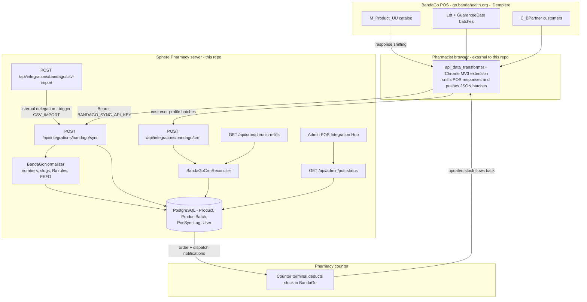
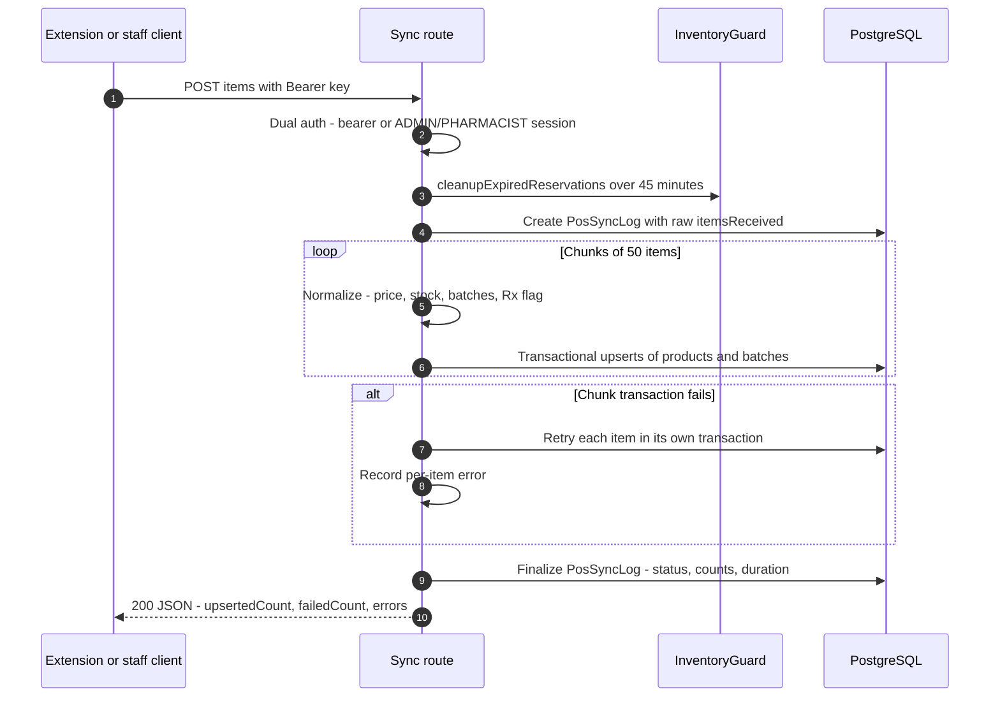
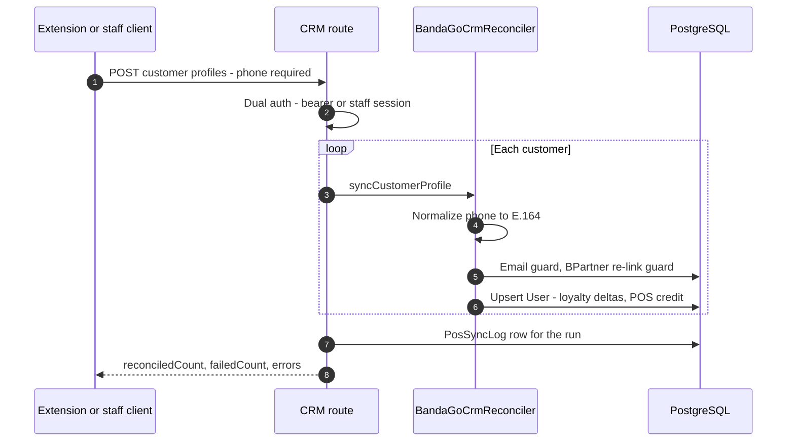

# BandaGo POS & CRM Integration

The physical pharmacy in Roysambu runs its counter sales, stock, and customer records in **BandaGo**, an iDempiere-based POS/CRM hosted at `go.bandahealth.org`. This repository contains the **server-side receiving end** of that integration: three API routes, a hardened data normalizer, a CRM reconciler, an inventory guard, a chronic-refill cron job, and an admin "POS Integration Hub" that together keep the online storefront's catalogue, stock levels, batch/expiry records, and customer loyalty data synchronized with the physical shop. The pushing side — a Chrome MV3 extension called `api_data_transformer` that runs in the pharmacist's browser — is **external to this repo** (see [Blueprint: implemented here vs external](#blueprint-implemented-here-vs-external)).

| Audience | Status | Verified |
| --- | --- | --- |
| Engineers, AI coding agents | **Implemented** (server side; open security items in the [security warning](#security-warning-requires-remediation)) | November 2026 |

## What it is

BandaGo is built on iDempiere, so the integration is expressed in iDempiere vocabulary:

- **`M_Product_UU`** — the POS's globally unique product identifier; stored locally as `Product.externalPosId`.
- **`C_BPartner`** — the POS's business-partner (customer) record; stored locally as `User.externalBPartnerId`.
- **Lot / `GuaranteeDate`** — batch numbers and expiry dates; stored locally as `ProductBatch` rows.
- **`BH_SellPrice`** — the POS selling price, accepted as a column alias by CSV import.

Data flows one way into this app (inventory and customer profiles are *received*, never pushed to BandaGo), and the outbound side of the loop is human-mediated: online orders reserve stock, staff are notified, the pharmacist deducts stock at the BandaGo counter terminal, and the updated levels flow back through the extension.

## Architecture



The chronic-refill cron closes the care loop: 30 days after a prescription order completes, patients are reminded (with a 7-day per-patient throttle) to re-order.

### API surface

| Endpoint | Methods | Auth | Purpose |
| --- | --- | --- | --- |
| `/api/integrations/bandago/sync` | `POST` | Bearer key or `ADMIN`/`PHARMACIST` session | Product, price, stock, and batch ingestion. |
| `/api/integrations/bandago/csv-import` | `POST` | Bearer key or `ADMIN`/`PHARMACIST` session | CSV bulk upload (multipart), delegates internally to sync. |
| `/api/integrations/bandago/crm` | `POST`, `GET` | Bearer key or staff session (`POST` `ADMIN`/`PHARMACIST`; `GET` adds `STAFF`) | Customer profile reconciliation and lookup. |
| `/api/cron/chronic-refills` | `GET` | Bearer `CRON_SECRET` | Refill eligibility + reminder dispatch. |
| `/api/admin/pos-status` | `GET` | `ADMIN`/`PHARMACIST`/`STAFF` | Telemetry for the admin hub. |

Key source files: `src/app/api/integrations/bandago/*`, `src/lib/bandago-normalizer.ts`, `src/lib/crm/bandago-crm.ts`, `src/lib/inventory-guard.ts`, `src/components/views/admin/sections/pos-sync-section.tsx`, `prisma/migrations/20261104200000_add_bandago_pos_support/`.

## Configuration

| Name | Required | Secret | Sandbox / production | Description |
| --- | --- | --- | --- | --- |
| `BANDAGO_SYNC_API_KEY` | Yes (machine auth) | Yes | Same value both | Bearer secret accepted by `/sync`, `/csv-import`, and CRM `POST`. If unset, the bearer path never validates and only staff sessions pass. **Must not** reuse the default shipped in `.env.example` — see the security warning below. |
| `NEXT_PUBLIC_POS_SYNC_SECRET` | No (should be removed) | Exposed | Same value both | Sent as a Bearer header **from the browser** by the admin CSV dropzone. Because `NEXT_PUBLIC_*` values are inlined into the client bundle, this is a browser-exposed credential. See the security warning. |
| `CRON_SECRET` | Yes | Yes | Same value both | Bearer secret (≥32 chars) required by `GET /api/cron/chronic-refills`. |
| `NEXT_PUBLIC_APP_URL` | Yes | No | Production HTTPS | Base URL used to build refill reminder links (defaults to `https://spherepharmacy.co.ke`). |

## POST /api/integrations/bandago/sync

The primary ingestion endpoint (485-line route at `src/app/api/integrations/bandago/sync/route.ts`).

**Authentication is dual-mode:**

1. `Authorization: Bearer <BANDAGO_SYNC_API_KEY>` (machine-to-machine, used by the extension), **or**
2. an active staff session with role `ADMIN` or `PHARMACIST` (used by browser flows).

If neither passes, the route answers `401` with `Unauthorized: Invalid POS Sync Credentials`. Note the bearer comparison is a plain string equality, not constant-time.

**Payload shape** (strings shown for price/stock to illustrate tolerant parsing):

```json
{
  "trigger": "EXTENSION_STREAM",
  "items": [
    {
      "externalPosId": "<M_Product_UU>",
      "name": "Panadol Extra 500mg",
      "sku": "PAN-500",
      "slug": "optional-custom-slug",
      "categorySlug": "pain-fever",
      "price": "1,250.50",
      "costPrice": "KSh 900",
      "stock": "42",
      "requiresPrescription": false,
      "imageUrl": "https://example/panadol.webp",
      "nearestExpiryDate": "2027-05-31",
      "dosageForm": "Tablet",
      "strength": "500mg",
      "batches": [
        { "batchNumber": "LOT-A21", "qtyOnHand": 20, "expiryDate": "2027-05-31", "externalBatchId": "..." }
      ]
    }
  ]
}
```

- `trigger` must be one of `EXTENSION_STREAM`, `BACKGROUND_POLL`, `CSV_IMPORT`, `MANUAL_RECONCILE`; anything else silently defaults to `EXTENSION_STREAM`.
- Each item's identifier is resolved as `externalPosId ?? id ?? uu ?? M_Product_UU`. Items missing an identifier **or** a name are pushed onto `errors[]` and skipped — one bad item never crashes the batch.
- Before processing, `InventoryGuard.cleanupExpiredReservations(45)` releases virtual reservations older than 45 minutes (warnings are non-fatal).

**Processing** is chunked: items are upserted in chunks of **50** inside `prisma.$transaction` (`maxWait` 10s, `timeout` 30s). If a whole chunk transaction fails, the route falls back to **per-item isolated transactions**, so one poisoned item only fails itself. Failures accumulate in `errors[]` keyed by `externalPosId` + `name` + error message.

**Statuses and response.** The final `PosSyncLog.status` is `SUCCESS` (zero errors), `PARTIAL` (some), or `FAILED` (every item failed). The HTTP response is **200 even for partial failure** — callers must inspect the body:

```json
{ "success": true, "upsertedCount": 48, "failedCount": 2, "durationMs": 1840, "timestamp": "...", "errors": [ ... up to 20 ... ] }
```

A truly fatal pipeline error returns `500` with `POS Sync pipeline encountered an unrecoverable failure`.

**PosSyncLog telemetry.** A `PosSyncLog` row is created at the start of every run with `itemsReceived` set to the **raw** item count (before validation), then finalized with `itemsUpserted`, `itemsFailed`, `durationMs`, `completedAt`, and a `details` JSON in which error entries are **capped at 50**. Special cases: an empty packet logs `SUCCESS` with `Zero items provided in synchronization packet`; a packet where every item was invalid logs `FAILED` with `All items provided were invalid or lacked required identifiers`.



## Normalization rules (`src/lib/bandago-normalizer.ts`)

- **Number parsing.** `parseNumber` strips everything except `[0-9.-]`, so `"1,250.50"`, `"KSh 3,400"`, and `"KES 150"` all parse. `parseInteger` additionally clamps to `max(0, floor(...))`. Prices are stored as `Prisma.Decimal`.
- **Categories.** Slugs are normalized to lowercase kebab-case with a default of `otc`. Unknown categories are **auto-created** (Title Case name, `Pill` icon), cached in memory, and upserted inside the transaction.
- **Slugs.** `slugify(name, externalPosId)` produces `name-slug` plus a first-6-characters suffix of the external ID. Collisions with a slug owned by a different product are disambiguated with an 8-character externalPosId-derived suffix, then a random 4-character suffix if still taken.
- **Product matching order.** (1) exact `externalPosId` unique lookup; (2) otherwise `externalPosId` **or** `slug` (with/without suffix) **or** case-insensitive name match limited to legacy products with `externalPosId = null`. A legacy product matched this way gets **linked** (its `externalPosId` is set) and **keeps its slug**.
- **SKU pre-linking.** If an incoming SKU already belongs to a *different* product, the old product's SKU is re-suffixed with `-{id.slice(0,6)}` (or its `externalPosId` is re-pointed) so the incoming product can claim the clean SKU.
- **Image preservation.** Existing custom local images under `/images/products/*` (anything other than the `generic-medicine.webp` placeholder) are **never overwritten** by sync. New products get `item.imageUrl` or the generic placeholder.
- **Rx classification (Kenya PPB).** `classifyRequiresPrescription(name, categorySlug, rawFlag)` returns true if the raw flag is true/`"true"`/`"1"`/`"yes"`, **or** the category matches `\b(prescription|rx|pom)\b`, **or** the name matches `\b(pom|rx)\b` with word boundaries (so "pomegranate" stays OTC), **or** the name contains one of a ~30-item keyword list of prescription-only medicines (amoxicillin, azithromycin, ciprofloxacin, metronidazole, insulin, metformin, losartan, atorvastatin, tramadol, codeine, diazepam, ...). The result is **OR'd with the existing flag** — a sync can add the Rx requirement but can never downgrade it ("Issue 3" hardening).

## Batches and FEFO

`BandaGoNormalizer.processBatches` implements first-expired-first-out hygiene per Kenya PPB rules:

- **Duplicate aggregation.** The same batch number can appear across multiple warehouse locators; quantities are summed and the **earliest** expiry wins.
- **Expiry default.** A batch with no parsable expiry date defaults to now + **365 days** (never `Invalid Date`).
- **Expired batches.** `expiry <= now` sets `isExpired`, and expired units are **excluded from `validStock`** — they can never count toward online sellable stock.
- **Flags.** `nearestExpiryDate` is the earliest expiry among valid batches; `hasNearExpiry` is true when it falls within **90 days**.
- **Sellable stock.** With a non-empty `batches[]`, `stockQty` = FEFO-valid stock; without batches, `stockQty` = raw stock unless the item-level `nearestExpiryDate` is itself expired, in which case it is 0.

Stock fields on `Product` after a sync:

| Field | Meaning | Set from |
| --- | --- | --- |
| `stock` | Physical count from BandaGo | `parseInteger(item.stock)` |
| `stockQty` | FEFO-valid sellable count | `validStock` when batches present, else raw stock (0 if the item-level expiry has passed) |
| `virtualReservedStock` | Checkout holds to subtract | Existing value (order flow owns it) |
| `inStock` / `stockStatus` | Effective availability | `effectiveSellable > 0` and `OUT_OF_STOCK` / `LOW_STOCK` (≤5) / `IN_STOCK` |
| `safetyStockBuffer` | Walk-in floor | 2 on create |

Online availability is ultimately governed by the `InventoryGuard` formula — `getAvailableStock = max(0, min(stock, stockQty) − safetyBuffer − virtualReservedStock)` — and the sync's pre-step `cleanupExpiredReservations(45)` releases stale virtual holds so the incoming physical truth is not masked by abandoned checkouts.

**Batch persistence rules** (designed so a partial payload cannot wipe data):

| Incoming item | Effect on `ProductBatch` rows |
| --- | --- |
| `stock === 0` | All batches for the product are **deleted**. |
| Non-empty `batches[]` | Batches are **replaced** (delete + `createMany`, blank batch numbers filtered out). |
| No `batches` array at all | Existing batches are **left untouched**. |

## CSV import — POST /api/integrations/bandago/csv-import

Day-1 bulk migration path, also usable for periodic reconciliation. Accepts `multipart/form-data` with a `file` field; the file must contain at least a header row and one data row. Uses the same dual auth as sync (the staff-session path exists precisely for browser uploads from the admin hub).

The parser in `bandago-normalizer.ts` handles multiline quoted values, escaped `""` quotes, CRLF line endings, UTF-8 BOM, and blank rows. Headers are lowercased with non-alphanumerics stripped, then matched against this alias matrix:

| Canonical field | Accepted header aliases |
| --- | --- |
| `externalPosId` | `externalPosId`, `uu`, `id`, `M_Product_UU`, `productId` |
| `name` | `name`, `productName`, `itemName`, `description` |
| `price` | `price`, `BH_SellPrice`, `sellPrice`, `unitPrice` |
| `costPrice` | `costPrice`, `BH_CostPrice`, `cost`, `purchasePrice` |
| `stock` | `stock`, `quantityOnHand`, `QtyOnHand`, `qtyOnHand`, `stockQty`, `qty` |
| `categorySlug` | `categorySlug`, `category`, `categoryName`, `group` |
| `requiresPrescription` | `requiresPrescription`, `rx`, `isPrescription`, `pom` |
| `nearestExpiryDate` | `nearestExpiryDate`, `expiryDate`, `GuaranteeDate`, `guaranteeDate`, `expiry` |
| `batchNumber` | `batchNumber`, `batch`, `lot`, `lotNumber`, `bhLotNumber` |
| `sku` | `sku`, `value`, `code`, `barcode` |
| `dosageForm` | `dosageForm`, `dosage`, `form` |
| `strength` | `strength`, `dose` |
| `imageUrl` | `imageUrl`, `image`, `photo` |
| `slug` | `slug`, `urlSlug` |

A single batch is synthesized per row from `batchNumber` + `stock` + `nearestExpiry`. The route then **delegates internally**: it builds a `NextRequest` for `/api/integrations/bandago/sync` with a Bearer header, forwards the caller's cookie header, and invokes the sync `POST` handler directly (no network hop) with `trigger: 'CSV_IMPORT'`.

## CRM — POST/GET /api/integrations/bandago/crm

**POST** (bearer key or `ADMIN`/`PHARMACIST` session) accepts an array, a `{customers: [...]}` wrapper, or a single object. Per-customer fields: `phone` (required), `name`, `email`, `externalBPartnerId`, `loyaltyDelta`, `posCreditBalance`, `isChronicPatient`. Each profile runs through `BandaGoCrmReconciler.syncCustomerProfile` in its own try/catch so failures are keyed by phone in `errors[]`. The run writes its own `PosSyncLog` row and returns `{success, reconciledCount, failedCount, errors?, durationMs}`.

Reconciler behavior (`src/lib/crm/bandago-crm.ts`):

- **Phone is the canonical key.** Kenyan numbers are normalized to E.164 `+254XXXXXXXXX` (`0...` → `+254...`, `254...` → `+254...`, 9-digit → `+254...`), and the `User` row is upserted by phone.
- **`loyaltyDelta` increments both** `loyaltyPoints` (live web balance) and `loyaltyPointsBalance` (POS-side synced balance). `posCreditBalance` is a `Decimal` set (not incremented).
- **Email guard.** An email owned by a *different* phone number is dropped rather than moved.
- **`externalBPartnerId` re-linking guard.** If the BPartner ID currently belongs to another user, it is detached from that user first, then linked here (handles phone changes in the POS).
- **Create path defaults:** name `Pharmacy Customer`, credit `0.00`.

**GET** (adds `STAFF` to the allowed roles) supports three modes:

- `?phone=` — normalize, then return the user plus `externalBPartnerId`, `loyaltyPoints`, `loyaltyPointsBalance`, `posCreditBalance`, `isChronicPatient`, and their last 5 orders (id, reference, status, total, createdAt). Missing customer → `404 Customer not found`.
- `?bpartnerId=` — same projection, looked up by `externalBPartnerId`.
- No parameters — chronic refill eligibility list, using `?daysThreshold=` (default **30 days**).



## Chronic refill cron — GET /api/cron/chronic-refills

Scheduled externally, authenticated with `Bearer CRON_SECRET` (≥32 chars). The job calls `checkChronicRefillEligible(30)`:

- Orders created at least 30 days ago in status `DELIVERED` (legacy), `COMPLETED_DELIVERY`, or `COMPLETED_PICKUP` with **≥1 `requiresPrescription` item**.
- Deduplicated per patient (userId / guestPhone / order id).
- Patients with a **newer** non-`CANCELLED`/`REJECTED` Rx order since the cutoff are excluded.
- Reminders are throttled to **at most one `CHRONIC_REFILL_REMINDER` per patient per 7 days**, delivered in-app plus email, linking to `${NEXT_PUBLIC_APP_URL}/orders/{id}`.
- Returns `{ok, eligible, notified}`. Eligibility is purely time-based — no dosage inference.

## Admin POS hub and compliance alerts

`GET /api/admin/pos-status` (`ADMIN`/`PHARMACIST`/`STAFF`) exposes `totalSyncedProducts` (`externalPosId != null`), `totalBatches`, `nearExpiryCount` (non-expired stock expiring within 90 days, taken as the max of batch- and product-level dates), `lastSyncTimestamp`, and the last 20 `PosSyncLog` rows including `details`.

The admin UI section `pos-sync-section.tsx` — "BandaGo POS Integration Hub" — renders four metric cards (POS Products Mapped, Active Batches (Lots), Near-Expiry Flags <90d labelled as a *Kenya PPB audit alert*, Last Live Signal, which shows "Awaiting extension" before the first sync), auto-refreshing every 30 seconds, plus a manual CSV dropzone and the audit trail table. Its empty state reads "No synchronization events recorded yet. Connect api_data_transformer to begin."

## Security model

- Dual auth on all three integration routes: bearer secret (machine) or `ADMIN`/`PHARMACIST` staff session (human). CRM `GET` additionally allows `STAFF`.
- The sync payload is treated as untrusted: numbers re-parsed, identifiers stringified and trimmed, and items without both `externalPosId` and `name` rejected.
- Idempotence comes from `externalPosId`/phone-keyed upserts rather than request de-duplication — repeated pushes converge to the same state.
- Clinical data never enters this pipeline (see [Regulatory notes](#regulatory-notes)).

## Security warning (requires remediation)

> **Status: Requires remediation.** Three related credential-handling defects ship in the current code. They are documented here so operators can compensate until fixed.

1. **`NEXT_PUBLIC_POS_SYNC_SECRET` is browser-exposed.** The admin CSV dropzone (`pos-sync-section.tsx`) sends `Authorization: Bearer ${process.env.NEXT_PUBLIC_POS_SYNC_SECRET}` from the browser. Any `NEXT_PUBLIC_*` variable is inlined into the client bundle, so anyone who can load the storefront can extract this value and call `/api/integrations/bandago/*` with valid bearer credentials.
2. **Hard-coded fallback in `csv-import/route.ts`** (line 122): when `BANDAGO_SYNC_API_KEY` is unset, the effective secret falls back to a literal string in source, so the internal delegation to `/sync` passes bearer auth even in an unconfigured deployment. Anyone who has read this repository knows the fallback value.
3. **`.env.example` ships a same-value default** for both `BANDAGO_SYNC_API_KEY` and `NEXT_PUBLIC_POS_SYNC_SECRET`, so deployments that copy the example verbatim share a publicly known credential.

**Remediation guidance:**

- Remove the browser-exposed `NEXT_PUBLIC_POS_SYNC_SECRET` entirely; the routes already accept staff sessions, which is the correct auth path for the admin hub.
- Remove the hard-coded fallback in `csv-import/route.ts` and fail closed when `BANDAGO_SYNC_API_KEY` is unset.
- Remove the default values from `.env.example` (document the variable, do not pre-fill it).
- **Rotate** `BANDAGO_SYNC_API_KEY` in any deployment that ever ran with the example value, since it must be considered public.
- Lower severity, same family: bearer comparisons in these routes use plain `===` rather than `timingSafeEqual`.

## Blueprint: implemented here vs external

The full design lives in [`sphere_pharmacy_bandago_pos_crm_integration_blueprint.md`](../../sphere_pharmacy_bandago_pos_crm_integration_blueprint.md) (9 sections: architecture, schema extensions, sync API spec, CSV ingestion, reservation engine, patient CRM, admin control center, regulatory compliance, rollout checklist). The shipped code hardens the blueprint with staff-session auth, item identifier fallbacks, image and Rx-flag preservation, SKU/slug collision handling, and reservation cleanup.

- **Implemented in this repo:** all server-side pieces — the three API routes, `Product`/`ProductBatch`/`PosSyncLog`/`User` schema extensions (migration `add_bandago_pos_support`), `BandaGoNormalizer`, `BandaGoCrmReconciler`, `InventoryGuard`, the chronic-refills cron, `GET /api/admin/pos-status`, the admin POS hub, and `tests/bandago-pos-crm-integration.test.mjs`. (The blueprint's `ProductCategory` model shipped as `Category`; `src/lib/db.ts` aliases `prisma.productCategory` → `prisma.category` for compatibility.)
- **Not in this repo:** the `api_data_transformer` Chrome MV3 extension — it runs in the pharmacist's browser, sniffs BandaGo POS network/CDP responses, transforms them, and pushes batches with the bearer secret. It also provides the CSV exporter used for Day-1 migrations.

## Regulatory notes

- **Kenya PPB (Pharmacy and Poisons Act, Cap 244).** The normalizer enforces three PPB-derived rules at ingestion: expired batches never count toward sellable stock; `requiresPrescription` can be raised but never lowered by a sync; near-expiry (<90 days) stock is flagged for audit in the admin hub. Prescription records themselves are retained separately by the prescription-retention cron (`PRESCRIPTION_RETENTION_DAYS`; the blueprint states a 2-year intent, CI pins 365).
- **Kenya DPA / ODPC.** Patient diagnoses, doctor notes, and clinical records held in BandaGo are **never synced** — only sanitized inventory, customer contact details, and basic loyalty data cross the boundary. Sphere acts as data processor; the database connection is encrypted (`sslmode=require`) and secrets live in environment variables.

## Operational requirements

- Deploy the `add_bandago_pos_support` migration before enabling any sync traffic.
- Set `BANDAGO_SYNC_API_KEY` to a fresh random value and verify the route answers `401` without a bearer (rollout checklist item from the blueprint).
- Schedule `GET /api/cron/chronic-refills` with `Authorization: Bearer <CRON_SECRET>`; there is no in-repo scheduler, so this is a deployment responsibility (see [operations docs](../operations/environment-variables.md)).
- Point `api_data_transformer` at the sync endpoint and confirm the admin hub's Last Live Signal card turns over.
- Verify reservation behavior beyond `stock − safetyBuffer` is rejected (blueprint's "double-selling nightmare" scenario).
- Monitor `PosSyncLog` via `/api/admin/pos-status`; investigate `PARTIAL`/`FAILED` runs using the capped error details.

## Testing

`tests/bandago-pos-crm-integration.test.mjs` (run with the `npm test` node test runner) covers the load-bearing rules:

- Slug generation and external-ID suffixing.
- PPB prescription classification (raw flag, category, name keywords; word-boundary behavior).
- FEFO expired-lot exclusion from valid stock.
- The available-stock formula (physical − safety buffer − virtual reservations).
- Kenyan phone normalization.
- Source-contract greps that pin the route/auth wiring in place.

The admin live-sync surface additionally has `tests/admin-live-sync.test.mjs`. These are static/unit tests — they do not call BandaGo; end-to-end verification against a live POS happens through the rollout checklist above.

## Known limitations

- **FEFO applies at ingestion only.** Batch-level deduction at order time is not implemented; `stockQty` is computed when POS data lands, not per-pick.
- **The reservation engine is partially legacy.** Order creation today uses physical deduct-and-restore SQL; of the `InventoryGuard` virtual path only `getAvailableStock` and `cleanupExpiredReservations(45)` (called by this sync) are actually invoked.
- **Partial failures return HTTP 200** — automation must read `success`/`failedCount`, not the status code.
- **Chronic refill matching is time-based only** and still queries the legacy `DELIVERED` status alongside the current terminal statuses.
- **No outbound order push.** Sphere never writes orders back to BandaGo; the loop depends on counter-side deduction and the extension stream.
- **The CSV dropzone currently authenticates with the browser-exposed secret** (see the security warning) rather than the staff session.

## Related documentation

- [API reference](../api/api-reference.md) — request/response contracts for the integration routes.
- [Security overview](../security/) — sessions, roles, and the route-to-role matrix.
- [Workflows](../workflows/) — order, reservation, and payment flows that consume synced stock.
- [Payment and notification audit](../payment-notification-audit.md) — broader operational audit context.
- [Environment variables](../operations/environment-variables.md) — deployment-level configuration.
