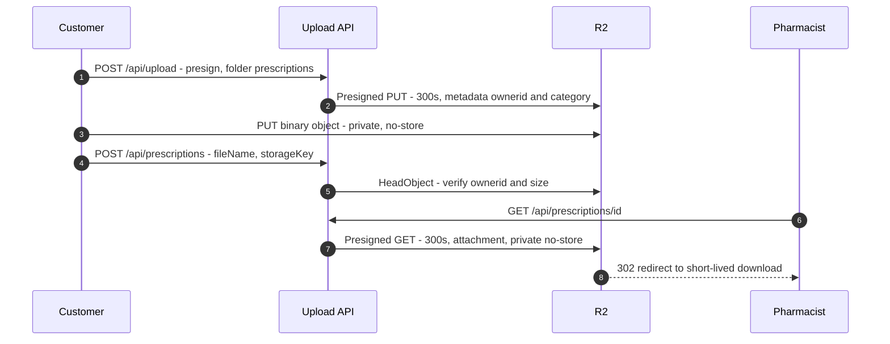

# Cloudflare R2 Object Storage

All binary media for Sphere Pharmacy — prescription scans, medicine-request photos, product and service imagery, avatars — is stored in **Cloudflare R2**, accessed through the AWS SDK v3 S3 client (`src/lib/r2.ts`) with presigned URLs for anything private. The integration is a thin, deliberate layer: one client, two access modes (public-immutable vs private-no-store), a small operation inventory, and clamped presigning windows so sensitive objects are never long-lived URLs.

| Audience | Status | Verified |
| --- | --- | --- |
| Engineers, AI coding agents | **Environment-dependent** (code paths fully shipped; stores objects only when R2 credentials are configured) | November 2026 |

## What it is

- **Provider:** Cloudflare R2 via its S3-compatible API (`@aws-sdk/client-s3` + `@aws-sdk/s3-request-presigner`), `region: "auto"`.
- **Default endpoint:** `https://<account-id>.r2.cloudflarestorage.com` (overridable via `R2_ENDPOINT`).
- **Fail-closed configuration:** `isR2Configured()` checks the four required variables; `config()` throws `"Private object storage is not configured"` when any are missing, so features degrade loudly rather than writing to nowhere.
- **No SDK lock-in beyond AWS client:** everything is standard S3 commands, so the bucket can be inspected with any S3 tooling.

## Configuration

| Name | Required | Secret | Sandbox / production | Description |
| --- | --- | --- | --- | --- |
| `R2_ACCOUNT_ID` | Yes | No | Same | Cloudflare account id; also builds the default endpoint. |
| `R2_ACCESS_KEY_ID` | Yes | Yes | Same | S3-compatible access key created in the R2 dashboard (token-scoped). |
| `R2_SECRET_ACCESS_KEY` | Yes | Yes | Same | Matching secret key. |
| `R2_BUCKET_NAME` | Yes | No | Same | Target bucket for all media. |
| `R2_ENDPOINT` | No | No | Same | Defaults to `https://<account-id>.r2.cloudflarestorage.com`. |
| `R2_PUBLIC_URL` | Yes for public assets | No | Same | Public base URL (r2.dev or custom domain). Throws on public upload if unset. |
| `NEXT_PUBLIC_R2_PUBLIC_URL` | No | No | Same | Browser-visible copy of the public base URL (image rendering). |

## Access model

Two modes, chosen per upload via `access: "public" | "private"` (default **private**):

| Mode | Cache-Control | URL | Used for |
| --- | --- | --- | --- |
| `public` | `public, max-age=31536000, immutable` | `${R2_PUBLIC_URL}/${key}` | Product/service images, avatars — immutable content, CDN-cacheable for one year. |
| `private` (default) | `private, no-store, max-age=0` | Presigned only, never a stable public URL | Prescriptions, medicine-request photos. |

## Presigned URLs

- `getPresignedDownloadUrl(key, expiresInSeconds = 300, downloadName?)` — clamped to **30–300 seconds**; forces `ResponseCacheControl: private, no-store` and, when a download name is given (sanitized: `" \ \r \n` → `_`), a `Content-Disposition: attachment` header with both plain and `UTF-8''` filename forms. Prescription downloads ride this (`?download=1` → 302 redirect to the presigned URL).
- `getPresignedUploadUrl(key, contentType, contentLength, metadata, expiresInSeconds = 300)` — same clamp; used **only for the prescriptions folder** by `POST /api/upload` (`action: "presign"`), which enforces 1–10MB and attaches metadata `ownerid`, `originalname`, `category`. The upload itself is `private, no-store`.

Short windows are intentional: even a leaked link is useless within five minutes, and no link is ever cacheable.

Why presigned **upload** exists only for prescriptions: it is the one flow where the customer's browser must write a large binary directly to storage (XHR progress bars need a direct PUT), so the server hands out a tightly-scoped, metadata-stamped, 30–300 second PUT instead of relaying the bytes. Every other folder uploads through the server-side `POST /api/upload`, which can enforce folder permissions and MIME sniffing centrally.

## Operations inventory

| Function | What it does | Used by |
| --- | --- | --- |
| `uploadToR2` | `PutObjectCommand` with mode-appropriate Cache-Control and optional metadata | Upload API, base64 paths, service images |
| `uploadBase64ToR2` | Strips a data-URL prefix, then `uploadToR2` | Prescription base64 fallback, settings base64 uploads |
| `getObjectFromR2` | `GetObjectCommand` → Buffer + contentType + metadata + size | Staff-proxied medicine-request photo streaming |
| `objectMetadataInR2` | `HeadObjectCommand` → metadata or `null` (never throws) | Prescription upload verification (owner check) |
| `deleteFromR2` | `DeleteObjectCommand` | Prescription retention cron, orphan cleanup |
| `objectExistsInR2` | `HeadObject`-based existence check | Existence guards |
| `getPresignedDownloadUrl` | Presigned GET, 30–300s, attachment disposition | Prescription downloads |
| `getPresignedUploadUrl` | Presigned PUT, 30–300s, metadata-bound | Direct-to-R2 prescription uploads |

## Usage map

The prescription lifecycle shows the access model end-to-end:

| Asset class | Access | Key layout | Access path |
| --- | --- | --- | --- |
| Prescriptions | Private | `prescriptions/{userId}/{uuid}.{ext}` | Customer uploads via presigned PUT or base64; pharmacists read via 300s presigned downloads; every access writes a `PrescriptionAccessLog` row. Uploads verified by key prefix + `HeadObject` metadata (`ownerid === userId`, `category prescriptions`). |
| Medicine-request photos | Private | `medicine-requests/{uuid}.{ext}` | Guest-submitted (≤3MB, magic-byte checked); staff view via a **proxied streaming route** (`/api/admin/medicine-requests/{id}/photo`) — no presigned URL is ever exposed. Orphan objects deleted if the row fails. |
| Product & service images | Public | `products|services/{ownerId}/{uuid}.{ext}` | Public immutable URLs; **curated local library** (`src/lib/image-library.ts`, ~60 webp files under `public/images/products/`) is the primary source and is never overwritten by BandaGo sync (see [BandaGo integration](bandago-pos-crm.md)). |
| Avatars | Public | `avatars/{ownerId}/{uuid}.{ext}` | Any signed-in user; served from the public URL. |

Upload permissions per folder: `prescriptions` customer-only, `avatars` any session, `products`/`services` `ADMIN|PHARMACIST`, `general` `ADMIN|STAFF`. Files ≤10MB, MIME-allowlisted (jpeg/png/webp/gif/heic-heif/pdf) with magic-byte sniffing; keys are always `{folder}/{ownerId}/{uuid}.{ext}` with a sanitized `originalname`.

### Upload API contract (`POST /api/upload`)

| Aspect | Rule |
| --- | --- |
| Auth | Any signed-in session; folder rules refine it (above). Rate limit 20 / 15 min per principal. |
| Validation | MIME allowlist (jpeg/png/webp/gif/heic-heif/pdf), magic-byte sniffing, extension must match MIME, `safeName` sanitized ≤80 chars. |
| Key layout | `{folder}/{ownerId}/{uuid}.{ext}` — owner-scoped by construction. |
| Metadata | `ownerid`, `originalname`, `category` — read back via `HeadObject` for verification. |
| Presign action | `action: "presign"` is **prescriptions-only**, 1–10MB, 30–300s expiry. |
| Direct upload verify | `POST /api/prescriptions` re-checks the key prefix `prescriptions/{userId}/`, `HeadObject` metadata (`ownerid === userId`, `category prescriptions`), and size 1–10MB before creating the row. |

Two client paths use this contract: the checkout and prescriptions views upload binaries via XHR with progress and a **120-second timeout** (`storageApi.uploadFile`), and older/base64 flows send data URLs through `uploadBase64ToR2` after server-side magic-byte validation. Medicine requests are the exception — they post their photo inline (base64, ≤3MB) to their own route, which validates and writes the private object itself.

## Browser integration

- **CSP** (`next.config.ts`): `img-src` allows `https://*.r2.dev` and `https://*.cloudflarestorage.com` (plus `self`, `data:`, `blob:`).
- **Next.js images:** `images.remotePatterns` mirrors the same two host patterns.
- **Managed-image validation** (`src/lib/security/service.ts`): service hero images accept only `/images/...` site paths or HTTPS URLs on the `R2_PUBLIC_URL` host — third-party image URLs are rejected.

## Error handling

- Missing configuration throws on first use (`Private object storage is not configured`) — routes surface this as `503` with a random `errorId`, never a stack trace.
- `objectMetadataInR2` returns `null` on any error (HeadObject miss or failure), letting callers treat unknown objects as absent.
- Prescription retention: if an R2 delete fails, the row is skipped (retried next cron run) rather than leaving a DB row pointing at nothing.
- Presign failures on prescription reads answer `503` — the route never falls back to a public URL.

## Security model

- **Owner-scoped keys.** Private objects live under `{folder}/{ownerId}/…` and the upload API stamps `ownerid` metadata; prescription reads verify ownership before presigning, and every read is access-logged.
- **Short-lived presigns.** 30–300s, `no-store`, attachment disposition — no copyable permanent links to private data.
- **No public path to private objects.** Medicine-request photos stream through an authenticated staff route; prescriptions presign per-request.
- **Token-scoped credentials.** Use R2 API tokens limited to the one bucket rather than account-wide keys.

## Operational requirements

- Create the bucket, enable public access (or a custom domain) for the public asset classes, and set `R2_PUBLIC_URL` accordingly — public uploads throw without it.
- Keep the curated local product-image library in `public/images/products/` under source control; it is the fallback for every synced product.
- Schedule the prescription-retention cron (`GET /api/cron/prescription-retention`, Bearer `CRON_SECRET`) which performs the R2 deletes for soft-deleted prescriptions past `PRESCRIPTION_RETENTION_DAYS`.
- Monitor for `503` `errorId` logs mentioning storage — they indicate credential or endpoint drift.

## Testing

`tests/security-static.test.mjs` codifies the storage invariants that matter most: prescriptions are stored privately (no public URL path), and the upload route keeps its permission wiring. Feature-level behavior (medicine-request photo caps, orphan cleanup) is covered by `tests/medicine-requests.test.mjs`. No test performs live R2 I/O — credentials are never required in CI.

## Status classification

**Environment-dependent.** Every code path (upload, presign, proxy, retention deletes, existence checks) is shipped and used across the prescriptions, medicine-requests, services, and catalogue features; the system only stores real objects once R2 credentials and a public URL are configured for the deployment.

## Known limitations

- Single bucket for all asset classes — separation is by key prefix and folder permissions, not by bucket policy.
- Presigned downloads cap at 300s; long review sessions must re-fetch links.
- No lifecycle rules are managed in code — retention is enforced by the app's retention cron, not R2 policies.
- `objectExistsInR2` cannot distinguish "missing" from "R2 error" (both return `false`).
- No bucket-level metrics or lifecycle policies are wired into the app — capacity and cost monitoring happen in the Cloudflare dashboard.
- Public objects are served with one-year immutable caching; replacing a public asset under the **same key** will not invalidate browsers or the CDN until the cache expires — new uploads always use fresh UUID keys to avoid this.

## Related documentation

- [BandaGo integration](bandago-pos-crm.md) — why sync never overwrites local product imagery.
- [API reference](../api/api-reference.md) — upload and prescription route contracts.
- [Security overview](../security/) — upload validation and prescription access control.
- [Environment variables](../operations/environment-variables.md) — deployment configuration.
