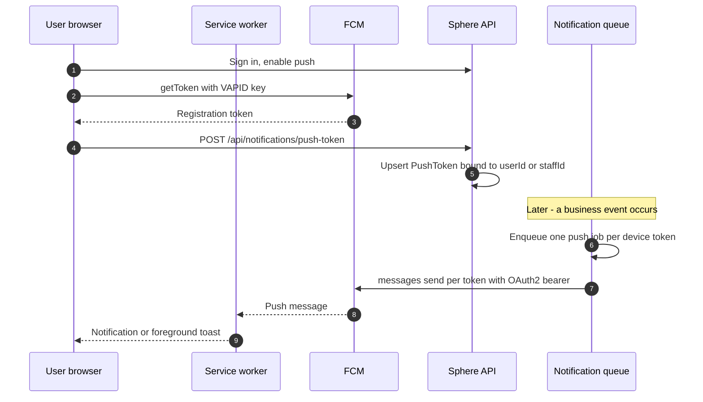

# Firebase Cloud Messaging (Web Push)

Sphere Pharmacy delivers web push notifications through **Firebase Cloud Messaging (FCM)** — the HTTP v1 API on the server side (with OAuth2 tokens minted directly from a Google service account, no admin SDK) and the Firebase Web SDK in the browser. Push is one of the two dispatch channels of the durable notification queue; it is never sent inline from request handlers.

| Audience | Status | Verified |
| --- | --- | --- |
| Engineers, AI coding agents | **Environment-dependent** (fully implemented; requires Firebase project credentials + VAPID key to deliver) | November 2026 |

## What it is

- **Server side** (`src/lib/firebase/admin.ts`): mints Google OAuth2 access tokens by signing an RS256 JWT with the service-account private key, then posts each message to `https://fcm.googleapis.com/v1/projects/{projectId}/messages:send` with native `fetch`. No external Firebase dependency is needed on the server.
- **Client side** (`src/lib/firebase/client.ts`): registers `/firebase-messaging-sw.js` at scope `/`, requests notification permission, obtains an FCM token with the VAPID key, registers it against the signed-in identity, and surfaces foreground messages as toasts.
- **Delivery model:** push jobs are queued transactionally with the business event and dispatched by the cron-driven notification dispatcher — one job **per registered device token**, so a user with three devices gets three deliveries.
- **Consistency rule:** only one notification per event per channel identity — the in-app row carries the content, and the email/push jobs are delivery tasks for it.

## Configuration

### API surface

| Endpoint | Methods | Auth | Purpose |
| --- | --- | --- | --- |
| `/api/notifications/push-token` | `POST`, `DELETE` | Any session | Register/remove the device token bound to the caller. |
| `/api/notifications` | `GET`, `PATCH` | Session-scoped | In-app inbox (last 100) and mark-read. |
| `/api/notifications/prefs` | `GET`, `PUT` | Customer | Email/push preferences enforced at dispatch. |
| `/api/notifications/dispatch-test` | `GET`, `POST` | `ADMIN` | Config probe + real test push to own devices. |
| `/api/admin/notification-health` | `GET` | `ADMIN` | Channel/status counts, failures, configured flags. |
| `/api/cron/notifications` | `GET` | Bearer `CRON_SECRET` | Dispatcher (10 jobs per run, `maxDuration` 300s). |

| Name | Required | Secret | Sandbox / production | Description |
| --- | --- | --- | --- | --- |
| `FIREBASE_SERVICE_ACCOUNT_KEY` | One of the two server options | Yes | Same | Full service-account JSON as a single string. Takes precedence over the individual variables. |
| `FIREBASE_PROJECT_ID` | Yes (if no JSON) | No | Same | Project id (falls back to `NEXT_PUBLIC_FIREBASE_PROJECT_ID`). |
| `FIREBASE_CLIENT_EMAIL` | Yes (if no JSON) | No | Same | Service-account email (`...iam.gserviceaccount.com`). |
| `FIREBASE_PRIVATE_KEY` | Yes (if no JSON) | Yes | Same | Private key; `\n` escapes in string form are normalized. |
| `NEXT_PUBLIC_FIREBASE_API_KEY` | Yes (client) | No | Same | Browser Firebase config. |
| `NEXT_PUBLIC_FIREBASE_AUTH_DOMAIN` | Yes (client) | No | Same | Browser Firebase config. |
| `NEXT_PUBLIC_FIREBASE_PROJECT_ID` | Yes (client) | No | Same | Browser Firebase config. |
| `NEXT_PUBLIC_FIREBASE_STORAGE_BUCKET` | Yes (client) | No | Same | Browser Firebase config. |
| `NEXT_PUBLIC_FIREBASE_MESSAGING_SENDER_ID` | Yes (client) | No | Same | Browser Firebase config. |
| `NEXT_PUBLIC_FIREBASE_APP_ID` | Yes (client) | No | Same | Browser Firebase config. |
| `NEXT_PUBLIC_FIREBASE_VAPID_KEY` | Yes (client) | No | Same | Web Push certificate key for `getToken`. |
| `NEXT_PUBLIC_APP_URL` | Yes | No | Production HTTPS | Origin used to force same-origin click-through links. |

## Server-side sending

`sendPushNotification({tokens, title, body, icon?, badge?, data?, link?})`:

1. Resolves service-account credentials (JSON string first, then individual variables); **fails closed** — no credentials means a failed result, never a simulated send.
2. Mints (or reuses) an OAuth2 token, cached in memory and refreshed when less than ~5 minutes of validity remains; the token exchange (`oauth2.googleapis.com/token`, JWT-bearer grant) has a 12-second timeout.
3. Sends **one FCM HTTP v1 request per token** (12s timeout each, `Promise.allSettled`): `webpush` block with `Urgency: high`, icon/badge defaulting to `/favicon.ico`, and a `click_action`/`fcm_options.link` that is **forced same-origin** — any off-origin `link` degrades to the site origin.
4. Counts sent/failed; responses containing `UNREGISTERED` / `registration-token-not-registered` mark the token invalid.
5. **Prunes invalid tokens** from the `PushToken` table automatically.

## Client-side flow

- **Support gate:** `isPushNotificationSupported()` requires a secure context, `serviceWorker`, `Notification`, and `PushManager`.
- **Local development:** `localhost` counts as a secure context, so push can be exercised locally with the browser config present; the failure message states this explicitly ("Push alerts require a supported browser on HTTPS (localhost is also supported).").
- **Enable:** request permission → register `/firebase-messaging-sw.js` with scope `/` → `getToken(messaging, {vapidKey, serviceWorkerRegistration})` → `POST /api/notifications/push-token` with `{token, platform: userAgent.slice(0,150)}` → cache in `localStorage["sphere_device_token"]`. The app re-enables automatically on load when a session exists, permission is granted, and the cached token is present.
- **Permission states are distinguished:** a `denied` result returns "Push permission is blocked. Allow notifications for this site in your browser settings and try again." (the user must unblock in the browser), while a plain dismissal returns "Push notification permission was not granted." — only the former is unrecoverable without browser settings.
- **Disable:** `deleteToken` on the messaging instance, unsubscribe the push subscription, `DELETE /api/notifications/push-token` (best-effort), and clear the cache.
- **Foreground:** the service worker `postMessage`s `PUSH_NOTIFICATION` payloads; `setupForegroundNotificationListener` renders a sonner toast with a **View action that only opens same-origin URLs** (off-origin links are ignored).
- **Background:** the service worker (`public/firebase-messaging-sw.js`) displays the notification and focuses/opens the link on click.

Push payloads are deliberately generic: the title is always "Sphere Pharmacy", the body "You have a new update. Open Sphere to view it securely." — the actual content lives behind the sign-in, in the in-app inbox. The `data` block carries `title`, `body`, `url`, and a timestamp for the service worker.

## Token model

`PushToken` rows are keyed by the token string and upserted **bound to the caller's identity** — `userId` or `staffId`, the staff role (or `CUSTOMER`), and a truncated `platform` string. Validation on registration rejects tokens that are not 32–4096 characters, that start with `{` (JSON pasted by mistake), or that start with `dev_fcm_` (placeholder values — a static test enforces this). `DELETE` is scoped to the caller's own tokens; logout also deregisters the cached token.

Lifecycle wiring across the app:

- On app mount, the root page calls `refresh()` (session bootstrap) and `setupForegroundNotificationListener()`, and re-enables push when a session exists, permission is already granted, and `sphere_device_token` is cached — so returning users stay subscribed without re-prompting.
- The admin topbar exposes an explicit push-enable toggle for staff.
- `POST /api/auth/logout` deregisters the push token sent in the body (only if it belongs to the caller) before destroying the session.
- The client caches the token in `localStorage["sphere_device_token"]` and reuses it across visits.

## Delivery via the notification outbox

Push is queued exactly like email: `notifyCustomer`/`notifyStaff` write in-app notifications and enqueue **one `NotificationDelivery` job per registered device token** (`{key}:push:{tokenId}`) with payload `{token, title, body, link, data}` — no network I/O inside the caller's transaction. The dispatcher (driven by `GET /api/cron/notifications` every minute with Bearer `CRON_SECRET`):

- Claims due jobs atomically (lock token, 120s lock, attempts+1).
- Re-verifies the recipient still exists/is active and honors their notification preferences (opt-out → `SKIPPED`).
- Re-verifies token ownership, then calls `sendPushNotification`.
- On failure: up to **8 attempts** with exponential backoff (`min(3600, 60·2^(attempts-1))` seconds); after a **23-hour** retry window the job is `FAILED`.

Admin observability: `GET /api/admin/notification-health` reports channel/status counts and the configured flags (including push); `POST /api/notifications/dispatch-test` sends a real test push to the admin's own registered devices and distinguishes "no push-enabled device registered" from provider failures.

## Error handling

- Provider auth failures return a failed result with a descriptive error (credentials / Cloud Messaging API access) — never a crash.
- Per-token sends are isolated; one bad token cannot fail the batch, and dead tokens are pruned for the next run.
- Client enablement failures map SDK error codes (`messaging/permission-blocked`, `messaging/invalid-vapid-key`) to actionable messages.
- Incomplete browser config is detected before any permission prompt and reported as a deployment configuration error.

## Security model

- The service-account **private key is server-only**; the browser sees only the public web config and VAPID key.
- Tokens are identity-bound at registration and ownership is re-verified at dispatch — a stolen token string cannot be re-registered to another account without their session.
- Click-through links are forced same-origin on both the server payload and the client toast handler.
- Registration tokens are treated as credentials for delivery, not as authentication for anything.

## Operational requirements

- Create the Firebase project, enable Cloud Messaging, register a web app (for the `NEXT_PUBLIC_FIREBASE_*` values), create a Web Push certificate (VAPID), and provision a service account with Firebase Messaging scope.
- Schedule `GET /api/cron/notifications` at least every minute with `Authorization: Bearer <CRON_SECRET>` — without the scheduler, push (and email) jobs never dispatch.
- Keep `CRON_SECRET` at 32+ characters; the cron route's `authorizedJob()` check compares it in constant time.
- Monitor `/api/admin/notification-health` for `FAILED` push jobs and stale tokens.

## Testing

`tests/security-static.test.mjs` codifies that only real FCM tokens are accepted (the `dev_fcm_` placeholder rejection) alongside the wider notification wiring. `tests/dispatch-readiness.test.mjs` and `tests/admin-live-sync.test.mjs` cover the dispatch and admin surfaces. No test delivers a real push — Firebase credentials are never required in CI; the `POST /api/notifications/dispatch-test` probe is the live end-to-end check.

## Status classification

**Environment-dependent.** The full pipeline — permission flow, token registry, per-device outbox jobs, OAuth2 minting, invalid-token pruning, admin probes — is implemented and tested; actual delivery requires the Firebase project credentials and VAPID key to be configured for the deployment.

## Known limitations

- Web push only — no native iOS/Android apps; on iOS, push works only for installed PWAs (a browser platform constraint).
- **In-memory OAuth2 token cache** means a token is minted per server instance (each instance mints its own).
- Notification payloads are generic by design ("You have a new update. Open Sphere to view it securely.") — content stays on the server.
- The `PushToken` platform field is a truncated user-agent, not a structured device fingerprint.
- Tokens are stored as raw FCM registration strings in the database (they are the delivery key), so database read access implies push-send ability — consistent with their delivery-only sensitivity, but worth knowing for access scoping.

## Related documentation

- [Resend email](resend.md) — the sibling dispatch channel of the same outbox.
- [API reference](../api/api-reference.md) — push-token and notification route contracts.
- [Workflows](../workflows/) — notification queuing and dispatch flow.
- [Environment variables](../operations/environment-variables.md) — deployment configuration.
