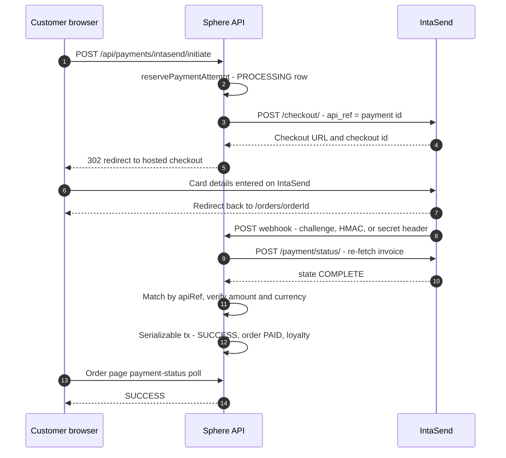

# IntaSend Hosted Card Checkout

Sphere Pharmacy accepts card payments (Visa/Mastercard) through IntaSend's **hosted checkout**: the storefront creates a checkout session server-side, redirects the customer to IntaSend's page to enter card details, and finalizes the payment only from IntaSend's authenticated webhook after re-fetching the invoice server-to-server. Card data never touches this application. The client lives in `src/lib/intasend/client.ts`; the routes are `/api/payments/intasend/initiate` and `/api/payments/intasend/webhook`, with a mirrored pair for clinical service bookings.

| Audience | Status | Verified |
| --- | --- | --- |
| Engineers, AI coding agents | **Environment-dependent** (real-provider capable, not live-certified) | November 2026 |

## What it is

- **Provider:** IntaSend — `api.intasend.com/api/v1` (production) or `sandbox.intasend.com/api/v1` (sandbox).
- **Capability:** hosted card checkout (`POST /checkout/`), invoice status lookup (`POST /payment/status/`), signed webhooks, and refunds via the chargebacks API (`POST /chargebacks/`, `GET /chargebacks/<id>/`).
- **Card-scope rule, enforced in code:** the initiate route only supports checkout mode — `"Card details must be entered only on IntaSend's hosted checkout."` There is no API-collected card flow and the `Payment.cardLast4` column is never populated.
- **Configuration fails closed.** `isIntaSendConfigured()` requires the publishable key, secret key, and a webhook secret of ≥24 characters, and requires `INTASEND_ENVIRONMENT=production` when `NODE_ENV=production`.

### API surface

| Endpoint | Methods | Auth | Purpose |
| --- | --- | --- | --- |
| `/api/payments/intasend/initiate` | `POST` | Order owner, staff, or guest order-access token | Create a hosted checkout session (8/15 min per order). |
| `/api/payments/intasend/webhook` | `POST` | Challenge / HMAC / secret header | Order card payment outcome. |
| `/api/service-bookings/[id]/pay/card` | `POST` | Booking owner | Hosted checkout for a booking (8/15 min per booking). |
| Service webhook path | `POST` | Same verification | Booking card payment outcome (`apiRef` = payment id or booking reference). |
| `/api/payments/refund` | `POST` | `ADMIN` | Chargeback creation and `REFUND_PENDING` polling (10/h per admin). |

## Configuration

| Name | Required | Secret | Sandbox / production | Description |
| --- | --- | --- | --- | --- |
| `INTASEND_ENVIRONMENT` | Yes | No | `sandbox` or `production` | Selects the API base URL. Production builds must set `production` or the integration reports unconfigured. |
| `INTASEND_PUBLISHABLE_KEY` | Yes | No | Both | Public key, sent with checkout/status/refund requests. |
| `INTASEND_SECRET_KEY` | Yes | Yes | Both | Server-side API secret, used as the `Bearer` token. |
| `INTASEND_WEBHOOK_SECRET` | Yes | Yes | Both, ≥24 chars | The dashboard challenge/secret used for webhook verification (body challenge, HMAC, or header). |
| `NEXT_PUBLIC_APP_URL` | Yes | No | Production HTTPS | Sent as `host` on checkout creation; base for `redirect_url`. Must be HTTPS in production (enforced). |

## Checkout session creation

`createIntaSendCheckoutSession` calls `POST /checkout/` with `Authorization: Bearer <secret>` plus `X-IntaSend-Public-API-Key`, and a 15-second timeout:

- `public_key`, split `first_name`/`last_name`, optional `email`/`phone_number`.
- `host = NEXT_PUBLIC_APP_URL`, `amount = amount.toFixed(2)`, `currency: "KES"`.
- `api_ref = payment.id` — the local payment row's id is the correlation key end-to-end.
- `redirect_url` defaults to `${appUrl}/orders/<orderId>` (service bookings use `/services?tab=bookings`).
- `method: "CARD-PAYMENT"` and `card_tarrif: "BUSINESS-PAYS"` (the merchant absorbs card fees; `tarrif` is IntaSend's own field spelling).

The response is validated hard: the returned `url` must be **HTTPS on `payment.intasend.com`, `sandbox.intasend.com`, or `checkout.intasend.com`** — anything else throws `Unexpected hosted checkout URL`. The checkout `id` (or `invoice_id`) is stored as `Payment.checkoutRequestId` and the hosted URL as `providerReference`.

The initiate route is idempotent per client `idempotencyKey` (server key `order:{id}:intasend:{key}` / `service:{id}:intasend:{key}`): while a `PROCESSING` payment holds a stored HTTPS `providerReference`, retries **return the same checkout** instead of creating a new one.

### Payment lifecycle and guards

`Payment` rows carry `provider INTASEND`, `method HOSTED_CHECKOUT`, unique `(provider, providerReference)` and `(provider, checkoutRequestId)`, and an `idempotencyKey` unique across attempts. Before any network I/O, `reservePaymentAttempt` (Serializable) rejects duplicate keys, blocks a second active attempt on the same order/booking, and verifies payability (order exactly `AWAITING_PAYMENT`, or booking in an active status with `UNPAID`/`FAILED` payment and matching amount). Initiation additionally requires the mode to be `checkout` — the error message is explicit that card details belong only on IntaSend's page. Uncertain provider responses leave the payment `PROCESSING` with a reconcile note and answer `503`, which is exactly the state the stored-checkout reuse path is designed to recover from.

## Invoice status API

`getIntaSendInvoice(invoiceId, checkout?)` calls `POST /payment/status/` with `{invoice_id | checkout_id, public_key}` and normalizes the response. The only success state is exactly **`COMPLETE`**; `FAILED` and `CANCELLED` are handled as terminal failures; anything else is treated as not-yet-complete. This API is the mandatory source of truth — the webhook body is only ever a *trigger* to call it.

## Webhook verification and processing

`POST /api/payments/intasend/webhook` accepts three verification methods (any one passes, all timing-safe):

1. **Body challenge** — the JSON body contains a `challenge` string equal to `INTASEND_WEBHOOK_SECRET`.
2. **HMAC signature** — `x-intasend-signature` or `x-webhook-signature` (with an optional `sha256=` prefix) equals `HMAC-SHA256(secret, rawBody)`.
3. **Secret header** — `x-intasend-webhook-secret` equals the secret.

Verification alone is **never sufficient**. The route then re-fetches the invoice server-to-server and:

- Matches the payment by provider `INTASEND` and `id = invoice.apiRef` **or** `checkoutRequestId = invoice.id` **or** `providerReference = invoice.id`, requiring `apiRef === payment.id || order.reference`.
- Verifies amount, currency, phone, and receipt shape (`paymentMatchesExpected`).
- Records a `PaymentWebhookEvent` (`eventId = intasend:{event_id | invoice:state:tracking}`); benign replays are acknowledged, conflicting replays answer `409`.
- On `COMPLETE`: Serializable transaction — payment `SUCCESS`, order `PAID` (version bump + history), loyalty award, notifications queued.
- On `FAILED`/`CANCELLED`: payment `FAILED` with `"Card payment was not completed"`.

> **Returning from hosted checkout never establishes success.** The redirect back to the order page is cosmetic; the payment only finalizes via the verified webhook plus server-side invoice re-fetch. The storefront's status polling reads local state, it does not query IntaSend.

## Refunds

Admin-only (`POST /api/payments/refund`):

1. `createIntaSendRefund(invoiceId, amount, reason, details)` → `POST /chargebacks/` with `{public_key, invoice, amount: amount.toFixed(2), reason, reason_details}`. The route validates the invoice id and amount (±0.001), sets the payment to `REFUND_PENDING` with `refundReference = refund.id`, and audits `REFUND_REQUESTED`.
2. A subsequent refund call on a `REFUND_PENDING` payment polls `getIntaSendRefund` (`GET /chargebacks/<id>/`); when the state reaches `COMPLETED`, `finalizeRefund` runs in a Serializable transaction: payment `REFUNDED`, order `REFUNDED`, loyalty clawback and re-credit, refund notice.
3. Refund states surface as `PENDING` until then — there is no webhook for chargeback completion, so completion is poll-driven.

## Error handling and retries

- **Uncertain initiation.** If checkout creation fails ambiguously, the payment stays `PROCESSING` with a reconcile note and the route answers `503`; the stored checkout URL is reused on retry rather than double-charging sessions.
- **Idempotent attempts.** `reservePaymentAttempt` (Serializable, before any network I/O) rejects duplicate idempotency keys and concurrent attempts for the same order/booking.
- **Timeouts.** 15 seconds on every IntaSend call, `no-store` on refund lookups.
- **Webhook failures.** Events that cannot be matched answer `404`; verification failures are rejected before any state change.

## Sandbox vs production

| Aspect | Sandbox | Production |
| --- | --- | --- |
| Base URL | `sandbox.intasend.com/api/v1` | `api.intasend.com/api/v1` |
| Keys | Test publishable/secret pair (`.env.example` placeholders) | Live keys after KYC |
| Hosted page | `sandbox.intasend.com` | `payment.intasend.com` / `checkout.intasend.com` (both allowlisted) |
| App origin | `NEXT_PUBLIC_APP_URL` may be local | Must be HTTPS (enforced with a throw at checkout creation) |
| Environment flag | `INTASEND_ENVIRONMENT=sandbox` (default) | `INTASEND_ENVIRONMENT=production` **required** when `NODE_ENV=production` |

## Security model

- Checkout URL **hostname allowlist** prevents redirect attacks even if the provider response were tampered with.
- Webhook auth supports IntaSend's documented body challenge; the residual risk of challenge-only auth is mitigated by the **mandatory server-side invoice re-fetch** before any state change.
- Secrets never reach the browser: only the publishable key and the hosted URL are client-visible.
- Raw webhook bodies are hashed (`payloadHash`) into the `PaymentWebhookEvent` ledger for replay/conflict detection.

## Status classification

**Environment-dependent.** Hosted checkout, webhook verification with invoice re-fetch, idempotent initiation, and poll-driven refunds are fully implemented and covered by tests, but the integration has not been exercised against a live production IntaSend account (KYC, real keys, certified webhook). See the [payment and notification audit](../payment-notification-audit.md) for outstanding release blockers.

## Testing

`tests/security-static.test.mjs` codifies the webhook authentication functions (all three verification paths) among the payment invariants. Payment-flow tests via `npm test` exercise checkout session creation, the hosted-URL allowlist, webhook matching, and refund polling against the local state machine. No test performs live IntaSend calls; sandbox verification requires real sandbox keys and a reachable webhook endpoint.

## Known limitations

- **No in-store service cash settlement.** Service bookings support pay-at-pharmacy intent and hosted checkout, but no endpoint records cash collected for services (documented gap).
- **Refund completion is poll-driven** — no chargeback webhook; an admin must re-submit the refund action (or an operator job must) to advance `REFUND_PENDING` → `REFUNDED`.
- **Body-challenge webhook auth** is only as strong as the mandatory re-fetch that follows it.
- **No card metadata.** `cardLast4` is declared on the payment model but never populated — the hosted flow never exposes card details.

## Related documentation

- [M-Pesa Daraja](mpesa-daraja.md) — the STK Push payment rail.
- [API reference](../api/api-reference.md) — payment route contracts.
- [Workflows](../workflows/) — checkout, payment capture, and refund flows.
- [Payment and notification audit](../payment-notification-audit.md) — certification blockers.
- [Environment variables](../operations/environment-variables.md) — deployment configuration.
