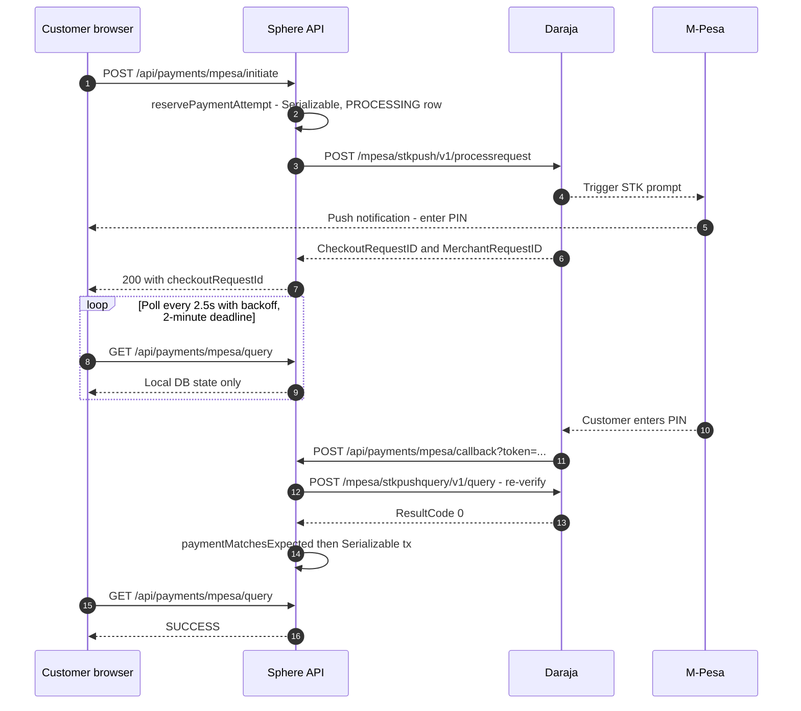

# Safaricom M-Pesa Daraja (Lipa Na M-Pesa Online / STK Push)

Sphere Pharmacy collects M-Pesa payments through Safaricom's Daraja **Lipa Na M-Pesa Online** API — the STK Push flow where a customer's phone presents a PIN prompt and the outcome is confirmed by an authenticated server-to-server callback. The client library (`src/lib/mpesa/daraja.ts`) talks directly to Daraja with native `fetch`, caches OAuth tokens, composes STK requests, and normalizes result codes; the API routes around it add idempotent payment attempts, callback verification with a mandatory re-query, and a read-only polling endpoint for the storefront.

| Audience | Status | Verified |
| --- | --- | --- |
| Engineers, AI coding agents | **Environment-dependent** (real-provider capable, not live-certified) | November 2026 |

## What it is

- **Provider:** Safaricom Daraja, base URL `api.safaricom.co.ke` (production) or `sandbox.safaricom.co.ke` (sandbox).
- **Capability used:** STK Push (`/mpesa/stkpush/v1/processrequest`) and status query (`/mpesa/stkpushquery/v1/query`), authenticated with an OAuth client-credentials bearer token.
- **Scope:** order payments (`POST /api/payments/mpesa/initiate`, callback at `/api/payments/mpesa/callback`) and a mirrored flow for clinical service bookings (`/api/service-bookings/[id]/pay/mpesa`, callback at `/api/payments/mpesa/service-callback`).
- **Configuration fails closed.** `isDarajaConfigured()` requires every credential *and* enforces `MPESA_ENVIRONMENT=production` when `NODE_ENV=production`; nothing is simulated when credentials are absent.

### API surface

| Endpoint | Methods | Auth | Purpose |
| --- | --- | --- | --- |
| `/api/payments/mpesa/initiate` | `POST` | Order owner, staff, or guest order-access token | Start an STK push for an order (5/15 min, keyed `orderId:phone`). |
| `/api/orders/[id]/request-payment` | `POST` | Staff incl. assigned riders | Staff-triggered push on payable orders (5/15 min). |
| `/api/payments/mpesa/callback` | `POST` | `?token=` vs `MPESA_CALLBACK_TOKEN` | Order payment outcome (server-to-server). |
| `/api/payments/mpesa/service-callback` | `POST` | `?token=` vs `MPESA_CALLBACK_TOKEN` | Service booking payment outcome. |
| `/api/payments/mpesa/query` | `GET` | Owner, assigned rider, staff, or guest token | Read-only local payment state (40/10 min). |
| `/api/payments/refund` | `POST` | `ADMIN` | Records refunds — refuses M-Pesa (see limitations). |

## Configuration

| Name | Required | Secret | Sandbox / production | Description |
| --- | --- | --- | --- | --- |
| `MPESA_ENVIRONMENT` | Yes | No | `sandbox` or `production` | Selects the Daraja base URL. A production build (`NODE_ENV=production`) **must** set `production` or the integration reports unconfigured. |
| `MPESA_CONSUMER_KEY` | Yes | Yes | Both | Daraja app consumer key, used for the OAuth token. |
| `MPESA_CONSUMER_SECRET` | Yes | Yes | Both | Daraja app consumer secret (Basic-auth pair with the key). |
| `MPESA_PASSKEY` | Yes | Yes | Both | Lipa Na M-Pesa Online passkey, used to build the STK password. The `.env.example` value is the public sandbox passkey — replace it for production. |
| `MPESA_SHORTCODE` | Yes | No | Both | Business shortcode / till. Sandbox example values ship in `.env.example`. |
| `MPESA_TRANSACTION_TYPE` | No | No | Both | Defaults to `CustomerPayBillOnline`. |
| `MPESA_CALLBACK_URL` | No | No | Production must be HTTPS | Optional explicit callback base. The `?token=` parameter is always (re)set on it. |
| `MPESA_CALLBACK_TOKEN` | Yes | Yes | Both, ≥24 chars | Shared secret appended to callback URLs and verified timing-safely on receipt. |
| `NEXT_PUBLIC_APP_URL` | Yes | No | Production HTTPS | App origin; used to build the default callback URL. |

## OAuth token caching

`getDarajaAccessToken()` keeps a **module-level in-memory cache** and refreshes when fewer than 60 seconds remain before expiry. The token request is `GET /oauth/v1/generate?grant_type=client_credentials` with `Authorization: Basic base64(consumerKey:consumerSecret)` and a 12-second timeout. Token lifetime comes from Daraja (parsed, default 3599s). Because the cache is in-process, each server instance mints its own token.

## STK push request composition

`initiateStkPush` builds the Daraja payload as follows:

- `Password = base64(shortcode + passkey + timestamp)` where `timestamp` is local `YYYYMMDDHHmmss`.
- `Amount = Math.round(amount)` — M-Pesa requires whole Kenyan shillings (the initiate route rejects fractional amounts before this point).
- `PartyA` / `PhoneNumber` = the customer's phone after `formatDarajaPhone`, and `PartyB` = the shortcode.
- `AccountReference = reference.slice(0, 12)` and `TransactionDesc = description.slice(0, 13)` — both truncated to Daraja field limits.
- `CallBackURL` = `MPESA_CALLBACK_URL` or `${NEXT_PUBLIC_APP_URL}/api/payments/mpesa/callback`, with `?token=<MPESA_CALLBACK_TOKEN>` appended; the callback protocol **must be HTTPS in production** (enforced with a throw).
- The request has a 15-second timeout; success requires `response.ok` **and** `ResponseCode === "0"`.

Phone formatting (`formatDarajaPhone`) strips non-digits and normalizes to `2547XXXXXXXX` / `2541XXXXXXXX`: `254…` 12-digit passes through, `0…` 10-digit drops the leading zero, and a bare 9-digit `7…`/`1…` is prefixed.

## Callback processing

`POST /api/payments/mpesa/callback` (and the `service-callback` mirror for bookings):

1. **Authenticate** the `?token=` query parameter against `MPESA_CALLBACK_TOKEN` with `timingSafeEqual`.
2. **Parse** `Body.stkCallback` — `CheckoutRequestID`, `ResultCode`, and `CallbackMetadata` items (`MpesaReceiptNumber`, `PhoneNumber`, `Amount`).
3. **Locate** the payment by `(provider MPESA, checkoutRequestId)`; unknown IDs answer `404`.
4. **Re-query** Daraja via `queryStkPush` — a `ResultCode 0` callback is only trusted after the query also returns `SUCCESS` and `paymentMatchesExpected` passes (amount with 2-decimal `sameMoney`, currency KES, normalized phone, receipt matching `/^[A-Z0-9-]{6,64}$/i`).
5. **Commit** inside a Serializable transaction: record the webhook event, mark the payment `SUCCESS` with `providerReference = receipt`, queue the outcome notification, move the order to `PAID` (from `AWAITING_PAYMENT` / `AVAILABILITY_CONFIRMED` / `PRESCRIPTION_VERIFIED`) with a version bump and status history, and award loyalty points (`earn:<orderId>` ledger key).
6. **Non-zero results** mark the payment `FAILED` and notify the customer.

Idempotence: `PaymentWebhookEvent` rows use `eventId = mpesa:{checkoutRequestId}:{resultCode}:{receipt|none}` — benign replays are acknowledged, conflicting replays answer `409`.

### ResultCode map

| ResultCode | Meaning | Payment outcome |
| --- | --- | --- |
| `0` | Success | `SUCCESS` (after re-query + verification) |
| `1032` | Cancelled by user | `FAILED` |
| `1037` | Timeout / no response | `FAILED` |
| `1` | Insufficient balance | `FAILED` |
| `2001` | Incorrect PIN | `FAILED` |
| `1019` | Transaction failed | `FAILED` |
| anything else | In-flight or unknown | `PENDING` until the callback lands |

## Query endpoint (read-only)

`GET /api/payments/mpesa/query?checkoutRequestId=` is **local state only** — it reads the payment row in the database (owner, assigned rider, staff, or guest order-access token; 40 requests / 10 minutes) and never calls Daraja. Provider reconciliation is performed exclusively by the authenticated callbacks and jobs; the storefront's polling loop (every 2.5s, backoff ×1.5 capped at 10s, 2-minute deadline) simply watches this state flip.

## Payment lifecycle and idempotency

`Payment` rows carry `provider MPESA`, `method STK_PUSH`, and move `PENDING/PROCESSING → SUCCESS | FAILED`. Initiation is guarded by `reservePaymentAttempt` (`src/lib/security/payment-attempt.ts`), which runs in a **Serializable transaction before any network I/O**: it rejects duplicate idempotency keys, rejects a second active attempt for the same order (`PAYMENT_ATTEMPT_EXISTS` → 409), and verifies payability (customer flow requires the order to be exactly `AWAITING_PAYMENT` with a positive whole-KSh total and no existing `SUCCESS` payment; the staff flow accepts the payable set `PRESCRIPTION_VERIFIED`, `AVAILABILITY_CONFIRMED`, `AWAITING_PAYMENT`, `READY_FOR_PICKUP`, `OUT_FOR_DELIVERY` with all prescriptions approved).

Idempotency keys are namespaced by flow:

| Flow | Server key |
| --- | --- |
| Customer order | `order:{orderId}:mpesa:{clientKey}` |
| Staff-requested payment | `staff:{orderId}:mpesa:{clientKey}` |
| Service booking | `service:{bookingId}:mpesa:{clientKey}` |

Client keys must match `/^[a-zA-Z0-9_-]{16,100}$/`. A replayed key returns `"Payment request already sent."`, and a `PROCESSING` payment younger than 15 minutes blocks new attempts.

## Service bookings mirror

`POST /api/payments/mpesa/service-callback` implements the same token check, re-query, and verification for `ServicePayment` rows (bookings for clinical services). Event IDs use the `mpesa-service:` prefix, and a verified success sets the booking's `paymentStatus` to `PAID`.

## Error handling and retries

- **Uncertain initiation.** If Daraja's response is ambiguous, the payment stays `PROCESSING` with `failureReason "Provider response uncertain; reconcile before another attempt"` and the route answers `503`; a new attempt is blocked while a `PROCESSING` payment is under 15 minutes old.
- **Idempotent attempts.** `reservePaymentAttempt` runs in a Serializable transaction *before* any network I/O: duplicate idempotency keys and concurrent attempts are rejected (`PAYMENT_ATTEMPT_EXISTS` → 409), and replays of the same key return `"Payment request already sent."`.
- **Timeouts.** 12s for OAuth, 15s for STK push and query — all via `AbortSignal.timeout`.
- **Frontend polling failures** surface as the 2-minute deadline expiring; the order remains `AWAITING_PAYMENT` and the customer can retry or change method.

## Security model

- Callbacks are authenticated by the token query parameter (timing-safe compare); initiation routes require the order owner, staff (including assigned riders via `request-payment`), or a guest order-access token.
- The callback re-queries Daraja before trusting even a success result — the callback body alone never finalizes money.
- All provider fetches are timeout-bounded and `no-store`.
- Known caveat (accepted Daraja practice): the token travels in the **URL query string**, which can leak into access logs. Scope log retention accordingly.

## Sandbox vs production

| Aspect | Sandbox | Production |
| --- | --- | --- |
| Base URL | `sandbox.safaricom.co.ke` | `api.safaricom.co.ke` |
| Credentials | Daraja sandbox app (public example passkey/shortcode in `.env.example`) | Own shortcode + live passkey + production consumer pair |
| Callbacks | Any reachable URL | **HTTPS enforced in code** when `NODE_ENV=production` |
| Environment flag | `MPESA_ENVIRONMENT=sandbox` (default) | `MPESA_ENVIRONMENT=production` **required** or the integration reports unconfigured |

## Status classification

**Environment-dependent.** The integration is fully implemented and real-provider capable — OAuth caching, STK composition, token-authenticated callbacks with mandatory re-query, and idempotent payment attempts are all shipped and covered by static/unit tests — but it has not been live-certified against a production Daraja app. Follow the release blockers in the [payment and notification audit](../payment-notification-audit.md) before going live.

## Testing

- `tests/security-static.test.mjs` codifies the webhook authentication functions (callback token verification) and other payment security invariants.
- Payment-flow tests (run via `npm test`) exercise the local state machine: attempt reservation, callback verification, and result mapping.
- `docs/payment-notification-audit.md` records the manual source/config audit that classified this integration as "not yet production-ready".

None of the automated tests call Safaricom; sandbox verification requires live Daraja sandbox credentials.

## Known limitations

- **Refunds are manual.** `POST /api/payments/refund` refuses `MPESA` successes with a 409: M-Pesa Express refunds must be completed and verified in the M-PESA organisation portal (B2C process) before being recorded here.
- **Callback token in the URL query** (Daraja's documented practice) can leak into logs.
- **No missing-callback recovery job.** Payments that stay `PROCESSING` because a callback never arrived require operator reconciliation; the query endpoint will not trigger it.
- **In-memory OAuth cache** means a token is minted per server instance (acceptable at this scale, worth knowing for burst traffic).

## Related documentation

- [IntaSend cards](intasend.md) — the alternative hosted-checkout payment rail.
- [API reference](../api/api-reference.md) — payment route contracts.
- [Workflows](../workflows/) — checkout and payment capture flows.
- [Payment and notification audit](../payment-notification-audit.md) — certification blockers and operational requirements.
- [Environment variables](../operations/environment-variables.md) — deployment configuration.
