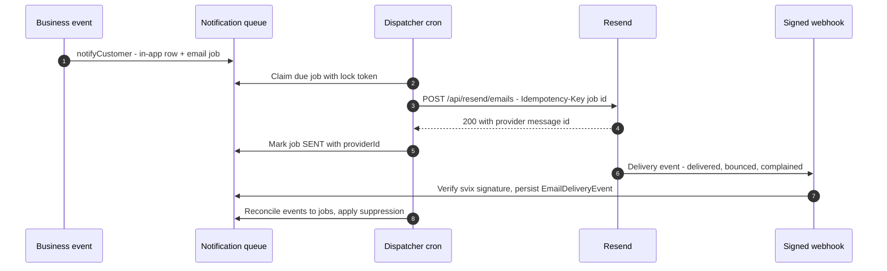

# Resend Email

Transactional email for Sphere Pharmacy is delivered through **Resend's REST API**, called directly with native `fetch` — no SDK, no queue-side coupling. Emails are never sent from request handlers: business events enqueue one email job per recipient in the durable `NotificationDelivery` outbox, a cron-driven dispatcher sends them with an idempotency key, and a signed Svix webhook feeds delivery/bounce/complaint events back into the same system.

| Audience | Status | Verified |
| --- | --- | --- |
| Engineers, AI coding agents | **Environment-dependent** (fully implemented; requires a Resend API key and verified sender domain to deliver) | November 2026 |

## What it is

- **Provider:** Resend — `POST https://api.resend.com/emails` (send) and a signed webhook (`svix-*` headers) for delivery events.
- **Transport:** native `fetch` with a **12-second timeout**, `Authorization: Bearer <RESEND_API_KEY>`, and an `Idempotency-Key` header set to the notification job id, so dispatcher retries cannot double-send.
- **Placement:** one half of the notification outbox (email + web push, see [Firebase FCM](firebase.md)); templates render the Sphere brand in table-based HTML.

### API surface

| Endpoint | Methods | Auth | Purpose |
| --- | --- | --- | --- |
| `/api/notifications/email-webhook` | `POST` | Svix signature (see below) | Delivery/bounce/complaint events. |
| `/api/notifications` | `GET`, `PATCH` | Session-scoped | In-app inbox — the email channel's visible sibling. |
| `/api/notifications/prefs` | `GET`, `PUT` | Customer | Email opt-in/out enforced at dispatch. |
| `/api/notifications/dispatch-test` | `GET`, `POST` | `ADMIN` | Config probe + real test email to the admin's own address. |
| `/api/admin/notification-health` | `GET` | `ADMIN` | Channel/status counts, oldest pending, recent failures. |
| `/api/cron/notifications` | `GET` | Bearer `CRON_SECRET` | Dispatcher + event reconciliation (10 jobs per run). |

## Configuration

| Name | Required | Secret | Sandbox / production | Description |
| --- | --- | --- | --- | --- |
| `RESEND_API_KEY` | Yes | Yes | Same | API key for `api.resend.com`. Without it `sendEmail` fails closed with `"Email delivery is not configured"`. |
| `RESEND_FROM_EMAIL` | Yes | No | Production: verified domain required | From address. Falls back to `Sphere Pharmacy <onboarding@resend.dev>` in non-production; **production refuses to send** when unset or still on the `@resend.dev` default ("A verified sender domain is required in production"). |
| `RESEND_WEBHOOK_SECRET` | Yes | Yes | Same, `whsec_...` | Svix signing secret for `POST /api/notifications/email-webhook`. |
| `NEXT_PUBLIC_APP_URL` | Yes | No | Production HTTPS | Origin used when building links inside emails and for same-origin link resolution. |

## Sending

`sendEmail({to, subject, html, text?, from?, replyTo?, idempotencyKey?})` (`src/lib/email/resend.ts`):

- Recipients are validated (`>3` chars, contains `@`) and de-duplicated into an array; zero valid recipients is a failed result, not a crash.
- Payload: `from` (per-call override or the configured default), `to`, `subject`, `html`, optional `text` and `reply_to`.
- Headers: `Authorization`, `Content-Type`, and — when the dispatcher calls it — `Idempotency-Key: <job id>`.
- Success requires `response.ok` **and** a provider `id` in the response; failures return `{success: false, error}` and log structured warn/error events (no recipient addresses in logs).
- The route never throws for provider problems; the dispatcher decides retries.

## Templates

`src/lib/email/templates.ts` renders a shared `baseLayout` — table-based, dark-mode-safe, teal `#0f766e` brand color, footer with the Lumumba Drive, Roysambu address and phone/WhatsApp lines. Subjects are suffixed `— Sphere Pharmacy`. The template set:

| Template | Trigger |
| --- | --- |
| `orderConfirmationTemplate` | Order created |
| `orderStatusUpdateTemplate` | Order status transitions |
| `paymentReceiptTemplate` | Payment captured (M-Pesa, card, cash) |
| `prescriptionStatusTemplate` | Prescription reviewed (approve/reject/clarify) |
| `backInStockTemplate` | Stock alert on a watched product |
| `adminNotificationTemplate` | Staff-facing operational notices |
| `serviceBookingTemplate` | Service booking lifecycle events |

Chronic-refill reminders and dispatch-test emails compose simpler inline HTML through the same queue.

## Delivery queue integration

1. **Queueing.** `notifyCustomer`/`notifyStaff` are database-only (they run inside the caller's transaction): they write the in-app `Notification` row (dedupe key, `skipDuplicates`) and enqueue **one email job per recipient** — `{key}:email` — with `{to, subject, html, text}`. No network I/O happens in the request path. Staff fan-out follows roles (default `ADMIN`) or explicit staff ids, and staff emails are only queued when an `emailHtml` payload is supplied.
2. **Dispatch.** `GET /api/cron/notifications` (every minute, Bearer `CRON_SECRET` ≥32) claims up to 10 due jobs atomically (lock token, 120s lease, attempts+1, crash recovery via `lockedUntil`), re-validates the recipient and their notification preferences (opt-out → `SKIPPED`), skips suppressed addresses, and sends with `idempotencyKey = job.id` → `SENT` + `providerId` + `sentAt`.
3. **Retries.** Failures retry with exponential backoff (`min(3600, 60·2^(attempts-1))` seconds), up to 8 attempts inside a **23-hour** retry window, then `FAILED "Retry window expired"`.
4. **Suppression.** Bounce/complaint events upsert an `EmailSuppression` row; suppressed addresses are never re-sent.

## Signed webhook

`POST /api/notifications/email-webhook` verifies Svix signatures before doing anything:

- **Secret:** `RESEND_WEBHOOK_SECRET` (a `whsec_...` value).
- **Headers:** `svix-id` + `svix-timestamp` — the timestamp must be within **±300 seconds** of now (replay protection).
- **Signature:** `v1` signatures are `HMAC-SHA256(secret, "${svix-id}.${svix-timestamp}.${rawBody}")`, compared with `timingSafeEqual` (any listed signature may match).
- Payload cap: 65,536 bytes.

Processing then **persists an `EmailDeliveryEvent` before acknowledging** — delivery events can arrive before the send response returns, so the ack can never be the trigger for storing it. Events map as follows:

| Event | Effect |
| --- | --- |
| `delivered` | Marks the matched job delivered (never overwriting a terminal bounce/complaint state). |
| `bounced` | Job marked bounced; address upserted into `EmailSuppression`. |
| `complained` | Job marked complained; address suppressed. |
| `failed` | Job marked failed — eligible for the retry path if attempts remain. |

The dispatcher's reconciliation pass (`reconcileEmailEvents`, ≤100 unprocessed events per run) matches events to jobs by `providerId`; events younger than 24 hours with no match are left waiting (the job may still be in flight); matched events update job status without ever overwriting `BOUNCED`/`COMPLAINED`, and those two states upsert the suppression list.

## Error handling and retries

- Provider HTTP errors and exceptions are captured as `{success: false, error}` with structured logging — the dispatcher's backoff schedule (above) is the retry mechanism.
- The idempotency key makes any retry-after-ack safe: Resend deduplicates on the same key.
- Webhook verification failure rejects the request outright; no event is stored.
- Reconciliation is idempotent — events are marked processed after application.

## Security model

- The API key is server-only; templates never embed secrets.
- Webhook authenticity is cryptographic (HMAC over id + timestamp + raw body) with replay window enforcement — not a shared query token.
- Admin observability (`GET /api/admin/notification-health`) exposes counts, oldest-pending age, and recent failures **without message bodies, addresses, or tokens**.
- Links inside emails resolve against `NEXT_PUBLIC_APP_URL`; the outbox enforces same-origin link targets at enqueue time.

## Operational requirements

- Create a Resend account, verify the sending domain, set `RESEND_FROM_EMAIL` to an address on it, and configure the webhook to `POST /api/notifications/email-webhook` with a signing secret.
- Schedule `GET /api/cron/notifications` at least every minute with Bearer `CRON_SECRET` — without it, nothing dispatches and nothing reconciles.
- Monitor `/api/admin/notification-health` for `FAILED`/`BOUNCED`/`COMPLAINED` counts and the configured flags (email, webhook, push, scheduler secret).
- Use `POST /api/notifications/dispatch-test` for a real end-to-end probe (admin's own address).
- Keep `NEXT_PUBLIC_APP_URL` on HTTPS in production — links embedded in templates resolve against it, and enqueue-time link resolution enforces same-origin targets.
- Watch the suppression list as a deliverability signal: growing `EmailSuppression` rows usually indicate a stale or mistyped address corpus.

## Testing

`tests/security-static.test.mjs` codifies the webhook authentication functions; `tests/dispatch-readiness.test.mjs` covers the dispatcher's claim/retry semantics; `docs/payment-notification-audit.md` contains the full manual audit of the durable notification system (dispatcher leases, bounded retries, backoff, suppression). No test sends real email — the audit document is the operational reference for live verification.

## Status classification

**Environment-dependent.** Sending, queueing, retry/backoff, suppression, and signed-event reconciliation are fully implemented; delivery requires a live Resend key plus a verified sender domain (the production guard enforces the domain).

## Known limitations

- Email is the only SMTP-style channel; SMS and WhatsApp are **not** dispatched by this queue (see the notifications documentation for ground truth — the only SMS in the product is OTP via Africa's Talking).
- The dispatcher processes at most 10 jobs per run — scale the cron frequency, not the batch, for throughput.
- Reconciliation only sees events Resend emits; silent drops between provider and inbox are invisible to the system.
- One sender identity (`RESEND_FROM_EMAIL`) for all mail — no per-template from-addresses.

## Related documentation

- [Firebase FCM](firebase.md) — the sibling dispatch channel.
- [API reference](../api/api-reference.md) — notification route contracts.
- [Workflows](../workflows/) — notification queuing and dispatch flow.
- [Payment and notification audit](../payment-notification-audit.md) — dispatcher design history and operational requirements.
- [Environment variables](../operations/environment-variables.md) — deployment configuration.
