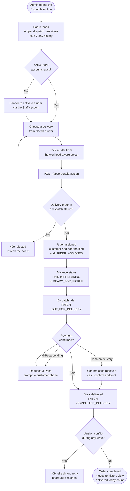

# A03 — Assign and dispatch a delivery

An admin (or pharmacist/counter staff) opens the Dispatch control room, a live board of every delivery order in the four dispatch statuses. They assign one or many orders to active riders, advance each order through preparation to OUT_FOR_DELIVERY, chase payment (M-Pesa prompt or cash confirmation), and close the loop by confirming delivery. Every action notifies the customer, notifies the rider, appends order status history and writes an audit row.

| Metadata | Value |
| --- | --- |
| Primary actor | Admin (PHARMACIST and STAFF have the same dispatch rights; RIDER sees a personal board instead) |
| Secondary actors | Rider (receives assignments, can self-serve transitions — journey R01), Customer (receives notifications) |
| Functional area | Fulfilment — dispatch board and rider assignment |
| Entry point | `/admin` → Dispatch section (`DispatchControlRoom` for non-rider roles) |
| Status | Implemented — verified against code |
| End condition | Order `COMPLETED_DELIVERY`, payment `SUCCESS`, assignment and transitions recorded in history and audit |
| Related journeys | A01 (workspace entry), A02 (order queue to payment), R01 (rider side of the same delivery), O02/O03 (customer placement and payment) |

## Journey map

## Journey steps

### Step 1 — Open the dispatch control room

- **User action:** The admin signs into the workspace (journey A01) and opens the Dispatch section.
- **Location:** `src/components/views/admin/sections/dispatch-control-room.tsx` (rendered for non-rider roles by `admin-view.tsx`); data from `GET /api/orders?scope=dispatch&limit=100`, `GET /api/orders?scope=dispatch-history&limit=100` and `GET /api/orders/riders`.
- **Destination:** The live board with summary tiles (needs a rider, ready to hand off, out for delivery, delivered today).
- **Purpose:** See every active delivery and its rider state in one place.
- **System behaviour:** All three calls run in parallel via `Promise.allSettled`; the dispatch scope requires `requireStaff(["ADMIN", "PHARMACIST", "STAFF"])` and returns DELIVERY orders in `DISPATCH_STATUSES` (PAID, PREPARING, READY_FOR_PICKUP, OUT_FOR_DELIVERY); the history scope returns COMPLETED_DELIVERY orders updated in the last 7 days; the riders call returns active RIDER staff accounts. The board silently reloads every 45 seconds while the tab is visible, flags deliveries older than two hours, and merges server-side search matches so an Orders → Dispatch handoff never loses an eligible order.
- **Outcome:** The board shows unassigned, at-pharmacy and on-road deliveries with customer, drop-off, fee, payment state and rider workload chips.
- **Next step:** Assign a rider to an unassigned delivery.
- **Alternative paths:** A RIDER signing in gets `DispatchSection` instead (journey R01); if the roster fails to load a warning suggests refreshing before assigning.

### Step 2 — Assign a rider

- **User action:** The admin picks a rider from the per-order select (each option shows that rider's active count) and clicks Assign rider — or selects up to 25 unassigned deliveries and bulk-assigns them.
- **Location:** `assign`/`batchAssign` in `dispatch-control-room.tsx`; API `POST /api/orders/[id]/assign` (`src/app/api/orders/[id]/assign/route.ts`).
- **Destination:** The order shows the rider name, an Assigned badge and a Call rider link.
- **Purpose:** Give the delivery a responsible rider before it leaves the pharmacy.
- **System behaviour:** The route requires ADMIN/STAFF/PHARMACIST, rejects non-DELIVERY orders (400) and orders outside `DISPATCH_STATUSES` (409), and validates the target is an active RIDER account (400 otherwise). The write is guarded by an optimistic `updateMany` on `version` and current status so a concurrent change returns 409. On success it appends a status-history note (assigned or reassigned), writes an audit `RIDER_ASSIGNED` row, notifies the customer in-app and by email, and notifies the rider through `notifyStaff` (`NEW_DELIVERY_ASSIGNED`, push and email). Bulk assign loops sequentially to avoid flooding notifications.
- **Outcome:** Rider name stored on the order (`riderId`, `riderName`); both parties informed; workload chips update.
- **Next step:** Advance the order through preparation.
- **Alternative paths:** Reassigning an order that is already OUT_FOR_DELIVERY opens a confirmation dialog warning to check with the current rider first; assigning the same rider again is a no-op.

### Step 3 — Advance preparation to ready-for-dispatch

- **User action:** The admin uses the per-card status action: Start preparing on PAID orders, then Mark ready for dispatch on PREPARING orders.
- **Location:** `changeStatus` in `dispatch-control-room.tsx`; API `PATCH /api/orders/[id]` (`src/app/api/orders/[id]/route.ts`).
- **Destination:** The order moves PAID → PREPARING → READY_FOR_PICKUP.
- **Purpose:** Track physical progress on the board so handoffs happen only when the parcel is packed.
- **System behaviour:** The PATCH route requires any staff session, validates the target status against `canTransitionOrder` (`src/lib/security/order-workflow.ts`), and writes inside a transaction with a version guard — a lost race returns 409 ORDER_CONFLICT. Every transition appends `OrderStatusHistory` with the actor, writes an audit row (`ORDER_STATUS_<status>`), and notifies the customer in-app/email; for delivery orders READY_FOR_PICKUP uses "Ready for dispatch" copy instead of pickup copy. The board refuses transitions that skip the workflow (for example PAID straight to READY_FOR_PICKUP).
- **Outcome:** The card's badge and action button reflect the new status; the Ready to hand off tile count changes.
- **Next step:** Dispatch the rider.
- **Alternative paths:** Riders can perform their own READY_FOR_PICKUP → OUT_FOR_DELIVERY and completion steps from their board (journey R01); conflicting updates by two staff resolve through the 409 path and a board refresh.

### Step 4 — Dispatch the rider and handle payment

- **User action:** With a rider assigned and the order READY_FOR_PICKUP, the admin clicks Dispatch rider (OUT_FOR_DELIVERY); for unpaid orders they then either Request M-Pesa (online payment) or Confirm cash received (cash on delivery).
- **Location:** `dispatch-control-room.tsx` action row; APIs `PATCH /api/orders/[id]`, `POST /api/orders/[id]/request-payment`, `POST /api/orders/[id]/cash-confirm`.
- **Destination:** The delivery is on the road and the payment path is in motion.
- **Purpose:** Get the parcel moving without ever losing sight of the money.
- **System behaviour:** `OUT_FOR_DELIVERY` is rejected with 409 unless the order is a delivery with a rider assigned. The cash-confirm route requires any staff member, only allows cash confirmation in `CASH_ALLOWED` statuses (including OUT_FOR_DELIVERY for riders on their own COD delivery), verifies no successful payment already exists, then inside a Serializable transaction creates a `Payment` (provider CASH, method CASH_ON_DELIVERY, status SUCCESS), awards loyalty points for signed-in customers, and appends history; audit `CASH_CONFIRMED`. The M-Pesa request sends an STK push to the customer phone (journey O03 completes it).
- **Outcome:** The card shows Payment received (or stays flagged as awaiting payment with a wallet counter on the board).
- **Next step:** Mark the delivery complete once payment is confirmed.
- **Alternative paths:** If the customer cannot pay, the order remains OUT_FOR_DELIVERY and appears in the "awaiting payment" filter; cancellation is handled from the Orders section, not the dispatch board.

### Step 5 — Confirm delivery and close the loop

- **User action:** After the rider hands over the parcel, the admin confirms the completion dialog: "Confirm delivered".
- **Location:** `confirmAction` in `dispatch-control-room.tsx`; API `PATCH /api/orders/[id]` with `status: COMPLETED_DELIVERY`.
- **Destination:** The order leaves the active board and appears in the Completed view (last 7 days) and the Delivered today tile.
- **Purpose:** Record the final state that unlocks reporting, loyalty and reorder history.
- **System behaviour:** The PATCH guard rejects COMPLETED_DELIVERY for pickup orders and for orders without a successful payment; the Mark delivered button stays disabled until payment is confirmed. The transition writes status history and audit, and notifies the customer that delivery is complete. The board moves the order to the history list on its next reload.
- **Outcome:** The delivery lifecycle is closed end-to-end for this order.
- **Next step:** Pick the next delivery; the completed history view remains searchable for reference.
- **Alternative paths:** The rider can complete their own delivery from their board (R01); a reassign mid-delivery returns to Step 2 with the confirmation dialog.

## Decision points

| Decision | Branches | Enforced by/where |
| --- | --- | --- |
| Board scope | Non-rider staff → control room; RIDER → personal board | `renderSection` in `admin-view.tsx` |
| Assignment eligibility | DELIVERY + dispatch status → assign; otherwise 400/409 | `POST /api/orders/[id]/assign` |
| Rider valid | Active RIDER account → assigned; anything else → 400 | rider check in `assign/route.ts`; roster from `GET /api/orders/riders` |
| Status transition | Workflow order enforced (PAID→PREPARING→READY_FOR_PICKUP→OUT_FOR_DELIVERY→COMPLETED_DELIVERY) | `canTransitionOrder` in `src/lib/security/order-workflow.ts` |
| Dispatch guard | OUT_FOR_DELIVERY requires rider + DELIVERY fulfillment | PATCH guard in `src/app/api/orders/[id]/route.ts` |
| Payment state | Paid → allow completion; COD → cash-confirm; online pending → M-Pesa prompt | Payment checks in PATCH and `cash-confirm/route.ts` |
| Reassignment | OUT_FOR_DELIVERY → confirmation dialog before reassign | `assign` in `dispatch-control-room.tsx` |
| Concurrent edits | Version/status mismatch → 409, reload | `updateMany` version guards in assign and PATCH routes |

## Error and recovery paths

- **Roster empty:** the board shows a dashed hint to activate a rider in Staff (A15); assignment is impossible until an active RIDER exists.
- **Assignment conflict (409):** another staff member moved the order first — the board auto-reloads on error and the admin retries against fresh data.
- **Invalid reassignment:** reassigning an on-road delivery requires the confirmation dialog; the server still accepts the write because the order remains in a dispatch status.
- **Status rejected (409):** skipping a workflow step or dispatching without a rider is refused with a specific message; follow the suggested order of operations.
- **Cash confirmed twice (409):** `cash-confirm` detects an existing successful payment or a concurrent confirmation and refuses; refresh to see the recorded payment.
- **Payment never arrives:** the order stays on the board flagged "awaiting payment"; use Call/WhatsApp/Map links on the card to reach the customer before deciding on cancellation from Orders.
- **Notification delivery failures:** customer/rider notifications are queued through the notification pipeline (journey SYS-10); the order state itself is already committed, so no rework is needed.
- **Board staleness:** the 45-second auto-reload plus the manual Refresh button recover from missed updates; the "older than 2 hours" flag highlights delayed deliveries.

## Traceability

| Concern | Implementation reference |
| --- | --- |
| Control room UI | `src/components/views/admin/sections/dispatch-control-room.tsx` |
| Rider board (R01 side) | `src/components/views/admin/sections/dispatch-section.tsx` |
| Board data | `GET /api/orders` scopes `dispatch` and `dispatch-history` in `src/app/api/orders/route.ts` |
| Rider roster | `GET /api/orders/riders` in `src/app/api/orders/riders/route.ts` |
| Assignment | `POST /api/orders/[id]/assign` (version guard, notifications, audit) |
| Status transitions | `PATCH /api/orders/[id]` in `src/app/api/orders/[id]/route.ts` |
| Transition rules | `canTransitionOrder` in `src/lib/security/order-workflow.ts` |
| Cash confirmation | `POST /api/orders/[id]/cash-confirm` |
| M-Pesa prompt | `POST /api/orders/[id]/request-payment` (STK push) |
| Dispatch statuses | `DISPATCH_STATUSES`, `RIDER_ALLOWED_STATUSES` in `src/lib/constants.ts` |
| Notifications | `notifyCustomer`, `notifyStaff`, `addStatusEvent`, `audit` in `src/lib/notify.ts` |
| API client bindings | `ordersApi.dispatchBoard/dispatchHistory/dispatchRiders/assignRider/updateStatus/markPaidCash` in `src/lib/api-client.ts` |
| Order model | `Order`, `OrderStatusHistory`, `Payment` models in `prisma/schema.prisma` |

## Related journeys and documents

- **A01** — staff sign-in that precedes every dispatch session
- **A02** — the order queue where availability, payment and preparation start
- **R01** — the rider's own board for the same delivery (self-serve dispatch and completion)
- **O02** — the customer delivery order that created this board entry
- **O03** — the M-Pesa flow the "Request M-Pesa" action triggers
- Docs: [orders and fulfillment](../../features/orders-and-fulfillment.md) · [order lifecycle](../../workflows/order-lifecycle.md) · [pharmacy operations](../../product/pharmacy-operations.md) · [journey index](../README.md)
