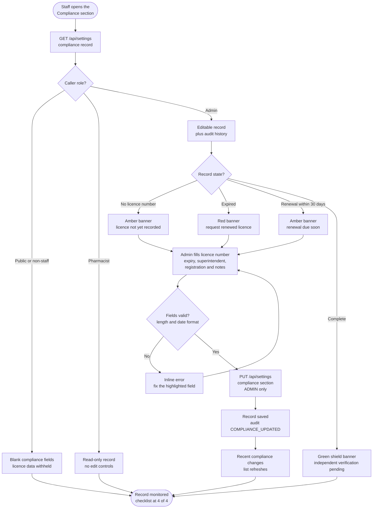

# A17 — Compliance information

The Compliance section is the pharmacy's internal register for the PPB premises licence and the superintendent pharmacist. It is deliberately humble: the record is a draft that staff maintain, not a verification. Admins can edit and save the licence number, expiry date, superintendent name and PPB registration plus internal notes; pharmacists see the same record read-only. Every save writes a `COMPLIANCE_UPDATED` audit row, the section surfaces recent compliance changes from the audit log, and the public API never exposes the stored values. Expiry is tracked live: past expiry turns the banner red, renewal within 30 days turns it amber.

| Metadata | Value |
| --- | --- |
| Primary actor | Admin (edits and saves; the only role that sees the compliance audit history) |
| Secondary actors | Pharmacist (view-only access to the record) |
| Functional area | Compliance — licence record, access boundaries, retention |
| Entry point | `/admin` → Compliance section |
| Status | Implemented — verified against code |
| End condition | Record saved or read; status banner reflects completeness/expiry; change visible in the compliance audit history |
| Related journeys | A01 (workspace), A15 (roles that gate access), A16 (audit activity), X01 (prescription privacy), SYS-06 (retention job) |

Recording note: scene A17 is recorded as "Admin with Pharmacist view only" — capture the admin experience first, then show the pharmacist's read-only view of the same record.

## Journey map

## Journey steps

### Step 1 — Open the compliance workspace

- **User action:** The staff member opens the Compliance section from the Management navigation group.
- **Location:** `src/components/views/admin/sections/compliance-section.tsx`; record from `GET /api/settings` (`src/app/api/settings/route.ts`).
- **Destination:** The compliance workspace — status banner, record card, checklist, saved snapshot and recent changes.
- **Purpose:** Check or maintain the licence position before it becomes a regulatory problem.
- **System behaviour:** The settings route returns the compliance object only to ADMIN or PHARMACIST sessions; everyone else (including public callers) receives blank fields, so unverified licence details never reach public clients. The section loads the record and, for admins, additionally fetches the audit log for the change history. The header banner always carries a "Not independently verified" badge and the note that saving is not PPB verification or approval to publish.
- **Outcome:** The current record and its status are on screen.
- **Next step:** Read the status banner and checklist.
- **Alternative paths:** A failed load shows a retryable error; pharmacists proceed read-only (Step 4).

### Step 2 — Assess record status

- **User action:** The admin reads the banner title and the four-field checklist (licence number, expiry date, superintendent name, PPB registration) with its progress bar.
- **Location:** Banner and "Record checklist" card in `compliance-section.tsx`.
- **Destination:** A clear verdict: not recorded / expired / needs attention / complete-but-unverified.
- **Purpose:** Make the licence position impossible to mistake.
- **System behaviour:** The section computes days until expiry: negative → expired (red banner, "Expired — request a renewed licence"), 0–30 → renewal soon (amber, "Renewal due in N days"), otherwise on track; a complete record shows the green shield with "Record complete — independent verification pending". The checklist reflects the current editor values including unsaved edits, so the admin sees what a save would achieve. The saved-snapshot card shows the persisted values for comparison.
- **Outcome:** The admin knows exactly what to fix.
- **Next step:** Edit the record (admin) or monitor (pharmacist).
- **Alternative paths:** The section explicitly warns not to record the outdated 2024 licence as current — context notes in the fields themselves.

### Step 3 — Edit and save the record (ADMIN)

- **User action:** The admin enters the licence number, expiry date, superintendent name, PPB registration and internal follow-up notes, then clicks Save internal record (or Discard to revert).
- **Location:** `save` in `compliance-section.tsx`; API `PUT /api/settings` with the `compliance` section (`src/app/api/settings/route.ts`).
- **Destination:** The banner and snapshot update; the change appears in the recent-changes list.
- **Purpose:** Keep the internal register current — nothing is published.
- **System behaviour:** The PUT requires `requireStaff(["ADMIN"])`, restricts keys to the five compliance fields, enforces text lengths (160 per field, 1000 for notes), validates the expiry as a real `YYYY-MM-DD` calendar date (400 otherwise), and persists through `saveSettingsSection("compliance", ...)` which merges into the JSON `Setting` row. An audit row `COMPLIANCE_UPDATED` is written with the note "Internal compliance record updated (not PPB-verified)". The client blocks saving an invalid date before the request and disables Refresh while unsaved changes exist.
- **Outcome:** The record is durable, internal and audited.
- **Next step:** Review the change history.
- **Alternative paths:** Discard (with confirmation) reverts the form to the last saved state; a failed save shows the server error and keeps the edits.

### Step 4 — Pharmacist view-only access

- **User action:** A pharmacist opens the same section to check the licence and superintendent details.
- **Location:** Same component — `isAdmin` false path in `compliance-section.tsx`.
- **Destination:** The record, checklist and snapshot without any editable fields.
- **Purpose:** Let clinical staff verify the superintendent record without being able to alter it.
- **System behaviour:** All inputs are disabled and the card is marked "Read only" with a lock icon; the footer states an administrator must maintain or correct the details; the checklist renders without edit links; and the audit history card states that audit history is restricted to administrators (the audit fetch itself is skipped for non-admins).
- **Outcome:** The pharmacist can consult the register but not change it.
- **Next step:** Raise corrections with an admin (journey A15).
- **Alternative paths:** If the pharmacist believes the record is wrong, the section's snapshot card is the shared reference for the conversation.

### Step 5 — Review the change history and retention posture

- **User action:** The admin scans "Recent compliance changes" — the last six audit entries matching compliance updates.
- **Location:** `complianceAudit` filter in `compliance-section.tsx`; data from `GET /api/admin/audit`; retention rules in `docs/security/retention-and-deletion.md`.
- **Destination:** Who changed what, when — actor, action, details, timestamp.
- **Purpose:** Evidence that the register is maintained responsibly.
- **System behaviour:** The section filters the audit log to `COMPLIANCE_UPDATED` rows, entries against the compliance setting, or licence-related entities, showing the six most recent. Underlying retention posture: `AuditLog` (and `PrescriptionAccessLog`, which records every view/download of prescription documents — journey X01) have no automatic deletion by design, so the compliance trail and access logs persist until a governance decision sets a ceiling; prescription files themselves follow the env-driven retention window (journey SYS-06).
- **Outcome:** The admin can cite the history and knows the logs are not auto-expiring.
- **Next step:** Schedule the renewal follow-up recorded in the notes.
- **Alternative paths:** If the audit feed fails, the card shows a refresh hint rather than a silent gap.

## Decision points

| Decision | Branches | Enforced by/where |
| --- | --- | --- |
| Who sees the record | ADMIN/PHARMACIST staff → real values; all others → blank fields | `canViewRecord` in `GET /api/settings` |
| Who may edit | ADMIN → editable + save; PHARMACIST → read-only | `requireStaff(["ADMIN"])` on PUT; disabled inputs in the section |
| Expiry status | Expired / due within 30 days / on track / not recorded | `daysUntil` logic and banner in `compliance-section.tsx` |
| Field validity | Text length caps and real calendar date → save; else 400 | PUT validation in `src/app/api/settings/route.ts` |
| Unsaved changes | Save or Discard before refresh; discard needs confirmation | `dirty` state and AlertDialog in the section |
| Audit visibility | ADMIN → compliance history; others → restricted note | audit fetch gated on `isAdmin` in `compliance-section.tsx` |
| Publication | Saving never publishes a licence claim | banner copy; public GET returns blank compliance |

## Error and recovery paths

- **Invalid expiry date (400):** the client blocks obviously invalid dates and the server rejects non-calendar dates with a message — re-enter the date printed on the licence.
- **Field too long (400):** notes are capped at 1000 characters and other fields at 160 (live counters help); shorten and retry.
- **Save failure:** the error toast carries the server message and the form keeps unsaved edits — retry or discard.
- **Audit history fails to load:** the card shows "Could not load audit history. Refresh to retry." — the record itself remains fully usable.
- **Settings load failure:** a full-section error with retry; no partial record is displayed.
- **Accidental overwrite:** the previous values remain in the audit history (`COMPLIANCE_UPDATED` rows with actor and timestamp) — restore by re-entering them; there is no versioned undo.
- **Wrong role editing attempt:** pharmacists physically cannot edit (inputs disabled) and a forged request would fail the ADMIN guard with 403.

## Traceability

| Concern | Implementation reference |
| --- | --- |
| Compliance section UI | `src/components/views/admin/sections/compliance-section.tsx` |
| Settings read (role-scoped compliance) | `GET /api/settings` in `src/app/api/settings/route.ts` |
| Compliance save | `PUT /api/settings` compliance block (ADMIN, length/date validation) |
| Settings persistence | `saveSettingsSection`/`getSettings` in `src/lib/settings.ts`; `Setting` model in `prisma/schema.prisma` |
| Compliance defaults | `DEFAULT_COMPLIANCE` in `src/lib/settings.ts` |
| Audit of changes | `COMPLIANCE_UPDATED` via `audit()` in the settings route |
| Compliance history filter | `complianceAudit` in `compliance-section.tsx` from `GET /api/admin/audit` |
| Audit log model and retention | `AuditLog` model in `prisma/schema.prisma`; `docs/security/retention-and-deletion.md` |
| Prescription access logs | `PrescriptionAccessLog` model in `prisma/schema.prisma` (journey X01) |
| Role guard | `requireStaff` in `src/lib/session.ts`; NAV roles ADMIN/PHARMACIST in `admin-view.tsx` |
| API client bindings | `settingsApi.get`, `settingsApi.update`, `adminApi.audit` in `src/lib/api-client.ts` |

## Related journeys and documents

- **A01** — staff sign-in and the workspace that hosts this section
- **A15** — the role management that decides who can edit vs view
- **A16** — the wider audit activity story this section filters
- **X01** — prescription uploads whose document access is separately logged
- **SYS-06** — the retention job that eventually expires prescription files
- Docs: [retention and deletion](../../security/retention-and-deletion.md) · [privacy and health data](../../security/privacy-and-health-data.md) · [user roles and permissions](../../product/user-roles-and-permissions.md) · [journey index](../README.md)
