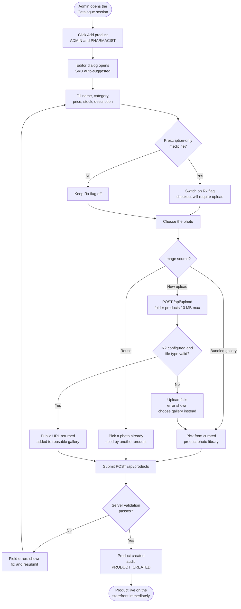

# A08 — Create a product and choose images

An admin opens the Catalogue section and clicks Add product. The editor dialog collects identity (name, SKU, category, brand, pack size), commercial fields (price, optional compare-at price), stock (quantity and status), compliance copy (description, usage, warnings) and the prescription-only switch. The image block offers three sources: the curated photo library shipped with the app, photos already uploaded for other products, or a brand-new upload that goes to public object storage (R2). Saving posts to `POST /api/products`, which validates every field, sanitises the image reference and audit-logs the creation.

| Metadata | Value |
| --- | --- |
| Primary actor | Admin (PHARMACIST may also create products; only ADMIN sees the delete action) |
| Secondary actors | Customers (see the product immediately), Staff (later edits — journey A07) |
| Functional area | Catalogue — product creation and imagery |
| Entry point | `/admin` → Catalogue → Add product (`ProductEditorDialog` mode create) |
| Status | Environment-dependent (requires live provider) — verified against code |
| End condition | Product created and live; image is an owned site image or an R2 public URL; `PRODUCT_CREATED` audit row written |
| Related journeys | A01 (workspace), A07 (edits and stock), A09 (CSV bulk import), P02/P03 (storefront discovery) |

Status note: gallery selection and URL entry work without external services; the upload path calls `uploadToR2`, which requires live R2 credentials (`R2_ACCOUNT_ID`, `R2_ACCESS_KEY_ID`, `R2_SECRET_ACCESS_KEY`, `R2_BUCKET_NAME`, `R2_PUBLIC_URL`) — without them uploads fail closed and the journey cannot be exercised end-to-end.

## Journey map

## Journey steps

### Step 1 — Open the product editor

- **User action:** The admin opens Catalogue and clicks Add product (the button is rendered for all roles that can reach the section; product deletion remains admin-only).
- **Location:** `src/components/views/admin/sections/catalogue-section.tsx` — `ProductEditorDialog` (mode create).
- **Destination:** The create dialog with identity, pricing, stock, imagery and compliance fields.
- **Purpose:** Capture everything the storefront and checkout need before the product goes live.
- **System behaviour:** The dialog auto-selects the first category and suggests an SKU (`SPH-<CAT>-<num>` from the category name, regenerable with the dice button). Client-side validation runs live: name at least 2 characters, category chosen, price greater than zero, compare-at price (if set) greater than price, stock a non-negative whole number.
- **Outcome:** A form the admin can complete in one pass, with errors surfaced per field.
- **Next step:** Set the commercial and compliance fields.
- **Alternative paths:** Staff without ADMIN still see the catalogue for stock edits (journey A07); bulk onboarding can use the CSV import dialog (journey A09) instead.

### Step 2 — Set pricing, stock and the prescription flag

- **User action:** The admin enters price (and optionally a compare-at price to show a discount), stock quantity and stock status, description, usage info and warnings, and decides whether the item is prescription-only.
- **Location:** Same dialog — price/compare/stock inputs, description textareas and the Prescription-only switch in `catalogue-section.tsx`.
- **Destination:** A complete commercial record.
- **Purpose:** The Rx flag is compliance-critical: it forces customers to attach an approved prescription before the order can proceed.
- **System behaviour:** Client helpers derive a suggested stock status from quantity (OUT_OF_STOCK at 0, LOW_STOCK at or below 10); the switch maps to `requiresPrescription`. On the storefront the flag drives the Rx filter (journey P02) and checkout prescription checks (journey X02).
- **Outcome:** Pricing, stock and compliance copy are ready to save.
- **Next step:** Choose the product photo.
- **Alternative paths:** Products can be created out-of-stock or with status DISCONTINUED to hide them from the storefront immediately; stock can be adjusted later from the table's steppers (A07).

### Step 3 — Choose the product image

- **User action:** The admin opens Browse gallery (curated library plus previously uploaded photos plus photos reused from other products), or uploads a new photo, or pastes an image path/URL.
- **Location:** `ProductImageGalleryDialog` and the upload input in `catalogue-section.tsx`; library from `src/lib/image-library.ts`; uploads via `storageApi.uploadFile` → `POST /api/upload` (`src/app/api/upload/route.ts`).
- **Destination:** The selected photo previews in the dialog and its reference sits in the form's image field.
- **Purpose:** Every product card shows a real photo; the gallery avoids duplicate uploads across medicines.
- **System behaviour:** The gallery merges three sources: `PRODUCT_IMAGE_LIBRARY` (bundled `/images/products/*.webp`), photos already used by loaded products, and this session's uploads. Uploads are restricted to image types, capped at 10 MB, validated by `validateFile`, and stored under `products/<ownerId>/<uuid>` with public access; the route only allows the `products` folder for ADMIN/PHARMACIST sessions. A successful upload returns the public URL and the photo is added to the reusable gallery for this and future products.
- **Outcome:** The form's image field holds a site-relative path or an owned public URL.
- **Next step:** Save the product.
- **Alternative paths:** If R2 is not configured the upload call fails and an error toast appears — pick a bundled gallery photo instead; the fallback image applies when the field is left empty.

### Step 4 — Save the product

- **User action:** The admin clicks Add product to submit the form.
- **Location:** `save` in `ProductEditorDialog`; API `POST /api/products` (`src/app/api/products/route.ts`) via `adminApi.upsertProduct`.
- **Destination:** The dialog closes and the new product appears at the top of the catalogue table.
- **Purpose:** Persist the record so the storefront can list it immediately.
- **System behaviour:** The route requires `requireStaff(["ADMIN", "PHARMACIST"])` and re-validates server-side: name 2–160 characters, price 0–10,000,000, non-negative integer stock values, category existence, SKU format `^[A-Z0-9._-]{3,64}$` with uniqueness (409 on clash; a random `SPH-` SKU is generated when omitted), compare-at price greater than price, boolean flags, and the image through `managedImage` — only `/images/...` site paths or URLs under the configured `R2_PUBLIC_URL` are accepted, otherwise 400. Stock status falls back to a server-derived value from quantity and threshold. The product is created and an audit row `PRODUCT_CREATED` records actor, product and price.
- **Outcome:** The saved product DTO returns; the table and overview counts refresh through the shared `refreshKey`.
- **Next step:** The product is live — verify it on the storefront (journeys P02/P03).
- **Alternative paths:** Field errors re-open with the server message; a duplicate SKU returns 409 and regenerating the SKU resolves it; the server rejects unowned image URLs with 400.

### Step 5 — Verify on the storefront

- **User action:** The admin (or a colleague) opens the storefront catalogue or the product page to confirm listing, price, stock badge and photo.
- **Location:** Public `GET /api/products` (non-admin scope filters `active` products) and the product view.
- **Destination:** The new product in search, categories and the Rx filter as appropriate.
- **Purpose:** Confirm the customer-facing reality matches the record.
- **System behaviour:** Public catalogue queries exclude inactive/discontinued items; ratings aggregates attach (published reviews only); the storefront reads the same image reference. Stock changes from orders feed back into the admin table and the overview's inventory signals.
- **Outcome:** The product is discoverable and orderable (or prescription-gated when the Rx flag is set).
- **Next step:** Maintain it through stock steppers and the editor (journey A07).
- **Alternative paths:** Mistakes are corrected by editing; admin-only deletion keeps past order line items intact (a dialog suggests discontinuing instead).

## Decision points

| Decision | Branches | Enforced by/where |
| --- | --- | --- |
| Who may create | ADMIN/PHARMACIST → create/edit; others read/stock only | `requireStaff(["ADMIN", "PHARMACIST"])` in `POST /api/products` |
| Image source | Gallery / reuse / new upload / manual URL | Image block in `catalogue-section.tsx`; `PRODUCT_IMAGE_LIBRARY` |
| Upload allowed | Valid image ≤ 10 MB and R2 configured → stored; else 400/413/500 | `POST /api/upload` + `validateFile` + `uploadToR2` |
| Image ownership | Site path or R2 public URL → accepted; other URLs → 400 | `managedImage` in `src/lib/security/service.ts` |
| SKU | Unique and well-formed → kept; clash → 409; missing → generated | SKU validation in `POST /api/products` |
| Rx flag | On → prescription required at checkout; off → OTC | `requiresPrescription` on the Product model; checkout guards |
| Stock status | Explicit choice or derived from quantity and threshold | `deriveStockStatus` in the products route; client `stockStatusForQty` |
| Visibility | Active → storefront; DISCONTINUED → hidden | `where: { active: true }` in public `GET /api/products` |

## Error and recovery paths

- **Upload unavailable (environment):** `uploadToR2` throws when R2 credentials are missing; the API returns a storage error and the toast surfaces it — select a bundled gallery photo instead; nothing is saved half-way because the product save is a separate call.
- **Invalid image reference (400):** pasted URLs outside `/images/` or the R2 public base are rejected by `managedImage`; choose from the gallery or upload first.
- **Duplicate SKU (409):** the server reports the clash; regenerate the SKU or edit it manually and resubmit.
- **Invalid pricing (400):** price of zero or a compare-at price not above the sale price is blocked client- and server-side; correct the highlighted field.
- **Stock validation (400):** fractional or negative quantities are rejected; use whole numbers and let the status derive.
- **Categories failed to load:** the editor warns that categories could not be loaded and asks to retry — creation is blocked until a category is available since categoryId is validated server-side.
- **Wrong Rx flag discovered later:** toggle it from the catalogue table or the editor (journey A07); existing orders keep their line-item `requiresPrescription` snapshot.
- **Accidental creation:** admins can delete (with a warning that order history keeps line-item records), or discontinue to hide while preserving history.

## Traceability

| Concern | Implementation reference |
| --- | --- |
| Catalogue section and table | `src/components/views/admin/sections/catalogue-section.tsx` |
| Product editor dialog and gallery | `ProductEditorDialog`, `ProductImageGalleryDialog` in `catalogue-section.tsx` |
| Curated image library | `src/lib/image-library.ts` (`PRODUCT_IMAGE_LIBRARY`) |
| Image fallback and sanitising | `src/lib/image.ts` (`FALLBACK_PRODUCT_IMAGE`, `sanitizeImageInput`, `productImageSrc`) |
| Create endpoint | `POST /api/products` in `src/app/api/products/route.ts` |
| Upload endpoint | `POST /api/upload` in `src/app/api/upload/route.ts` |
| Object storage | `uploadToR2` / `isR2Configured` in `src/lib/r2.ts` (public access, `R2_PUBLIC_URL`) |
| Image ownership guard | `managedImage` in `src/lib/security/service.ts` |
| File validation | `validateFile` in `src/lib/security/file.ts` |
| Stock statuses and labels | `STOCK_STATUSES`, `STOCK_LABELS` in `src/lib/constants.ts` |
| Product model | `Product` model in `prisma/schema.prisma` (price, stockQty, requiresPrescription, image) |
| Audit | `audit(... "PRODUCT_CREATED" ...)` in the products route; `audit()` in `src/lib/notify.ts` |
| API client bindings | `adminApi.upsertProduct`, `storageApi.uploadFile` in `src/lib/api-client.ts` |
| Public storefront query | `GET /api/products` (non-admin scope) in `src/app/api/products/route.ts` |

## Related journeys and documents

- **A01** — staff sign-in and the overview that surfaces inventory warnings
- **A07** — updating products and stock after creation
- **A09** — CSV bulk import as the alternative to single creation
- **P02 / P03** — how customers discover and view the product just created
- **X02** — the checkout behaviour the prescription-only flag triggers
- Docs: [storefront and catalogue](../../features/storefront-and-catalogue.md) · [inventory lifecycle](../../workflows/inventory-lifecycle.md) · [file storage security](../../security/file-storage-security.md) · [journey index](../README.md)
