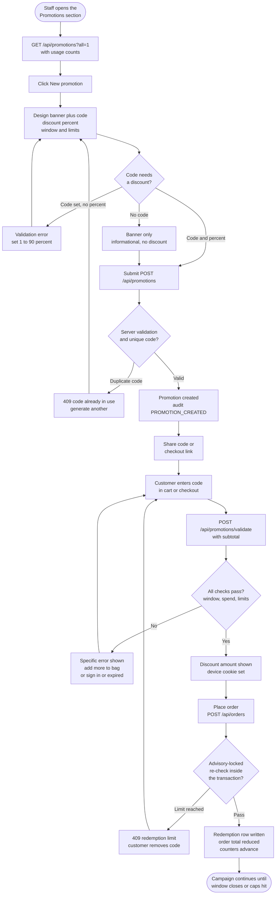

# A14 — Create and use a promotion

An admin or counter staff member opens Promotions and creates an offer: a banner (title, description, badge, colour) optionally carrying a checkout code with a 1–90% discount, a Kenya-local date window, a minimum spend and up to four independent usage limits (total, per customer, per network, per browser). Saving posts to `POST /api/promotions`. The customer then enters the code in cart/checkout, which calls `POST /api/promotions/validate` — the same checks re-run later inside the order-creation transaction under an advisory lock so concurrent checkouts cannot over-redeem. One promotion per order, discount on the subtotal only.

| Metadata | Value |
| --- | --- |
| Primary actor | Admin (STAFF has the same promotion rights; ADMIN also decides archival) |
| Secondary actors | Customers (redeem the code at checkout); the system (enforcement at placement) |
| Functional area | Marketing — promotions and redemption |
| Entry point | `/admin` → Promotions → New promotion |
| Status | Implemented — verified against code |
| End condition | Promotion created and audited; order placed with `discountAmount` and a `PromotionRedemption` row; counters updated |
| Related journeys | O01/O02 (checkout where codes apply), O03 (payment afterwards), C08 (loyalty interaction), A01 (workspace) |

## Journey map

## Journey steps

### Step 1 — Open the promotions workspace

- **User action:** The staff member opens the Promotions section from the Business navigation group.
- **Location:** `src/components/views/admin/sections/promotions-section.tsx`; data from `GET /api/promotions?all=1` (`src/app/api/promotions/route.ts`).
- **Destination:** The promotion catalogue with Live/Scheduled/Expired/Paused filters, search, and usage counters.
- **Purpose:** See the current campaign set and each code's redemption progress before adding another.
- **System behaviour:** The `all=1` scope requires `requireStaff(["ADMIN", "STAFF"])` and returns up to 500 promotions including inactive ones, each with its redemption count. Status chips (live/scheduled/expired/paused) are computed client-side from `active`, `startsAt` and `endsAt`. Public listing without the flag only returns active, public, in-window, non-exhausted offers.
- **Outcome:** A filtered view of every campaign and its usage.
- **Next step:** Create the promotion.
- **Alternative paths:** Existing promotions can be paused/enabled with the toggle, edited, shared (code copy or `checkout?promo=CODE` link) or removed — removal archives any promotion that already has redemptions.

### Step 2 — Design the promotion

- **User action:** The staff member clicks New promotion and fills the editor: title, description, badge, colour theme, optional code (with a Generate button), discount percentage, minimum spend, visibility (public banner or private code-only), start/end dates and the usage limits panel.
- **Location:** `PromotionEditorDialog` in `promotions-section.tsx`.
- **Destination:** A live preview card showing exactly what customers will see.
- **Purpose:** Encode the campaign rules once so every redemption is automatic and bounded.
- **System behaviour:** Client validation enforces title 3–160, description 5–2000, code charset `^[A-Z0-9_-]{3,32}$`, whole-number discount 1–90 (required when a code is set), private promotions require a code, limits as whole numbers 1–1,000,000, minimum spend up to 10,000,000, and end date on/after start. The generate button derives a prefix from the title and appends five random characters from an unambiguous alphabet. Defaults seed per-customer and per-browser limits to 2; date inputs are Kenya-local calendar days (stored as start `00:00:00+03:00`, end `23:59:59.999+03:00`).
- **Outcome:** A valid form ready to save.
- **Next step:** Save the promotion.
- **Alternative paths:** A banner without a code stays informational — it never discounts an order; staff can leave all limits blank for unlimited redemptions (not recommended).

### Step 3 — Save the promotion

- **User action:** The staff member submits the editor.
- **Location:** `save` in `PromotionEditorDialog`; API `POST /api/promotions`.
- **Destination:** The dialog closes and the new promotion heads the list.
- **Purpose:** Persist the campaign so checkout can enforce it.
- **System behaviour:** The route requires ADMIN/STAFF and re-validates through `src/lib/promotions.ts` helpers (`promotionCode`, `promotionDiscount`, `promotionDate`, `promotionLimitFields`): private without a code → 400, code without a discount → 400, reversed dates → 400, and a unique-constraint clash on the code → 409. On success the `Promotion` row is created and an audit row `PROMOTION_CREATED` is written. Editing later goes through `PATCH /api/promotions/[id]` (audit `PROMOTION_UPDATED`); deleting an unused promotion hard-deletes, while one with redemptions is archived (`active: false`, audit `PROMOTION_ARCHIVED`) so limit history survives.
- **Outcome:** The campaign exists; the list shows its status chip and redemption counter.
- **Next step:** Share the code with customers.
- **Alternative paths:** Duplicate codes are rejected with a clear message — regenerate and resubmit; pausing is instant via the toggle (audit-free status flips through PATCH).

### Step 4 — Customer applies the code at checkout

- **User action:** The customer enters the code in the cart/checkout promo field or opens the shared `checkout?promo=CODE` link.
- **Location:** `src/components/views/checkout-view.tsx` (`applyPromo`); API `POST /api/promotions/validate` (`src/app/api/promotions/validate/route.ts`).
- **Destination:** The discount line appears with the amount saved.
- **Purpose:** Prove the code is valid for this basket before it affects the total.
- **System behaviour:** The validate endpoint is public but rate-limited (40/minute) and checks, in order: code exists (404), active (409), has a discount percentage (409), started (409), not expired (410), minimum spend met (400 with the shortfall), total `maxUses` not exhausted (409), per-customer limit requires sign-in (401 for guests) and is not exceeded (409), per-network limit fails closed when the HMAC secret is missing (503) and is enforced by hashed IP (409), and per-browser limit via the `sphere_promo_device` cookie hash (409). On success it returns the promotion and the computed `discountAmount`, and sets the device cookie for future browser-limit checks. The checkout withholds the discount unless the validation matches the current subtotal, user and cart code; infrastructure failures return 503 with a reference ID instead of blaming the customer.
- **Outcome:** The customer sees the verified discount; the staff member sees the usage counter after redemption.
- **Next step:** The customer places the order.
- **Alternative paths:** Errors are specific and actionable (add more to the bag, sign in, expired); a code that fails permanently is forgotten client-side so it cannot silently reapply.

### Step 5 — Redemption is enforced at order placement

- **User action:** None by staff — this step records the server-side enforcement that protects the campaign.
- **Location:** `POST /api/orders` (`src/app/api/orders/route.ts`) transaction block; `src/lib/promotions.ts` for identity hashing.
- **Destination:** The order is created with the discount and a `PromotionRedemption` row.
- **Purpose:** Make over-redemption impossible even under concurrency.
- **System behaviour:** Before the transaction, guest + per-user-limited promotion → 401, per-IP-limited without an IP hash → 503, per-browser-limited without a validated browser hash → 409. Inside the Serializable transaction the route takes a Postgres advisory lock on the promotion id (`pg_advisory_xact_lock(hashtext(...))`), re-reads the promotion and re-checks activity, window, minimum spend and every limit against live redemption counts, then decrements stock, creates the order (`discountAmount` capped at the subtotal; delivery fee never discounted; discount applied before loyalty redemption) and writes the `PromotionRedemption` (unique `orderId` — exactly one promotion per order) carrying `userId`, `ipHash`, `browserHash`. Distinct errors (`PROMOTION_LIMIT`, `PROMOTION_CUSTOMER_LIMIT`, `PROMOTION_NETWORK_LIMIT`, `PROMOTION_BROWSER_LIMIT`, `PROMOTION_UNAVAILABLE`) each map to a specific 409 message.
- **Outcome:** The order total reflects the campaign; counters advance atomically.
- **Next step:** Payment proceeds (journeys O03/O04); the admin monitors usage on the promotions list.
- **Alternative paths:** If the campaign caps out between validation and placement, the customer gets a clear 409 and can remove the code and reorder; staff can raise `maxUses` via PATCH to extend a campaign.

## Decision points

| Decision | Branches | Enforced by/where |
| --- | --- | --- |
| Who may manage | ADMIN/STAFF → CRUD; others → section hidden | `requireStaff(["ADMIN", "STAFF"])` in `/api/promotions` routes; NAV roles |
| Banner vs code and visibility | Code → checkout discount, banner only → informational; public → storefront offers, private → code only | `code`/`discountPct` and `isPublic` checks in POST and validate |
| Window | Starts/ends parsed as Kenya-local days; outside window → 409/410 | `promotionDate` in `src/lib/promotions.ts`; validate checks |
| Minimum spend | Subtotal below minimum → 400 with shortfall | `minimumSpend` checks in validate and order placement |
| Usage limits | Total/per-customer/per-network/per-browser each 1–1,000,000 or unlimited | `promotionLimitFields`; count checks in validate + locked transaction |
| Redemption identity | Signed-in userId, HMAC ipHash (fails closed), device-cookie browserHash | `promotionIdentity` in `src/lib/promotions.ts` |
| Stacking | One promotion per order; discount before loyalty | `PromotionRedemption.orderId @unique`; total computation in POST /api/orders |
| Delete with history | Zero redemptions → hard delete; any → archive paused | DELETE handler in `src/app/api/promotions/[id]/route.ts` |

## Error and recovery paths

- **Duplicate code (409):** the editor surfaces the server message on the code field — regenerate the code and save again.
- **Validation errors (400):** field-level messages (title length, discount range, reversed dates, limit ranges) block saving; correct the highlighted inputs.
- **Customer minimum spend not met (400):** the message states the exact shortfall; the customer adds items or staff lower `minimumSpend` via edit.
- **Guests and per-customer limits (401):** the customer must sign in to redeem — by design, so the limit is meaningful; staff should warn customers when sharing such codes.
- **Per-network offers without a secret (503):** IP-limited promotions fail closed when the hash secret is absent; configure `TOKEN_HASH_SECRET`/`SESSION_SECRET` (≥32 chars) to enable them.
- **Cap reached mid-checkout (409):** the placement-time re-check refuses the order with a specific message; the customer removes the code and reorders — no stock or points were deducted on the failed attempt.
- **Infrastructure failures at validation (503):** the error carries a reference ID and never claims the code is invalid; retrying usually resolves it.
- **Accidental deletion attempt:** promotions with redemptions are archived instead of deleted, preserving the audit and limit history; re-enable with the toggle if needed.

## Traceability

| Concern | Implementation reference |
| --- | --- |
| Promotions section UI | `src/components/views/admin/sections/promotions-section.tsx` |
| List (admin scope) | `GET /api/promotions?all=1` in `src/app/api/promotions/route.ts` |
| Create mutation | `POST /api/promotions` (validation helpers, audit `PROMOTION_CREATED`) |
| Edit and delete | `PATCH`/`DELETE /api/promotions/[id]` in `src/app/api/promotions/[id]/route.ts` |
| Validation endpoint | `POST /api/promotions/validate` in `src/app/api/promotions/validate/route.ts` |
| Code/date/discount/limit parsing | `promotionCode`, `promotionDate`, `promotionDiscount`, `promotionLimitFields` in `src/lib/promotions.ts` |
| Redemption identity and device cookie | `promotionIdentity`, `withPromoDeviceCookie` in `src/lib/promotions.ts` |
| Placement-time enforcement | Advisory-lock transaction block in `POST /api/orders` |
| Checkout apply flow | `applyPromo` in `src/components/views/checkout-view.tsx` |
| Models | `Promotion`, `PromotionRedemption` in `prisma/schema.prisma` |
| Audit trail | `PROMOTION_CREATED/UPDATED/ARCHIVED/DELETED` rows via `audit()` in `src/lib/notify.ts` |
| API client bindings | `promotionsApi.list/validate/create/update/remove` in `src/lib/api-client.ts` |
| Feature reference | `docs/features/loyalty-and-promotions.md` |

## Related journeys and documents

- **O01 / O02** — the checkout flows where the code is applied
- **O03** — M-Pesa payment after the discounted total
- **C08** — Sphere Points redemption, which stacks after the promotion discount
- **A01** — staff sign-in preceding campaign work
- **A15** — the STAFF role that shares promotion rights
- Docs: [loyalty and promotions](../../features/loyalty-and-promotions.md) · [order lifecycle](../../workflows/order-lifecycle.md) · [payments and refunds](../../features/payments-and-refunds.md) · [journey index](../README.md)
