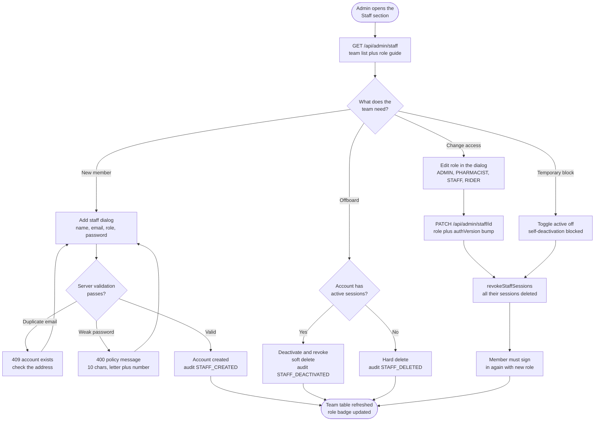

# A15 — Manage staff accounts and roles

The Staff section is admin-only: it lists every team member with role badges and an active toggle, explains what each role can access, and provides add/edit dialogs with a password generator. The backend (`GET/POST /api/admin/staff`, `PATCH/DELETE /api/admin/staff/[id]`) enforces the ADMIN guard, validates emails, roles and passwords, and — critically — on any role, active or password change it bumps `authVersion` and calls `revokeStaffSessions`, killing that member's live sessions instantly so access changes take effect immediately rather than at next sign-in.

| Metadata | Value |
| --- | --- |
| Primary actor | Admin (the only role that can reach the section or its endpoints) |
| Secondary actors | Pharmacists, counter staff and riders whose accounts are managed |
| Functional area | Management — staff accounts, roles and access |
| Entry point | `/admin` → Staff section |
| Status | Implemented — verified against code |
| End condition | Staff record created/updated/deactivated; sessions revoked on security changes; `STAFF_CREATED/UPDATED/DEACTIVATED/DELETED` audit rows written |
| Related journeys | A01 (staff sign-in), A03 (rider accounts on the dispatch board), T01/T02 (role boundaries), A17 (compliance visibility) |

## Journey map

## Journey steps

### Step 1 — Review the team and role guide

- **User action:** The admin opens the Staff section from the Management navigation group.
- **Location:** `src/components/views/admin/sections/staff-section.tsx`; data from `GET /api/admin/staff` (`src/app/api/admin/staff/route.ts`).
- **Destination:** The team table (member, contact, role, title, joined date, active switch) plus the "What each role can access" reference cards.
- **Purpose:** Decide who needs onboarding, a role change or offboarding, with the role baseline in view.
- **System behaviour:** The route requires `requireStaff(["ADMIN"])` and returns every `StaffUser` (oldest first) as DTOs. The role cards summarise: ADMIN — full access; PHARMACIST — overview, orders, prescription review, catalogue; STAFF — overview, orders, catalogue, promotions; RIDER — delivery-focused queues. The current admin's own row is marked "(you)" and its deactivate/delete controls are disabled.
- **Outcome:** A complete picture of accounts and their access.
- **Next step:** Add, edit or deactivate an account.
- **Alternative paths:** A load failure shows an error card with retry; non-admin roles never see this section in navigation (and would receive 403 from the API).

### Step 2 — Add a staff member

- **User action:** The admin clicks Add staff and completes the dialog: full name, email, optional phone and job title, role, and an initial password (or Generate).
- **Location:** `StaffEditorDialog` (mode create) in `staff-section.tsx`; API `POST /api/admin/staff`.
- **Destination:** The new member appears in the table with their role badge.
- **Purpose:** Give the new colleague credentials scoped to the right role from day one.
- **System behaviour:** The route requires ADMIN, validates name (≥2 characters), email format, role against `ROLES`, and the password through `validatePassword` — at least 10 characters including a letter and a number (the dialog's own hint mentions 6, but the server enforces the stricter policy). A duplicate email returns 409. The password is hashed with scrypt before storage. An audit row `STAFF_CREATED` records name and role. The client reminds the admin to share the password securely.
- **Outcome:** The account exists and can sign in at the staff tab (journey A01).
- **Next step:** Tell the member their credentials (out of band).
- **Alternative paths:** Generate produces a 10-character password from an unambiguous alphabet; validation failures show inline or server messages and keep the dialog open.

### Step 3 — Change a role or reset a password

- **User action:** The admin edits a member, changes the role select (ADMIN, PHARMACIST, STAFF, RIDER) and saves; optionally sets a new password in the same dialog.
- **Location:** `StaffEditorDialog` (mode edit); API `PATCH /api/admin/staff/[id]` (`src/app/api/admin/staff/[id]/route.ts`).
- **Destination:** The row shows the new role badge; the member's live sessions end.
- **Purpose:** Reflect organisational changes immediately and securely.
- **System behaviour:** The PATCH requires ADMIN and applies only provided fields: name, email (uniqueness-checked, 409 on clash), phone, title, role (validated against `ROLES`), active and password (policy-validated, scrypt-hashed). Any role change, active change or password set increments `authVersion` and then calls `revokeStaffSessions(id)`, deleting all `Session` rows for that member. An audit row `STAFF_UPDATED` records the change. Self-deactivation is refused (400) both client- and server-side.
- **Outcome:** The member must sign in again; their new session carries the new role (and the workspace navigation rebuilds accordingly).
- **Next step:** The member re-authenticates (journey A01) and sees their new scope.
- **Alternative paths:** Even without the explicit revocation, sessions store `authVersion` at creation and `getSession` rejects stale versions — revocation is belt and braces so changes apply within one request.

### Step 4 — Deactivate or remove an account

- **User action:** The admin flips the active switch (temporary block) or opens Delete and confirms removal.
- **Location:** `setActive` and the delete dialog in `staff-section.tsx`; APIs `PATCH /api/admin/staff/[id]` and `DELETE /api/admin/staff/[id]`.
- **Destination:** The row greys out (deactivated) or disappears (deleted).
- **Purpose:** Offboard cleanly while preserving audit history where it matters.
- **System behaviour:** Deactivation sets `active: false`, bumps `authVersion` and revokes sessions; the login route then refuses the account with 403. Delete refuses self-removal (400); if any sessions exist it performs a soft delete — deactivate plus session deletion, audit `STAFF_DEACTIVATED` — otherwise a hard delete with audit `STAFF_DELETED`. The dialog recommends deactivation as the safer choice because audit history and records stay intact.
- **Outcome:** The member loses access immediately in all cases.
- **Next step:** Continue managing the team; rider availability updates on the dispatch board (journey A03) on its next reload.
- **Alternative paths:** Reactivating an account restores sign-in with the same role and password; a permanently deleted account cannot be restored — recreate it instead.

### Step 5 — Changes take effect across the workspace

- **User action:** None by the admin — this step records how the rest of the system reacts.
- **Location:** `getSession` in `src/lib/session.ts`; consumers such as `admin-view.tsx`, `GET /api/orders/riders` and the staff login route.
- **Destination:** The member's next request is either rejected (revoked) or scoped to the new role.
- **Purpose:** Guarantee that access decisions are always evaluated against current account state.
- **System behaviour:** Every authenticated request resolves the session cookie to a `Session` row and rejects staff sessions when the account is inactive, the stored `authVersion` mismatches, or the session is older than 12 idle hours. The rider roster for dispatch (`/api/orders/riders`) filters `role: RIDER, active: true`, so deactivating a rider removes them from assignment immediately.
- **Outcome:** Role and status changes propagate within a single request cycle.
- **Next step:** None — management loop complete.
- **Alternative paths:** If a revoked member has the workspace open, their next data call fails the guard and the shell returns them to the staff gate.

## Decision points

| Decision | Branches | Enforced by/where |
| --- | --- | --- |
| Section access | ADMIN → section + endpoints; all others → hidden/403 | `requireStaff(["ADMIN"])` in staff routes; NAV roles in `admin-view.tsx` |
| Role validity | Must be one of ADMIN, PHARMACIST, STAFF, RIDER | `ROLES` check in POST/PATCH staff routes |
| Password policy | ≥10 characters with letter and number → accepted; else 400 | `validatePassword` in `src/lib/hash.ts` |
| Email uniqueness | New/changed email clashes → 409 | unique lookup in POST and PATCH |
| Security-relevant change | Role/active/password → `authVersion` bump + `revokeStaffSessions` | PATCH handler; `revokeStaffSessions` in `src/lib/session.ts` |
| Self-protection | Cannot deactivate or delete own account (400) | checks in PATCH/DELETE and disabled UI controls |
| Delete vs deactivate | Sessions exist → soft delete (deactivate + revoke); none → hard delete | DELETE handler in `src/app/api/admin/staff/[id]/route.ts` |
| Session validity | Inactive, stale authVersion or 12 h idle → session rejected | `getSession` staff-invalid checks in `src/lib/session.ts` |

## Error and recovery paths

- **Duplicate email (409):** an account with that email already exists — search the table and edit that account instead of creating a second one.
- **Password policy failure (400):** the server requires 10+ characters with a letter and a number even though the dialog hint says 6 — use the Generate button to avoid the mismatch; retry with a compliant password.
- **Invalid role (400):** only the four `ROLES` values are accepted; re-select from the dropdown.
- **Self-deactivation/self-deletion blocked (400):** the UI disables the controls and the server double-checks — ask another admin to make the change.
- **Member "still signed in":** revoked sessions die on their next request; if a page appears cached, a refresh returns them to the gate. No further action is needed.
- **Wrong role granted:** re-run the edit; the second change revokes sessions again and the member re-authenticates with the corrected scope.
- **Deleted by mistake:** hard-deleted accounts are unrecoverable — recreate the account; audit rows retain the actor names of past actions either way.

## Traceability

| Concern | Implementation reference |
| --- | --- |
| Staff section UI | `src/components/views/admin/sections/staff-section.tsx` |
| Team list and creation | `GET`/`POST /api/admin/staff` in `src/app/api/admin/staff/route.ts` |
| Update, deactivate, delete | `PATCH`/`DELETE /api/admin/staff/[id]` in `src/app/api/admin/staff/[id]/route.ts` |
| Session revocation | `revokeStaffSessions` in `src/lib/session.ts` |
| Session validity and idle timeout | `getSession` (`authVersion`, `active`, `STAFF_IDLE_MS`) in `src/lib/session.ts` |
| Password hashing and policy | `hashPassword`, `validatePassword` in `src/lib/hash.ts` (scrypt) |
| Roles and labels | `ROLES`, `ROLE_LABELS` in `src/lib/constants.ts` |
| Staff model | `StaffUser` model in `prisma/schema.prisma` (role, active, authVersion) |
| Rider roster effect | `GET /api/orders/riders` (role RIDER, active only) |
| Login interaction | `POST /api/auth/staff-login` (inactive → 403) |
| Audit trail | `STAFF_CREATED/UPDATED/DEACTIVATED/DELETED` via `audit()` in `src/lib/notify.ts` |
| API client bindings | `adminApi.staff/createStaff/updateStaff/deleteStaff` in `src/lib/api-client.ts` |
| Role permissions reference | `docs/product/user-roles-and-permissions.md` |

## Related journeys and documents

- **A01** — the staff sign-in these accounts use
- **A03** — the dispatch board that consumes active rider accounts
- **T01 / T02** — pharmacist and counter-staff workspace boundaries set by these roles
- **A17** — compliance visibility that follows the same role split (ADMIN edit, PHARMACIST read-only)
- **A14** — promotions, where STAFF shares management rights
- Docs: [user roles and permissions](../../product/user-roles-and-permissions.md) · [access control](../../security/access-control.md) · [retention and deletion](../../security/retention-and-deletion.md) · [journey index](../README.md)
