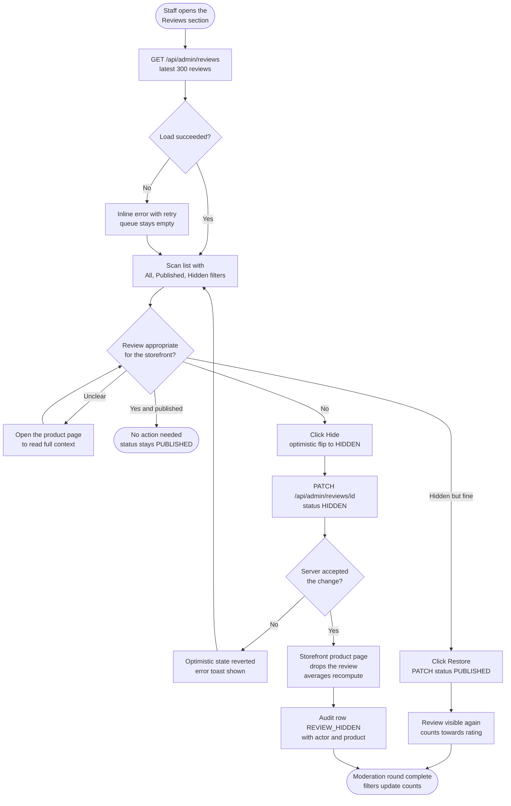

# A13 — Moderate product reviews

An admin (or pharmacist) opens the Reviews section — a single moderation queue for every customer product review. New reviews are published by default and appear on the storefront immediately; moderation is retrospective: staff scan the list, filter by status, and hide anything inappropriate or reinstate hidden reviews. Hidden reviews disappear from the product page and stop counting towards the average rating, while the author still sees their own review with its status.

| Metadata | Value |
| --- | --- |
| Primary actor | Admin (PHARMACIST has identical moderation rights) |
| Secondary actors | Customers (authors, journey C09), other customers (readers of published reviews) |
| Functional area | Catalogue — review moderation |
| Entry point | `/admin` → Reviews section |
| Status | Implemented — verified against code |
| End condition | Review status flips to `HIDDEN` or `PUBLISHED`; `REVIEW_HIDDEN`/`REVIEW_PUBLISHED` audit row written |
| Related journeys | C09 (write a review), P03 (product page display), A08 (the product being reviewed), A01 (workspace) |

## Journey map

## Journey steps

### Step 1 — Open the moderation queue

- **User action:** The staff member signs in (journey A01) and opens the Reviews section from the Business navigation group.
- **Location:** `src/components/views/admin/sections/reviews-section.tsx`; data from `GET /api/admin/reviews` (`src/app/api/admin/reviews/route.ts`).
- **Destination:** The full review list with status filter tabs (All, Published, Hidden) and per-status counts.
- **Purpose:** See every piece of customer feedback in one queue, newest first.
- **System behaviour:** The route requires `requireStaff(["ADMIN", "PHARMACIST"])` and returns up to 300 reviews ordered by creation date, optionally filtered by `?status=PUBLISHED|HIDDEN`. Each row DTO includes rating, comment, product name and SKU, author name and contact (email or phone), creation date and moderation status.
- **Outcome:** The queue renders with counts per status and a note that storefront averages count published reviews only.
- **Next step:** Assess a review.
- **Alternative paths:** If the load fails an inline error with a retry button appears; an empty queue shows an empty state explaining reviews will appear once customers write them (journey C09).

### Step 2 — Assess the review

- **User action:** The staff member reads the star rating, product, author, date and comment, optionally switching filters to focus on published or hidden items.
- **Location:** `ReviewRow` in `reviews-section.tsx`.
- **Destination:** A decision: leave published, hide, or restore.
- **Purpose:** Keep the storefront trustworthy — spam, abuse or off-topic content is hidden; genuine feedback stays visible.
- **System behaviour:** Rating-only reviews (no comment) are rendered as "No comment — rating only." Rows expose the author contact so staff can follow up out of band if needed. Reviews are created published by default (the `Review` model defaults `status` to PUBLISHED), so moderation is a post-publication check rather than an approval gate.
- **Outcome:** The staff member knows which reviews to act on.
- **Next step:** Hide or restore the review.
- **Alternative paths:** For context, open the product page to see the review as customers see it (journey P03); no in-app link to message the author exists — use the displayed contact channel.

### Step 3 — Hide or restore

- **User action:** The staff member clicks Hide on a published review, or Restore on a hidden one.
- **Location:** `setReviewStatus` in `reviews-section.tsx`; API `PATCH /api/admin/reviews/[id]` (`src/app/api/admin/reviews/[id]/route.ts`).
- **Destination:** The row's badge flips (Hidden amber / Published green) and the action button inverts.
- **Purpose:** Make the storefront reflect the moderation decision immediately.
- **System behaviour:** The UI optimistically flips the status before the request; the PATCH route requires ADMIN/PHARMACIST, validates the status is exactly `PUBLISHED` or `HIDDEN` (400 otherwise), returns 404 for a missing review, updates the row, and writes an audit row — `REVIEW_HIDDEN` or `REVIEW_PUBLISHED` — with the actor, role, product SKU and a summary. On failure the optimistic change is reverted and an error toast is shown.
- **Outcome:** The review's moderation state is durable and audited; filter counts update.
- **Next step:** Confirm the storefront effect or continue with the next review.
- **Alternative paths:** Concurrent moderation by two staff members resolves simply — the last write wins and both see the final state on reload; there is no review deletion, only status changes.

### Step 4 — Storefront effect settles

- **User action:** None by staff — this step records what customers experience next.
- **Location:** `GET /api/products/[id]/reviews` (`src/app/api/products/[id]/reviews/route.ts`) and `attachRatings` in `src/lib/dto.ts`.
- **Destination:** The product page reflects the decision on next load.
- **Purpose:** Ensure hidden content never influences other customers.
- **System behaviour:** The public reviews endpoint returns only PUBLISHED reviews and computes rating breakdowns from PUBLISHED rows only; catalogue aggregates (`avgRating`, `reviewCount`) likewise filter `status: "PUBLISHED"`. A hidden review's author still sees their own review with its status when signed in — moderation is transparent to the author, not silent.
- **Outcome:** Public averages and lists match the moderated set.
- **Next step:** Return to the queue; new customer reviews (C09) join the All list as they arrive.
- **Alternative paths:** Restoring reverses everything symmetrically; because averages recompute per request there is no cache to clear.

## Decision points

| Decision | Branches | Enforced by/where |
| --- | --- | --- |
| Who may moderate | ADMIN/PHARMACIST → queue + actions; STAFF/RIDER → section hidden | `requireStaff(["ADMIN", "PHARMACIST"])` in both review routes; NAV roles in `admin-view.tsx` |
| Status filter | All / PUBLISHED / HIDDEN with live counts | `?status=` param on `GET /api/admin/reviews`; tabs in `reviews-section.tsx` |
| Valid status value | PUBLISHED or HIDDEN accepted; anything else → 400 | `REVIEW_STATUSES` check in `PATCH /api/admin/reviews/[id]` |
| Missing review | 404 → UI reverts optimistic flip | `findUnique` guard in the PATCH route |
| Storefront visibility | Published → listed and counted; hidden → excluded | `status: "PUBLISHED"` filters in reviews GET and `attachRatings` |
| Author visibility | Author sees own review regardless of status | `mine` lookup in `GET /api/products/[id]/reviews` |
| Audit | Every hide/restore recorded with actor and role | `audit()` calls in `PATCH /api/admin/reviews/[id]` |

## Error and recovery paths

- **Queue fails to load:** an inline error card with a retry button replaces the list; previously loaded data is cleared, not frozen.
- **Optimistic update rejected (404/403/400):** the row reverts to its prior status and an error toast shows the server message — the storefront was never changed.
- **Review not found (404):** the review (or its product) was removed; a reload of the queue drops the row.
- **No pre-publication gate:** because reviews publish immediately, inappropriate content can be briefly visible between writing and moderation — the team should watch the queue; there is no in-app rate limit on moderation actions to slow recovery.
- **Accidental hide:** restore reverses the effect completely; the audit trail keeps both actions, so the correction is visible rather than silent.
- **Review deletion:** there is no staff delete for reviews — hiding is the only removal, which preserves the record for disputes and audit.

## Traceability

| Concern | Implementation reference |
| --- | --- |
| Moderation queue UI | `src/components/views/admin/sections/reviews-section.tsx` |
| Queue data | `GET /api/admin/reviews` in `src/app/api/admin/reviews/route.ts` (take 300, newest first) |
| Moderation mutation | `PATCH /api/admin/reviews/[id]` in `src/app/api/admin/reviews/[id]/route.ts` |
| Review statuses | `REVIEW_STATUSES`, `REVIEW_STATUS_LABELS` in `src/lib/constants.ts` |
| Review model | `Review` model in `prisma/schema.prisma` (unique per product+user, status default PUBLISHED) |
| Public display filter | `GET /api/products/[id]/reviews` (PUBLISHED only, author exception) |
| Rating aggregates | `attachRatings` in `src/lib/dto.ts` (groupBy status PUBLISHED) |
| Audit trail | `audit()` calls (`REVIEW_HIDDEN`, `REVIEW_PUBLISHED`) in the PATCH route |
| Role guard | `requireStaff(["ADMIN", "PHARMACIST"])` from `src/lib/session.ts` |
| API client bindings | `adminApi.reviews`, `adminApi.setReviewStatus` in `src/lib/api-client.ts` |
| Customer-side creation | `POST /api/products/[id]/reviews` (journey C09) |

## Related journeys and documents

- **C09** — the customer journey that creates the reviews being moderated
- **P03** — the product page where published reviews and averages appear
- **A08** — creating the products customers review
- **A01** — staff sign-in preceding moderation
- **A16** — the audit activity feed where moderation actions surface
- Docs: [storefront and catalogue](../../features/storefront-and-catalogue.md) · [customer CRM](../../features/customer-crm.md) · [user roles and permissions](../../product/user-roles-and-permissions.md) · [journey index](../README.md)
