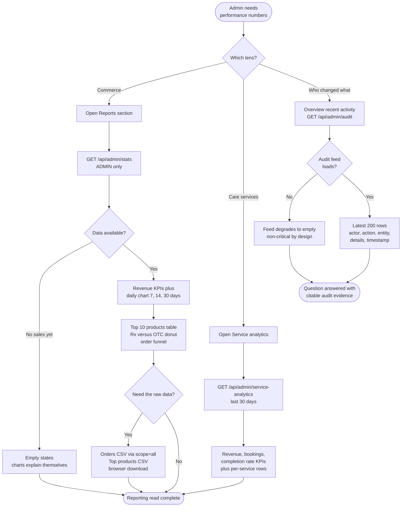

# A16 — Reports, service analytics and audit activity

Reporting is spread across three admin-only surfaces. The Reports section renders the commerce picture from `GET /api/admin/stats`: revenue KPIs, a daily revenue chart, the top-10 products table, the Rx-vs-OTC mix and the order funnel in lifecycle order, plus client-side CSV exports (orders and top products). The Service analytics section summarises the care business from `GET /api/admin/service-analytics`: bookings, completions, revenue and per-service breakdown over the last 30 days. Audit activity — the evidence layer for everything else — flows from `GET /api/admin/audit`, written by the `audit()` helper on staff mutations and surfaced on the Overview's recent-activity card and (filtered) in the Compliance section.

| Metadata | Value |
| --- | --- |
| Primary actor | Admin (all three surfaces are ADMIN-only) |
| Secondary actors | System (audit rows are written automatically by staff actions across the workspace) |
| Functional area | Reporting — sales, services and audit |
| Entry point | `/admin` → Reports; `/admin` → Service analytics; audit feed on `/admin` → Overview |
| Status | Implemented — verified against code |
| End condition | The admin has read (and optionally exported) the numbers and can cite audit rows |
| Related journeys | A01 (overview summary), A02/A03 (the orders behind the funnel), A11 (service bookings), A15 (staff actions in the audit feed) |

## Journey map

## Journey steps

### Step 1 — Open the Reports section

- **User action:** The admin opens Reports from the Business navigation group.
- **Location:** `src/components/views/admin/sections/reports-section.tsx`; data from `GET /api/admin/stats` (`src/app/api/admin/stats/route.ts`).
- **Destination:** Headline KPI cards, the revenue chart, product ranking, order mix and the status funnel.
- **Purpose:** Answer the commerce questions: how much, from what, and where do orders stall.
- **System behaviour:** The stats route requires `requireStaff(["ADMIN"])` and aggregates in parallel: revenue today/this week/all-time from successful payments, orders today/this week, active and awaiting-payment counts, pending prescriptions, product stock counts, customer count, a 14-day orders/revenue series, top 10 products by quantity sold from paid orders, the Rx-vs-OTC split and a per-status breakdown emitted in lifecycle order. The section offers 7/14/30-day range tabs that slice the daily series.
- **Outcome:** A complete commerce dashboard with a generated-at stamp.
- **Next step:** Drill into a specific area or export.
- **Alternative paths:** With no sales, each chart shows an explanatory empty state rather than a blank canvas; a failed load shows a retryable error.

### Step 2 — Read the funnel and product performance

- **User action:** The admin studies the order funnel (counts by status in lifecycle order), the top-10 products table and the Rx/OTC donut.
- **Location:** Same section — funnel, table and donut cards in `reports-section.tsx`.
- **Destination:** Insights such as stuck orders (AWAITING_PAYMENT), bestsellers and prescription share.
- **Purpose:** Turn counts into operating decisions.
- **System behaviour:** The funnel maps `statusBreakdown` over `ORDER_STATUSES` with labels from `ORDER_STATUS_LABELS`, colouring completions green and rejected/cancelled/refunded red; the top-products table ranks `topProducts` (name, quantity, revenue); the donut shows the `rxVsOtc` split with the Rx share as a percentage.
- **Outcome:** The admin knows which queues need attention (linking back to journeys A02/A03).
- **Next step:** Export the data or switch lenses.
- **Alternative paths:** Payment-provider split is deliberately absent — the section notes it lands once the stats API exposes it (documented limitation).

### Step 3 — Export CSVs

- **User action:** The admin clicks Orders CSV or Top products CSV.
- **Location:** `exportOrdersCsv`/`exportProductsCsv` in `reports-section.tsx`; orders data from `GET /api/orders?scope=all&limit=100`.
- **Destination:** Two browser-generated CSV files (`sphere-orders-<date>.csv`, `sphere-top-products-<date>.csv`).
- **Purpose:** Take the data into spreadsheets or share with the owner.
- **System behaviour:** The orders export fetches up to 100 recent orders (staff scope), then builds rows locally — reference, date, customer, phone, type, fulfilment, status, item count, subtotal, delivery fee, total — and downloads via the shared `downloadCsv` helper; no server-side file is created. The products export serialises `stats.topProducts` directly. Toasts confirm the row counts.
- **Outcome:** Files land in the admin's downloads folder.
- **Next step:** Open them externally.
- **Alternative paths:** The orders export is capped at the 100 most recent orders — for full history, repeat after filtering or use the API directly; a fetch failure shows an error toast and no file.

### Step 4 — Read service analytics

- **User action:** The admin opens the Service analytics section.
- **Location:** `src/components/views/admin/sections/service-analytics-section.tsx`; data from `GET /api/admin/service-analytics` (`src/app/api/admin/service-analytics/route.ts`).
- **Destination:** KPI cards (service revenue, appointments, completed visits, completion rate) and the per-service breakdown.
- **Purpose:** Judge the care business separately from product sales.
- **System behaviour:** The route requires an ADMIN staff session (403 otherwise) and, by default, aggregates `ServiceBooking` rows created in the last 30 days (optional `from`/`to` date params): total bookings, completed count, cancelled count (CANCELLED/REJECTED/NO_SHOW), revenue summed from completed booking prices, the completion rate, and a per-service list sorted by bookings. The section renders each service with its booking share bar and revenue.
- **Outcome:** The care picture is quantified.
- **Next step:** Cross-check with the bookings workflow (journey A11) if a service underperforms.
- **Alternative paths:** With no bookings the section shows an encouraging empty state; a failed load offers retry.

### Step 5 — Trace audit activity

- **User action:** The admin returns to the Overview (or opens Compliance) to see who did what recently.
- **Location:** Recent-activity card in `overview-section.tsx` (top 10 rows) and the filtered compliance history in `compliance-section.tsx`; data from `GET /api/admin/audit` (`src/app/api/admin/audit/route.ts`).
- **Destination:** A chronological feed of staff actions — actor, action (for example `RIDER_ASSIGNED`, `PRODUCT_CREATED`, `STAFF_UPDATED`), entity, details and relative time.
- **Purpose:** Provide the evidence layer behind every number on the dashboards.
- **System behaviour:** The audit route requires ADMIN and returns the latest 200 `AuditLog` rows (newest first). Rows are written by the `audit()` helper in `src/lib/notify.ts` from staff routes across the workspace — order status changes, assignments, cash confirmations, product and promotion changes, staff changes, settings and compliance updates. On the Overview the feed is non-critical: a failure degrades to an empty card while the stats still render. There is no dedicated full-page audit view; the Overview feed and the Compliance filter are the surfaces.
- **Outcome:** The admin can cite specific rows when asking "who changed this".
- **Next step:** Follow up with the actor or correct the underlying record via the relevant journey.
- **Alternative paths:** Deeper forensics can query the `AuditLog` table directly; log retention is deliberately unlimited pending a governance decision (see retention-and-deletion.md).

## Decision points

| Decision | Branches | Enforced by/where |
| --- | --- | --- |
| Reports access | ADMIN → section + stats; others → hidden/403 | `requireStaff(["ADMIN"])` in stats route; NAV roles |
| Service analytics access | ADMIN only (403 otherwise) | role check in `src/app/api/admin/service-analytics/route.ts` |
| Audit access | ADMIN only | `requireStaff(["ADMIN"])` in `GET /api/admin/audit` |
| Range selection | 7/14/30-day tabs slice the daily series | `range` state in `reports-section.tsx` |
| Export scope | Orders CSV limited to 100 most recent via scope=all | `ordersApi.allOrders()` and `downloadCsv` |
| Analytics window | Default last 30 days; optional from/to | date params in the service-analytics route |
| Audit feed failure | Overview degrades to empty card; stats unaffected | try/catch around `adminApi.audit()` in `overview-section.tsx` |

## Error and recovery paths

- **Stats load failure:** the Reports (and Overview) sections show a `SectionError` with retry; no partial numbers are rendered.
- **Empty data:** each chart has a purpose-written empty state ("No revenue data yet", "No product sales yet") so the section never looks broken.
- **Service analytics failure:** a retryable error card; the 30-day default can be retried without parameters.
- **Audit feed failure (Overview):** the feed silently empties — deliberate, because audit is a supporting feed, not the primary data; the Compliance section surfaces its own load error with a refresh hint.
- **Export fetch failure:** an error toast explains the failure; no partial CSV is written.
- **Export truncation:** the orders CSV caps at 100 rows — for larger extracts, export repeatedly with different date windows or use the API; documented as a limitation.
- **Stale numbers:** all reports re-fetch on `refreshKey` changes and section entry; use Refresh in Service analytics or re-enter Reports to re-pull.

## Traceability

| Concern | Implementation reference |
| --- | --- |
| Reports section UI | `src/components/views/admin/sections/reports-section.tsx` |
| Commerce stats | `GET /api/admin/stats` in `src/app/api/admin/stats/route.ts` |
| Order funnel and statuses | `ORDER_STATUSES`, `ORDER_STATUS_LABELS` in `src/lib/constants.ts` |
| CSV exports | `exportOrdersCsv`, `exportProductsCsv`, `downloadCsv` in `reports-section.tsx`/`admin-shared.tsx` |
| Orders export data | `GET /api/orders?scope=all` in `src/app/api/orders/route.ts` |
| Service analytics UI | `src/components/views/admin/sections/service-analytics-section.tsx` |
| Service analytics data | `GET /api/admin/service-analytics` in `src/app/api/admin/service-analytics/route.ts` |
| Audit feed | `GET /api/admin/audit` in `src/app/api/admin/audit/route.ts` (latest 200) |
| Audit writer | `audit()` in `src/lib/notify.ts`; callers across `src/app/api/**` |
| Audit model | `AuditLog` model in `prisma/schema.prisma` |
| Audit surfaces | `overview-section.tsx` recent activity; `compliance-section.tsx` compliance filter |
| API client bindings | `adminApi.stats`, `adminApi.audit`, `serviceAnalyticsApi.summary` in `src/lib/api-client.ts` |

## Related journeys and documents

- **A01** — the overview that summarises these same stats
- **A02 / A03** — the order and dispatch work that feeds the funnel
- **A11** — the service booking workflow behind service analytics
- **A15** — staff management actions that appear in the audit feed
- **A17** — the compliance section's filtered audit view
- Docs: [pharmacy operations](../../product/pharmacy-operations.md) · [orders and fulfillment](../../features/orders-and-fulfillment.md) · [services and bookings](../../features/services-and-bookings.md) · [journey index](../README.md)
