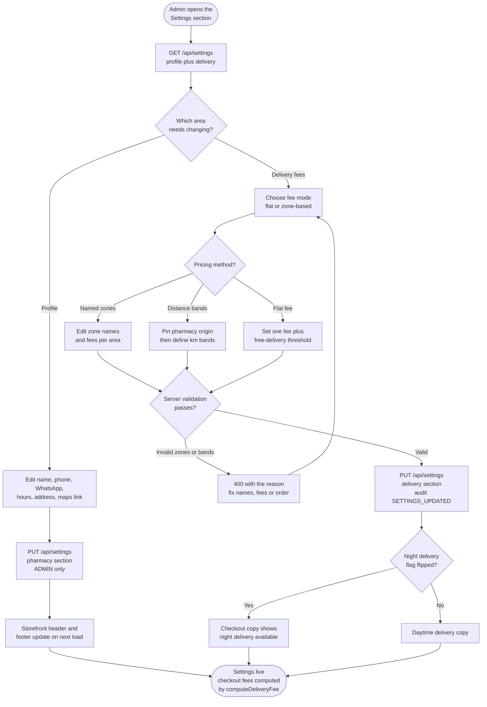

# A18 — Pharmacy settings and delivery pricing

The Settings section is the owner's control panel. The Pharmacy profile tab edits the name, tagline, phone, WhatsApp, email, hours, address and maps link that the storefront header and footer display. The Delivery & pricing tab chooses between a flat fee and named zones, sets the free-delivery threshold and the night-delivery flag, pins the pharmacy's coordinates (current location or place search) and optionally switches to distance-based pricing with kilometre bands. Everything saves through `PUT /api/settings` into JSON `Setting` rows, is audited as `SETTINGS_UPDATED`, and is consumed live: the storefront re-reads the profile and checkout fees are computed by `computeDeliveryFee` on the server for every delivery order.

| Metadata | Value |
| --- | --- |
| Primary actor | Admin (the only role that can open the section or call the PUT) |
| Secondary actors | Customers (experience the resulting contact details and delivery fees) |
| Functional area | Settings — pharmacy profile and delivery pricing |
| Entry point | `/admin` → Settings → Pharmacy profile / Delivery & pricing tabs |
| Status | Implemented — verified against code |
| End condition | Settings persisted and audited; storefront profile and checkout delivery fees reflect them |
| Related journeys | A01 (workspace), O02 (delivery checkout that reads the fees), A03 (deliveries priced by these rules), A17 (compliance lives beside these settings) |

## Journey map

## Journey steps

### Step 1 — Open the settings workspace

- **User action:** The admin opens the Settings section from the Management navigation group.
- **Location:** `src/components/views/admin/sections/settings-section.tsx`; data from `GET /api/settings` (`src/app/api/settings/route.ts`).
- **Destination:** Four tabs: Pharmacy profile, Delivery & pricing, Notifications and Demo reference.
- **Purpose:** One place for everything the storefront and checkout read from configuration.
- **System behaviour:** The GET merges stored JSON `Setting` rows over code defaults (`PHARMACY` and `DELIVERY_DEFAULTS` in `src/lib/constants.ts`) via `getSettings` in `src/lib/settings.ts`, so the forms always render effective values. The section warns that changes go live immediately.
- **Outcome:** Current profile and delivery configuration on screen.
- **Next step:** Edit the relevant tab.
- **Alternative paths:** A failed load shows a retryable error; the notifications tab (push/email diagnostics) and demo credentials are outside this journey.

### Step 2 — Maintain the pharmacy profile

- **User action:** The admin updates contact details, opening-hours label, address or the Google Maps URL and clicks Save pharmacy profile.
- **Location:** Pharmacy profile tab in `settings-section.tsx`; API `PUT /api/settings` with the `pharmacy` section.
- **Destination:** The storefront header, footer and contact surfaces show the new details.
- **Purpose:** Keep the public face of the pharmacy accurate.
- **System behaviour:** The PUT requires ADMIN and copies only whitelisted keys (name, tagline, phone, whatsapp, email, hoursLabel, address, mapsUrl), trimmed and length-capped (500 for address/mapsUrl, 160 otherwise). `saveSettingsSection("pharmacy", ...)` merges the values into the stored JSON, and an audit row `SETTINGS_UPDATED` (entity `pharmacy`) is written. Storefront surfaces read these settings on their next request.
- **Outcome:** Profile saved with a confirmation toast.
- **Next step:** Move to delivery pricing or finish.
- **Alternative paths:** Invalid input types are rejected with 400; because values merge, editing one field never disturbs the others.

### Step 3 — Configure fee mode, zones and thresholds

- **User action:** The admin selects flat fee or zone-based mode, sets the flat fee and free-delivery-over threshold, toggles night delivery, and (in zone mode) adds, renames, reprices or removes delivery zones.
- **Location:** Delivery & pricing tab — fee-mode radio group, fee inputs, night-delivery switch and the zones editor in `settings-section.tsx`.
- **Destination:** The pricing rules that checkout will apply.
- **Purpose:** Price delivery by business reality — one fee, or per-area fees with a free threshold.
- **System behaviour:** The zone editor is disabled (visually and functionally) unless mode is zone; each zone row is a name plus fee pair, removable individually. The night-delivery switch carries the "+KSh 100" label and the 8:30 PM–midnight description; enabling it flips the checkout delivery copy to night availability — the current fee engine (`computeDeliveryFee`) applies no automatic night surcharge, so the surcharge is an operational convention, not a computed charge. Saving sends the whole delivery object to `PUT /api/settings`, which validates: mode and pricingMode present, non-negative flat fee, optional non-negative free-over, boolean nightDelivery, and zones as an array (max 50) where every zone has a trimmed name (max 100) and a non-negative fee — otherwise 400 with the reason. On success the merged settings persist and an audit row `SETTINGS_UPDATED` (entity `delivery`) is written.
- **Outcome:** Delivery pricing is live; the checkout fee quote changes immediately.
- **Next step:** Optionally switch to distance pricing.
- **Alternative paths:** Invalid zones block the save with a specific message; the free-over threshold can be cleared to disable free delivery.

### Step 4 — Pin the origin and use distance pricing (optional)

- **User action:** The admin pins the pharmacy location (Use current location button or the place search), selects distance-based pricing and defines kilometre bands with fees.
- **Location:** Delivery origin & pricing method panel and the distance-bands editor in `settings-section.tsx`; place search via `GET /api/location/search`.
- **Destination:** Fees computed from the customer's map pin instead of a zone name.
- **Purpose:** Price by real distance when zones are too coarse.
- **System behaviour:** The origin is stored as `pharmacyLocation` (latitude, longitude, label); distance mode requires a pinned origin and at least one valid band before the PUT accepts it (400 otherwise). Bands (max 30) must be ordered and non-overlapping — the server validates that each band's minimum sits at or after the previous maximum. At checkout, `computeDeliveryFee` computes the haversine distance from the origin to the customer's coordinates and picks the matching band.
- **Outcome:** Distance-based fees are active.
- **Next step:** Save and verify at checkout.
- **Alternative paths:** Zone pricing remains available by switching the radio back; without coordinates on a customer address the fee falls back to the zone/flat logic.

### Step 5 — Checkout applies the rules

- **User action:** None by the admin — this step records how the saved settings reach customers.
- **Location:** `computeDeliveryFee` in `src/lib/settings.ts`; quote API `GET /api/settings/delivery-fee`; order creation in `POST /api/orders`.
- **Destination:** The customer sees the correct delivery fee for their address and subtotal.
- **Purpose:** Server-authoritative pricing that cannot be tampered with from the client.
- **System behaviour:** `computeDeliveryFee` first applies the free-over threshold (subtotal at or above it → fee 0), then flat mode returns the flat fee; distance mode (with coordinates and a pinned origin) selects the matching band; otherwise the zone list matches the delivery area case-insensitively, falling back to the last zone's fee and then the flat fee. The checkout quotes via `GET /api/settings/delivery-fee?area=&subtotal=&lat=&lon=`, and order creation recomputes the fee server-side inside the order POST — the stored `deliveryFee` is always the server's number.
- **Outcome:** Delivery orders are priced consistently across quote and charge.
- **Next step:** Monitor delivery economics in Reports (journey A16).
- **Alternative paths:** An unknown area falls back to the highest zone fee (the last zone acts as "everywhere else") — ordering zones from nearest to farthest makes that fallback sensible.

## Decision points

| Decision | Branches | Enforced by/where |
| --- | --- | --- |
| Section access | ADMIN → section and PUT; others → hidden/403 | `requireStaff(["ADMIN"])` in `PUT /api/settings`; NAV roles |
| Fee mode | flat → one fee; zone → per-area fees | `mode` radio and validation in the PUT route |
| Pricing method | zone names vs distance bands (needs origin) | `pricingMode` check: distance requires `pharmacyLocation` + bands |
| Free delivery | Subtotal ≥ freeOver → fee 0; blank → never free | first check in `computeDeliveryFee` |
| Zone fallback | Named zone → its fee; unknown → last zone fee; none → flat fee | zone lookup chain in `computeDeliveryFee` |
| Night delivery | On → checkout shows night availability; no computed surcharge | flag in settings; checkout copy in `checkout-view.tsx` |
| Zone/band validity | Names and non-negative fees, ordered non-overlapping bands → save; else 400 | delivery block validation in `PUT /api/settings` |
| Fee authority | Client quote informational; order stores server-computed fee | `computeDeliveryFee` call inside `POST /api/orders` |

## Error and recovery paths

- **Invalid zones (400):** a zone missing a name or carrying a negative fee blocks the save with the reason — fix the highlighted row; empty names are dropped on save.
- **Distance mode misconfigured (400):** enabling distance pricing without a pinned origin or with zero bands is rejected — pin the origin and add bands first.
- **Overlapping bands (400):** bands must be ordered and non-overlapping — the editor appends new bands starting at the previous maximum to help; reorder manually if edited.
- **Flat-fee confusion:** in zone mode the flat-fee input is disabled; the flat fee still acts as the final fallback for unmapped areas.
- **Night surcharge expectation:** the switch's label mentions a +KSh 100 surcharge, but no surcharge is computed — handle it operationally or adjust zone/flat fees; documented as a code-verified limitation.
- **Save failure:** the toast carries the server error; edits remain in the form — retry or reload to discard.
- **Wrong origin pin:** re-pin via current location or place search and save again; distance fees recompute per request, so corrections apply immediately.

## Traceability

| Concern | Implementation reference |
| --- | --- |
| Settings section UI | `src/components/views/admin/sections/settings-section.tsx` |
| Settings read | `GET /api/settings` in `src/app/api/settings/route.ts` |
| Settings write (profile, delivery, validation) | `PUT /api/settings` in `src/app/api/settings/route.ts` |
| Settings persistence and defaults | `getSettings`, `saveSettingsSection` in `src/lib/settings.ts`; `PHARMACY`, `DELIVERY_DEFAULTS` in `src/lib/constants.ts` |
| Fee computation | `computeDeliveryFee`, `distanceKm` in `src/lib/settings.ts` |
| Fee quote endpoint | `GET /api/settings/delivery-fee` in `src/app/api/settings/delivery-fee/route.ts` |
| Fee at order creation | `computeDeliveryFee` call in `POST /api/orders` (`src/app/api/orders/route.ts`) |
| Night-delivery surface | `nightDelivery` flag read in `checkout-view.tsx` |
| Place search | `GET /api/location/search` consumed by the settings section |
| Settings model | `Setting` model (key/value JSON) in `prisma/schema.prisma` |
| Audit trail | `SETTINGS_UPDATED` via `audit()` in the settings route |
| API client bindings | `settingsApi.get/update/deliveryFee` in `src/lib/api-client.ts` |

## Related journeys and documents

- **A01** — the admin sign-in that precedes configuration
- **O02** — the delivery checkout that quotes and pays these fees
- **A03** — dispatch operations for the orders these fees price
- **A17** — the compliance record stored through the same settings mechanism
- **A16** — reports where delivery revenue and totals land
- Docs: [orders and fulfillment](../../features/orders-and-fulfillment.md) · [storefront and catalogue](../../features/storefront-and-catalogue.md) · [pharmacy operations](../../product/pharmacy-operations.md) · [journey index](../README.md)
