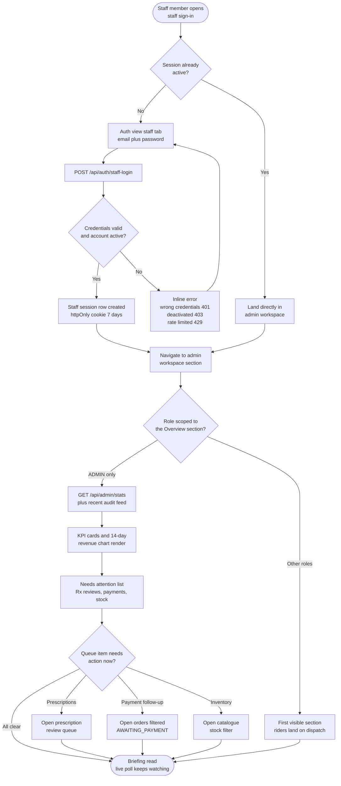

# A01 — Staff sign-in and daily overview

Every internal journey starts here: a team member opens the staff sign-in tab of the auth view, authenticates with a staff email and password, and lands in the admin workspace where the Overview section (admins only) assembles the day's briefing — revenue and order KPIs, a 14-day trend, pending prescriptions, awaiting-payment orders, inventory warnings and the latest staff audit activity.

| Metadata | Value |
| --- | --- |
| Primary actor | Admin (all staff roles sign in the same way) |
| Secondary actors | Pharmacists, counter staff and riders signing into the same workspace |
| Functional area | Workspace — authentication and daily overview |
| Entry point | Auth view staff tab (`navigate("auth", { mode: "staff" })`) or the gated admin workspace |
| Status | Implemented — verified against code |
| End condition | Active staff session (7-day expiry, 12-hour idle cap) and a rendered role-scoped workspace with Overview for ADMIN |
| Related journeys | A03 (dispatch board), A15 (staff accounts), A16 (reports/audit), A04 (prescription review), A02 (order processing) |

## Journey map

## Journey steps

### Step 1 — Open the staff sign-in view

- **User action:** The team member chooses the staff sign-in entry (for example the Staff dashboard link in the storefront footer) or opens the admin workspace while signed out.
- **Location:** `src/components/views/auth-view.tsx` (staff mode) reached via the app-store `openAuth("staff", "admin")`; gate in `src/components/views/admin/admin-view.tsx`.
- **Destination:** The staff sign-in panel rendered inside `AdminAccessFrame` — "Your team. Your workspace." with email and password fields.
- **Purpose:** Separate internal access from customer accounts; staff never use the customer login, OTP or register tabs.
- **System behaviour:** When `authMode === "staff"` the auth view renders a dedicated sign-in card with links back to the storefront and to customer sign-in. If a staff session already exists, the admin view skips the gate and renders the workspace shell directly; customers and anonymous visitors see a `StaffGate` prompt instead.
- **Outcome:** The staff sign-in form is displayed with any contextual message (for example a redirect notice after a required re-login).
- **Next step:** Enter staff credentials and submit.
- **Alternative paths:** A visitor can return to the storefront or switch to the customer sign-in tab; an already-authenticated staff member goes straight to their first permitted section.

### Step 2 — Sign in with staff credentials

- **User action:** The staff member enters their staff email address and password and submits the form.
- **Location:** `handleStaffLogin` in `src/components/views/auth-view.tsx`; API `POST /api/auth/staff-login` (`src/app/api/auth/staff-login/route.ts`).
- **Destination:** The admin workspace (`navigate("admin")`) on success.
- **Purpose:** Establish the role-scoped staff session that every admin API route will authorize.
- **System behaviour:** The route trims and lowercases the email, caps the request at 4 KB, and rate-limits to 5 attempts per 15 minutes keyed on the email. It looks up the `StaffUser`, verifies the scrypt password hash, and rejects inactive accounts with 403. Legacy demo hashes are opportunistically upgraded on successful login. `createSession({ staffId })` writes a `Session` row (staff role, 7-day expiry, `authVersion` snapshot) and sets the httpOnly `sphere_session` cookie; the response returns the staff DTO and role.
- **Outcome:** The client stores the session payload, refreshes the auth store, shows a welcome toast and navigates to the admin workspace.
- **Next step:** The workspace loads the section permitted for the role.
- **Alternative paths:** Wrong credentials return 401 and the form shows an inline alert; deactivated accounts return 403 with a "contact your admin" message; after 5 failed attempts the rate limiter blocks further tries for 15 minutes.

### Step 3 — Land in the role-scoped workspace

- **User action:** None — the workspace shell decides which section the staff member sees first.
- **Location:** `src/components/views/admin/admin-view.tsx` — `NAV` list, `NAV_GROUPS` (Workspace, Patient care, Business, Management) and the section router.
- **Destination:** The first section visible for the role — Overview for admins.
- **Purpose:** Give each role exactly the navigation it is entitled to, without manual configuration.
- **System behaviour:** The view filters `NAV` entries by role (for example `overview` is ADMIN-only, `staff` and `settings` are ADMIN-only, `dispatch` is available to all staff). A deep link such as `params.section` is honoured when the role may access it; otherwise a Restricted-section empty state offers the first permitted section. For ADMIN, PHARMACIST and STAFF the shell also starts a `GET /api/admin/live-changes` poll every 15 seconds that bumps the shared `refreshKey` and toasts when a new order or care booking arrives.
- **Outcome:** The admin sees the sidebar grouped by area with the Overview section rendered.
- **Next step:** The overview fetches its numbers.
- **Alternative paths:** RIDER accounts never see Overview and land on Dispatch; pharmacists and counter staff see Orders first.

### Step 4 — Read the daily briefing

- **User action:** The admin scans the overview: greeting with active-order and pending-prescription counts, KPI cards, the revenue and orders chart, the needs-attention list, bestsellers, sales mix, status breakdown and recent activity.
- **Location:** `src/components/views/admin/sections/overview-section.tsx`; data from `GET /api/admin/stats` (`src/app/api/admin/stats/route.ts`) and `GET /api/admin/audit`.
- **Destination:** A mental picture of the day: how much has been sold, what is queued, what is at risk.
- **Purpose:** Decide where to spend the next working minutes without opening every queue.
- **System behaviour:** `GET /api/admin/stats` requires `requireStaff(["ADMIN"])` and computes: orders today/this week, revenue today/week/all-time from successful payments, active orders (`ACTIVE_STATUSES`), `AWAITING_PAYMENT` count, pending prescriptions (PENDING, not deleted), product stock counts, total customers, a 14-day orders/revenue series, top 10 products by quantity sold, the Rx-vs-OTC split and a status breakdown in lifecycle order. The overview additionally fetches the audit log and shows the 10 most recent staff actions; if the audit call fails the feed degrades to empty because it is non-critical.
- **Outcome:** KPI cards (revenue today, orders today, active orders, customers) and charts render, each KPI deep-links into the matching section.
- **Next step:** Follow the most urgent attention item.
- **Alternative paths:** If the stats call fails the section shows a retryable error; staff without the ADMIN role get 403 from the stats endpoint and never see this section.

### Step 5 — Follow an attention item into a working section

- **User action:** The admin clicks a needs-attention row (prescription reviews, awaiting payment, inventory check), a status-breakdown bar or a KPI card.
- **Location:** `onNavigateSection` handlers in `overview-section.tsx`, routed through `goTo` in `admin-view.tsx`.
- **Destination:** The Prescriptions section, the Orders section pre-filtered (for example `status: AWAITING_PAYMENT`), or the Catalogue pre-filtered by stock status.
- **Purpose:** Turn the briefing into the first concrete action of the shift.
- **System behaviour:** `goTo` checks the target section against the role, navigates with section parameters, closes mobile/search overlays and refocuses the content area; the destination section consumes the filter params on load. The overview refreshes through the shared `refreshKey` when actions elsewhere change the underlying data.
- **Outcome:** The admin is working the queue they chose — prescription review (A04), order processing (A02) or dispatch (A03).
- **Next step:** Continue with the destination journey; sign out from the sidebar when finished (`POST /api/auth/logout` clears the session row and cookie).
- **Alternative paths:** Clicking "View reports" opens the Reports section (A16); "Today's bookings" opens the service calendar; a role without access to a target section sees a toast that the section is not available.

## Decision points

| Decision | Branches | Enforced by/where |
| --- | --- | --- |
| Session state | Valid staff session → workspace; none/invalid → staff sign-in gate | `getSession`/`StaffGate` in `admin-view.tsx`; staff validity checks in `src/lib/session.ts` |
| Credentials | Verified → session created; unknown/wrong → 401; inactive → 403; 5th failure → rate limit | `POST /api/auth/staff-login` (rate limit 5/15 min per email) |
| Role scope | ADMIN → Overview; PHARMACIST/STAFF → Orders; RIDER → Dispatch | `NAV` roles arrays and section router in `admin-view.tsx` |
| Section access | Permitted → render; not permitted → restricted empty state | `goTo` role check plus `renderSection` guard in `admin-view.tsx` |
| Overview data | ADMIN session → stats JSON; others → 403 | `requireStaff(["ADMIN"])` in `GET /api/admin/stats` |
| Attention routing | Rx reviews → prescriptions; payment → orders filtered; stock → catalogue filtered | `onNavigateSection` calls in `overview-section.tsx` |
| Live updates | New order/booking cursor change → toast + refresh; poll failure → silent retry | `/api/admin/live-changes` poll in `admin-view.tsx` (15 s) |

## Error and recovery paths

- **Incorrect staff email or password (401):** the form shows an inline destructive alert; after five attempts within 15 minutes the rate limiter returns 429 — wait or have an admin verify the account.
- **Deactivated account (403):** the account exists but `active` is false; an administrator must reactivate it in the Staff section (journey A15).
- **Session invalidated mid-shift:** role changes, deactivation or password resets call `revokeStaffSessions` and bump `authVersion`, so the next request fails the staff-validity check and the shell returns to the gate — sign in again with the new credentials.
- **Idle timeout:** staff sessions also expire after 12 hours idle (`STAFF_IDLE_MS` in `src/lib/session.ts`); re-authenticating restores the same workspace.
- **Stats load failure:** the overview renders a `SectionError` with a retry button; the audit feed failure alone degrades silently to an empty recent-activity card.
- **Deep link to a forbidden section:** the shell shows the Restricted-section empty state with a shortcut back to the first permitted section — no server data is exposed.
- **Live poll failures:** failed `/api/admin/live-changes` polls are swallowed and the previous cursor retained; the 15-second interval retries automatically.

## Traceability

| Concern | Implementation reference |
| --- | --- |
| Staff sign-in UI | `src/components/views/auth-view.tsx` (staff mode, `handleStaffLogin`) |
| Staff sign-in API | `POST /api/auth/staff-login` in `src/app/api/auth/staff-login/route.ts` |
| Session creation and cookies | `createSession` in `src/lib/session.ts` (`sphere_session`, 7-day staff expiry) |
| Session validity, idle and authVersion | `getSession` in `src/lib/session.ts` (`STAFF_IDLE_MS`, `authVersion` comparison) |
| Workspace shell, navigation and role guard | `src/components/views/admin/admin-view.tsx` (`NAV`, `NAV_GROUPS`, `goTo`, `StaffGate`) |
| Overview UI | `src/components/views/admin/sections/overview-section.tsx` |
| Overview data | `GET /api/admin/stats` in `src/app/api/admin/stats/route.ts` |
| Audit feed | `GET /api/admin/audit` in `src/app/api/admin/audit/route.ts`; `audit()` in `src/lib/notify.ts` |
| Live-change polling | `GET /api/admin/live-changes` consumed in `admin-view.tsx` |
| Roles and labels | `ROLES`, `ROLE_LABELS` in `src/lib/constants.ts` |
| API client bindings | `authApi.staffLogin`, `adminApi.stats`, `adminApi.audit` in `src/lib/api-client.ts` |
| Auth store | `src/store/use-auth-store.ts` (`setSession`, `refresh`, `logout`) |
| Role permissions baseline | `docs/product/user-roles-and-permissions.md` |

## Related journeys and documents

- **A03** — assign and dispatch a delivery from the dispatch board
- **A15** — manage the staff accounts that this journey authenticates
- **A16** — the reports and audit surfaces the overview summarises
- **A04** — the prescription review queue an attention item links to
- **A02** — order processing reached from the awaiting-payment and status links
- Docs: [user roles and permissions](../../product/user-roles-and-permissions.md) · [pharmacy operations](../../product/pharmacy-operations.md) · [orders and fulfillment](../../features/orders-and-fulfillment.md) · [journey index](../README.md)
