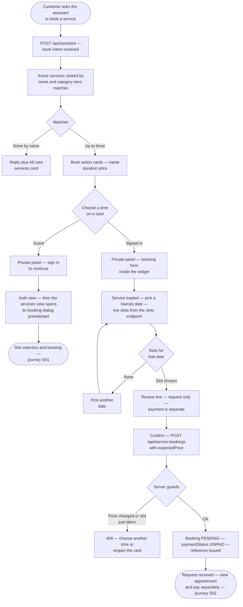

# H02 — Book through the assistant

Telling the assistant "book a medication review" triggers the `book` intent: the route loads all active services, ranks them against the query terms (service name and category), and returns up to three `book` action cards (name, duration, price) plus an "All care services" card. Clicking "Choose a time" opens a private panel inside the widget — deliberately outside the AI conversation, because bookings are account data the model never sees. Signed-in customers get an in-widget booking form (service details, a Nairobi-date picker, live slots, an explicit review line, and a confirm that re-verifies price and duration); guests are sent to sign-in first, and the services view then opens the booking dialog with that service preselected (journey S01's flow). Submission creates a `PENDING` booking with `UNPAID` payment status — the assistant's copy is explicit that the pharmacy still confirms and nothing is charged.

| Metadata | Value |
| --- | --- |
| Primary actor | Customer (signed-in to submit; guests can search) |
| Secondary actors | System (assistant route, service matching, slot engine, booking creation) |
| Functional area | AI assistant |
| Entry point | `AssistantWidget` in `src/components/assistant/assistant-widget.tsx` → `AssistantPrivatePanel` / `BookingForm` in `src/components/assistant/assistant-actions.tsx` |
| Status | Implemented — verified against code |
| End condition | `ServiceBooking` created (status `PENDING`, `paymentStatus: UNPAID`, reference issued) or the customer diverted to the services view |
| Related journeys | S01 (standard booking flow), S02 (appointment payment), S03 (tracking/reschedule), H01/H03 (other assistant intents), A11 (staff confirmation) |

## Journey map

## Journey steps

### Step 1 — Ask the assistant to book

- **User action:** The customer opens the assistant and types a booking request (or taps the "Book a medication review" quick prompt).
- **Location:** Composer in `src/components/assistant/assistant-widget.tsx`; `POST /api/assistant` (`src/app/api/assistant/route.ts`).
- **Destination:** A reply with service action cards.
- **Purpose:** Describe the wanted service in natural language.
- **System behaviour:** The request passes the same gates as journey H01 (rate limit, credential and safety scans, deterministic intent with optional Groq enhancement). The deterministic rules map book/schedule/appointment phrasing to a `book` intent with filler words stripped; the system prompt constrains the model to extract only a service name — never a guessed date or time — because slot truth lives in the booking system.
- **Outcome:** A `book` intent with a query.
- **Next step:** Service matching.
- **Alternative paths:** Medical-advice phrasing can escalate to the pharmacist before any booking cards are produced (journey H01 step 3).

### Step 2 — See matched service cards

- **User action:** None — the book branch runs and renders cards.
- **Location:** `resolveIntent` book branch in `src/app/api/assistant/route.ts`.
- **Destination:** Up to three `book` cards and an "All care services" card.
- **Purpose:** Turn the description into concrete bookable services.
- **System behaviour:** The route loads active services (`db.service.findMany`, up to 100, ordered by `sortOrder`) and scores each against the query terms (terms longer than 2 characters, matched against `name + category`, lowercase). Matches (score > 0) are returned first, capped at three; with no matches the reply says so and offers the "All care services" navigation card. Each `book` card carries the service id, name, price (or null for ask-the-pharmacy pricing) and duration in minutes; the card footer shows "N minutes · KSh …".
- **Outcome:** The customer sees real, bookable services with prices.
- **Next step:** Choose a time on one of them.
- **Alternative paths:** "All care services" navigates to the services catalogue (journey S01) for browsing.

### Step 3 — Choose a time: the private panel

- **User action:** The customer clicks "Choose a time" on a service card.
- **Location:** `AssistantActionCard.run` → `AssistantPrivatePanel` in `src/components/assistant/assistant-actions.tsx`.
- **Destination:** The in-widget private workspace (labelled "PRIVATE · YOUR ACCOUNT").
- **Purpose:** Move from conversation to an account action the AI cannot see.
- **System behaviour:** `book` (and `pay`) actions open the private panel instead of navigating — the assistant's chat messages never include account data. For a signed-in customer the panel renders `BookingForm` for that service id; the panel can be closed at any time. This is the deliberate session/privacy boundary documented for the assistant.
- **Outcome:** The booking form is open, scoped to the chosen service.
- **Next step:** Guests sign in; customers pick a date.
- **Alternative paths:** Closing the panel returns to the conversation with no state changed.

### Step 4 — Guest handoff with preselection

- **User action:** A guest clicking "Choose a time" sees "Your account, kept private." and clicks "Sign in to continue".
- **Location:** Guest branch of `AssistantPrivatePanel` in `assistant-actions.tsx`; deep-link effect in `src/components/views/services-view.tsx`.
- **Destination:** The auth view, then the services view with the booking dialog open for that service.
- **Purpose:** Bookings require an account; the handoff keeps the choice.
- **System behaviour:** The panel calls `openAuth("login", "services", "Sign in to continue securely.", { serviceId: action.id })` and closes the widget. After sign-in (journeys C01/C02), the services view's deep-link effect finds `params.serviceId`, looks the service up in the loaded list, and opens the booking dialog (`setBookingService`) before clearing the intent — the customer continues in the standard journey S01 flow with the service preselected, never re-searching.
- **Outcome:** The guest is signed in and the booking dialog is open on the chosen service.
- **Next step:** Complete the booking in the services view (journey S01).
- **Alternative paths:** Registering a new account works the same way; abandoning sign-in leaves no booking state.

### Step 5 — Pick a date and live slot (signed-in panel)

- **User action:** The signed-in customer picks a date (Nairobi time, today or later) and chooses an available time from the dropdown.
- **Location:** `BookingForm` in `assistant-actions.tsx`; endpoints `GET /api/services/[id]` (service details) and `GET /api/services/[id]/slots?date=…` (via `servicesApi.get` / `serviceBookingsApi.slots`).
- **Destination:** A selected slot with a review line.
- **Purpose:** Choose a real, still-free time.
- **System behaviour:** The form loads the service (name, duration, price — "Contact pharmacy for pricing" when null). Choosing a date fetches live slots for that date; "Checking live availability…" shows while loading, and a day with no slots offers "No times available — try another day". Once a slot is selected, an explicit review line appears: "Review: <service> on <date> at <time>, Nairobi time. This submits a booking request; payment is separate." — the customer must consciously confirm.
- **Outcome:** A concrete, reviewed slot choice.
- **Next step:** Confirm the booking request.
- **Alternative paths:** Slot or service load failures show an in-panel error with a retry path (re-pick the date, or open care services).

### Step 6 — Confirm the booking request

- **User action:** The customer clicks "Confirm booking request".
- **Location:** `confirm` in `BookingForm`; endpoint `POST /api/service-bookings` (`src/app/api/service-bookings/route.ts`).
- **Destination:** The "Request received." result panel.
- **Purpose:** Submit the request with every guard server-side.
- **System behaviour:** The client re-fetches the service and refuses if the price or duration changed since the card was rendered. The POST (rate limited to 8 per hour per user) requires a customer session and an active service; `expectedPrice` must match the current price (409 otherwise); the start must be in the future, within 180 days, fit in one Nairobi day, match the service duration, and fall inside the service's availability windows; a conflicting booking (any active booking overlapping the slot) returns 409. On success the booking is created with status `PENDING`, `paymentStatus: UNPAID`, a reference, and a status-history entry (actor CUSTOMER). A request lock prevents double submits; a 5xx outcome switches the panel to an uncertain state that links to "Check my appointments first".
- **Outcome:** The request exists; the panel shows service, Nairobi date/time and reference, plus "The pharmacy still needs to confirm your appointment. No payment has been taken."
- **Next step:** View the appointment and its payment options.
- **Alternative paths:** "View appointment & payment options" navigates to the services view's bookings tab (journey S03/S02); the standard services-view booking dialog (journey S01) is the full-featured equivalent.

### Step 7 — After submission

- **User action:** None — the pharmacy takes over.
- **Location:** Staff appointment workflow (journey A11).
- **Destination:** The booking moves from PENDING toward confirmed/completed; payment happens separately.
- **Purpose:** Make clear the assistant submitted a request, not a confirmed appointment.
- **System behaviour:** Staff confirm, reschedule or reject bookings through the admin workflow; the customer tracks everything in the bookings tab (journey S03) and pays via journey S02 (M-Pesa, card, or pay-at-pharmacy) or journey H03. Booking notifications flow through the notification pipeline (journey C06).
- **Outcome:** The booking lifecycle continues outside the assistant.
- **Next step:** The journey ends at the hand-off.
- **Alternative paths:** A rejected or cancelled booking frees the slot; the customer can rebook through the same assistant path.

## Decision points

| Decision | Branches | Enforced by/where |
| --- | --- | --- |
| Intent resolved | `book` (query = service terms) vs navigate/none | `fallbackIntent` + `intentSchema` in `src/lib/assistant/contracts.ts` |
| Services matched? | Score > 0 → up to 3 cards; none → "All care services" card | ranking in the book branch of `resolveIntent` |
| Signed in? | Guest → auth with `{ serviceId }` preselection; customer → in-widget form | `AssistantPrivatePanel` session branch; deep-link effect in `services-view.tsx` |
| Slots for the date? | Some → selectable; none → pick another date | `serviceBookingsApi.slots` + dropdown state in `BookingForm` |
| Service details unchanged? | Same price/duration → submit; changed → in-panel error | re-fetch check in `confirm` |
| Server guards | Active service, expectedPrice match, future/within-180-days/one-day, duration, availability window, no conflict → 201; else 409/400 | `POST /api/service-bookings` |
| Uncertain outcome (5xx)? | Panel switches to check-appointments-first mode | `setUncertain` in `BookingForm` |

## Error and recovery paths

- **No matching service:** the reply invites naming the check or consultation, and the "All care services" card opens the catalogue (journey S01).
- **Service/slot load failure:** the panel explains and suggests reopening care services; retrying the date re-fetches slots.
- **Price changed before confirm:** the panel asks the customer to close and reopen the card for the latest details — the 409 path is the same server-side.
- **Slot just taken (409):** "That slot was just booked. Please choose another time." — pick another slot or date; the conflict check covers all active bookings.
- **Time outside availability (409):** the slot list only shows valid windows, but a stale selection is rejected server-side — re-pick from the live list.
- **Rate limited (8 bookings/hour):** wait before retrying; the standard services-view flow shares the limit.
- **Uncertain submission (5xx/network):** the panel stops further attempts and links to the appointments tab to check before rebooking — prevents duplicate requests.
- **Provider outage (Groq):** the deterministic book intent still matches services by name — booking works without the model.

## Traceability

| Concern | Implementation reference |
| --- | --- |
| Widget and private panel | `src/components/assistant/assistant-widget.tsx`; `AssistantPrivatePanel` in `src/components/assistant/assistant-actions.tsx` |
| Book intent matching | book branch of `resolveIntent` in `src/app/api/assistant/route.ts` (`db.service.findMany`, term ranking) |
| Action card run routing | `AssistantActionCard.run` — `book` → private panel, in `assistant-actions.tsx` |
| Guest sign-in handoff | `openAuth("login", "services", …, { serviceId })` in the panel; deep-link effect (`params.serviceId` → `setBookingService`) in `src/components/views/services-view.tsx` |
| In-widget booking form | `BookingForm` in `assistant-actions.tsx` (service load, date picker, slots, review line, confirm) |
| Slots endpoint | `GET /api/services/[id]/slots?date=…` via `serviceBookingsApi.slots` in `src/lib/api-client.ts` |
| Booking creation | `POST /api/service-bookings` in `src/app/api/service-bookings/route.ts` (guards, `PENDING`, `UNPAID`, reference, rate limit 8/h) |
| Client APIs | `servicesApi.get`, `serviceBookingsApi.slots`, `serviceBookingsApi.create` in `src/lib/api-client.ts` |
| Appointments navigation | `navigate("services", { tab: "bookings" })` in the result panel |
| Data model | `Service`, `ServiceBooking` models (`prisma/schema.prisma`) — status `PENDING`, `paymentStatus: UNPAID` |

## Related journeys and documents

- **S01** — the standard browse-and-book flow (and where guest handoffs land)
- **S02** — paying for the appointment afterwards
- **S03** — tracking, rescheduling and reviewing the visit
- **H01 / H03** — the assistant's product-finding and payment journeys
- **A11** — the staff workflow that confirms the request
- Docs: [services and bookings](../../features/services-and-bookings.md) · [AI assistant](../../features/ai-assistant.md) · [service bookings workflow](../../workflows/service-bookings.md)
