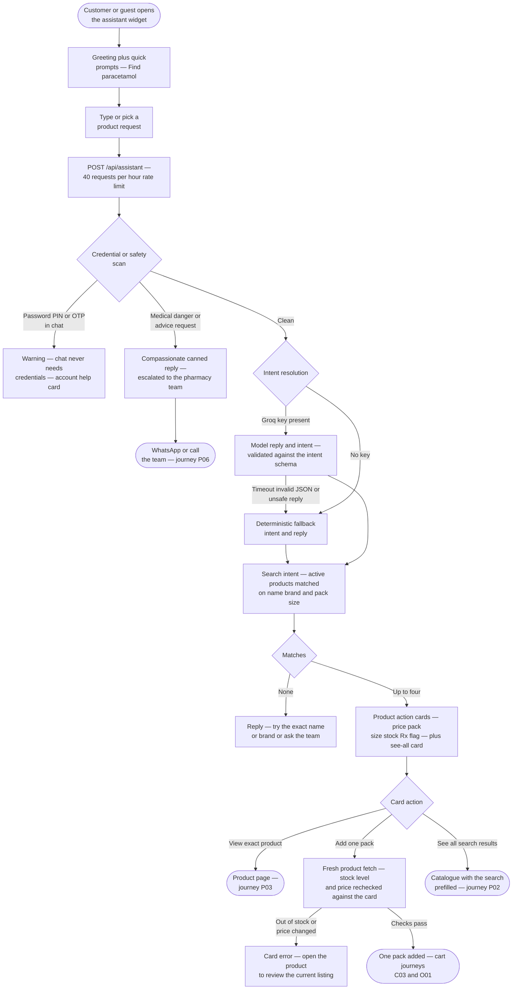

# H01 — Find products with the assistant

The assistant widget is a floating launcher on every non-admin view. Guests and signed-in customers can ask for a product in plain language ("Find paracetamol"); the request goes to `POST /api/assistant`, which rate-limits, scans for credentials and medical-safety triggers, and resolves an intent — deterministically via keyword rules, enhanced by a Groq model call when `GROQ_API_KEY` is configured (the deterministic path alone is fully functional, so the journey works without the provider). A `search` intent queries the catalogue (`db.product.findMany`, active only, matched on name/brand/pack size) and returns up to four product action cards plus a "See all search results" card. Card actions re-verify everything client-side: "View exact product" navigates to the listing; "Add one pack" re-fetches the product, re-checks stock and price, and only then adds one pack to the cart. Chat content is treated as untrusted — the assistant never sees account data.

| Metadata | Value |
| --- | --- |
| Primary actor | Customer or guest (search needs no session) |
| Secondary actors | System (assistant route, intent resolution, catalogue query) |
| Functional area | AI assistant |
| Entry point | `AssistantWidget` in `src/components/assistant/assistant-widget.tsx` |
| Status | Implemented — verified against code |
| End condition | Product page opened, pack added to the cart after re-check, or catalogue search opened |
| Related journeys | P02 (catalogue search), P03 (product page), C03 (cart), H02/H03 (booking and payment intents), P06 (human fallback) |

## Journey map

## Journey steps

### Step 1 — Open the assistant widget

- **User action:** The customer clicks the round launcher button (MessageCircle icon with an "AI" badge) fixed at the bottom-right.
- **Location:** `AssistantWidget` in `src/components/assistant/assistant-widget.tsx` (mounted in `src/app/page.tsx` for all non-admin views).
- **Destination:** The assistant panel with greeting and quick prompts.
- **Purpose:** Get help without navigating menus.
- **System behaviour:** The widget opens with a fixed greeting ("Karibu! … I can find exact products, help book a service, open checkout, or prepare a payment") and four quick-prompt chips ("Find paracetamol", "Book a medication review", "Take me to checkout", "Help me pay with M-Pesa"). A privacy strip states that chat messages go to AI while account and payment forms stay private; Escape closes the panel. No session is required to chat.
- **Outcome:** The conversation surface is ready.
- **Next step:** Ask for a product.
- **Alternative paths:** The "Prefer WhatsApp?" link at the bottom hands off to a human (journey P06) at any point.

### Step 2 — Ask for a product

- **User action:** The customer types a request like "find paracetamol 500mg" (Enter sends; Shift+Enter adds a newline; 1,800-character cap) or taps a quick prompt.
- **Location:** Composer in `assistant-widget.tsx` (`send`); `assistantApi.chat` in `src/lib/api-client.ts`.
- **Destination:** The message appears in the conversation with a loading chip.
- **Purpose:** Describe the product in the customer's own words.
- **System behaviour:** The whole conversation (user/assistant turns) is POSTed to `/api/assistant`. The route caps the request at 20 KB, rate-limits to 40 requests per hour per client, keeps only the last 8 messages, and takes the last user message (trimmed to 1,800 characters) as the trigger. Empty conversations get a canned welcome.
- **Outcome:** The request is submitted.
- **Next step:** Server-side safety scanning and intent resolution.
- **Alternative paths:** A failed request shows a fallback message directing the customer to WhatsApp or the pharmacy phone, marked escalated.

### Step 3 — Route processing: safety, intent, optional model

- **User action:** None — the server processes the message.
- **Location:** `POST /api/assistant` (`src/app/api/assistant/route.ts`); contracts in `src/lib/assistant/contracts.ts`.
- **Destination:** A resolved intent (search, navigate, book, pay, appointments, none).
- **Purpose:** Understand what the customer wants without acting on it.
- **System behaviour:** First, credential detection (`hasCredential`) — passwords, PINs, OTPs, API keys in chat get a warning reply and an account-help card, escalated. Then `safetyResponse` intercepts urgent danger and medical-advice phrasing (dosage, interactions, pregnancy safety, "what medicine should I take…") with canned compassionate replies that route to the pharmacist — escalation, no product actions. Otherwise the intent starts as the deterministic `fallbackIntent` (keyword rules that extract a search query by stripping filler words) with a deterministic reply. If a `GROQ_API_KEY` is present (and the message is not already a direct request the rules resolved), the route calls Groq's chat completions (model from `GROQ_MODEL`, default `openai/gpt-oss-20b`; temperature 0.4; 650 max tokens; 15-second timeout), redacts the conversation (`redact` masks tokens, phones, emails), validates the returned intent against `intentSchema` (a zod discriminated union), and only accepts the reply through `safeModelReply` (which rejects replies claiming completed actions and any credential echo). Any provider failure silently keeps the deterministic intent — the flow never breaks on the provider.
- **Outcome:** A trustworthy intent and reply.
- **Next step:** Product matching for search intents.
- **Alternative paths:** Medical-safety triggers end the product path here with escalation (step 1 alternative); the system prompt hard-codes that intents only *prepare* clickable actions and never claim success.

### Step 4 — Product matching

- **User action:** None — the search branch runs.
- **Location:** `resolveIntent` search branch in `src/app/api/assistant/route.ts`.
- **Destination:** A reply with product action cards.
- **Purpose:** Turn the query into exact catalogue listings.
- **System behaviour:** The query is split into at most 8 terms; `db.product.findMany` returns active products where every term matches (case-insensitive `contains`) the name, brand or pack size, ordered by name, capped at 4. Each becomes a `product` action card (`id`, label = name, `price`, `packSize`, `stockStatus`, `requiresPrescription`), followed by a `search` action ("See all search results"). The reply either lists the matches ("Check the name, strength, and pack size before choosing") or, with no matches, suggests the exact name/brand and the pharmacy team. Prescription products render with a "Prescription & pharmacist review required" line on the card.
- **Outcome:** Up to four exact product cards plus the catalogue hand-off.
- **Next step:** Act on a card.
- **Alternative paths:** For navigate intents the same route returns a single navigation card (labels like "Explore the shop"); those follow the app store's view router.

### Step 5 — Act on a product card

- **User action:** The customer clicks "View exact product" or "Add one pack" on a product card.
- **Location:** `AssistantActionCard` in `src/components/assistant/assistant-actions.tsx` (`run`, `add`).
- **Destination:** The product page, or the cart with one pack added.
- **Purpose:** Reach the real listing — the assistant's card is a pointer, not a source of truth.
- **System behaviour:** "View exact product" navigates to the product view with the card's id (journey P03). "Add one pack" re-fetches the product via `GET /api/products/[id]`, then re-checks: the stock status must still be `IN_STOCK`/`LOW_STOCK` with remaining quantity above what is already in the cart (else "There isn't enough stock for another pack."), and the current price must equal the card's price (else "The price has changed. Open the product to review its current price…"). Only then does `cart.add` add one pack (journey C03), and the card shows "One pack added to your bag". A lock prevents double-clicks; the add button is disabled for out-of-stock cards from the start.
- **Outcome:** The customer is on the listing or the item is in the cart.
- **Next step:** Review the product page or continue to checkout (journey O01).
- **Alternative paths:** On a stock/price failure the card shows the exact reason and the customer can open the product to see live data.

### Step 6 — Jump to full search results

- **User action:** The customer clicks "See all search results".
- **Location:** `run` search branch in `assistant-actions.tsx` (catalog filters + navigation).
- **Destination:** The catalogue view with the query applied.
- **Purpose:** Browse beyond the four cards with the catalogue's filters and sorting.
- **System behaviour:** The client resets catalogue filters, sets the search filter to the assistant's query (`setCatalogFilters({ search })`), and navigates to the catalog view — the standard journey P02 takes over. The widget closes on navigation so the results are unobstructed.
- **Outcome:** A full search results page.
- **Next step:** Filter, sort and open products (journeys P02/P03).
- **Alternative paths:** From there the customer can also ask the assistant again with a refined name or brand.

## Decision points

| Decision | Branches | Enforced by/where |
| --- | --- | --- |
| Credentials in chat? | Yes → warning + account-help card, escalated; no → continue | `hasCredential` in `src/lib/assistant/contracts.ts` |
| Safety trigger? | Urgent danger / medical advice → canned reply, escalation; product lookup → continue | `safetyResponse` in contracts; system prompt rules |
| Model available and needed? | Key present and no direct-request intent → Groq call; else/timeout/bad JSON → deterministic fallback | `GROQ_API_KEY` branch in `POST /api/assistant` |
| Model intent valid? | Passes `intentSchema` → used; fails → deterministic intent kept | zod validation in the route |
| Model reply safe? | No credential echo and no false-success claims → used; else → deterministic reply | `safeModelReply` in contracts |
| Search matches? | ≥ 1 → product cards + see-all; 0 → guidance reply | `findMany` result in `resolveIntent` |
| Add-to-cart re-check | Stock sufficient and price unchanged → add; else → explanatory error on the card | `add` in `assistant-actions.tsx` |
| Prescription product? | Card shows the review-required notice; add still allowed (Rx handled at checkout) | `requiresPrescription` on the card |

## Error and recovery paths

- **Rate limited (429):** 40 assistant requests per hour per client; wait and retry — the widget shows the standard error message.
- **Assistant route failure:** the widget posts an escalated fallback message with WhatsApp/call options (journey P06) — search is recoverable via the catalogue (journey P02).
- **Provider outage (Groq):** silently degrades to the deterministic intent/reply — product cards still return; only conversational polish is lost.
- **No catalogue match:** the reply suggests the exact name/brand or asking the team; the see-all card still opens the catalogue.
- **Stale card data (price/stock changed):** the add path re-fetches and refuses with the specific reason; "View exact product" always shows live data.
- **Out-of-stock product card:** the add button is disabled up-front; the view action shows the out-of-stock page with the notify option (journey C07).
- **Oversized conversation:** requests over 20 KB are rejected; only the last 8 messages are ever processed — restarting the chat avoids the limit.
- **Assistant claims something was done:** prevented by `safeModelReply` and the system prompt (actions only prepare, the site verifies) — no order, booking or payment can originate from chat text.

## Traceability

| Concern | Implementation reference |
| --- | --- |
| Widget UI and conversation | `src/components/assistant/assistant-widget.tsx` (greeting, quick prompts, composer, escalated hand-off) |
| Widget mounting | `src/app/page.tsx` (`AssistantWidget` on all non-admin views) |
| Chat client API | `assistantApi.chat` in `src/lib/api-client.ts` |
| Assistant endpoint | `POST /api/assistant` in `src/app/api/assistant/route.ts` (rate limit 40/h, 20 KB cap, last-8 messages) |
| Intent contract and safety | `intentSchema`, `safetyResponse`, `hasCredential`, `redact`, `fallbackIntent`, `fallbackReply`, `safeModelReply`, `assistantViews` in `src/lib/assistant/contracts.ts` |
| Product matching | search branch of `resolveIntent` — `db.product.findMany` on name/brand/packSize, active only, take 4 |
| Action cards | `AssistantActionCard` in `src/components/assistant/assistant-actions.tsx` (view/add/see-all, stock+price re-check, add lock) |
| Catalogue hand-off | `resetCatalogFilters` / `setCatalogFilters({ search })` / `navigate("catalog")` in `assistant-actions.tsx` |
| Model integration | Groq chat completions call (model, timeout, JSON intent validation) in the assistant route |
| Cart line creation | `cart.add` via `src/store/use-cart-store.ts` (journey C03) |

## Related journeys and documents

- **P02** — the catalogue search the see-all card opens
- **P03** — the product page the view action opens
- **C03 / O01** — the cart and checkout that follow an add
- **H02 / H03** — the booking and payment intents of the same assistant
- **P06** — the WhatsApp/call escalation path
- Docs: [AI assistant](../../features/ai-assistant.md) · [storefront and catalogue](../../features/storefront-and-catalogue.md) · [customer journeys](../../product/customer-journeys.md)
