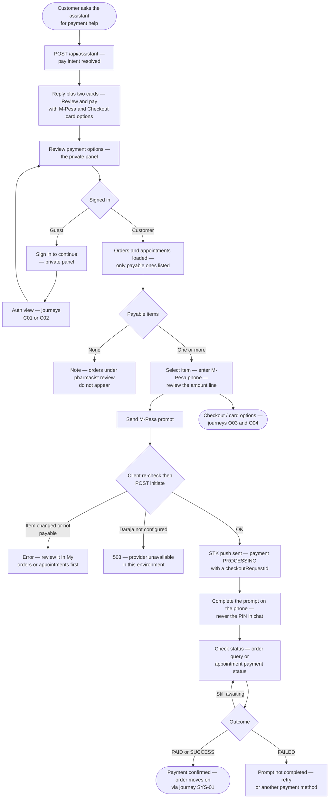

# H03 — Pay through the assistant

"Help me pay with M-Pesa" resolves to the assistant's `pay` intent, which returns two cards: "Review & pay with M-Pesa" (the private payment panel) and "Checkout / card options" (the normal checkout). The panel is deliberately outside the AI conversation — the model never sees orders, amounts or the phone number. Inside, the customer's payable items are listed (orders in `AWAITING_PAYMENT` with no active payment, and unpaid appointments), one is selected, an M-Pesa phone number entered, and the amount reviewed on an explicit line before the prompt is requested. The client re-fetches the item and verifies it is still payable at the same amount; the server route (`POST /api/payments/mpesa/initiate`) enforces ownership, status, idempotency and rate limits before sending the STK push via Daraja — the step that makes this journey environment-dependent. The M-Pesa PIN is never entered in chat; the customer completes the prompt on their phone and checks the status in the panel. Staff can also push a payment request to a customer's phone from the order view (`POST /api/orders/[id]/request-payment`), the staff-side companion of this flow.

| Metadata | Value |
| --- | --- |
| Primary actor | Customer (signed-in — payments require an account or guest order token) |
| Secondary actors | System (assistant route, M-Pesa initiate route, Daraja STK push, callback) |
| Functional area | AI assistant |
| Entry point | `AssistantWidget` → `AssistantPrivatePanel` → `PaymentForm` in `src/components/assistant/assistant-actions.tsx` |
| Status | Environment-dependent (requires live provider) — verified against code |
| End condition | STK push requested (payment `PROCESSING` with a checkoutRequestId) and status checked; completion via the Daraja callback (SYS-01) |
| Related journeys | O03 (standard M-Pesa checkout), H01/H02 (other assistant intents), O06 (orders view), SYS-01 (callback processing) |

## Journey map

## Journey steps

### Step 1 — Ask for payment help

- **User action:** The customer opens the assistant and asks for payment help (or taps "Help me pay with M-Pesa").
- **Location:** Composer in `src/components/assistant/assistant-widget.tsx`; `POST /api/assistant` (`src/app/api/assistant/route.ts`).
- **Destination:** A reply with two action cards.
- **Purpose:** Get to the right payment surface without hunting through views.
- **System behaviour:** The `pay` intent (deterministically matched by pay/mpesa keywords that are not informational questions; the model can produce it too) returns the fixed reply — "Open your payment options below to select your own order or appointment, check the amount, and request an M-Pesa prompt. Nothing is charged from this conversation alone." — plus two actions: `{ type: "pay", label: "Review & pay with M-Pesa" }` and a navigate card to the checkout view ("Checkout / card options").
- **Outcome:** The customer sees both payment routes.
- **Next step:** Open the review-and-pay panel.
- **Alternative paths:** The checkout card navigates to checkout (guests are asked to sign in with their bag preserved); card payment follows journey O04 from there.

### Step 2 — Open the private payment panel

- **User action:** The customer clicks "Review payment options" on the pay card.
- **Location:** `AssistantActionCard.run` → `AssistantPrivatePanel` → `PaymentForm` in `src/components/assistant/assistant-actions.tsx`.
- **Destination:** The in-widget panel ("A little help with payment.").
- **Purpose:** Perform an account action the AI conversation cannot see or influence.
- **System behaviour:** `pay` actions open the private panel. Guests see "Your account, kept private." with a "Sign in to continue" button (`openAuth("login", "orders", …)`); signed-in customers get the payment form. The panel explains: select a payable order or appointment, check the amount and phone number before sending a prompt.
- **Outcome:** The payment form is ready.
- **Next step:** Select what to pay.
- **Alternative paths:** Closing the panel cancels nothing — no request has been made.

### Step 3 — Select a payable order or appointment

- **User action:** The customer picks an item from the "Pay for" dropdown and types their M-Pesa number (e.g. 0712 345 678).
- **Location:** `PaymentForm` in `assistant-actions.tsx`; `ordersApi.myOrders()` + `serviceBookingsApi.mine()`; filters in `src/lib/assistant/payment-review.ts`.
- **Destination:** A review line: "Pay Sphere Pharmacy KSh … for <reference>. An M-Pesa approval prompt will be sent to …".
- **Purpose:** Choose exactly what to pay and where the prompt goes.
- **System behaviour:** The panel loads the customer's orders and bookings and filters them client-side: orders must be `AWAITING_PAYMENT` with a positive total and no payment in `SUCCESS`/`PROCESSING`/`PENDING` (`orderCanBePaid`); appointments must be in an active status (`PENDING`, `CONFIRMED`, `RESCHEDULED`, `ARRIVED`, `IN_PROGRESS`) with `paymentStatus` `UNPAID` or `FAILED` and a positive price (`bookingCanBePaid`). Orders under pharmacist review are excluded by design. The phone is validated against the Kenyan M-Pesa pattern before anything can be sent.
- **Outcome:** A concrete payable selection with an explicit amount review.
- **Next step:** Send the prompt.
- **Alternative paths:** "No payable items were found" explains that orders awaiting review will not appear; "View my orders / other payment options" navigates to the orders view (journey O06).

### Step 4 — Send the M-Pesa prompt

- **User action:** The customer clicks "Send M-Pesa prompt · KSh …".
- **Location:** `confirm` in `PaymentForm`; endpoints `POST /api/payments/mpesa/initiate` (orders) or `POST /api/service-bookings/[id]/pay/mpesa` (appointments).
- **Destination:** The "Request sent" status.
- **Purpose:** Trigger the STK push for the reviewed amount.
- **System behaviour:** The client re-fetches the item and re-checks it is still payable at the same amount (`orderCanBePaid` + `reviewAmount`, or the booking equivalents) — a changed order shows "This order changed. Please review it in My orders before paying." An idempotency key (a UUID kept per selection+phone and reused on retries) travels with the request. The order route enforces: a valid Kenyan Safaricom number, a well-formed idempotency key, 5 initiations per 15 minutes per order+phone, ownership (session user, staff, or a valid guest access token), status exactly `AWAITING_PAYMENT` with a positive whole-KES total, no prior successful payment, Daraja configured (503 otherwise), no in-flight request within 15 minutes, then reserves the payment attempt and sends the STK push (`initiateStkPush`), recording the `checkoutRequestId` on the `PROCESSING` payment. A duplicate idempotency key returns the original request instead of a second push.
- **Outcome:** The push is on the customer's phone; the panel says to complete it there and never enter the PIN in chat.
- **Next step:** Complete on the phone and check the status.
- **Alternative paths:** On provider-uncertain failures the payment is left `PROCESSING` with a reconciliation note and the panel reports an unclear outcome — check status before retrying.

### Step 5 — Check the payment status

- **User action:** The customer completes (or dismisses) the M-Pesa prompt on their phone, then clicks "Check payment status".
- **Location:** `check` in `PaymentForm`; endpoints `GET /api/payments/mpesa/query?checkoutRequestId=…` (orders) or `GET /api/service-bookings/[id]/payment-status` (appointments).
- **Destination:** A status message in the panel.
- **Purpose:** Learn the outcome without leaving the assistant.
- **System behaviour:** The query maps the payment (and order) status to a customer-facing message: `PAID`/`SUCCESS` → "Payment confirmed. Thank you—your payment status is now updated."; `FAILED` → guidance to open the order or appointment for next steps; otherwise → still awaiting confirmation, check again shortly. The authoritative state change happens in the Daraja callback (journey SYS-01), which flips the payment to `SUCCESS`, moves the order (e.g. to `PAID`), awards loyalty points and sends notifications — the panel only reads the result.
- **Outcome:** The customer knows whether the payment landed.
- **Next step:** Confirmed → done; failed/awaiting → retry or use another method.
- **Alternative paths:** "View my orders / other payment options" leads to the orders view (journey O06) where the same M-Pesa flow is available in full (journey O03).

### Step 6 — Staff-pushed prompts (the companion path)

- **User action:** None — staff initiate this for a customer at the counter or on the phone.
- **Location:** `POST /api/orders/[id]/request-payment` (`src/app/api/orders/[id]/request-payment/route.ts`).
- **Destination:** An M-Pesa prompt on the customer's phone for an existing order.
- **Purpose:** Let the pharmacy request payment for an order the customer already has.
- **System behaviour:** Restricted to staff roles (ADMIN, STAFF, PHARMACIST, and RIDER for their own out-for-delivery orders), rate limited to 5 per 15 minutes per order, it validates an idempotency key, requires an order in a payable status (`PRESCRIPTION_VERIFIED`, `AVAILABILITY_CONFIRMED`, `AWAITING_PAYMENT`, `READY_FOR_PICKUP`, `OUT_FOR_DELIVERY`) with reviewed prescriptions and no successful payment, resolves the phone from the body, guest phone or account phone, then reserves the attempt, sends the STK push, moves the order to `AWAITING_PAYMENT` where applicable, audits `PAYMENT_REQUESTED`, and notifies the customer in-app. The customer completes it exactly as in step 5.
- **Outcome:** The customer receives a payment prompt initiated by the pharmacy.
- **Next step:** Complete on the phone; the callback (SYS-01) finalizes.
- **Alternative paths:** The customer can always decline a prompt and pay through checkout instead (journeys O03/O04).

## Decision points

| Decision | Branches | Enforced by/where |
| --- | --- | --- |
| Intent | pay keywords vs informational question vs checkout navigate | `fallbackIntent` pay/navigate rules and system prompt in the assistant route |
| Signed in? | Guest → sign-in (orders destination); customer → payment panel | `AssistantPrivatePanel` session branch |
| Order payable? | `AWAITING_PAYMENT`, total > 0, no active payment → listed; else hidden | `orderCanBePaid` in `src/lib/assistant/payment-review.ts` |
| Appointment payable? | Active status + `UNPAID`/`FAILED` + price > 0 → listed; else hidden | `bookingCanBePaid` in payment-review.ts |
| Item still payable at the same amount at send time? | Yes → initiate; no → "changed" error | re-fetch + `reviewAmount` in `confirm` |
| Ownership | Session user, staff, or valid guest token → allowed; else 403 | `POST /api/payments/mpesa/initiate` |
| Duplicate or in-flight request? | Same idempotency key → original response; in-flight within 15 min → 409 | idempotency key + `reservePaymentAttempt` in the initiate route |
| Daraja configured? | Yes → STK push; no → 503 (environment dependency) | `isDarajaConfigured` in `src/lib/mpesa/daraja.ts` |

## Error and recovery paths

- **No payable items:** the panel explains orders under pharmacist review do not appear — pay after review, or check the orders view (journey O06).
- **Invalid phone (400):** the panel requires a valid Kenyan M-Pesa number before sending; correct and retry.
- **Item changed before sending:** the client blocks the request and points to My orders / My appointments — the amount must be re-reviewed.
- **Order not ready for payment (409):** the status moved (e.g. staff action) — the panel's stale copy is the cause; reopen from the orders view.
- **Already paid (409):** a successful payment exists (maybe from another device); check status instead of re-sending.
- **Rate limited (429):** 5 initiations per 15 minutes per order+phone — wait, then retry; the idempotency key prevents duplicate prompts for the same attempt.
- **Daraja unavailable (503):** not configured in this environment (the environment dependency) or the provider response was uncertain — the payment stays `PROCESSING` for reconciliation; check the status before another attempt.
- **Prompt ignored on the phone:** the payment eventually resolves as failed or expires; the panel's FAILED branch directs to the order for next steps.
- **Status check failure:** the panel advises viewing the order before making another payment — preventing double charges.

## Traceability

| Concern | Implementation reference |
| --- | --- |
| Pay intent branch | `resolveIntent` pay branch in `src/app/api/assistant/route.ts` (reply + "Review & pay with M-Pesa" + checkout cards) |
| Private payment panel | `AssistantPrivatePanel` / `PaymentForm` in `src/components/assistant/assistant-actions.tsx` |
| Payable filters | `orderCanBePaid`, `bookingCanBePaid`, `reviewAmount` in `src/lib/assistant/payment-review.ts` |
| Order M-Pesa initiation | `POST /api/payments/mpesa/initiate` in `src/app/api/payments/mpesa/initiate/route.ts` (ownership, status, idempotency, rate limit, `reservePaymentAttempt`, STK push) |
| Appointment M-Pesa initiation | `servicePaymentsApi.mpesa` → `POST /api/service-bookings/[id]/pay/mpesa` in `src/lib/api-client.ts` |
| Status checks | `paymentsApi.mpesaQuery` / `servicePaymentsApi.status` in `src/lib/api-client.ts` |
| Daraja client | `initiateStkPush`, `isDarajaConfigured` in `src/lib/mpesa/daraja.ts` |
| Callback completion | journey SYS-01 (`system/mpesa-callback.md`) — payment `SUCCESS`, order `PAID`, loyalty award |
| Staff-pushed prompt | `POST /api/orders/[id]/request-payment` in `src/app/api/orders/[id]/request-payment/route.ts` |
| Client APIs | `ordersApi.myOrders` / `get`, `serviceBookingsApi.mine`, `paymentsApi.mpesaInitiate` / `mpesaQuery` in `src/lib/api-client.ts` |

## Related journeys and documents

- **O03** — the full M-Pesa checkout journey this panel parallels
- **O04** — the card-payment alternative via the checkout card
- **H01 / H02** — the assistant's product-finding and booking journeys
- **O06** — the orders view the panel links out to
- **SYS-01** — the Daraja callback that completes the payment
- Docs: [payments and refunds](../../features/payments-and-refunds.md) · [AI assistant](../../features/ai-assistant.md) · [payment lifecycle](../../workflows/payment-lifecycle.md)
