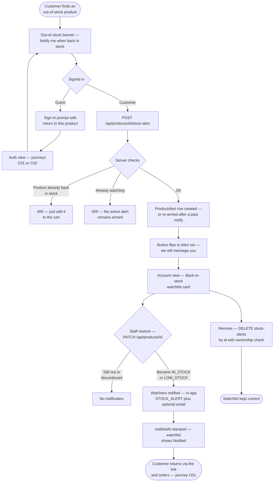

# C07 — Subscribe to back-in-stock alerts

When a product is out of stock, its page swaps the purchase actions for a "Notify me when back in stock" button. Subscribing creates a `ProductAlert` row (one per customer per product); the account view's "Back-in-stock watchlist" card lists active and already-notified watches and can remove them. The trigger is a staff product update: when `PATCH /api/products/[id]` moves a product from `OUT_OF_STOCK`/inactive to `IN_STOCK`/`LOW_STOCK`, every pending watcher is notified (in-app `STOCK_ALERT` plus an optional email), and the alert row is stamped `notifiedAt` — which both flips the watchlist to "Notified" and lets the customer re-arm it later.

| Metadata | Value |
| --- | --- |
| Primary actor | Customer (signed-in — alerts require an account) |
| Secondary actors | Staff (restock via product update), System (notification fan-out) |
| Functional area | Storefront and notifications |
| Entry point | Product view out-of-stock block — `src/components/views/product-view.tsx` |
| Status | Implemented — verified against code |
| End condition | Watcher notified on restock; `ProductAlert.notifiedAt` stamped; watchlist reflects Watching or Notified |
| Related journeys | P03 (the product page), P02 (finding products), C06 (the inbox the alert lands in), A07 (staff stock update), O01 (ordering once back) |

## Journey map

## Journey steps

### Step 1 — Encounter an out-of-stock product

- **User action:** The customer opens a product whose stock badge says out of stock (from the catalogue, journey P02, or a saved item, journey P03).
- **Location:** Out-of-stock block in `src/components/views/product-view.tsx` (`outOfStock` derivation).
- **Destination:** The dashed out-of-stock panel below the product details.
- **Purpose:** Decide what to do about an unavailable item.
- **System behaviour:** `outOfStock` is true when `stockStatus` is `OUT_OF_STOCK` or `DISCONTINUED`. The panel says the product is out of stock right now, and — only for `OUT_OF_STOCK` — shows the "Notify me when back in stock" button. Discontinued products show no notify or buy actions at all. The quantity stepper and add-to-cart are replaced entirely.
- **Outcome:** The customer sees the notify option (or a final "discontinued" notice).
- **Next step:** Subscribe (or browse related products / order via WhatsApp).
- **Alternative paths:** WhatsApp ordering remains available as the human fallback for urgent needs (journey P06).

### Step 2 — Sign in if needed

- **User action:** A guest clicking the notify button is redirected to sign-in.
- **Location:** `handleStockAlert` in `product-view.tsx` → `openAuth("login", "product", "Sign in so we can alert you the moment it's back in stock.", { productId })`.
- **Destination:** The auth view (login tab, with register and OTP tabs available).
- **Purpose:** Alerts are tied to an account so the restock notification can find the customer.
- **System behaviour:** The app store records the auth intent (`authNext: product`, params carrying the product id) so a successful sign-in (journeys C01/C02) returns the customer to this exact product with the message shown. No alert row exists yet — nothing to clean up if the customer abandons sign-in.
- **Outcome:** The customer is signed in and back on the product page.
- **Next step:** Subscribe to the alert.
- **Alternative paths:** The customer may create an account or use phone-code sign-in; both return to the product.

### Step 3 — Subscribe to the alert

- **User action:** The signed-in customer clicks "Notify me when back in stock".
- **Location:** `catalogApi.stockAlert.create(product.id)` in `src/lib/api-client.ts`; endpoint `POST /api/products/[id]/stock-alert` (`src/app/api/products/[id]/stock-alert/route.ts`).
- **Destination:** The button becomes "Alert set — we'll message you" with a success toast.
- **Purpose:** Register interest in this product's restock.
- **System behaviour:** The route requires a customer session, loads the product and rejects inactive ones (404). If the product is currently `IN_STOCK` or `LOW_STOCK` it returns 400 ("This product is in stock right now." — stale page). It then looks up an existing alert by the unique `productId_userId` pair: an active watch (`notifiedAt` null) returns 409 ("You're already watching this product."), while a previously notified one is re-armed by clearing `notifiedAt`; otherwise a new `ProductAlert` row is created. The response (201) is the `StockAlertDTO` the watchlist renders. Client-side the button locks (`alertSet`) to prevent double submits, resetting when the customer switches products.
- **Outcome:** An armed alert exists for this customer and product.
- **Next step:** Continue shopping; manage the list later.
- **Alternative paths:** Errors surface as toasts with the server's message — a 409 means the watch is already active and nothing is lost.

### Step 4 — Manage the watchlist

- **User action:** The customer opens My account and reviews the "Back-in-stock watchlist" card, optionally removing entries.
- **Location:** Watchlist card in `src/components/views/account-view.tsx` (`reloadWatchlist`); endpoints `GET /api/products/stock-alerts` and `DELETE /api/products/stock-alerts?id=`.
- **Destination:** The list of watched products with active counts.
- **Purpose:** See and prune what is being watched.
- **System behaviour:** `GET /api/products/stock-alerts` requires a customer session and returns the customer's alerts (newest first) with the product name and an `active` flag (`notifiedAt === null`); the card shows an "N active" badge and per-item state — "Watching · added <time ago>" (bell icon) or "Notified · <time ago>" (check icon). Product names link to the product page. Remove calls the DELETE route, which requires the alert id as a query parameter, verifies the row belongs to the caller (404 otherwise), and deletes it; the list reloads with a toast. Load failures degrade to an empty list.
- **Outcome:** The watchlist matches what the customer actually wants to track.
- **Next step:** Wait for the restock notification.
- **Alternative paths:** A notified entry can be removed or left; re-arming happens from the product page (step 3), not the watchlist.

### Step 5 — Staff restock triggers the notification

- **User action:** None — a staff member (admin or pharmacist) updates the product's stock.
- **Location:** `PATCH /api/products/[id]` (`src/app/api/products/[id]/route.ts`), became-available block; staff journey A07.
- **Destination:** Notifications queued for every pending watcher.
- **Purpose:** Turn a stock change into customer notifications.
- **System behaviour:** After the product update commits, the route computes `becameAvailable`: the previous state was `OUT_OF_STOCK` or inactive AND the new state is `IN_STOCK` or `LOW_STOCK` (a stock-status change without that transition — e.g. staying out of stock with a different quantity — notifies nobody). When true, it loads all watchers with `notifiedAt: null`, builds an email from `backInStockTemplate` (product name, price, product URL from `NEXT_PUBLIC_APP_URL`), and for each watcher calls `notifyCustomer` with event `STOCK_ALERT`, title "<Product> is back in stock!", an in-app `IN_APP` entry carrying the product link and metadata, and the email when the watcher has an address. Each processed alert is then stamped `notifiedAt: new Date()` — one notification per restock cycle. This is the only code path that dispatches back-in-stock notifications (the bulk-import and sync routes do not trigger it).
- **Outcome:** Every pending watcher is notified exactly once for this restock.
- **Next step:** The customer receives the update.
- **Alternative paths:** If the product is set straight to `DISCONTINUED`, watchers receive nothing and the product page loses the notify button.

### Step 6 — Receive and act on the notification

- **User action:** The customer sees the update (bell badge/toast on an open tab, inbox entry, or email) and clicks it.
- **Location:** Notification center / account inbox (journey C06); email client for the emailed copy.
- **Destination:** The product page (notification link) — or the account view for emails without a direct link.
- **Purpose:** Buy the item while it lasts.
- **System behaviour:** The in-app entry carries the product URL; clicking marks it read and navigates (journey C06). The product page now shows live stock and purchase actions; the watchlist entry shows "Notified". Adding to cart and checking out follows journeys P03/O01 — the server re-validates stock at order time, so the customer can still miss out if stock is exhausted.
- **Outcome:** The customer is back on a buyable product.
- **Next step:** Order it (journeys O01/O02/X02), or re-arm the alert after a future sell-out.
- **Alternative paths:** If stock is gone again by the time they arrive, the page shows out-of-stock and the customer can subscribe again — the old alert is re-armed via the 409-then-update path in step 3.

## Decision points

| Decision | Branches | Enforced by/where |
| --- | --- | --- |
| Stock state | `OUT_OF_STOCK` → notify button; `DISCONTINUED` → none; in/low stock → normal purchase actions | `outOfStock` derivation and render branches in `product-view.tsx` |
| Signed in? | Guest → auth with product return; customer → subscribe | `isCustomer` check in `handleStockAlert`; `requireCustomer()` in the route |
| Product still out of stock? | In/low stock → 400 (page was stale); out/inactive → proceed | stock-status guard in `POST /api/products/[id]/stock-alert` |
| Existing alert? | Active → 409; previously notified → re-arm (`notifiedAt: null`); none → create | `productId_userId` unique lookup in the stock-alert route |
| Restock transition? | Became `IN_STOCK`/`LOW_STOCK` from out/inactive → notify; otherwise → nothing | `becameAvailable` in `PATCH /api/products/[id]` |
| Watcher has an email? | Yes → in-app + email; no → in-app only | `w.user?.email` branch in the became-available block |
| Removing an alert? | Owner match → delete; mismatch/missing id → 404/400 | `DELETE /api/products/stock-alerts` |

## Error and recovery paths

- **Product in stock at subscribe time (400):** the catalogue state was stale — the page reflects current stock; simply add the item to the cart.
- **Already watching (409):** the existing alert stays armed; the toast confirms the state, no duplicate row is created.
- **Product vanished or deactivated (404):** the alert cannot be created; the product page shows its not-found empty state.
- **Subscription network failure:** a toast asks the customer to retry; no row was written.
- **Watchlist load failure:** the card falls back to an empty list on error — reopening the account view reloads it.
- **Removing someone else's alert:** impossible — the delete route scopes rows to the caller's id (404).
- **Restock notification missed:** there is no re-delivery — but the watchlist keeps the "Notified" entry with the product link, and the customer can re-arm the alert on the product page for the next cycle.
- **Sold out again before ordering:** stock is re-checked at order creation (journey O01); the customer can subscribe again via the re-arm path.

## Traceability

| Concern | Implementation reference |
| --- | --- |
| Product page alert UI | `src/components/views/product-view.tsx` (`handleStockAlert`, out-of-stock block, `alertSet`/`alertBusy` states) |
| Subscribe endpoint | `POST /api/products/[id]/stock-alert` in `src/app/api/products/[id]/stock-alert/route.ts` |
| Watchlist endpoints | `GET` / `DELETE /api/products/stock-alerts` in `src/app/api/products/stock-alerts/route.ts` |
| Watchlist card | `src/components/views/account-view.tsx` (Back-in-stock watchlist card, active badge, remove action) |
| Restock trigger and fan-out | became-available block in `PATCH /api/products/[id]` (`src/app/api/products/[id]/route.ts`) — `notifyCustomer` + `notifiedAt` stamp |
| Restock email template | `backInStockTemplate` in `src/lib/email/templates.ts` |
| Notification fan-out mechanics | `enqueue` / `notifyCustomer` in `src/lib/notify.ts` (in-app row + email/push jobs; dispatch in SYS-10) |
| Client API | `catalogApi.stockAlert` (create/list/remove) in `src/lib/api-client.ts` |
| Stock statuses | `STOCK_STATUSES` in `src/lib/constants.ts` |
| Data model | `ProductAlert` model (`prisma/schema.prisma`) — `productId`, `userId`, `notifiedAt`, unique `productId_userId` |
| Staff-side stock update | journey A07 (`staff/update-products-stock.md`) |

## Related journeys and documents

- **P03** — the product page this button lives on
- **P02** — finding products that might be out of stock
- **C06** — the inbox, push and email channels the restock alert travels on
- **A07** — the staff stock update that triggers the notification
- **O01** — ordering once the product is back
- Docs: [inventory and stock](../../features/inventory-and-stock.md) · [notifications](../../features/notifications.md) · [storefront and catalogue](../../features/storefront-and-catalogue.md)
