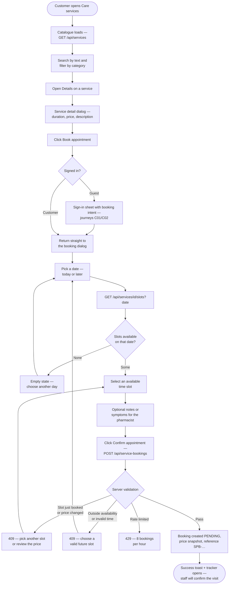

# S01 — Browse services and book an appointment

Sphere Pharmacy publishes bookable clinical services (screenings, consultations, wellness checks) alongside the product catalogue. Browsing and slot discovery are public; submitting a booking requires an account. The booking dialog loads real availability for a chosen date — slots are computed server-side from the service's weekly rules in fixed Nairobi time, capacity one per slot, past and already-booked slots excluded — and the create route re-validates the slot, the exact duration and the price before creating a `PENDING` booking. A submitted booking is a request: it is not a confirmed visit until staff confirm it (journey A11).

| Metadata | Value |
| --- | --- |
| Primary actor | Customer (guests can browse; account needed to book) |
| Secondary actors | Staff (confirmation, rescheduling — journeys A11/A12) |
| Functional area | Services and bookings |
| Entry point | Services view (`/services`) — catalogue tab |
| Status | Implemented — verified against code |
| End condition | `ServiceBooking` status `PENDING`, `paymentStatus` `UNPAID`, reference issued; customer + staff notified |
| Related journeys | S02 (paying for the booking), S03 (tracking/reviewing), A10 (service publishing), A11 (staff workflow), H02 (assistant-guided booking) |

## Journey map

## Journey steps

### Step 1 — Browse the service catalogue

- **User action:** The customer opens Care services and browses the catalogue, optionally searching by text and filtering by category.
- **Location:** Services view, catalogue tab — `src/components/views/services-view.tsx`; data from `servicesApi.list()` → `GET /api/services`.
- **Destination:** A filtered list of services.
- **Purpose:** Find the relevant care service.
- **System behaviour:** The catalogue route returns only active services for the public (staff can pass `includeInactive=true`), ordered featured-first then by sort order and name, with images. The view derives the distinct category chips from the loaded services and filters client-side by category and free-text match across name, category, short and full description.
- **Outcome:** The customer sees the available services with pricing and imagery.
- **Next step:** Open a service's details.
- **Alternative paths:** Load failures show an error message; the customer can retry. Deep links (`?previewServiceId=`) open a specific service's detail dialog directly (used by the homepage cards).

### Step 2 — Open the service details

- **User action:** The customer clicks Details on a service card.
- **Location:** `ServiceDetailDialog` in `services-view.tsx`.
- **Destination:** The detail dialog.
- **Purpose:** Review what the service involves before committing to a time.
- **System behaviour:** The dialog shows the hero image, category, duration in minutes, the price label (or the KES price, or "Free / Inquire" when unset), the full description, and a "what to expect" section describing the confidential in-person consultation. The Book appointment button moves to booking.
- **Outcome:** The customer understands the service, its duration and cost.
- **Next step:** Start booking.
- **Alternative paths:** Customers with questions can use the pharmacy contact channels (journey P06) instead of booking.

### Step 3 — Sign in with booking intent

- **User action:** A guest clicking Book appointment is taken to the sign-in sheet; after authenticating they are returned directly to the booking dialog.
- **Location:** `ServiceDetailDialog` book handler in `services-view.tsx` (`openAuth("login", "services", …, { serviceId })`).
- **Destination:** The booking dialog for the chosen service.
- **Purpose:** Tie the appointment to a real customer account (required for notifications, payment and review).
- **System behaviour:** The service id is stored as an auth intent; once a session exists, a deep-link effect re-opens the booking dialog for that service automatically. Signed-in customers skip straight to the dialog. The create route independently requires a customer session (`requireCustomer`) and returns 401 otherwise.
- **Outcome:** An authenticated customer in the booking dialog.
- **Next step:** Pick a date and slot.
- **Alternative paths:** Guests who decline to sign in can still browse; the assistant can also guide booking (journey H02).

### Step 4 — Pick a date and an available slot

- **User action:** The customer picks a date (today or later) and selects one of the offered time slots.
- **Location:** `BookingDialog` in `services-view.tsx`; slots from `serviceBookingsApi.slots(serviceId, date)` → `GET /api/services/[id]/slots?date=YYYY-MM-DD` (`src/app/api/services/[id]/slots/route.ts`).
- **Destination:** A selected slot with start/end times and a label.
- **Purpose:** Choose a concrete, bookable time.
- **System behaviour:** The slots route loads the service's enabled availability rules for that weekday and steps through them in `durationMinutes` increments while a full slot fits; slots in the past and slots overlapping an existing active booking (status not CANCELLED/REJECTED/NO_SHOW) are excluded — capacity is strictly one per slot. All slot math is in fixed Nairobi time (UTC+3) regardless of server timezone. The dialog shows a loading state, an explicit empty state when nothing is available ("No slots are available on this date"), and a summary of the selected slot and expected duration.
- **Outcome:** A valid future slot is selected.
- **Next step:** Add notes and confirm.
- **Alternative paths:** No availability on the chosen day → pick another date. If the service has no rules enabled, every date will be empty — the customer should contact the pharmacy (staff manage availability in journey A10).

### Step 5 — Add notes and confirm the booking

- **User action:** The customer optionally adds notes or symptoms (fictional for demos) and clicks "Confirm appointment".
- **Location:** `submit` in `BookingDialog`; endpoint `POST /api/service-bookings` (`src/app/api/service-bookings/route.ts`).
- **Destination:** A created booking (or an actionable error).
- **Purpose:** Submit the booking request.
- **System behaviour:** The route requires a customer session, caps the body (16 KB) and rate-limits bookings (8 per hour per user). It re-validates everything server-side: the service is active; the optional `expectedPrice`, when sent, matches the current price exactly (409 "price changed" otherwise); start/end are valid and exactly `durationMinutes` apart; the start is in the future and at most 180 days ahead; the slot fits within one Nairobi day and inside an enabled availability rule; and no conflicting booking exists (409 "That slot was just booked"). On success it creates the booking with reference `SPB-<12hex>`, status `PENDING`, `paymentStatus` `UNPAID`, a price snapshot, the customer's notes (≤ 1,000 chars) and an initial history entry (actor CUSTOMER), then notifies the customer (booking received, pending confirmation) and staff (`SERVICE_BOOKING` to ADMIN/PHARMACIST/STAFF).
- **Outcome:** The booking exists as a PENDING request.
- **Next step:** See the confirmation and tracker.
- **Alternative paths:** Slot races and price drift return 409 with clear guidance (re-pick the slot; the dialog re-fetches); availability mismatches (e.g. a stale slot after staff changed rules) also return 409.

### Step 6 — Receive the pending booking

- **User action:** The customer reads the success toast and the auto-opened status tracker.
- **Location:** `handleBookingCreated` in `services-view.tsx` (toast with "Track status & details" action; `BookingTraceDialog` auto-opens — journey S03).
- **Destination:** The tracker dialog for the new booking.
- **Purpose:** Give the customer instant reassurance and the reference.
- **System behaviour:** The toast shows the service, reference and formatted Nairobi time; the tracker shows the progress milestones with "Awaiting pharmacy schedule verification" as the current stage. Staff confirm (or reschedule/cancel) the booking in their workspace (journeys A11/A12); the status then advances (CONFIRMED → ARRIVED → IN_PROGRESS → COMPLETED) and reminders go out 24 hours and 2 hours before the visit (journey SYS-07). Payment is chosen separately (journey S02).
- **Outcome:** The customer knows the request is in and what happens next.
- **Next step:** Optionally choose payment (journey S02); otherwise just attend.
- **Alternative paths:** If staff decline the request, the customer sees CANCELLED/REJECTED with guidance to book another slot (journey S03).

## Decision points

| Decision | Branches | Enforced by/where |
| --- | --- | --- |
| Viewer signed in? | Guest browsing → allowed; guest booking → sign-in with intent; customer → book | `openAuth` intent in `services-view.tsx`; `requireCustomer` in `POST /api/service-bookings` |
| Catalogue scope | Public → active services only; staff → optional inactive | `includeInactive` handling in `GET /api/services` |
| Slots for a date | Rules enabled for that weekday → computed slots; none → empty state | `GET /api/services/[id]/slots` (weekday rules, duration stepping, overlap exclusion) |
| Slot still free at submit? | No conflicting booking → created; conflict → 409 "just booked" | overlap check + create guard in `POST /api/service-bookings` |
| Price unchanged? | `expectedPrice` matches → proceed; drift → 409 "price changed" | price equality check in `POST /api/service-bookings` |
| Slot shape valid? | Exact duration, future, ≤ 180 days, one Nairobi day, inside a rule → accept; else 400/409 | validation block in `POST /api/service-bookings` |
| Booking limit | ≤ 8 per hour per user → accept; beyond → 429 | `service-booking` rate limit |
| Initial state | Always `PENDING` + `UNPAID` — confirmation and payment are separate steps | booking creation data in `POST /api/service-bookings` |

## Error and recovery paths

- **Catalogue fails to load:** an error message appears; retrying reloads the list. Services are never cached stale in the view.
- **No slots on a date:** explicit empty state advising another day; this is normal (capacity 1, business hours only), not a fault.
- **Slot raced (409):** someone booked the same moment; the customer re-picks from the refreshed slot list.
- **Price changed (409):** staff edited the price between opening the dialog and confirming; the customer reviews the updated price before booking again.
- **Invalid slot submission (400/409):** a stale or manipulated slot (past time, wrong duration, outside rules) is rejected server-side — the dialog's own slot source makes this rare.
- **Rate limited (429):** 8 bookings per hour per user; wait before submitting more.
- **Not signed in (401):** the dialog routes the customer through sign-in and preserves the booking intent so nothing is lost.
- **Service deactivated between browsing and booking (404):** the service is no longer available; refresh the catalogue.

## Traceability

| Concern | Implementation reference |
| --- | --- |
| Services view (catalogue, filters, dialogs) | `src/components/views/services-view.tsx` |
| Catalogue endpoint | `GET /api/services` (`src/app/api/services/route.ts`) — active-only for public |
| Service detail dialog | `ServiceDetailDialog` in `services-view.tsx` |
| Booking dialog | `BookingDialog` in `services-view.tsx` (date picker, slot grid, notes, submit) |
| Slots endpoint | `GET /api/services/[id]/slots` (`src/app/api/services/[id]/slots/route.ts`) — Nairobi UTC+3 slot math |
| Booking creation | `POST /api/service-bookings` (`src/app/api/service-bookings/route.ts`) |
| Typed clients | `servicesApi.list`, `serviceBookingsApi.slots/create` in `src/lib/api-client.ts` |
| Availability rules model | `ServiceAvailability` model (`prisma/schema.prisma`); managed in journey A10 |
| Booking statuses and history | `ServiceBooking`, `ServiceBookingStatusHistory` models (`prisma/schema.prisma`) |
| Notifications | `notifyServiceBooking`, `notifyStaff` from `src/lib/notify.ts` |
| Reminders (later) | `GET /api/cron/service-booking-reminders` — journey SYS-07 |
| Workflow deep dive | `docs/workflows/service-bookings.md` |
| API contract | `openapi/sphere-api.yaml` — `GET /services`, `GET /services/{id}/slots`, `POST /service-bookings` |

## Related journeys and documents

- **S02** — choosing how to pay for the booked appointment
- **S03** — tracking the appointment and reviewing the completed visit
- **A10** — staff publishing the service and setting the availability rules
- **A11** — staff confirming and running the appointment
- **H02** — booking the same services through the AI assistant
- Docs: [services and bookings](../../features/services-and-bookings.md) · [service bookings workflow](../../workflows/service-bookings.md)
