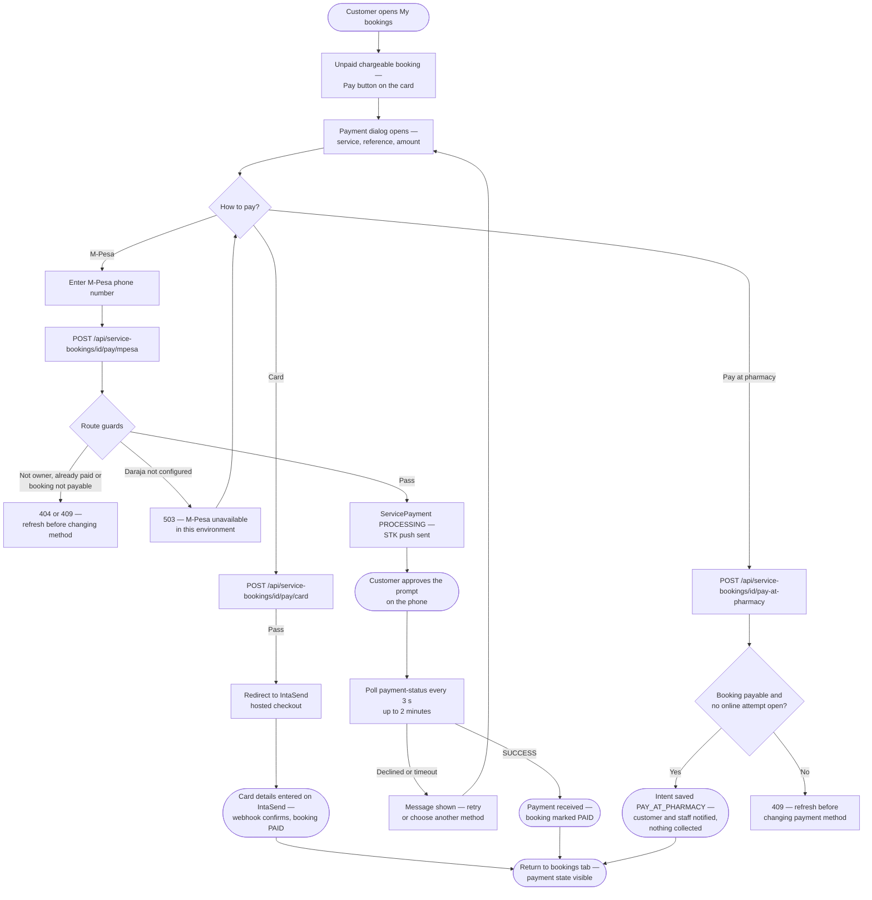

# S02 — Choose appointment payment

Appointment payment is a separate decision from booking: an unpaid, chargeable booking can be paid online at any time before the visit (M-Pesa STK push or IntaSend hosted card checkout — the same provider integrations as order payments, with service-scoped idempotency keys and callbacks) or the customer can declare the intent to pay at the pharmacy counter. The choice UI and the counter option are fully implemented and work end-to-end; the M-Pesa and card branches additionally require live provider credentials (Daraja/IntaSend) to exercise — they fail closed with 503 when the environment is not configured, exactly like journeys O03/O04.

| Metadata | Value |
| --- | --- |
| Primary actor | Customer (booking owner) |
| Secondary actors | System (provider callbacks — SYS-01 and the IntaSend service webhook), Staff (counter payment on the visit day) |
| Functional area | Services and bookings |
| Entry point | My bookings card → Pay, or tracker → "Pay Now via M-Pesa" |
| Status | Implemented — verified against code (M-Pesa/card branches are provider-dependent) |
| End condition | `ServiceBooking.paymentStatus` is `PAID` (provider-confirmed) or `PAY_AT_PHARMACY` (intent recorded, nothing collected) |
| Related journeys | S01 (booking), S03 (tracking), O03/O04 (order-side equivalents), SYS-01 (M-Pesa callback) |

## Journey map

## Journey steps

### Step 1 — Open the payment dialog

- **User action:** On an unpaid, chargeable booking, the customer clicks Pay (booking card) or "Pay Now via M-Pesa" (tracker dialog).
- **Location:** `ServicePaymentDialog` in `src/components/views/services-view.tsx`; eligibility for the button: `price > 0`, `paymentStatus !== "PAID"`, status not CANCELLED/REJECTED.
- **Destination:** The payment dialog.
- **Purpose:** Decide how the visit will be paid for.
- **System behaviour:** The dialog shows the service name, booking reference and total, and explains the flexible options: pay securely now via M-Pesa or card, or pay at the pharmacy counter during the visit. It also opens from the tracker's payment section, which displays the current payment status (Paid / Pay at pharmacy counter / Unpaid).
- **Outcome:** The customer sees the amount and the three options.
- **Next step:** Choose a branch.
- **Alternative paths:** Free services (price null or 0) show "Free Consultation" and no payment action; completed/cancelled bookings are not payable.

### Step 2 — Pay with M-Pesa

- **User action:** The customer enters an M-Pesa phone number and clicks "Pay with M-Pesa".
- **Location:** `payMpesa` in `ServicePaymentDialog`; endpoint `POST /api/service-bookings/[id]/pay/mpesa` (`src/app/api/service-bookings/[id]/pay/mpesa/route.ts`).
- **Destination:** An STK prompt on the customer's phone and a polling state in the dialog.
- **Purpose:** Pay the appointment fee from the customer's M-Pesa wallet.
- **System behaviour:** The route requires the booking owner (404 otherwise), rejects already-paid or non-payable bookings (CANCELLED/REJECTED/COMPLETED → 409), validates the Kenyan M-Pesa number, requires a whole-KES amount, enforces the idempotency key and rate limit (5 per 15 minutes per booking+phone), and fails closed with 503 when Daraja is not configured. It blocks a second in-flight push (409) and reserves a `ServicePayment` (provider MPESA, method STK_PUSH, status PROCESSING) before calling `initiateStkPush` with the **service callback** URL (`/api/payments/mpesa/service-callback`), storing the `checkoutRequestId`. The dialog then polls `GET /api/service-bookings/[id]/payment-status` every 3 seconds for up to 2 minutes; on `SUCCESS` it shows the "Payment received!" state and marks the booking paid in the UI. The provider outcome itself is only trusted via the authenticated service callback (journey SYS-01's service-scoped twin) — the polling endpoint is read-only.
- **Outcome:** The booking is `PAID` with a successful ServicePayment, or a failure message with retry guidance.
- **Next step:** See the paid state on the booking (journey S03).
- **Alternative paths:** Declines/timeouts leave the booking unpaid and payable again; a pending push must be resolved (checked) before starting another.

### Step 3 — Pay with card

- **User action:** The customer clicks "Pay with Card".
- **Location:** `payCard` in `ServicePaymentDialog`; endpoint `POST /api/service-bookings/[id]/pay/card` (`src/app/api/service-bookings/[id]/pay/card/route.ts`).
- **Destination:** A redirect to IntaSend's hosted checkout page.
- **Purpose:** Pay by Visa/Mastercard without exposing card data to Sphere.
- **System behaviour:** The route requires the owner, rejects non-payable or zero-price bookings, fails closed when IntaSend is not configured, and reserves a `ServicePayment` (provider INTASEND, method HOSTED_CHECKOUT) with a service-scoped idempotency key (`service:{id}:intasend:{key}`). It creates a hosted checkout session with the booking amount and customer details, sets the redirect back to `/services?tab=bookings`, stores the checkout id and URL on the payment, and returns the URL; the dialog redirects the browser there. Card details are entered only on IntaSend; the outcome is confirmed by the authenticated IntaSend webhook (service path), after which the booking's payment becomes `SUCCESS`/`PAID`.
- **Outcome:** After completing the provider steps, the customer returns to the bookings tab and sees the paid state.
- **Next step:** Verify the state on My bookings (refresh if it still shows processing).
- **Alternative paths:** Provider outages return "Card checkout is temporarily unavailable"; abandoned checkouts leave the payment PROCESSING until reconciled — the booking stays payable afterwards.

### Step 4 — Choose pay at pharmacy

- **User action:** The customer clicks "Pay at pharmacy counter during visit".
- **Location:** `ServicePaymentDialog` pay-at-pharmacy handler; endpoint `POST /api/service-bookings/[id]/pay-at-pharmacy` (`src/app/api/service-bookings/[id]/pay-at-pharmacy/route.ts`).
- **Destination:** A saved preference — the dialog closes with a toast.
- **Purpose:** Defer payment to the counter during the visit.
- **System behaviour:** In a Serializable transaction the route verifies ownership and payability (not PAID; status not CANCELLED/REJECTED/COMPLETED/NO_SHOW; **no open or successful online payment attempt**), sets the booking's `paymentStatus` to `PAY_AT_PHARMACY`, and upserts a `ServicePayment` row (provider `IN_STORE`, method `PAY_AT_PHARMACY`, status `PENDING`, idempotency key `service:{id}:pay-at-pharmacy`). The customer is notified that no payment has been collected and staff (ADMIN/STAFF) are notified that payment is due in store. This is an intent marker: there is no in-app service cash-settlement endpoint — the counter payment is completed in person.
- **Outcome:** The booking shows "Pay at counter"; nothing has been charged.
- **Next step:** Pay at the pharmacy during the visit.
- **Alternative paths:** If an online attempt is open or the booking changed, the route returns 409 advising a refresh before changing the payment method.

### Step 5 — See the resulting payment state

- **User action:** The customer returns to the bookings tab (or is redirected back by IntaSend) and checks the booking card.
- **Location:** Bookings tab in `services-view.tsx`; data from `serviceBookingsApi.mine()` (`GET /api/service-bookings/mine`); payment status also via `GET /api/service-bookings/[id]/payment-status`.
- **Destination:** The booking card and tracker showing the payment state.
- **Purpose:** Confirm the choice took effect on the right booking.
- **System behaviour:** The card's fee row shows a tick-marked "Paid", "Pay at counter" or "Unpaid" from `paymentStatus`; the tracker's payment section repeats it with a Pay Now button while unpaid and not cancelled. Online payments become `PAID` only through the provider callbacks; the read-only status endpoint (rate-limited 40/10 min) backs the dialog's polling.
- **Outcome:** The customer has a clear, truthful payment state for the appointment.
- **Next step:** Attend the visit (journey S03).
- **Alternative paths:** A pending online payment can be re-checked by reopening the payment dialog; uncertain provider outcomes are never auto-reset (documented gap shared with orders — reconciliation happens in callbacks only).

## Decision points

| Decision | Branches | Enforced by/where |
| --- | --- | --- |
| Booking payable? | Positive price, not PAID, status not CANCELLED/REJECTED/COMPLETED → payable; else 409 (card/mpesa) or hidden buttons | guards in the three pay routes and button conditions in `services-view.tsx` |
| Payment channel | M-Pesa → STK + service callback · card → IntaSend hosted checkout · counter → PAY_AT_PHARMACY intent | `ServicePaymentDialog` handlers; the three routes |
| Payer authorized? | Booking owner → allowed; others → 404 (no disclosure) | `booking.userId !== session.userId` checks in all three routes |
| Provider configured? | Daraja/IntaSend configured → proceed; else 503 fail-closed | `isDarajaConfigured()` / `isIntaSendConfigured()` |
| Duplicate attempt? | Same idempotency key → return existing; in-flight PROCESSING < 15 min → 409 | idempotency and in-flight checks in the mpesa/card routes |
| Switching to counter? | No open/successful online attempt → save intent; else 409 refresh | `ServicePayment` existence check in the pay-at-pharmacy route |
| Online outcome | Callback confirms → `SUCCESS`/booking PAID; declined → FAILED, booking still payable; pending → keep polling | service callbacks; read-only `GET /api/service-bookings/[id]/payment-status` |
| Counter intent | Marker only — payment itself happens in store (no settlement endpoint) | `IN_STORE`/`PAY_AT_PHARMACY` ServicePayment row |

## Error and recovery paths

- **Booking not payable (409):** already paid, or the visit is cancelled/rejected/completed — refresh the bookings list before trying another method.
- **Not your booking (404):** only the owner sees and pays for a booking; sign in with the right account.
- **M-Pesa not configured (503):** Daraja credentials are missing in this environment — the branch is genuinely unavailable here; use card or pay at the counter.
- **Card checkout unavailable (503):** IntaSend is unconfigured or unreachable; an alternative channel is required. The reserved payment stays PROCESSING with a reconcile note — never silently reset.
- **In-flight push (409):** a payment request is already awaiting confirmation; check its status (and the phone) before starting another.
- **STK declined or timed out:** the failure is shown with the provider reason; the booking remains payable and the customer can retry or switch method.
- **Card abandoned at the provider:** the payment stays PROCESSING until the webhook reconciles; the customer can re-check later — the dialog's polling times out after 2 minutes with guidance.
- **Counter switch rejected (409):** an online attempt is open or succeeded; resolve it first (check status), then save the counter preference.
- **Wrong amount suspicion:** the amount always comes from the booking's price snapshot; if the service price changed after booking, the booked price still applies (price integrity was fixed at journey S01).

## Traceability

| Concern | Implementation reference |
| --- | --- |
| Payment dialog (three options) | `ServicePaymentDialog` in `src/components/views/services-view.tsx` |
| Booking card / tracker payment UI | bookings tab and `BookingTraceDialog` in `services-view.tsx` |
| M-Pesa route | `POST /api/service-bookings/[id]/pay/mpesa` (`src/app/api/service-bookings/[id]/pay/mpesa/route.ts`) |
| Card route | `POST /api/service-bookings/[id]/pay/card` (`src/app/api/service-bookings/[id]/pay/card/route.ts`) |
| Counter-intent route | `POST /api/service-bookings/[id]/pay-at-pharmacy` (`src/app/api/service-bookings/[id]/pay-at-pharmacy/route.ts`) |
| Status polling | `GET /api/service-bookings/[id]/payment-status` (`src/app/api/service-bookings/[id]/payment-status/route.ts`) |
| Provider callbacks (service-scoped) | `POST /api/payments/mpesa/service-callback` (`src/app/api/payments/mpesa/service-callback/route.ts`); IntaSend service webhook path |
| Daraja / IntaSend clients | `src/lib/mpesa/daraja.ts`; `src/lib/intasend/client.ts` |
| Payment attempt reservation | `reservePaymentAttempt` in `src/lib/security/payment-attempt.ts` (kind `service`) |
| Data model | `ServicePayment`, `ServiceBooking` models (`prisma/schema.prisma`) — `paymentStatus` UNPAID/PAID/PAY_AT_PHARMACY |
| Typed clients | `servicePaymentsApi.mpesa/card/payAtPharmacy/status` in `src/lib/api-client.ts` |
| Payments documentation | `docs/features/payments-and-refunds.md` (service payments section) |
| API contract | `openapi/sphere-api.yaml` — service booking pay endpoints |

## Related journeys and documents

- **S01** — the booking this payment belongs to
- **S03** — seeing the payment state while tracking the appointment
- **O03 / O04** — the order-side M-Pesa and card journeys sharing the same providers
- **SYS-01** — the M-Pesa callback pattern (service-scoped twin confirms this payment)
- **A11 / A12** — staff running the visit, including the counter hand-off
- Docs: [services and bookings](../../features/services-and-bookings.md) · [payments and refunds](../../features/payments-and-refunds.md) · [service bookings workflow](../../workflows/service-bookings.md)
