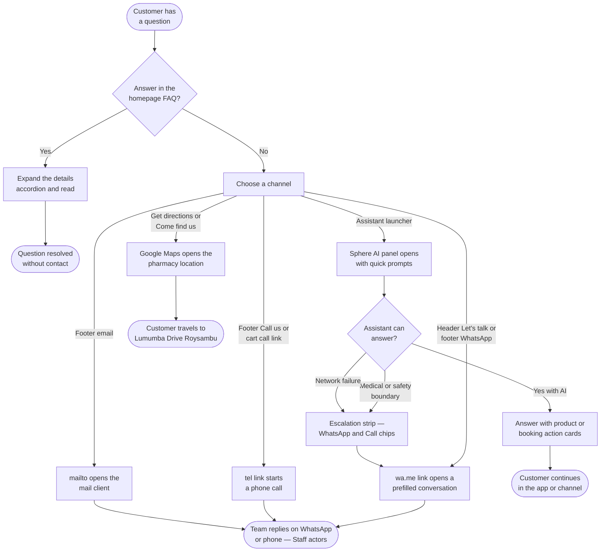

# P06 — Ask questions and contact the pharmacy

Every screen offers a way to reach a human: the homepage FAQ answers the most common questions first; the header's "Let's talk", the footer's WhatsApp/call/email block, the catalogue's empty-state WhatsApp button and the product page's "Order via WhatsApp" all open a prefilled WhatsApp conversation; the footer and assistant expose the phone number and map link. The AI assistant is the in-app first line — and when it hits its boundaries (medical questions, outages), it deliberately escalates with WhatsApp and call chips. WhatsApp links open a conversation in the customer's own WhatsApp app; the platform itself sends no WhatsApp messages.

| Metadata | Value |
| --- | --- |
| Primary actor | Customer (guest or signed-in) |
| Secondary actors | Staff (answer WhatsApp messages and calls; the assistant escalates to them) |
| Functional area | Contact and support |
| Entry point | Homepage FAQ · header "Let's talk" · footer Contact block · assistant launcher (every non-admin view) |
| Status | Implemented — verified against code |
| End condition | The customer is talking to the team on WhatsApp or phone, has emailed, has directions, or has the assistant's escalation options |
| Related journeys | P01 (navigation surfaces), P02 (catalogue empty state), P04 (medicine requests), H01–H03 (assistant journeys), S01 (booking a consultation instead) |

## Journey map

## Journey steps

### Step 1 — Check the homepage FAQ

- **User action:** The visitor scrolls to the homepage questions and clicks one to expand it.
- **Location:** FAQ section in `src/components/home/sphere-landing.tsx` (native `
`/`
` accordions).
- **Destination:** The expanded answer on the same page.
- **Purpose:** Get the common answers (online Rx ordering, pickup, delivery fees) without contacting anyone.
- **System behaviour:** Three curated questions render as disclosure widgets — no request is made; expanding is pure client behaviour. The prescription answer points at the upload flow, the pickup answer mentions Lumumba Drive and order tracking.
- **Outcome:** The question may be answered outright.
- **Next step:** If unanswered, pick a contact channel.
- **Alternative paths:** Product-level questions (dosage, interactions) are medical suitability questions that the assistant and staff handle, not the FAQ.

### Step 2 — Start a WhatsApp conversation

- **User action:** The customer clicks "Let's talk" (header), "Talk to our team" (landing footer), the WhatsApp pill (site footer), "Ask on WhatsApp" (empty catalogue), "Order via WhatsApp" (product page) or "Need help? Order via WhatsApp" (empty cart).
- **Location:** `waLink()` call sites: `src/components/layout/sphere-header.tsx`, `src/components/layout/footer.tsx`, `src/components/home/sphere-landing.tsx`, `src/components/views/catalog-view.tsx`, `src/components/views/product-view.tsx`, `src/components/views/cart-view.tsx`.
- **Destination:** The WhatsApp app (or web fallback) with a conversation to `254707475208` ready, prefilled where the link includes text.
- **Purpose:** Reach the team on the channel most Kenyan customers already use.
- **System behaviour:** `waLink(text?)` builds `https://wa.me/<whatsapp>?text=<encoded>` from the `PHARMACY` constant. Context-specific links prefill sensible text — the product page includes product name, pack size, price and quantity; the catalogue empty state says the customer is looking for a product they cannot find. Opening the link only prepares a conversation — the platform has not sent anything (documented in `docs/features/notifications.md` §9: WhatsApp exists only as `wa.me` links, never as a dispatched channel).
- **Outcome:** The customer types/sends in their own WhatsApp; the team (Staff actors) replies there.
- **Next step:** Resolve the question with the team.
- **Alternative paths:** If WhatsApp is not installed, the browser offers the web version or the customer falls back to calling.

### Step 3 — Call or email the pharmacy

- **User action:** The customer clicks "Call us" or the phone number in the footer (or the "or call" link in the cart summary), or the email address.
- **Location:** Contact block in `src/components/layout/footer.tsx`; cart footer line in `src/components/views/cart-view.tsx`; visit section phone link in `sphere-landing.tsx`.
- **Destination:** The phone dialer with `+254707475208`, or the mail client addressed to `orders@spherepharmacy.co.ke`.
- **Purpose:** Voice contact for personal help, or email for anything attachable.
- **System behaviour:** Links are `tel:` and `mailto:` built from `PHARMACY` constants; opening hours ("Daily: 8:00 AM – 10:30 PM", holiday caveat) and the compliance disclaimer render beside them. The email address is a placeholder pending client confirmation per the constant's comment — the footer disclaimer says contact details are pending final confirmation.
- **Outcome:** The customer is in a call or composing an email.
- **Next step:** The team answers during opening hours.
- **Alternative paths:** The assistant's escalation strip offers a Call chip with the same `tel:` link (step 5).

### Step 4 — Find the shop

- **User action:** The customer clicks the topline location link, "Come find us", or "Get directions".
- **Location:** `PHARMACY.mapsUrl` links in `sphere-landing.tsx` (topline and visit section) and `footer.tsx`.
- **Destination:** Google Maps searching for Sphere Pharmacy, Lumumba Drive, Roysambu, Nairobi.
- **Purpose:** Know where to go for pickup or an in-person consultation.
- **System behaviour:** A single maps URL constant opens in a new tab; the visit section repeats the address, hours and phone so the customer can screenshot one block. The footer repeats the address in the copyright line.
- **Outcome:** The customer has directions and the street address.
- **Next step:** Visit the pharmacy.
- **Alternative paths:** Service bookings (journey S01) let customers reserve an in-pharmacy slot instead of walking in.

### Step 5 — Ask the assistant and get handed off

- **User action:** The customer taps the floating launcher (bottom-right, every non-admin view) and types a question or picks a quick prompt ("Find paracetamol", "Book a medication review", …).
- **Location:** `src/components/assistant/assistant-widget.tsx`, mounted by `src/app/page.tsx` for non-admin views; backend `assistantApi.chat` → `/api/assistant`.
- **Destination:** The assistant panel with a reply, action cards, or an escalation strip.
- **Purpose:** Try the in-app helper before leaving the site.
- **System behaviour:** The widget posts the conversation to the assistant pipeline (journey SYS-09): deterministic guards first (emergency and medical-suitability patterns escalate without an LLM), then an LLM-enriched reply with optional product/booking/payment action cards. Markdown links in replies are only rendered as links when they point at the pharmacy's own `tel:` or `wa.me` destinations — everything else is stripped to plain text. When the reply is `escalated`, a strip states a pharmacy team member is the right person, with WhatsApp and Call chips; the composer carries a permanent "Prefer WhatsApp?" link. On any request failure the widget shows the same escalation message with the phone number — the fallback never fails.
- **Outcome:** The customer either gets the answer in-app or is one tap from WhatsApp/call.
- **Next step:** Continue with the escalated channel or the offered action (journeys H01–H03).
- **Alternative paths:** Without a configured LLM provider the assistant runs in deterministic mode — navigation and escalation still work; only the enriched replies degrade.

### Step 6 — The team answers

- **User action:** None by the customer — this step records the human side of the hand-off.
- **Location:** Staff devices: WhatsApp business inbox, phone, email; staff also reach out proactively via `waHref` deep links in the admin sections (orders, prescriptions, dispatch).
- **Destination:** A two-way conversation on the customer's chosen channel.
- **Purpose:** Close the loop with a human.
- **System behaviour:** Nothing about the WhatsApp/call/email exchange is tracked by the platform — there is no ticketing or transcript. Staff may subsequently create follow-ups in the system (e.g. answering a medicine request, journey A06) if the conversation turns into one.
- **Outcome:** The customer's question is answered by a person.
- **Next step:** Whatever the answer leads to — ordering, booking, or visiting.
- **Alternative paths:** Messages outside opening hours wait for the team; the footer notes prescriptions are reviewed during opening hours.

## Decision points

| Decision | Branches | Enforced by/where |
| --- | --- | --- |
| FAQ answers the question? | Yes → resolved inline; no → contact channel | static FAQ content in `sphere-landing.tsx` |
| Channel choice | WhatsApp (`waLink`) · phone (`tel:`) · email (`mailto:`) · maps (`mapsUrl`) · assistant | call sites across `sphere-header.tsx`, `footer.tsx`, `sphere-landing.tsx`, catalogue/product/cart views |
| Prefilled WhatsApp text? | Generic links vs context-specific (product, empty catalogue, cart) | `waLink(text)` call sites; `waText` in `product-view.tsx` |
| Assistant needs a human? | Boundary or outage → `escalated` strip with WhatsApp/Call; otherwise reply with actions | `escalated` flag handling in `assistant-widget.tsx`; guards in the assistant pipeline (journey SYS-09) |
| Link in an assistant reply | Pharmacy `tel:`/`wa.me` only → clickable; anything else → plain text | safe-link whitelist in `MarkdownMessage` (`assistant-widget.tsx`) |
| LLM provider available? | Yes → enriched replies; no → deterministic mode, escalation intact | provider config documented in `docs/features/ai-assistant.md` |

## Error and recovery paths

- **Assistant request failure:** the widget replaces the reply with the escalation message ("WhatsApp or call us on +254 707 475 208") — the customer always has a human path; nothing else on the page is affected.
- **Assistant boundary hit (medical suitability):** deliberate escalation, not an error — the strip offers WhatsApp/call and the medication-review booking.
- **WhatsApp not installed:** the `wa.me` link falls back to WhatsApp Web or the OS share sheet; the phone link in the same footer is the immediate alternative.
- **Contact details in flux:** the email address is an explicit placeholder and the footer disclaimer flags that contact details are pending final client confirmation — a documented data caveat, not a code fault.
- **Holiday hours differ:** the footer notes hours are confirmed by the pharmacy; a customer arriving outside them finds the maps listing rather than a closed storefront surprise.
- **No delivery guarantee on links:** opening a `wa.me` link prepares a conversation but sends nothing until the customer presses send — the customer stays in control of the outgoing message.

## Traceability

| Concern | Implementation reference |
| --- | --- |
| Pharmacy contact constants | `PHARMACY` (phone, whatsapp, email, address, hoursLabel, mapsUrl) and `waLink` in `src/lib/constants.ts` |
| Header contact | "Let's talk" link in `src/components/layout/sphere-header.tsx` |
| Footer contact block | WhatsApp pill, call, email, directions, hours, disclaimer in `src/components/layout/footer.tsx` |
| Landing contact surfaces | FAQ section, visit section, footer CTA in `src/components/home/sphere-landing.tsx` |
| Catalogue empty-state WhatsApp | `waLink(...)` fallback in `src/components/views/catalog-view.tsx` |
| Product WhatsApp order | `waText` and link in `src/components/views/product-view.tsx` |
| Cart help links | WhatsApp and `tel:` links in `src/components/views/cart-view.tsx` |
| Assistant widget and escalation | `src/components/assistant/assistant-widget.tsx` (launcher, escalation strip, safe links, failure fallback) |
| Assistant backend | `assistantApi.chat` in `src/lib/api-client.ts`; pipeline in journey SYS-09 |
| WhatsApp-as-links caveat | `docs/features/notifications.md` (§9 — wa.me links only, never a dispatched channel) |
| Assistant policy | `docs/features/ai-assistant.md` (deterministic-first, escalation boundaries) |

## Related journeys and documents

- **P01** — the header and footer surfaces this journey hangs off
- **P02 / P04** — the catalogue contexts that offer WhatsApp and medicine requests
- **H01 / H02 / H03** — the assistant's product, booking and payment journeys
- **SYS-09** — the assistant request pipeline behind the widget
- **S01** — booking a consultation when the answer needs one
- Docs: [AI assistant](../../features/ai-assistant.md) · [notifications](../../features/notifications.md) (WhatsApp caveat) · [customer journeys](../../product/customer-journeys.md)
