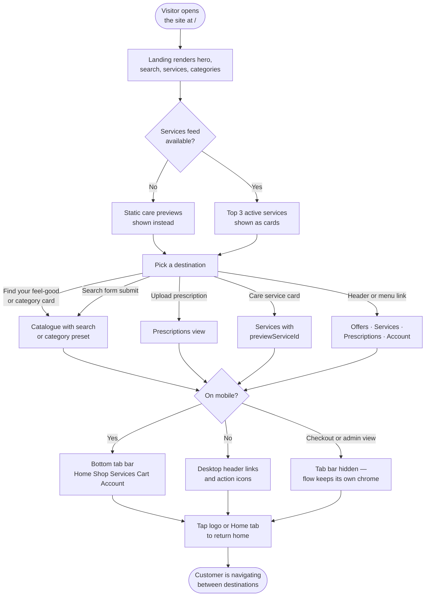

# P01 — Discover the pharmacy and navigate

A first-time visitor lands on the SphereLanding homepage, learns who the pharmacy is (Roysambu location, prescription review, delivery or pickup), and uses the landing actions, the shared SphereHeader and the mobile bottom tab bar to move between destinations. All navigation runs through the client-side view router in `use-app-store.ts`, which keeps the browser URL in sync and preserves an internal back-stack.

| Metadata | Value |
| --- | --- |
| Primary actor | Customer (guest or signed-in) |
| Secondary actors | None (staff destinations are out of scope) |
| Functional area | Storefront and catalogue |
| Entry point | `/` homepage — `SphereLanding` in `src/app/page.tsx` |
| Status | Implemented — verified against code |
| End condition | The customer is on the destination view (`catalog`, `services`, `prescriptions`, `cart`, `account`, …) and can return home from any view |
| Related journeys | P02 (catalogue search), P03 (product page), P06 (contact channels), C01 (account sign-in), S01 (care services) |

## Journey map

## Journey steps

### Step 1 — Land on the homepage

- **User action:** The visitor opens the site (or taps the logo from any view) and scans the landing page.
- **Location:** Home view — `SphereLanding` (`src/components/home/sphere-landing.tsx`), rendered by `src/app/page.tsx` when the app-store view is `home`.
- **Destination:** The landing page with hero, search bar, care services, category cards, prescription section, FAQ and footer.
- **Purpose:** Establish the brand, the Lumumba Drive location, and what can be done here before navigating.
- **System behaviour:** On mount the landing fetches `servicesApi.list()` and keeps the first three active services as care cards; if the feed fails it silently keeps its static `CARE_PREVIEWS` fallback. The topline links to `PHARMACY.mapsUrl`; the visit section shows `PHARMACY.hoursLabel` and a `tel:` link. The landing embeds its own `SphereHeader`; other views get the header from `page.tsx`.
- **Outcome:** The visitor sees who the pharmacy is and the main entry points.
- **Next step:** Choose a destination from the hero or search.
- **Alternative paths:** The FAQ section answers common questions inline (journey P06); "Current offers" and "My account" buttons in the landing footer go straight to those views.

### Step 2 — Pick a destination from the landing page

- **User action:** The visitor clicks "Find your feel-good", submits the search form, taps a category card (e.g. Vitamins & wellness), or clicks "Upload prescription".
- **Location:** Hero and search form in `sphere-landing.tsx` — `shop()` and `submit()` handlers; category grid; prescription section.
- **Destination:** The catalogue view (optionally with a preset search) or the prescriptions view.
- **Purpose:** Go from marketing content to a concrete task with one click.
- **System behaviour:** `shop(search)` calls `resetCatalogFilters()`, then `setCatalogFilters({ search })`, then `navigate("catalog")` — so landing searches never inherit stale filters. Category cards call `shop()` with their preset query ("vitamin", "skin", "baby" or empty). Prescription buttons call `navigate("prescriptions")`. Care service cards call `navigate("services", { previewServiceId })`.
- **Outcome:** The visitor lands on the chosen view with the intended context.
- **Next step:** Browse the catalogue (journey P02) or continue in the target view.
- **Alternative paths:** The "All care services" text link opens the services view without a preview; the FAQ `
` elements expand answers without leaving the page.

### Step 3 — Use the shared header

- **User action:** From any non-home storefront view the customer uses the header: logo (home), Shop health, Offers, Care services, Prescriptions links, the notification bell, "Let's talk", the account icon, or the bag icon with its live count.
- **Location:** `SphereHeader` (`src/components/layout/sphere-header.tsx`), mounted by `page.tsx` for every view except `home` and `admin`.
- **Destination:** Any of the main views; the bag opens the cart, the account icon opens the account view (which leads to sign-in if signed out — journey C01).
- **Purpose:** Constant access to the core destinations and the cart without going back home.
- **System behaviour:** Each link calls `navigate(view)`, which pushes the current view onto an internal history stack (capped at 30), updates the browser URL via `pushState`, and scrolls to top. The cart count is derived from `useCartStore` lines. The menu toggle reveals an expanded nav ("Upload prescription", "Current offers", "Explore care services", "Track my orders", "My account") and collapses on navigation.
- **Outcome:** The customer reaches the chosen view; the previous view is preserved in the back-stack.
- **Next step:** Continue shopping, or go back.
- **Alternative paths:** "Let's talk" opens WhatsApp (journey P06) instead of an in-app view; `NotificationCenter` opens notifications rather than navigating.

### Step 4 — Navigate on mobile with the bottom tab bar

- **User action:** On a phone the customer uses the fixed bottom tab bar: Home, Shop, Services, Cart and Account.
- **Location:** `MobileNav` (`src/components/layout/mobile-nav.tsx`), mounted by `page.tsx` for all non-admin views, hidden on the `checkout` view.
- **Destination:** The five core destinations; the Account tab highlights for the `account`, `orders`, `order` and `auth` views, the Shop tab for `catalog` and `product`.
- **Purpose:** One-tap access to the main destinations on small screens, with a badge showing the cart quantity.
- **System behaviour:** Tabs call `navigate(tab.view)`; the active tab is derived from a per-tab `match` list; the cart badge shows the live line count (capped at "99+"); a safe-area spacer keeps the bar clear of the iPhone home indicator.
- **Outcome:** The customer moves between destinations with a single thumb tap.
- **Next step:** Continue in the destination view.
- **Alternative paths:** During checkout the tab bar is hidden so a stray tap cannot interrupt the flow; in the admin workspace the bar is absent entirely.

### Step 5 — Return home or go back

- **User action:** The customer taps the Sphere logo (header), the Home tab (mobile), or uses the browser/device back control.
- **Location:** Logo button in `sphere-header.tsx`; Home tab in `mobile-nav.tsx`; `goBack` used by views such as the product page.
- **Destination:** The home view or the previous view.
- **Purpose:** Recover from a wrong turn or restart exploring from the top.
- **System behaviour:** `goBack()` prefers `window.history.back()`; if there is no browser history it pops the internal back-stack, falling back to `home`. A `popstate` listener calls `hydrateFromLocation()`, which re-derives the view and params from the URL (including `/products/<id>` and `/orders/<id>` patterns); unknown paths resolve to `home`.
- **Outcome:** The customer is back where they wanted to be, with the URL still matching the view.
- **Next step:** The journey ends, or the customer continues into any destination journey.
- **Alternative paths:** Opening a deep link directly (e.g. `/catalog`) hydrates that view on first load instead of home; account-area views (`account`, `orders`, `order`, `prescriptions`) additionally show the `CustomerHubNav` strip.

## Decision points

| Decision | Branches | Enforced by/where |
| --- | --- | --- |
| Which chrome renders? | `home` → landing with embedded header; `admin` → admin layout; everything else → `SphereHeader` + `Footer` + `MobileNav` | view conditionals in `src/app/page.tsx` |
| Services feed loaded? | Yes → live top-3 active services; failure → static `CARE_PREVIEWS` | `servicesApi.list()` effect in `sphere-landing.tsx` |
| Landing search or category click? | Search string preset vs empty reset | `shop(search)` — `resetCatalogFilters` + `setCatalogFilters` in `sphere-landing.tsx` |
| Mobile or desktop? | Mobile → sticky bottom tab bar; desktop → header links and action icons | `md:hidden` on `MobileNav`; CSS breakpoints in `page.tsx` layout |
| Show the tab bar? | Checkout/admin views hide it | early return in `mobile-nav.tsx` (`view === "checkout" \|\| view === "admin"`) |
| Back navigation source | Browser history → `history.back()`; else internal stack; else home | `goBack()` in `src/store/use-app-store.ts` |
| Unknown URL path? | Falls back to the `home` view | `stateFromLocation()` route table in `use-app-store.ts` |

## Error and recovery paths

- **Public services feed unavailable:** the care-services grid silently keeps its pictured static previews; navigation to the services view still works — no user-facing error.
- **Deep link to an unknown path:** `hydrateFromLocation()` resolves the view to `home`; the customer is never stranded on a blank screen.
- **Back-stack exhausted:** `goBack()` lands on `home` by design; there is no dead end.
- **Cart count out of date:** the badge derives from the persisted cart store, so a stale count corrects itself as soon as the store rehydrates from localStorage.
- **Rapid double navigation:** `navigate()` ignores a repeat navigation to the identical view and params, preventing duplicate history entries.

## Traceability

| Concern | Implementation reference |
| --- | --- |
| Landing page | `src/components/home/sphere-landing.tsx` (hero, search, categories, FAQ, footer) |
| Shell that swaps views | `src/app/page.tsx` (view conditionals, header/footer/mobile-nav mounting) |
| Shared header | `src/components/layout/sphere-header.tsx` (links, bag count, expanded menu) |
| Mobile tab bar | `src/components/layout/mobile-nav.tsx` (five tabs, cart badge, view hiding) |
| Site footer | `src/components/layout/footer.tsx` (contact details, quick links) |
| View router | `src/store/use-app-store.ts` (`navigate`, `replace`, `goBack`, `hydrateFromLocation`, URL mapping) |
| Catalogue filter entry | `setCatalogFilters` / `resetCatalogFilters` in `use-app-store.ts`, called by `shop()` |
| Pharmacy profile constants | `PHARMACY` and `waLink` in `src/lib/constants.ts` |
| Services feed | `servicesApi.list()` in `src/lib/api-client.ts` → `GET /api/services` |
| Account-area nav strip | `src/components/layout/customer-hub-nav.tsx` |
| State contracts | `docs/architecture/state-management.md` (view router, store-per-concern) |

## Related journeys and documents

- **P02** — searching and filtering once the catalogue is reached
- **P03** — opening a product page from the catalogue
- **P06** — the contact channels surfaced by the header and footer
- **C01** — what happens when the account icon leads to sign-in
- **S01** — the care-services destination behind the service cards
- Docs: [storefront and catalogue](../../features/storefront-and-catalogue.md) · [state management](../../architecture/state-management.md) · [customer journeys](../../product/customer-journeys.md)
