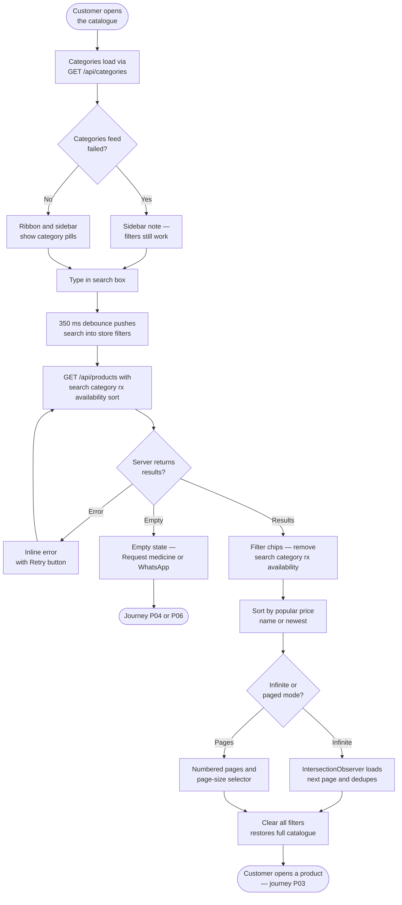

# P02 — Find and filter products

A shopper arrives on the catalogue (from the header, the landing page or the mobile Shop tab) and narrows several hundred products to a shortlist. Filters live client-side in the app store (`catalogFilters`), every result set is fetched server-side from `GET /api/products`, and the same query powers the grid, the list layout, infinite scroll and numbered paging.

| Metadata | Value |
| --- | --- |
| Primary actor | Customer (guest or signed-in) |
| Secondary actors | None |
| Functional area | Storefront and catalogue |
| Entry point | `/catalog` — `CatalogView` in `src/components/views/catalog-view.tsx` |
| Status | Implemented — verified against code |
| End condition | A filtered, sorted, paged product list is displayed — or the empty state with "Request medicine" and WhatsApp options |
| Related journeys | P01 (arrival), P03 (opening a product), P04 (requesting an unlisted medicine), P06 (WhatsApp fallback), O01 (ordering a found item) |

## Journey map

## Journey steps

### Step 1 — Open the catalogue

- **User action:** The customer opens the catalogue from the header "Shop health" link, the landing "Find your feel-good" button, a category card or the mobile Shop tab.
- **Location:** Catalogue view — `src/components/views/catalog-view.tsx` (rendered when the app-store view is `catalog`).
- **Destination:** The catalogue heading, category ribbon and first page of results.
- **Purpose:** See what the pharmacy stocks before narrowing down.
- **System behaviour:** On mount the view fetches categories via `catalogApi.categories()` (`GET /api/categories` — active categories ordered by `sortOrder`, each with its active product count). Products load through `catalogApi.products(...)` (`GET /api/products`) using the store's `catalogFilters` plus page and page size (client default 16). Both requests tolerate cancellation when the customer navigates away mid-load.
- **Outcome:** The full catalogue appears with the ribbon, result count and grid of product cards.
- **Next step:** Search or pick a category.
- **Alternative paths:** If the category feed fails, the sidebar shows a note that filters still work and hides the category list; the ribbon renders nothing (`LuxuryCategoryRibbon` returns null without categories).

### Step 2 — Search by name, brand or ingredient

- **User action:** The customer types a query (e.g. a medicine name) into the search box — sticky on mobile, in-flow on desktop — and optionally clears it with the X button.
- **Location:** Search inputs in `catalog-view.tsx`; debounce effect pushing the local override into the store.
- **Destination:** A result set matching the query.
- **Purpose:** Find a specific product without browsing.
- **System behaviour:** Typing sets a local `override`; after a 350 ms debounce the override is committed into `catalogFilters.search` and page resets to 1. The server splits the query into terms, lower-cases and strips punctuation, and matches each term case-insensitively against `name`, `brand`, `sku`, `description`, `packSize`, `usageInfo`, `warnings` and the category name (`GET /api/products` where-clause). The active search shows as a removable chip.
- **Outcome:** Matching products are listed; the count updates.
- **Next step:** Filter further or open a product.
- **Alternative paths:** No matches → the empty state offers "Clear all filters", the Request medicine card (journey P04, prefilled with the search text) and an "Ask on WhatsApp" button (journey P06).

### Step 3 — Narrow by category

- **User action:** The customer taps a category pill in the ribbon, or a category row (with icon and product count) in the desktop sidebar or mobile filter sheet.
- **Location:** `LuxuryCategoryRibbon` (`src/components/catalog/luxury-category-ribbon.tsx`); category list inside the shared filter panel in `catalog-view.tsx`.
- **Destination:** Results restricted to one category; the heading changes to the category name and description.
- **Purpose:** Browse a familiar shelf instead of the whole catalogue.
- **System behaviour:** `pickCategory(id)` sets `catalogFilters.category` (empty string means all), resets the page and closes the mobile sheet. The server accepts a category id or slug, resolves it via `db.category.findFirst`, and filters by `categoryId`; an unknown category yields an empty set. Tapping the active pill again clears the category.
- **Outcome:** The catalogue shows only the chosen category, with the count chip reflecting it.
- **Next step:** Apply type or stock filters.
- **Alternative paths:** "All Products" in the ribbon clears the category; the sidebar shows which category is active with its name badge.

### Step 4 — Apply prescription and availability filters

- **User action:** The customer chooses Prescription: All / Rx only / OTC only, and Availability: any / In stock / Low stock / Out of stock.
- **Location:** Filter panel in `catalog-view.tsx` — desktop sticky sidebar card or the mobile "Filters" sheet (`Sheet` component).
- **Destination:** A result set restricted by product type and stock state.
- **Purpose:** Check prescription requirements and live availability before choosing.
- **System behaviour:** The choices set `catalogFilters.rx` and `catalogFilters.availability` in the store. The server maps `rx=yes|no` to `requiresPrescription` and `availability=in|low|out` to `stockStatus` (`IN_STOCK` / `LOW_STOCK` / `OUT_OF_STOCK`) in `GET /api/products`. "Any" values are omitted from the query. Active filters appear as removable chips and light the "Active" badge and the mobile "!" badge.
- **Outcome:** The list reflects the type and stock constraints.
- **Next step:** Sort the results.
- **Alternative paths:** Each chip can be removed individually; "Clear all filters" / "Reset" restores `DEFAULT_CATALOG_FILTERS` in one action.

### Step 5 — Sort and change layout

- **User action:** The customer picks a sort order (Most popular, Price low to high, Price high to low, Name A–Z, Newest) and toggles between Grid view and List view.
- **Location:** Sort `Select` in the filter panel; layout switcher in the results header bar in `catalog-view.tsx`.
- **Destination:** The same result set in a different order and presentation.
- **Purpose:** Compare products in the order and layout that suits the shopper.
- **System behaviour:** Sort maps to server `orderBy` (`price`, `name`, `createdAt`) — except `popular`, which ranks products by aggregated `orderItem` quantities (top 500 sellers) with newest-first fallback for never-sold items. Layout (`grid` vs `list`) and pagination mode are purely presentational local state; list mode renders `compact-row` product cards.
- **Outcome:** Results are ordered and displayed as chosen.
- **Next step:** Browse further pages or open a product.
- **Alternative paths:** Switching filters always resets to page 1 so the customer never lands mid-pagination on a changed result set.

### Step 6 — Browse larger result sets

- **User action:** The customer keeps scrolling (Infinite mode) or uses numbered pages and the page-size selector (Pages mode).
- **Location:** `HighPerformancePagination` (`src/components/catalog/high-performance-pagination.tsx`).
- **Destination:** The next batch of results without losing filters.
- **Purpose:** Work through large categories comfortably.
- **System behaviour:** Infinite mode observes a sentinel element and calls `loadMore()`, which fetches the next page, deduplicates by product id, and appends; a failure shows a toast and keeps the current items. Pages mode calls `handlePageChange` / `handlePageSizeChange` (server clamps page ≥ 1 and pageSize 1–100) and smooth-scrolls to the top of the results.
- **Outcome:** The customer can reach every product in the filtered set.
- **Next step:** Open a product card (journey P03).
- **Alternative paths:** "Clear all filters" at any point restores the full catalogue; the WhatsApp fallback appears only when the result set is empty.

## Decision points

| Decision | Branches | Enforced by/where |
| --- | --- | --- |
| Categories loaded? | Yes → ribbon + sidebar list; failure → note, filters still usable | `catalogApi.categories()` effect and `categoriesError` in `catalog-view.tsx`; `GET /api/categories` |
| Search matches anything? | Results → grid/list; none → empty state with request + WhatsApp | `where.AND` term matching in `GET /api/products` (`src/app/api/products/route.ts`) |
| Category id or slug? | Resolved id filters; unknown → empty result | `db.category.findFirst({ where: { OR: [...] } })` in `GET /api/products` |
| Rx / availability value | `any` omitted; `yes`/`no` → `requiresPrescription`; `in`/`low`/`out` → `stockStatus` | query mapping in `GET /api/products` |
| Sort order | `popular` → sold-qty ranking + fallback; others → `orderBy` columns | sort branch in `GET /api/products` |
| Pagination mode | Infinite (observer + dedupe) vs Pages (numbered + page size) | `paginationMode` state and `HighPerformancePagination` |
| Filters changed mid-browse? | Reset to page 1 | `useEffect` on filter values in `catalog-view.tsx` |
| First load failed? | Inline error + Retry (reload nonce); empty list preserved | `error` / `reloadNonce` state in `catalog-view.tsx` |

## Error and recovery paths

- **Products request fails on first load:** an inline dashed panel shows the error with a Retry button; retry re-runs the same query via a reload nonce.
- **Load-more failure (infinite mode):** a toast reports the error; already loaded items stay on screen and the customer can keep trying.
- **Category feed failure:** the sidebar notes the failure and the rest of the catalogue (search, filters, sorting) keeps working.
- **Empty result set:** the empty state offers clearing filters, the medicine-request card (journey P04) and the WhatsApp fallback (journey P06) — no dead end.
- **Oversized or invalid paging params:** the server clamps page to ≥ 1 and pageSize to 1–100, so malformed links cannot break the list.
- **Stale duplicate items during infinite scroll:** appended pages are deduplicated by product id, so overlapping pages never render a product twice.

## Traceability

| Concern | Implementation reference |
| --- | --- |
| Catalogue view | `src/components/views/catalog-view.tsx` (search, filter panel, chips, layout and pagination modes) |
| Filter state | `CatalogFilters` and `DEFAULT_CATALOG_FILTERS` in `src/store/use-app-store.ts` |
| Category ribbon | `src/components/catalog/luxury-category-ribbon.tsx` |
| Pagination component | `src/components/catalog/high-performance-pagination.tsx` (infinite + pages modes) |
| Products endpoint | `GET /api/products` in `src/app/api/products/route.ts` (search terms, category, rx, availability, sort, paging, ratings) |
| Categories endpoint | `GET /api/categories` in `src/app/api/categories/route.ts` (active only, counts) |
| Typed API client | `catalogApi.products` / `catalogApi.categories` in `src/lib/api-client.ts` |
| DTO shaping | `toProductDTO` and `attachRatings` in `src/lib/dto.ts` |
| Stock statuses | `STOCK_STATUSES` in `src/lib/constants.ts` (`IN_STOCK`, `LOW_STOCK`, `OUT_OF_STOCK`) |
| Empty-state fallbacks | `MedicineRequest` card (`src/components/catalog/medicine-request.tsx`); `waLink` in `src/lib/constants.ts` |
| API contract | `docs/api/api-reference.md` and `openapi/sphere-api.yaml` — products and categories operations |

## Related journeys and documents

- **P01** — the header and landing entries that lead into the catalogue
- **P03** — opening one of the result cards
- **P04** — requesting a medicine the catalogue does not list
- **P06** — the WhatsApp fallback when nothing matches
- **O01** — ordering an item once found
- Docs: [storefront and catalogue](../../features/storefront-and-catalogue.md) · [API reference](../../api/api-reference.md) · [customer journeys](../../product/customer-journeys.md)
