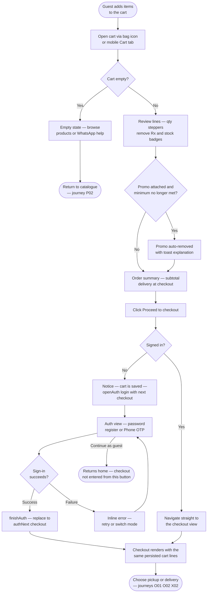

# C03 — Review the cart and return after sign-in

A guest builds a cart, reviews it, and clicks "Proceed to checkout" — which, in the current build, requires signing in. The cart itself lives in localStorage (`sphere-cart`), so the sign-in detour cannot lose it: after registering, signing in with a password, or verifying a phone code, the customer is returned straight to checkout with every line intact. The journey documents exactly where the sign-in wall sits, what survives it, and how the return works (`openAuth` → `authNext: "checkout"` → `replace` on success).

| Metadata | Value |
| --- | --- |
| Primary actor | Customer (guest becoming signed-in) |
| Secondary actors | None |
| Functional area | Cart and checkout |
| Entry point | Cart view — `src/components/views/cart-view.tsx` (header bag icon, mobile Cart tab) |
| Status | Implemented — verified against code |
| End condition | Signed-in customer on the checkout view with the original cart lines; fulfillment step ready |
| Related journeys | C01/C02 (the sign-in used), O01/O02 (the checkout continued), X02 (Rx checkout), C08 (promo redemption) |

## Journey map

## Journey steps

### Step 1 — Build and open the cart

- **User action:** The guest adds products from catalogue or product pages (journeys P02/P03), then opens the cart via the header bag icon (with count) or the mobile Cart tab.
- **Location:** Cart view — `src/components/views/cart-view.tsx`; state `src/store/use-cart-store.ts`.
- **Destination:** The cart with line items and order summary.
- **Purpose:** Review the order before committing.
- **System behaviour:** Cart lines live in the Zustand cart store persisted to localStorage as `sphere-cart` (only `lines` and `appliedPromo` are persisted). Each line keeps the product id, name, price, image, Rx flag, pack size and stock status at add time; quantities merge and cap at 99. The header badge and mobile tab badge derive from the same store, so every surface shows the same count.
- **Outcome:** The guest sees their full cart with subtotal and item count.
- **Next step:** Adjust the contents.
- **Alternative paths:** An empty cart shows the empty state with a "Browse products" action and a WhatsApp help link; the cart survives navigation, reloads and sign-out because it is device-local.

### Step 2 — Adjust quantities and remove lines

- **User action:** The customer increases or decreases a quantity with the steppers, or removes a line with the trash button; lines still show their Rx/OTC badge and an "Out of stock" badge if the stock state went bad.
- **Location:** Line cards in `cart-view.tsx` (`updateQty`, `handleRemove`); `setQty` / `remove` in the cart store.
- **Destination:** An updated cart with recalculated subtotal.
- **Purpose:** Get the cart exactly right before checkout.
- **System behaviour:** `setQty` caps at 99 and treats 0 as a removal; `remove` filters the line. Whenever lines change, `eligiblePromo` re-checks the attached promotion against its minimum spend and drops it if the subtotal no longer qualifies — the UI explains the drop with a toast ("Your cart no longer meets this offer's minimum spend."). Emptying the cart calls `forgetOffer()` to clear any linked offer intent. Prices shown are the stored line prices; the server re-validates prices and stock when the order is placed.
- **Outcome:** The cart is correct and the summary reflects it.
- **Next step:** Attempt checkout.
- **Alternative paths:** Unavailable lines (out of stock/discontinued) are visually flagged but not auto-removed — the customer decides; the server rejects them at order time if still invalid.

### Step 3 — Proceed to checkout while signed out

- **User action:** The guest clicks "Proceed to checkout" (or the mobile sticky "Checkout" bar).
- **Location:** `handleCheckout` in `cart-view.tsx`; `openAuth` in `src/store/use-app-store.ts`.
- **Destination:** The auth view, with an explanatory notice left behind on the cart.
- **Purpose:** The current checkout entry requires a customer account; the system saves the intent so nothing is lost.
- **System behaviour:** `handleCheckout` checks `session?.user`; for guests it sets a notice ("Sign in first so your cart stays exactly where you left it. After signing in, you'll return straight to checkout.") and calls `openAuth("login", "checkout", message)` — where the message differs when the cart contains prescription items (they need an account for pharmacist review). `openAuth` stores `authMode`, `authNext: "checkout"` (plus params) and `authMessage`, then navigates to the auth view with `?next=checkout`. The cart itself is untouched.
- **Outcome:** The guest is on the sign-in screen with a return ticket to checkout.
- **Next step:** Sign in by any mode.
- **Alternative paths:** "Continue as guest" on the auth view navigates home — it does not enter checkout; the OTC summary text in the cart ("you can check out as a guest in under a minute") describes the guest-capable checkout flow reachable by direct URL, not this button.

### Step 4 — Sign in (any mode)

- **User action:** The customer signs in with email/phone + password, registers a new account, or uses the Phone OTP tab.
- **Location:** `src/components/views/auth-view.tsx`; endpoints `POST /api/auth/login`, `POST /api/auth/register`, `POST /api/auth/otp/verify` (journeys C01/C02).
- **Destination:** An active customer session.
- **Purpose:** Satisfy the checkout sign-in requirement.
- **System behaviour:** All three modes end in the same place: the session payload is stored in `useAuthStore`, and the completion path runs `replace(authNext ?? "account", authNextParams ?? undefined)` followed by `clearAuthIntent()`. Because `authNext` is `"checkout"`, the replace targets the checkout view. Failures show inline errors and keep the customer on the auth view — the return intent survives retries and tab switches within the auth screen.
- **Outcome:** The customer is signed in and the return intent is still set.
- **Next step:** Automatic return to checkout.
- **Alternative paths:** A customer who abandons the auth view loses nothing — the cart remains in localStorage and the account exists; the next attempt repeats steps 3–4.

### Step 5 — Return to checkout with the preserved cart

- **User action:** None — the client performs the return.
- **Location:** `finishAuth` / register completion in `auth-view.tsx`; checkout view `src/components/views/checkout-view.tsx` reading `useCartStore`.
- **Destination:** The checkout view, step 1 (fulfillment).
- **Purpose:** Continue exactly where the customer left off.
- **System behaviour:** `replace("checkout")` swaps the view without pushing the auth view onto the back-stack. The checkout view reads the same persisted cart store — the lines are identical because they were never server-side. Being signed in now changes checkout behaviour: account details pre-fill, saved addresses load for delivery, loyalty redemption becomes available, and prescription items (if any) show the upload requirement. The linked promo, if one was being redeemed, is carried by `authNextParams` (e.g. `{ promo }`) from the cart's offer card.
- **Outcome:** The customer is on "Fulfillment" with the order summary showing the same items.
- **Next step:** Choose pickup or delivery and complete the order.
- **Alternative paths:** If the session expires before ordering, the checkout's own guards re-prompt sign-in (e.g. prescription orders show an in-flow sign-in button); the cart still survives.

### Step 6 — Continue the order

- **User action:** The customer picks pickup or delivery, provides details, and proceeds through the payment steps.
- **Location:** Checkout wizard in `checkout-view.tsx`.
- **Destination:** Order placement (journeys O01/O02, payments O03/O04/O05, or prescription checkout X02).
- **Purpose:** Convert the preserved cart into an order.
- **System behaviour:** The checkout re-validates everything server-side at placement: stock, prices, promo and loyalty. Prescription carts require uploaded prescription files before payment is unlocked. On success the cart is cleared (`clear()` also clears the offer intent).
- **Outcome:** The order exists; the cart journey ends.
- **Next step:** Track the order (journey O06).
- **Alternative paths:** Guest checkout remains possible when the checkout view is reached directly by URL with an OTC cart — the guest details path exists in the wizard (name + Kenyan phone) — but the standard cart button routes through sign-in as documented.

## Decision points

| Decision | Branches | Enforced by/where |
| --- | --- | --- |
| Cart empty? | Yes → empty state + catalogue/WhatsApp actions; no → review | `lines.length === 0` branch in `cart-view.tsx` |
| Promotion still eligible? | Subtotal ≥ minimum → kept; else → auto-removed with toast | `eligiblePromo` in `src/store/use-cart-store.ts` |
| Signed in at checkout click? | Customer → `navigate("checkout")`; guest → notice + `openAuth("login", "checkout", …)` | `handleCheckout` in `cart-view.tsx` |
| Cart contains Rx items? | Guest message names prescription checkout; signed-in flow requires uploads later | `rxLines.length` branches in `cart-view.tsx` and `checkout-view.tsx` |
| Sign-in mode | Password · register · OTP — all end in `replace(authNext)` | completion paths in `auth-view.tsx` |
| Promotion "Use" while guest with per-user limit | Requires sign-in: `openAuth("login", "checkout", …, { promo })` | offer card handler in `cart-view.tsx` |
| Continue as guest | Navigates home — does not enter checkout | guest button in `auth-view.tsx` |

## Error and recovery paths

- **Cart emptied by the customer:** the empty state offers browsing and WhatsApp help; `forgetOffer()` clears any linked offer intent so stale offers cannot resurface.
- **Promotion silently dropped:** never silent — a toast explains the minimum-spend miss, and the offers list lets the customer pick a different code.
- **Sign-in failure:** inline errors on the auth view; the return intent (`authNext: checkout`) is preserved across retries, so a later success still lands on checkout.
- **Session lost after returning:** the cart is device-local and unaffected; re-authenticating repeats the return. Prescription steps inside checkout prompt sign-in in-flow if needed.
- **Prices or stock changed since add-to-cart:** the cart shows stored prices, but the server re-validates at placement and rejects stale lines with actionable errors (journey O01's error paths); the customer adjusts and retries.
- **Cleared browser storage:** the cart is gone — there is no server-side guest cart; this is the documented trade-off for guest persistence (recovery is re-adding items, or signing in earlier so orders are at least historized).
- **Offer intent after emptying:** offer-intent state is explicitly forgotten when the cart empties, preventing a saved code from applying to an unrelated future cart.

## Traceability

| Concern | Implementation reference |
| --- | --- |
| Cart view (lines, summary, checkout CTA) | `src/components/views/cart-view.tsx` (`handleCheckout`, `updateQty`, `handleRemove`) |
| Cart store and persistence | `src/store/use-cart-store.ts` (persist `sphere-cart`, `partialize`, `eligiblePromo`, caps) |
| Sign-in wall and return intent | `openAuth(mode, next, message, nextParams)` in `src/store/use-app-store.ts` |
| Return execution | `finishAuth` / register completion (`replace(authNext ?? "account")`) in `src/components/views/auth-view.tsx` |
| Session store | `src/store/use-auth-store.ts` (`session`, `setSession`, `refresh`) |
| Checkout consumption of the cart | `src/components/views/checkout-view.tsx` (lines, promo validation, Rx gates) |
| Guest checkout branch (direct URL) | `continueFrom2` guest validation in `checkout-view.tsx` (name, phone, Rx block) |
| Offer intent | `forgetOffer` / `pendingOffer` in `src/lib/offer-intent.ts` |
| Promotions listing | `promotionsApi.list()` in `src/lib/api-client.ts` |
| State contracts | `docs/architecture/state-management.md` (cart store, auth intent, `finishAuth`) |
| Order placement (where the cart lands) | `POST /api/orders` in `src/app/api/orders/route.ts` (journeys O01/O02) |

## Related journeys and documents

- **C01 / C02** — the sign-in modes this journey can route through
- **O01 / O02** — the checkout continuations (pickup / delivery)
- **X02** — prescription checkout when the cart contains Rx items
- **C08** — loyalty and promotion redemption at checkout
- **O06** — tracking the order that results
- Docs: [state management](../../architecture/state-management.md) · [orders and fulfillment](../../features/orders-and-fulfillment.md) · [order lifecycle](../../workflows/order-lifecycle.md)
