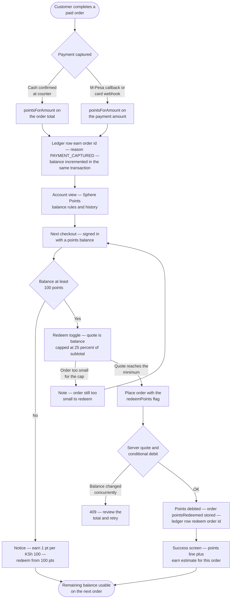

# C08 — Earn and redeem Sphere Points

Sphere Points are the store's loyalty currency. The rules live in one constant — `LOYALTY` in `src/lib/constants.ts`: 1 point per KSh 100 spent (floored), 1 point = KSh 1 at checkout, redemption starts at 100 points, and redemption is capped at 25% of the post-promotion subtotal. Earning happens exactly once per order, at payment capture: the cash-confirmation, M-Pesa callback and card webhook paths each write an `earn:<orderId>` `LoyaltyLedger` row (reason `PAYMENT_CAPTURED`) and increment `User.loyaltyPoints` inside the same transaction as the payment. Redemption happens at checkout: a toggle (shown when the balance is at least the minimum) mirrors the server quote, and the order route debits the points transactionally, storing `pointsRedeemed` and a `redeem:<orderId>` ledger row. Refunds claw back earned points and re-credit redeemed ones. Guests earn nothing — points require an account.

| Metadata | Value |
| --- | --- |
| Primary actor | Customer (signed-in — guests never earn or redeem) |
| Secondary actors | System (award and debit transactions, callbacks), Staff (cash confirmation triggers earning; refunds) |
| Functional area | Loyalty |
| Entry point | Account view Sphere Points card; checkout step 3 redemption toggle |
| Status | Implemented — verified against code |
| End condition | `User.loyaltyPoints`, `Order.pointsEarned`/`pointsRedeemed` and `LoyaltyLedger` rows agree |
| Related journeys | O01 (cash pickup earning), O02 (delivery), O03/O04 (online payment earning), O06 (orders view) |

## Journey map

## Journey steps

### Step 1 — Earn points on a captured payment

- **User action:** The customer pays for an order — cash at the counter, M-Pesa STK push, or card.
- **Location:** `POST /api/orders/[id]/cash-confirm`, `src/app/api/payments/mpesa/callback/route.ts`, `src/app/api/payments/intasend/webhook/route.ts`.
- **Destination:** Points credited to the account.
- **Purpose:** Reward completed purchases.
- **System behaviour:** Each payment-capture path computes earned points with `pointsForAmount` (floor of amount / 100) — the order total for cash, the payment amount for the provider callbacks — for orders owned by a signed-in customer. Inside the payment transaction it writes an idempotent `LoyaltyLedger` row (`eventKey: earn:<orderId>`, reason `PAYMENT_CAPTURED`, positive delta), increments `User.loyaltyPoints` and stamps `Order.pointsEarned`. Guest orders (`userId` null) earn nothing. The unique event key prevents double-crediting on webhook replays.
- **Outcome:** The balance rises by the earned points; the order shows the award.
- **Next step:** Watch the balance in the account view.
- **Alternative paths:** If a payment is later refunded, the clawback path (step 6) reverses this.

### Step 2 — Review the balance, rules and history

- **User action:** The customer opens My account and reads the Sphere Points card.
- **Location:** Sphere Points card in `src/components/views/account-view.tsx` (`reloadLoyalty`); endpoint `GET /api/orders/loyalty` (`src/app/api/orders/loyalty/route.ts`).
- **Destination:** The teal balance panel and points history list.
- **Purpose:** See what the points are worth and where they came from.
- **System behaviour:** `GET /api/orders/loyalty` requires a customer session and returns `loyaltySummary(userId)`: the balance, lifetime earned and redeemed totals, the rule constants, and a per-order history (the last 30 orders with `pointsEarned` or `pointsRedeemed` above zero — reference, status, date, earn/redeem chips, each linking to the order). The card shows the KES value of the balance (`balance × pointValue`) and the four rules (1 pt per KSh 100, 1 pt = KSh 1, redeem from 100 pts, max 25% of an order). If the summary call fails, the card falls back to the session's balance with empty history rather than blanking out.
- **Outcome:** The customer understands their position and the rules.
- **Next step:** Redeem at the next checkout.
- **Alternative paths:** The header session also carries `loyaltyPoints`, so the checkout quote works even before the summary loads.

### Step 3 — See the redemption offer at checkout

- **User action:** The customer reaches checkout step 3 (payment and order review) with a signed-in session.
- **Location:** Points notice block in `src/components/views/checkout-view.tsx` (order summary, lines ~1639+).
- **Destination:** The "Redeem N pts (−KSh …)" toggle — or an explanatory notice.
- **Purpose:** Decide whether to spend points on this order.
- **System behaviour:** The client mirrors the server rule locally: `loyaltyBalance` comes from the session user, `postPromoSubtotal` is the subtotal minus any promotion discount, and `maxRedeemablePoints(postPromoSubtotal, loyaltyBalance)` computes the quote (`min(balance, floor(subtotal × 25% / pointValue))`). `pointsEligible` additionally requires the balance ≥ 100 and the quote ≥ 100. With a sub-minimum balance the block explains the earn rate and the 100-pt threshold; with an eligible balance but a too-small order it notes the order is still too small to redeem (the 25% cap keeps the quote under 100).
- **Outcome:** The customer sees an exact redeem toggle with its KES value, or the reason there isn't one.
- **Next step:** Toggle redemption and place the order.
- **Alternative paths:** Guests see no points UI at checkout (they must sign in first — journeys C01/C02); promotions and points stack (the cap applies after the promo discount).

### Step 4 — Toggle redemption and place the order

- **User action:** The customer switches on "Redeem N pts" and clicks the place-order button for their payment method.
- **Location:** `redeemPoints` state and `buildPayload` in `checkout-view.tsx`; `ordersApi.create` → `POST /api/orders` (`src/app/api/orders/route.ts`).
- **Destination:** Order creation with `redeemPoints: true` in the payload.
- **Purpose:** Apply the balance to this order.
- **System behaviour:** The payload carries `redeemPoints: true` only when the toggle is on and the quote is eligible. The server never trusts the client number: it re-reads the customer's balance and recomputes `redemptionQuote(subtotal − discountAmount, balance).points` — the same min/cap/minimum rule — and folds `points × pointValue` into the order total. If the toggle is off (or the customer is a guest) no redemption occurs.
- **Outcome:** An order request that may redeem points.
- **Next step:** Server-side validation and debit.
- **Alternative paths:** The customer can un-toggle and pay full price; the promotion code and points combine in the same order.

### Step 5 — Server-side validation and debit

- **User action:** None — the order transaction runs.
- **Location:** Points branch of `POST /api/orders` (`src/app/api/orders/route.ts`).
- **Destination:** Order created with the redemption recorded.
- **Purpose:** Guarantee the debit is exact, once, and only when the order exists.
- **System behaviour:** Inside the serializable order transaction — after stock reservation succeeds — the route runs `tx.user.updateMany({ where: { id, loyaltyPoints: { gte: pointsRedeemed } }, data: { decrement } })`; if the conditional update affects no row (balance dropped concurrently) it throws `POINTS_CHANGED`, which surfaces as a 409 ("Your points balance changed. Review the total and try again.") with no stock or points deducted. Otherwise the order row stores `pointsRedeemed`, and a `LoyaltyLedger` row is written (`eventKey: redeem:<orderId>`, reason `ORDER_REDEMPTION`, negative delta). The client toasts "N Sphere Points redeemed", refreshes the session (so the header balance updates), and the success screen shows the points line (−KSh value) plus the estimated earn for this order (`pointsForAmount` of the net total).
- **Outcome:** Points debited, order total reduced, ledger consistent.
- **Next step:** Pay the reduced total (journeys O01/O02/O03/O04).
- **Alternative paths:** On `POINTS_CHANGED` the customer retries — the quote is recomputed from the fresh balance.

### Step 6 — Refunds claw points back

- **User action:** None — an admin refunds a paid order (staff action).
- **Location:** `finalizeRefund` in `src/app/api/payments/refund/route.ts`; `reversePointsForOrder` in `src/lib/loyalty.ts`.
- **Destination:** Earned points clawed back; redeemed points re-credited.
- **Purpose:** Keep the ledger truthful when money returns.
- **System behaviour:** When a refund is confirmed, the transaction writes two ledger rows for the order's owner: `refund-earn:<orderId>` with a negative delta (clawback capped at the current balance) and `refund-redeem:<orderId>` with a positive delta returning the redeemed points — both reason `PAYMENT_REFUNDED` — and adjusts `User.loyaltyPoints` accordingly. The `LoyaltyLedger` unique event keys make these idempotent. The customer sees the corrected balance on the next account-view load.
- **Outcome:** The points reflect the refunded order.
- **Next step:** The journey ends; the balance remains spendable.
- **Alternative paths:** Cancelled (never-paid) orders have no earn to reverse; redeemed points on cancelled orders are re-credited server-side and the checkout refreshes the balance.

## Decision points

| Decision | Branches | Enforced by/where |
| --- | --- | --- |
| Signed-in owner? | Customer → earn/redeed; guest → nothing | `order.userId` checks in the payment routes; `userId` gate in `POST /api/orders` |
| Earning idempotency | First capture → ledger row + increment; replay → unique `eventKey` blocks a duplicate | `eventKey: earn:<orderId>` in cash-confirm, M-Pesa callback, card webhook |
| Balance ≥ 100? | Yes → redemption UI; no → earn-rule notice | `LOYALTY.minRedeem` check in `checkout-view.tsx` and `redemptionQuote` |
| Quote ≥ 100 after the 25% cap? | Yes → redeem toggle; no → "order still too small" note | `maxRedeemablePoints` (client mirror) and `redemptionQuote` (server) in `src/lib/loyalty.ts` / `src/lib/constants.ts` |
| Balance unchanged at debit? | Yes → decrement + order; no → 409 `POINTS_CHANGED` | conditional `updateMany` in the order transaction |
| Payment later refunded? | Claw back earned (≤ balance) and return redeemed | `finalizeRefund` ledger rows in the refund route |
| Summary endpoint fails? | Fall back to session balance with empty history | `reloadLoyalty` catch in `account-view.tsx` |

## Error and recovery paths

- **Points balance changed (409):** another device redeemed first — the checkout message asks the customer to review the total and retry; the retry recomputes the quote.
- **Stock failure with redemption armed:** the order transaction aborts before the debit — no points are lost; fix the cart and re-place.
- **Quote below the minimum:** the UI explains the order is too small (25% cap under 100 pts); add items or save the points — points never expire in code.
- **Redemption on a guest order:** impossible — the payload flag is only honoured for signed-in customers (`body.redeemPoints && userId`).
- **Webhook replay double-earn:** prevented by the unique `earn:<orderId>` event key and the payment-webhook event table (journeys SYS-01/SYS-02).
- **Refund with a spent-down balance:** the clawback is capped at the current balance (`Math.min(pointsEarned, loyaltyPoints)`), so balances never go negative.
- **Summary endpoint unavailable:** the card shows the session balance (possibly with empty history) — a degraded but truthful view.
- **Browser shows a stale balance:** the session refresh after order placement and payment completion re-reads `GET /api/auth/me`, which carries the current `loyaltyPoints`.

## Traceability

| Concern | Implementation reference |
| --- | --- |
| Loyalty rules | `LOYALTY`, `pointsForAmount`, `maxRedeemablePoints` in `src/lib/constants.ts` |
| Quote and summary engine | `redemptionQuote`, `loyaltySummary` in `src/lib/loyalty.ts` |
| Summary endpoint | `GET /api/orders/loyalty` in `src/app/api/orders/loyalty/route.ts` |
| Balance card UI | `src/components/views/account-view.tsx` (Sphere Points card: balance, value, rules, history) |
| Redemption UI | `src/components/views/checkout-view.tsx` (`redeemPoints` state, quote mirroring, toggle, success-screen points lines) |
| Redemption server logic | points branch in `POST /api/orders` (`src/app/api/orders/route.ts`) — re-quoted, conditionally debited, ledger row |
| Earning on cash | `POST /api/orders/[id]/cash-confirm` (`pointsForAmount`, ledger `earn:`, balance increment) |
| Earning on M-Pesa | `src/app/api/payments/mpesa/callback/route.ts` (award block, `pointsEarned` stamp) |
| Earning on card | `src/app/api/payments/intasend/webhook/route.ts` (same pattern) |
| Refund clawback | `finalizeRefund` in `src/app/api/payments/refund/route.ts` (`refund-earn:` / `refund-redeem:` rows) |
| Data model | `LoyaltyLedger` (`eventKey` unique, `delta`, `reason`), `User.loyaltyPoints`, `Order.pointsEarned`/`pointsRedeemed` (`prisma/schema.prisma`) |

## Related journeys and documents

- **O01 / O02** — pickup and delivery checkouts where redemption happens
- **O03 / O04** — M-Pesa and card payments whose capture triggers earning
- **O06** — order history the points history links into
- Docs: [loyalty and promotions](../../features/loyalty-and-promotions.md) · [orders and fulfillment](../../features/orders-and-fulfillment.md) · [payments and refunds](../../features/payments-and-refunds.md)
