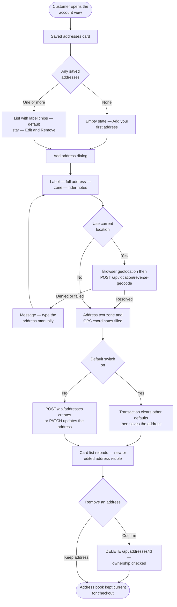

# C05 — Save and manage delivery addresses

The address book lives on the account view: a card listing saved addresses (label chip, default star, text, area, notes) with Add / Edit / Remove actions, backed by a dialog form. Each address stores a label, the full delivery text, a delivery zone (the area name that checkout matches against the zone fee table), optional rider notes, optional GPS coordinates (from a one-tap "Use my current location" that reverse-geocodes via the server), and an `isDefault` flag — enforced so only one address is ever the default. The same `Address` rows feed checkout step 2, where the default (or first) address is pre-selected with its zone and coordinates.

| Metadata | Value |
| --- | --- |
| Primary actor | Customer (signed-in) |
| Secondary actors | None (staff never touch a customer's addresses) |
| Functional area | Accounts and delivery |
| Entry point | Account view, Saved addresses card — `AccountView` in `src/components/views/account-view.tsx` |
| Status | Implemented — verified against code |
| End condition | Address book CRUD persisted through `/api/addresses`; default uniqueness maintained in transactions |
| Related journeys | C04 (the account view), O02 (delivery checkout that consumes addresses), R01 (the rider who uses the address), O06 (orders view) |

## Journey map

## Journey steps

### Step 1 — Open the saved addresses card

- **User action:** The customer opens My account and scrolls to the "Saved addresses" card.
- **Location:** Saved addresses card in `src/components/views/account-view.tsx` (`reloadAddresses` on view load).
- **Destination:** The address list (or the empty state).
- **Purpose:** Review and manage delivery destinations in one place.
- **System behaviour:** `addressesApi.list()` calls `GET /api/addresses`, which requires a customer session, returns the customer's addresses ordered default-first then newest, capped at 50. Load failure shows an error state with a "Try again" button; an empty book shows "No saved addresses yet" with an add CTA. Each card shows the label (with a Home/Work/MapPin icon heuristic), the default star badge, text, area and notes.
- **Outcome:** The current address book renders.
- **Next step:** Add a new address.
- **Alternative paths:** Guests cannot see the card at all — the account view shows the sign-in marketing card (journeys C01/C02).

### Step 2 — Fill in the address dialog

- **User action:** The customer clicks "Add address" (or "Edit" on a card) and types a label (e.g. Home, Work), the full address (building, street, estate — at least 8 characters client-side), picks a delivery zone, and optionally adds rider notes.
- **Location:** Address dialog in `account-view.tsx` (`openAddAddress`, `openEditAddress`, `saveAddress`).
- **Destination:** A complete form ready to save.
- **Purpose:** Capture everything a rider needs to find the door, plus the zone that drives the delivery fee.
- **System behaviour:** The zone select lists `DELIVERY_DEFAULTS.zones` names (Roysambu / TRM area, Kasarani, Githurai 44, …); when editing an address whose `area` is not a known zone, that value is prepended so it is not lost. Client validation blocks an empty label and address text under 8 characters. The form state (`AddressForm`) carries optional `latitude`/`longitude` (null until a location lookup fills them).
- **Outcome:** A labelled, zoned address ready to persist.
- **Next step:** Optionally capture GPS coordinates, then save.
- **Alternative paths:** The dialog can be cancelled any time (not while saving); edits pre-fill every field from the existing `AddressDTO`.

### Step 3 — Use current location for coordinates

- **User action:** The customer clicks "Use my current location" above the address text.
- **Location:** `UseCurrentLocationButton` in `src/components/shared/use-current-location-button.tsx`; endpoint `POST /api/location/reverse-geocode` (`src/app/api/location/reverse-geocode/route.ts`).
- **Destination:** Auto-filled address text, matched zone, and latitude/longitude in the form.
- **Purpose:** Attach exact GPS coordinates so the rider's navigation is unambiguous.
- **System behaviour:** The browser geolocation API runs (high accuracy, 15s timeout). Coordinates are POSTed to the reverse-geocode route (rate limited 30 per 10 minutes), which calls OpenStreetMap Nominatim and returns a `displayName`, `area` and `city`. The handler matches the returned area against the zone list and fills text, area and coordinates. Permission denial, unavailable position or geocoder failure shows an explanatory message — the customer simply types the address manually.
- **Outcome:** The form holds text + zone + coordinates (or a manual fallback).
- **Next step:** Save the address.
- **Alternative paths:** Without granting location permission nothing breaks — coordinates stay null and the address saves without them.

### Step 4 — Save the address (add or edit)

- **User action:** The customer clicks "Add address" / "Save address" in the dialog.
- **Location:** `addressesApi.create` / `addressesApi.update` in `src/lib/api-client.ts`; endpoints `POST /api/addresses` and `PATCH /api/addresses/[id]`.
- **Destination:** The dialog closes; the list reloads with a toast.
- **Purpose:** Persist the address server-side with a single default.
- **System behaviour:** Both routes require `requireCustomer()` and cap the body at 16 KB. Server validation: label defaulted to "Home", max 80 characters; text 5–500 characters; area trimmed to 120, notes to 500; `isDefault` must be boolean; latitude/longitude must arrive together and be within ±90/±180. When `isDefault: true` the route runs a transaction that first clears the flag on all other addresses (`updateMany`) and then creates/updates this one — the default is unique by construction. PATCH/DELETE first load the row scoped to `userId`, returning 404 for anything not owned by the caller. The client wraps address calls in a 15-second timeout that surfaces as a friendly 408 message.
- **Outcome:** The address is stored (or updated) and visible in the card list.
- **Next step:** Set another default, edit, or remove as needed.
- **Alternative paths:** A 400 (invalid text/label/coordinates) or 500 shows inline in the dialog — nothing is saved; the form keeps the customer's input for correction.

### Step 5 — Remove an address

- **User action:** The customer clicks "Remove" on an address card, then confirms in the dialog ("Remove this address?").
- **Location:** Confirm `AlertDialog` in `account-view.tsx` (`removeAddress`); endpoint `DELETE /api/addresses/[id]`.
- **Destination:** The list reloads without the address.
- **Purpose:** Keep the book free of stale destinations.
- **System behaviour:** The delete route re-checks ownership (`findFirst({ id, userId })`) and hard-deletes the row; 404 if it was already gone or belongs to someone else. "Keep address" cancels harmlessly. Past orders keep their own `deliveryAddress` snapshot text, so removing an address never rewrites order history.
- **Outcome:** The address no longer appears at checkout.
- **Next step:** Done, or add a replacement.
- **Alternative paths:** Deleting the default address leaves the remaining book without a default until the next save — checkout then pre-selects the first address.

### Step 6 — Use saved addresses at delivery checkout

- **User action:** The customer starts a delivery checkout (journey O02) and picks a saved address at step 2.
- **Location:** Checkout step 2 in `src/components/views/checkout-view.tsx` (addresses effect, `selectSavedAddress`).
- **Destination:** Checkout continues with the address applied.
- **Purpose:** One-tap delivery instead of retyping.
- **System behaviour:** On load, checkout fetches the same `GET /api/addresses` and pre-selects the default (or first) address, syncing the delivery zone from its `area` and the GPS coordinates. Choosing a different saved address re-syncs zone and coordinates. "New address" mode instead types a fresh address which — for signed-in customers — is saved into the book automatically at order time with label `Delivery · <zone>`. The chosen address id (`addressId`) or raw text travels in the `POST /api/orders` payload.
- **Outcome:** The delivery order carries the saved address, zone fee and coordinates.
- **Next step:** The order is placed (journey O02) and later assigned to a rider (journey R01).
- **Alternative paths:** Guests check out without a book — they type a one-off address that is not persisted.

## Decision points

| Decision | Branches | Enforced by/where |
| --- | --- | --- |
| Signed in? | Customer → address book; guest → sign-in card | `requireCustomer()` in all `/api/addresses` routes |
| Address text valid? | 5–500 chars server-side (≥ 8 client-side) → save; else 400 | `POST /api/addresses` / `PATCH /api/addresses/[id]` |
| Zone known? | Zone list from `DELIVERY_DEFAULTS.zones`; custom stored area kept as an extra option | `areaOptions` / `ZONE_NAMES` in `account-view.tsx` |
| Coordinates valid? | Both present and in range → stored; one-sided or out-of-range → 400 | paired latitude/longitude validation in both routes |
| Set as default? | Yes → transaction demotes all others first; no → plain save | `tx.address.updateMany` + create/update in the routes |
| Default removed? | Remaining book may have no default — checkout falls back to first address | `preferred = a.find(isDefault) ?? a[0]` in `checkout-view.tsx` |
| Ownership on edit/remove? | Row scoped to `userId` → 404 otherwise | `findFirst({ where: { id, userId } })` in the `[id]` route |

## Error and recovery paths

- **Invalid label or address (400):** the inline dialog error names the rule (label required, full address needed); correct and re-save.
- **Bad coordinates (400):** latitude/longitude must be sent together and be numerically valid — re-run "Use my current location" or clear them by saving without a location fix.
- **Address not found on edit/remove (404):** the list was stale (another device removed it) — reload the view; the book re-syncs from the server.
- **Save timing out (408):** address calls abort after 15 seconds with a connection-check message; retry when the network recovers — no partial rows are written.
- **Geolocation denied/failed:** the button explains the browser outcome (denied / unavailable / timeout); typing the address manually is always supported and coordinates remain null.
- **Reverse-geocode rate limit (429) or provider down (502/500):** the message asks the customer to try again later; manual entry is unaffected.
- **Removing an address referenced by past orders:** safe by design — orders snapshot their delivery text; only the book entry is deleted.
- **No default after deletion:** checkout pre-selects the first address instead; set a new default to restore the intended behaviour.

## Traceability

| Concern | Implementation reference |
| --- | --- |
| Address book UI and dialog | `src/components/views/account-view.tsx` (addresses state, `openAddAddress`, `openEditAddress`, `saveAddress`, `removeAddress`, address `Dialog` + delete `AlertDialog`) |
| Zone options | `DELIVERY_DEFAULTS.zones` in `src/lib/constants.ts`; `ZONE_NAMES` / `areaOptions` in `account-view.tsx` |
| Current-location capture | `src/components/shared/use-current-location-button.tsx` |
| Reverse geocoding | `POST /api/location/reverse-geocode` in `src/app/api/location/reverse-geocode/route.ts` (Nominatim) |
| List endpoint | `GET /api/addresses` in `src/app/api/addresses/route.ts` (default-first, newest, take 50) |
| Create endpoint | `POST /api/addresses` (16 KB cap, field validation, default-demote transaction) |
| Update / delete endpoints | `PATCH` / `DELETE /api/addresses/[id]` in `src/app/api/addresses/[id]/route.ts` (ownership checks) |
| Client API with timeout | `addressesApi` (`addressReq`, 15 s abort → 408) in `src/lib/api-client.ts` |
| Checkout consumption | addresses effect + `selectSavedAddress` in `src/components/views/checkout-view.tsx`; `addressId` / `deliveryAddress` in `CreateOrderPayload` |
| Data model | `Address` model (`prisma/schema.prisma`) — `label`, `text`, `area`, `notes`, `isDefault`, `latitude`, `longitude`, index `[userId, isDefault]` |

## Related journeys and documents

- **C04** — the account view this card lives on
- **O02** — delivery checkout that pre-selects the default address
- **R01** — the rider delivery that consumes the address text and coordinates
- **O06** — orders keep their own address snapshots
- Docs: [customer CRM](../../features/customer-crm.md) · [orders and fulfillment](../../features/orders-and-fulfillment.md) · [user roles and permissions](../../product/user-roles-and-permissions.md)
