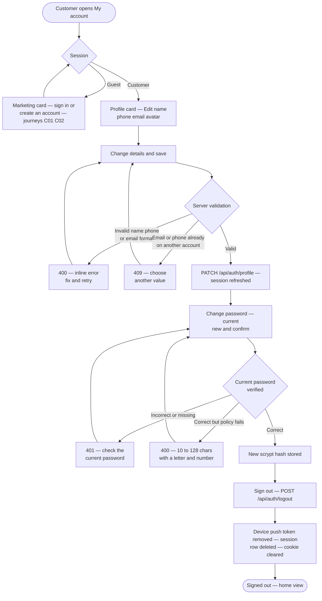

# C04 — Manage profile and account security

The account view is the signed-in customer's home base: a profile card (avatar, name, phone, email, member-since), a change-password card, notification channels, addresses, watchlist, points, notifications, and a "Security & data" card with sign-out. Everything editable goes through one endpoint — `PATCH /api/auth/profile` — which requires a customer session, re-validates every field server-side, and rejects email/phone collisions. Signing out is a real server-side logout: the `Session` row is deleted, the cookie is cleared, and the device's push token is removed when present.

| Metadata | Value |
| --- | --- |
| Primary actor | Customer (signed-in) |
| Secondary actors | System (session store, upload storage, push-token cleanup) |
| Functional area | Accounts and authentication |
| Entry point | Account view — `AccountView` in `src/components/views/account-view.tsx` |
| Status | Implemented — verified against code |
| End condition | Profile/password persisted via `PATCH /api/auth/profile`, or session destroyed via `POST /api/auth/logout` |
| Related journeys | C01 (password sign-in), C02 (OTP sign-in), C05 (addresses), C06 (notification channels), O06 (orders view) |

## Journey map

## Journey steps

### Step 1 — Open the account view

- **User action:** The customer clicks the header account button ("My account", aria-labelled) or the mobile navigation's account entry.
- **Location:** `src/components/views/account-view.tsx`; session from `src/store/use-auth-store.ts`.
- **Destination:** The account view (profile, points, password, channels, addresses, watchlist, notifications, security cards).
- **Purpose:** Reach every account-management surface in one place.
- **System behaviour:** While the session loads, skeletons render. Guests get a marketing card ("Your Sphere Pharmacy account") with Sign in / Create account buttons calling `openAuth("login"/"register", "account")`. Staff sessions get a separate staff card with the dashboard link and sign-out (the same logout path). Signed-in customers trigger one data load: addresses, notifications, watchlist, loyalty summary and channel preferences (`reloadAddresses`, `reloadNotifications`, `reloadWatchlist`, `reloadLoyalty`, `reloadPrefs`).
- **Outcome:** The customer sees their profile (avatar, name, phone, email, member since) and the action cards.
- **Next step:** Edit profile details.
- **Alternative paths:** Guests follow journeys C01 (password) or C02 (OTP) and return to the account view automatically (`authNext: account`).

### Step 2 — Edit profile details and photo

- **User action:** The customer clicks "Edit" on the profile card, updates name, phone (e.g. 0712 345 678) and email, and optionally clicks "Upload profile photo" to pick an image.
- **Location:** Profile card in `account-view.tsx` (`startEditProfile`, `saveProfile`, `handleAvatarUpload`).
- **Destination:** The inline edit form (or the OS file picker for the photo).
- **Purpose:** Correct contact details so order and prescription updates reach the customer.
- **System behaviour:** Client-side checks run first: name ≥ 2 characters, phone must pass `normalizePhone` (Kenyan 07…/01…/254…/7… forms), email must match a simple pattern — failures show an inline error and block submission. The photo uploads immediately via `storageApi.uploadFile(file, "avatars")` → `POST /api/upload` (multipart; avatars allowed for any signed-in session; ≤ 10 MB; JPEG/PNG/WebP/GIF/HEIC types; 20 uploads per 15 minutes), which stores the object in Cloudflare R2 and returns the public URL — that URL is then PATCHed into the profile. Upload to R2 needs live storage credentials; without them the photo step fails but the rest of the journey works.
- **Outcome:** A filled form (and, if uploaded, a new avatar already stored and shown in the form).
- **Next step:** Save the changes.
- **Alternative paths:** "Cancel" discards the form and restores the read-only card; a failed upload shows a toast and leaves the old avatar untouched.

### Step 3 — Save the profile

- **User action:** The customer clicks "Save changes".
- **Location:** `authApi.updateProfile` in `src/lib/api-client.ts`; endpoint `PATCH /api/auth/profile` (`src/app/api/auth/profile/route.ts`).
- **Destination:** Back to the read-only profile card with a "Profile updated" toast.
- **Purpose:** Persist the new details server-side.
- **System behaviour:** The route requires a customer session (`requireCustomer()`), loads the user, and validates each field: name trimmed to ≥ 2 characters (400), email format (400) plus uniqueness against other accounts (409), phone matched against `PHONE_RE` and normalized to `+254XXXXXXXXX` (400) plus uniqueness (409), avatar stored as a string or `null`. On success the `User` row is updated and the refreshed DTO returned; the client then calls `refreshSession()` (`GET /api/auth/me`) so the header and account view show the new values immediately.
- **Outcome:** The profile reflects the new details everywhere.
- **Next step:** Change the password, or continue using the account.
- **Alternative paths:** A 400/409 error is surfaced inline in the form — nothing is saved until the field is corrected; empty phone/email submissions clear the field rather than failing.

### Step 4 — Change the password

- **User action:** The customer types the current password, a new password and its confirmation, then clicks "Update password".
- **Location:** Password card in `account-view.tsx` (`savePassword`); endpoint `PATCH /api/auth/profile` with `currentPassword` + `password`.
- **Destination:** The form clears with a "Password changed" toast.
- **Purpose:** Rotate the account credential.
- **System behaviour:** The client blocks empty current password, new passwords under 6 characters, and mismatches. The server then does the authoritative checks: `verifyPassword(current, user.passwordHash)` — a wrong current password returns 401 — followed by `validatePassword` (10–128 characters, at least one letter and one number), which can still reject values the client accepted. The new password is hashed with scrypt (`hashPassword`) and stored as `passwordHash`. Other sessions are not revoked by this change (a documented behaviour — sessions live until they expire or the customer signs out).
- **Outcome:** The stored password hash is replaced.
- **Next step:** Sign out (or stay signed in on this session).
- **Alternative paths:** OTP-created accounts have no `passwordHash`, so the current-password check always fails (401) — passwordless accounts keep using journey C02; there is no set-first-password path in this form.

### Step 5 — Sign out

- **User action:** The customer clicks "Sign out" in the Security & data card.
- **Location:** `signOut` in `account-view.tsx`; `logout` in `src/store/use-auth-store.ts`; endpoint `POST /api/auth/logout` (`src/app/api/auth/logout/route.ts`).
- **Destination:** The home view with a "You've been signed out" toast.
- **Purpose:** End the session on this device.
- **System behaviour:** The client sends the locally stored push token (`localStorage sphere_device_token`) in the body; the route deletes any matching `PushToken` rows scoped to the caller, then `destroySession()` deletes the `Session` row and clears the `sphere_session` cookie. The client clears its session state and removes the stored device token. A network failure keeps the customer signed in with an error toast — the session is server-authoritative.
- **Outcome:** The device is signed out and no longer receives push alerts.
- **Next step:** Sign in again when needed (journeys C01/C02).
- **Alternative paths:** Staff use the same endpoint from their account card; a lost/stolen device's sessions can only be ended per-device by signing out there — customer sessions are not centrally revocable in the UI (staff sessions have admin-driven revocation).

### Step 6 — Session behaviour across the account

- **User action:** The customer continues browsing, returns later, or opens the app on another device.
- **Location:** `src/lib/session.ts` (`getSession`, `createSession`); `src/store/use-auth-store.ts` (`refresh`).
- **Destination:** Wherever the customer was — the session persists.
- **Purpose:** Understand what stays signed in and for how long.
- **System behaviour:** Sessions are opaque random tokens in the `Session` table behind an httpOnly `sphere_session` cookie; customer sessions last 30 days (`SESSION_DAYS = 30`). Every authenticated call re-reads the session and deletes expired rows. Profile edits refresh the client session but never create new ones; sign-out is the only customer-facing way to end one. The "Download my data" button in the Security & data card is disabled ("Coming soon") — an explicit non-shipped surface.
- **Outcome:** Predictable sign-in lifetime; changes apply on every device because they are server-side.
- **Next step:** The journey ends; account data (addresses, alerts, points) remains available after the next sign-in.
- **Alternative paths:** An expired session makes protected calls return 401 — the views then show sign-in prompts (journeys C01/C02) instead of account data.

## Decision points

| Decision | Branches | Enforced by/where |
| --- | --- | --- |
| Who is signed in? | Guest → marketing card + auth; customer → account view; staff → staff card with dashboard | Session resolution in `account-view.tsx` (`isCustomer`, `isStaff`) |
| Name valid? | ≥ 2 trimmed characters → save; else 400/inline error | `saveProfile` (client) and `PATCH /api/auth/profile` |
| Email/phone free? | Taken by another account → 409; free → updated | `findUnique` clash checks in the profile route |
| Phone valid Kenyan number? | Yes → normalized `+254…`; no → 400 | `normalizePhone` (client) and `PHONE_RE` (server) |
| Current password correct? | Yes → proceed; no/missing hash → 401 | `verifyPassword` in `PATCH /api/auth/profile` |
| New password policy | 10–128 chars, letter + number → stored (scrypt); else 400 | `validatePassword` in `src/lib/hash.ts` |
| Avatar upload allowed? | Signed-in session, image type, ≤ 10 MB → R2 upload; else 400/413/403 | `POST /api/upload` (`avatars` folder rules) |
| Logout with a device token? | Token present → `PushToken` rows removed; then session destroyed | `POST /api/auth/logout` |

## Error and recovery paths

- **Invalid field (400):** name under 2 characters, malformed email, or non-Kenyan phone — the inline message names the problem; correct and re-save.
- **Email or phone already in use (409):** the value belongs to another account; choose a different one — the current profile is untouched.
- **Wrong current password (401):** nothing changes; re-enter it (check caps lock / saved-password confusion). Repeated failure points to using OTP sign-in instead.
- **Weak new password (400):** the client only blocks under 6 characters and mismatches, so a 6–9 character or letter-less password is caught by the server's 10-char/letter+number policy — the message states the rule; pick a stronger password.
- **OTP-only account:** accounts created via phone code have no password to verify, so the change-password form cannot succeed for them — documented limitation; they continue with journey C02.
- **Avatar upload failure:** over-size/unsupported files are rejected by `POST /api/upload` (413/400); a missing R2 configuration fails the store — the profile text fields still save independently.
- **Logout network failure:** the toast "Couldn't sign out" appears and the session remains — retry; the server row is the source of truth.
- **Session expired mid-edit:** `PATCH /api/auth/profile` returns the 401 from `requireCustomer()`; re-authenticate (C01/C02) and re-enter the changes.

## Traceability

| Concern | Implementation reference |
| --- | --- |
| Account view (profile, password, security cards) | `src/components/views/account-view.tsx` (`startEditProfile`, `saveProfile`, `handleAvatarUpload`, `savePassword`, `signOut`) |
| Profile update endpoint | `PATCH /api/auth/profile` in `src/app/api/auth/profile/route.ts` |
| Logout endpoint | `POST /api/auth/logout` in `src/app/api/auth/logout/route.ts` (`destroySession`, `PushToken` cleanup) |
| Session store (client) | `src/store/use-auth-store.ts` (`refresh`, `logout`, `sphere_device_token` handling) |
| Session mechanism (server) | `src/lib/session.ts` — `SESSION_DAYS = 30`, `getSession`, `destroySession`, `requireCustomer` |
| Password hashing and policy | `src/lib/hash.ts` — `verifyPassword`, `hashPassword`, `validatePassword` (`PASSWORD_MIN` 10, `PASSWORD_MAX` 128) |
| Avatar upload | `storageApi.uploadFile` in `src/lib/api-client.ts` → `POST /api/upload` in `src/app/api/upload/route.ts` (`avatars` folder, R2 via `src/lib/r2.ts`) |
| Guest marketing card | `account-view.tsx` guest branch (`openAuth("login"/"register", "account")`) |
| Push-token deregistration on logout | `db.pushToken.deleteMany` in the logout route; token kept in `localStorage sphere_device_token` |
| Data model | `User`, `Session`, `PushToken` models (`prisma/schema.prisma`) |
| Architecture contract | `docs/architecture/authentication.md` (§1 session mechanism, §7 logout) |

## Related journeys and documents

- **C01** — password registration and sign-in
- **C02** — phone-code sign-in (and the OTP-only accounts this journey notes)
- **C05** — the saved-addresses card on the same view
- **C06** — notification channels and the in-app inbox on the same view
- **O06** — orders view reached from the account hub
- Docs: [authentication](../../architecture/authentication.md) · [customer CRM](../../features/customer-crm.md) · [user roles and permissions](../../product/user-roles-and-permissions.md)
