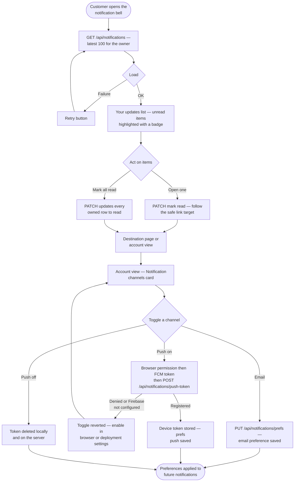

# C06 — Manage notifications and preferences

Two surfaces serve the same `Notification` rows: the header bell (a dialog listing the latest updates, refreshing every 60 seconds while open, with unread counts and click-through to the linked page) and the account view's Notifications card (with "Mark all read"). Preferences live in the "Notification channels" card: email is a toggle, in-app is always on, and push is registered per device — enabling it asks for browser permission, obtains a Firebase Cloud Messaging token, and stores it server-side so the dispatch job can push to that device. Staff see the same bell and inbox; this journey documents the customer side and notes the shared mechanics. The in-app inbox and preference storage work without any provider; push delivery additionally needs Firebase configuration (an environment-dependent sub-flow), and email fan-out is dispatched by the notification queue job (SYS-10).

| Metadata | Value |
| --- | --- |
| Primary actor | Customer (signed-in) |
| Secondary actors | System (notification fan-out, push registration, dispatch job) |
| Functional area | Notifications |
| Entry point | Bell in `src/components/layout/sphere-header.tsx` → `NotificationCenter`; account view cards in `src/components/views/account-view.tsx` |
| Status | Implemented — verified against code |
| End condition | Notifications read via `PATCH /api/notifications`; channel prefs on `NotificationPref`; device token in `PushToken` |
| Related journeys | C04 (account view + logout token cleanup), C07 (stock alerts that land here), O06 (order updates), X03 (refill updates), SYS-10 (dispatch pipeline) |

## Journey map

## Journey steps

### Step 1 — Open the notification center

- **User action:** The customer clicks the bell icon in the header.
- **Location:** `NotificationCenter` in `src/components/layout/notification-center.tsx` (mounted in `src/components/layout/sphere-header.tsx`).
- **Destination:** The "Your updates" dialog.
- **Purpose:** Catch up on order, payment, appointment and pharmacy updates.
- **System behaviour:** The bell renders only for a signed-in owner (`session.user.id || session.staff.id` — staff share this inbox with their own rows). Opening the dialog calls `GET /api/notifications`, which requires a session, resolves the owner (`userId` or `staffId`), and returns the latest 100 notifications newest-first with `Cache-Control: private, no-store`. The list refreshes every 60 seconds while open, on tab visibility change, and when the service worker reports a `PUSH_NOTIFICATION` message. Unread items are visually highlighted and the bell shows an unread badge (capped at 99+).
- **Outcome:** The customer sees their recent updates with unread state.
- **Next step:** Open an item or mark everything read.
- **Alternative paths:** Guests see no bell at all; a load failure shows an inline error with a Retry button.

### Step 2 — Read and act on a notification

- **User action:** The customer clicks a notification in the list.
- **Location:** `view(item)` in `notification-center.tsx`; endpoint `PATCH /api/notifications` with `{ id }`.
- **Destination:** The linked page (order detail, appointments, prescriptions, account) — or the account view when no link exists.
- **Purpose:** Mark the item read and jump to the thing that changed.
- **System behaviour:** The PATCH marks that single row read, scoped to the owner (`updateMany` with the owner filter — one customer cannot touch another's rows). The client then parses the notification's `metadata` JSON, resolves `link` against the site origin, and navigates only if it is same-origin (external links fall back to the account view). Unread markers update instantly in the UI.
- **Outcome:** The item is read and the customer lands on the relevant page.
- **Next step:** Continue from the destination page.
- **Alternative paths:** If marking read fails, an error appears and the item stays unread; the link is not followed in that case.

### Step 3 — Mark all read from the account view

- **User action:** On the account view's Notifications card the customer clicks "Mark all read" (shown only when unread items exist).
- **Location:** Notifications card in `account-view.tsx`; endpoint `PATCH /api/notifications` without an id.
- **Destination:** The list reloads with every item read.
- **Purpose:** Clear the backlog in one action.
- **System behaviour:** The same PATCH endpoint, without `body.id`, runs `updateMany` across all of the owner's notifications setting `read: true`; the card's unread badge disappears. The account card mirrors the bell's data (it loads the same `GET /api/notifications` on view open) and shows relative timestamps.
- **Outcome:** Inbox fully read on both surfaces.
- **Next step:** Adjust channel preferences.
- **Alternative paths:** Individual read-state is only set via the bell (click-through); the account card offers the bulk action.

### Step 4 — Review channel preferences

- **User action:** The customer opens the "Notification channels" card on the account view.
- **Location:** Channels card in `account-view.tsx` (`reloadPrefs`, `toggleChannel`); endpoint `GET /api/notifications/prefs`.
- **Destination:** The Email toggle, the per-device push block, and the always-on in-app row.
- **Purpose:** Decide how future notifications are delivered.
- **System behaviour:** `GET /api/notifications/prefs` requires a customer session and returns the stored `NotificationPref` (sms, whatsapp, email, push) or the defaults (all true) when no row exists. The UI exposes an Email switch ("Order confirmations, appointment updates, and receipts"), a "Push alerts on this device" block, and a disabled always-on In-app switch. `sms` and `whatsapp` exist in the model and API but have no customer-facing toggle in this view. Preference changes take effect for future fan-out — the in-app row itself is always written.
- **Outcome:** The customer sees the current channel settings.
- **Next step:** Toggle email or set up push.
- **Alternative paths:** If preferences fail to load, the card stays in skeleton state and toggles are unavailable until reload.

### Step 5 — Enable push on this device

- **User action:** The customer flips the push toggle on (or clicks "Enable push on this device").
- **Location:** `toggleChannel("push", …)` / the enable button in `account-view.tsx`; `enablePushNotifications` in `src/lib/firebase/client.ts`; endpoint `POST /api/notifications/push-token`.
- **Destination:** The toggle settles on with a success toast ("This device is registered for push alerts").
- **Purpose:** Receive alerts even when the tab is closed.
- **System behaviour:** The client first checks support (secure context, service worker, `Notification`, `PushManager`) and that the Firebase web config and VAPID key are present — missing config fails locally with an explanation. `Notification.requestPermission()` runs; denial or dismissal aborts and reverts the optimistic toggle. On grant, the service worker (`/firebase-messaging-sw.js`) is registered, an FCM token is obtained, and it is POSTed to `/api/notifications/push-token` — the route requires a session, validates the token (32–4096 chars, rejects JSON blobs and `dev_fcm_` test prefixes) and upserts a `PushToken` row linked to the user. The token is stored in `localStorage sphere_device_token` and the `push` preference is saved via `PUT /api/notifications/prefs`. Later, foreground pushes surface as toasts via `setupForegroundNotificationListener` (`src/app/page.tsx`), and each sign-in re-registers the token if permission is already granted.
- **Outcome:** This browser is registered; the dispatch job can push to it.
- **Next step:** Nothing else — alerts flow to the bell and the device.
- **Alternative paths:** Without Firebase credentials (environment-dependent) the enable step fails with a clear message and the toggle reverts; the in-app inbox and email keep working.

### Step 6 — Turn push off (or sign out)

- **User action:** The customer clicks "Turn push off", or signs out (journey C04).
- **Location:** `disablePushNotifications` in `src/lib/firebase/client.ts`; endpoint `DELETE /api/notifications/push-token`; logout route `POST /api/auth/logout`.
- **Destination:** Push disabled for this device; other devices unaffected.
- **Purpose:** Stop device alerts without losing the inbox.
- **System behaviour:** The client deletes the FCM token, unsubscribes the service-worker push subscription, DELETEs the server row (scoped to the caller), removes the local token, and saves `push: false` in preferences. Signing out performs the same token cleanup for the stored device token before destroying the session.
- **Outcome:** No further pushes to this device; in-app and email continue per preferences.
- **Next step:** The journey ends.
- **Alternative paths:** Re-enabling later repeats step 5 on this or any other browser — each device gets its own `PushToken` row.

## Decision points

| Decision | Branches | Enforced by/where |
| --- | --- | --- |
| Signed in? | Session → inbox + prefs; none → 401 / bell hidden | `getSession` in `/api/notifications`; owner check in `NotificationCenter` |
| Owner type | `userId` (customer) or `staffId` (staff) — same routes, separate rows | `where` resolution in `GET`/`PATCH /api/notifications` |
| Mark one or all? | `body.id` present → single row; absent → all owner rows read | `PATCH /api/notifications` |
| Link safe to follow? | Same-origin → navigate; otherwise → account view | origin check in `view()` in `notification-center.tsx`; `notificationUrl` in `src/lib/notify.ts` |
| Push support present? | Secure browser context + Firebase config → proceed; else local failure with message | `isPushNotificationSupported`, `missingFirebaseConfig` in `src/lib/firebase/client.ts` |
| Permission granted? | Granted → register token; denied/dismissed → revert toggle | `Notification.requestPermission()` flow |
| Token valid? | 32–4096 chars, not JSON/test-prefixed → upsert; else 400 | `POST /api/notifications/push-token` |
| Channel allowed at send time? | `email`/`push` default true, `sms`/`whatsapp` default false for dispatch | `channelAllowed` in `src/lib/notify.ts` |

## Error and recovery paths

- **Inbox load failure:** the bell and the account card show a Retry/Try again button; nothing is lost server-side.
- **Mark-read failure:** the item remains unread; retry by clicking again — the update is idempotent.
- **Prefs save failure:** optimistic toggle reverts with an error toast; the stored preference is unchanged.
- **Push not supported:** unsupported browsers (no service worker/PushManager or non-HTTPS) get an explanatory message; in-app and email still cover the customer.
- **Firebase misconfiguration (environment-dependent):** missing `NEXT_PUBLIC_FIREBASE_*` values or the VAPID key abort registration with "Firebase Web Messaging configuration is incomplete for this deployment." — a deployment fix, not a customer action.
- **Permission blocked by the browser:** the message directs the customer to site settings; after allowing, re-toggle push.
- **Token rejected (400):** malformed tokens never reach the database; re-enabling push obtains a fresh token.
- **Stale token after reinstall:** sign-in re-registration (`page.tsx` effect) and logout cleanup keep the `PushToken` table converging on live devices.

## Traceability

| Concern | Implementation reference |
| --- | --- |
| Notification center dialog | `src/components/layout/notification-center.tsx` (60 s refresh, visibility + `PUSH_NOTIFICATION` listeners, mark-read, safe-link navigation) |
| Header mounting | `src/components/layout/sphere-header.tsx` |
| Inbox endpoints | `GET` / `PATCH /api/notifications` in `src/app/api/notifications/route.ts` (owner-scoped, take 100, no-store) |
| Account view cards | `src/components/views/account-view.tsx` (Notifications card + Mark all read, Notification channels card, `toggleChannel`) |
| Preferences endpoints | `GET` / `PUT /api/notifications/prefs` in `src/app/api/notifications/prefs/route.ts` (upsert, defaults all-true) |
| Push client | `src/lib/firebase/client.ts` (`enablePushNotifications`, `disablePushNotifications`, `setupForegroundNotificationListener`) |
| Push token endpoints | `POST` / `DELETE /api/notifications/push-token` in `src/app/api/notifications/push-token/route.ts` |
| Foreground toasts + re-registration | `src/app/page.tsx` (`setupForegroundNotificationListener`, granted-permission re-enable effect) |
| Fan-out (inbox row + email/push jobs) | `enqueue` / `notifyCustomer` / `channelAllowed` in `src/lib/notify.ts`; dispatch job in journey SYS-10 |
| Data model | `Notification`, `NotificationPref`, `PushToken` models (`prisma/schema.prisma`) |
| Logout token cleanup | `POST /api/auth/logout` (journey C04) |

## Related journeys and documents

- **C04** — profile/security card on the same view; sign-out deregisters this device
- **C07** — back-in-stock alerts that arrive through this inbox
- **O06** — the order-status updates that dominate the inbox
- **X03** — prescription outcomes and refill reminders
- **SYS-10** — the dispatch job that delivers the email/push jobs queued here
- Docs: [notifications](../../features/notifications.md) · [customer CRM](../../features/customer-crm.md) · [authentication](../../architecture/authentication.md)
