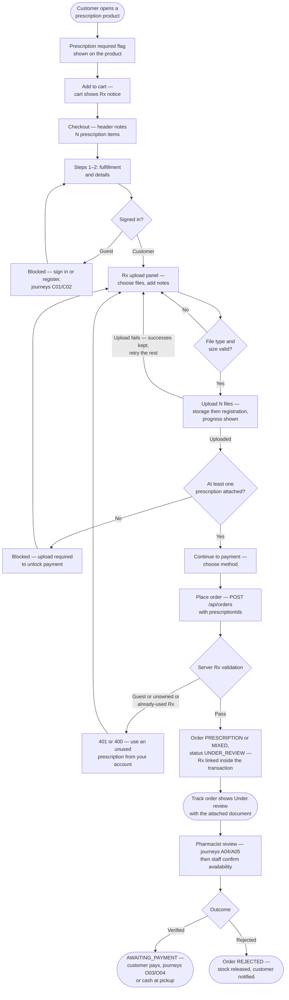

# X02 — Order prescription medicines

Prescription-only products can be added to the cart by anyone, but the checkout path changes the moment the cart contains one: guests are blocked with a sign-in requirement, the Details step grows a mandatory prescription-upload panel, and the placed order is created in `UNDER_REVIEW` — not awaiting payment — because a pharmacist must verify the attached documents first (journeys A04/A05). Only after verification (`PRESCRIPTION_VERIFIED`) and staff availability confirmation (`AWAITING_PAYMENT`) can the customer pay online; cash-at-counter remains possible at pickup.

| Metadata | Value |
| --- | --- |
| Primary actor | Customer (account required) |
| Secondary actors | Pharmacist (verification — A04/A05), Staff (availability confirmation, dispensing — A02) |
| Functional area | Orders (prescription gate) |
| Entry point | Prescription product page → Add to cart → Checkout |
| Status | Implemented — verified against code |
| End condition | Order type `PRESCRIPTION`/`MIXED`, status `UNDER_REVIEW`, prescriptions linked (`orderId` set), pharmacist queue notified |
| Related journeys | X01 (standalone upload), X03 (outcomes/refills), A04/A05 (review), O03/O04 (payment after clearance), O06 (tracking) |

## Journey map

## Journey steps

### Step 1 — Add a prescription-only product to the cart

- **User action:** The customer opens a prescription medicine's product page (which shows the prescription-required flag), sets the quantity and adds it to the cart.
- **Location:** Product page and cart view — `src/components/views/product-view.tsx` (product detail) and `src/components/views/cart-view.tsx`; the flag is `requiresPrescription` on the product/cart line.
- **Destination:** The cart with an Rx line.
- **Purpose:** Start an order that will require pharmacist verification before dispensing.
- **System behaviour:** The cart store keeps `requiresPrescription` per line; the cart view shows an Rx notice; the checkout header states how many prescription items the order includes and that a pharmacist review precedes dispensing. OTC items may be mixed in the same cart.
- **Outcome:** The cart contains at least one Rx line and checkout is opened.
- **Next step:** Proceed through fulfillment and details.
- **Alternative paths:** Customers without a prescription document yet can request the medicine through the medicine-request flows (journeys P04/P05) or contact the pharmacy (journey P06).

### Step 2 — Sign in at checkout

- **User action:** Guests reach the Details step and are stopped by the "Prescription items need an account" alert with Log in / Create account actions; they sign in and return to checkout.
- **Location:** Guest-details block in `checkout-view.tsx` (`hasRx` alert, `openAuth` with checkout intent).
- **Destination:** The same checkout step, now as a signed-in customer.
- **Purpose:** Tie the prescription and its review to a real account.
- **System behaviour:** The client blocks guest continuation when `hasRx` is true ("Prescription items require an account so the pharmacist can review and track your prescription."). The server independently rejects Rx orders from unauthenticated callers with 401 ("Prescription items require a verified account."). The sign-in sheet preserves the checkout intent so the customer lands back in the wizard.
- **Outcome:** A signed-in customer at the Details step.
- **Next step:** Upload prescriptions.
- **Alternative paths:** Customers who already have an account simply sign in (journeys C01/C02); the guest cart is preserved across sign-in (journey C03).

### Step 3 — Upload prescriptions in the Details step

- **User action:** In the prescription-required panel, the customer clicks Choose file(s), picks one or more photos/PDFs (≤ 10 MB each), optionally adds per-file notes for the pharmacist, and clicks "Upload N file(s)".
- **Location:** Rx upload panel in `checkout-view.tsx` (`handleFiles`, `uploadStaged`, staged and uploaded lists with progress).
- **Destination:** An "Uploaded · pending pharmacist review" list attached to this checkout.
- **Purpose:** Give the pharmacist the document(s) to verify against the ordered items.
- **System behaviour:** Files are validated client-side (type regex, 10 MB cap) and staged with previews; `uploadStaged` uploads each file via `storageApi.uploadFile` (private R2, folder `prescriptions`) and registers it via `prescriptionsApi.upload` (`POST /api/prescriptions`) — the same verified path as journey X01 — collecting the created prescription ids. Uploaded files can be removed from the order before placement; failed files remain staged with an error telling the customer the successful uploads were kept and the rest can be retried. This panel uploads fresh documents; it does not offer a picker for previously uploaded standalone prescriptions — the order links exactly the ids uploaded in this checkout session.
- **Outcome:** One or more uploaded prescription ids are ready to submit with the order.
- **Next step:** Continue to payment.
- **Alternative paths:** Upload failures surface per-file with retry; type/size violations are rejected with toasts before any upload starts.

### Step 4 — Continue to payment with the Rx gate

- **User action:** The customer clicks "Continue to payment".
- **Location:** `continueFrom2` in `checkout-view.tsx`.
- **Destination:** Step 3 (payment) — or an inline block.
- **Purpose:** Ensure the order cannot be placed without at least one prescription attached.
- **System behaviour:** The gate is explicit: when the cart has Rx items and no file has been uploaded, continuation is blocked with "Upload at least one prescription file — payment is unlocked once the pharmacist has your prescription." All the standard details guards (contact, address/zone for delivery) still apply.
- **Outcome:** The wizard reaches the payment step with prescriptions attached.
- **Next step:** Choose the payment method and place the order.
- **Alternative paths:** The customer can go back and add or remove documents; the success screen will also summarize attached prescriptions after placement.

### Step 5 — Place the prescription order

- **User action:** The customer picks a payment method (cash is the straightforward choice at placement, since online payment is not possible until review completes) and places the order.
- **Location:** Step 3 payment starters in `checkout-view.tsx`; endpoint `POST /api/orders` (`src/app/api/orders/route.ts`).
- **Destination:** The step-4 success screen.
- **Purpose:** Create the order with the prescriptions linked.
- **System behaviour:** The payload includes `prescriptionIds` (the uploaded ids). The server enforces the Rx gate: an account is required (401 otherwise), and every id must be an owned, unused (`orderId: null`), non-soft-deleted prescription — otherwise 400 ("Upload an unused prescription from your account."). Inside the Serializable create transaction, the order is created with type `PRESCRIPTION` (all lines Rx) or `MIXED`, status **`UNDER_REVIEW`** regardless of payment method, the initial history note "Prescription queued for pharmacist review", and the prescriptions are linked to the order (`orderId` set). Notifications go to the customer and to staff as `NEW_PRESCRIPTION_ORDER` (ADMIN/PHARMACIST, deep link into the prescriptions queue).
- **Outcome:** The order exists in `UNDER_REVIEW`; the success screen lists the attached prescription(s) with the reminder that a pharmacist reviews them before dispensing.
- **Next step:** Track the order while it is reviewed.
- **Alternative paths:** Stock shortfall (409) names the product; an M-Pesa/card selection still creates the order as `UNDER_REVIEW` — the immediate payment initiation will be rejected with 409 until staff advance the order, so cash-at-pickup or paying later from the order detail (journey O06) are the practical choices at placement.

### Step 6 — Wait for review, then pay and complete

- **User action:** The customer tracks the order (journey O06) and waits for the review outcome; once the order shows Awaiting payment, they pay online (journeys O03/O04) or pay cash at the counter.
- **Location:** Order detail view (`order-detail-view.tsx` shows the attached prescriptions and their statuses); staff actions in journeys A04/A05/A02.
- **Destination:** A paid, dispensable prescription order.
- **Purpose:** Understand that verification — not payment — is the gate.
- **System behaviour:** The pharmacist's decision (journeys A04/A05) recomputes the linked order: all prescriptions approved/partially approved → `PRESCRIPTION_VERIFIED`; all decided with any rejection → `REJECTED` (stock released, customer notified); otherwise the order stays `UNDER_REVIEW`. Staff then confirm availability, which advances the order to `AWAITING_PAYMENT`, unlocking online payment; packing to `READY_FOR_PICKUP` additionally requires every linked prescription to be in the approval family. The customer can also request refills later against the approved prescription (journey X03).
- **Outcome:** The order completes through the normal fulfillment pipeline (`COMPLETED_PICKUP`/`COMPLETED_DELIVERY`).
- **Next step:** The journey ends; refills continue in X03.
- **Alternative paths:** If the pharmacist requests clarification, the customer is notified with the question and responds via the contact channels or a new upload; a rejected document rejects the order and releases the stock.

## Decision points

| Decision | Branches | Enforced by/where |
| --- | --- | --- |
| Cart has Rx items? | Yes → account required + upload gate; no → journeys O01/O02 | `hasRx` in `checkout-view.tsx`; `hasRx` checks in `POST /api/orders` |
| Guest or customer? | Guest → blocked (client alert + server 401); customer → continue | guest alert in `checkout-view.tsx`; session check in `POST /api/orders` |
| File valid? | Allowed image/PDF ≤ 10 MB → staged; otherwise toast rejection | `RX_FILE_TYPES`/`MAX_RX_FILE_BYTES` in `checkout-view.tsx`; server re-validation in `POST /api/prescriptions` |
| Prescription attached? | ≥ 1 uploaded → payment unlocked; none → blocked inline | `continueFrom2` guard in `checkout-view.tsx` |
| Prescriptions usable? | Owned, unused, not deleted → linked in transaction; else 400 | ownership/uniqueness query in `POST /api/orders` |
| Order type and initial status | All lines Rx → `PRESCRIPTION`; mixed → `MIXED`; status `UNDER_REVIEW` regardless of payment method | type/`initialStatus` derivation in `POST /api/orders` |
| Review outcome | All approved → `PRESCRIPTION_VERIFIED`; any rejection among decided → `REJECTED`; else stays `UNDER_REVIEW` | aggregation in `PATCH /api/prescriptions/[id]` (journeys A04/A05) |
| Payment timing | Before `AWAITING_PAYMENT` → initiate routes 409; after → journeys O03/O04 or cash at pickup | status guard in the payment initiate routes |

## Error and recovery paths

- **Guest with Rx items (client block / server 401):** sign in or register; the cart and checkout state survive the round-trip (journey C03).
- **Invalid file type or size (toast):** only photos (JPG/PNG/WebP/HEIC) and PDFs up to 10 MB are accepted at both layers; re-pick the file.
- **Partial upload failure:** successful uploads are kept and listed; failed files stay staged for retry — the customer does not re-upload everything.
- **No prescription attached (inline block):** the customer cannot reach payment; upload at least one file or remove the Rx lines from the cart.
- **Unusable prescription ids (400):** the server only links prescriptions that are owned by the customer, not yet linked to an order and not deleted — re-upload through the panel (fresh uploads are always unused).
- **Online payment attempted too early (409):** the order is `UNDER_REVIEW`; the initiate route replies that the order is not ready for payment — wait for the pharmacist and staff to advance it, then pay from the order detail (journeys O03/O04/O06).
- **Stock shortfall at placement (409):** the error names the product; adjust the cart and retry — nothing is reserved on failure.
- **Rejected prescription:** the order moves to `REJECTED` with reserved stock released and the customer notified; a corrected document requires a new order (and new upload).
- **Clarification requested:** the customer is notified with the pharmacist's question and can respond through contact channels or by uploading a clearer document; the order remains `UNDER_REVIEW` until decided.

## Traceability

| Concern | Implementation reference |
| --- | --- |
| Rx flag on products/cart | `requiresPrescription` on `Product`/cart lines; Rx notice in `cart-view.tsx` |
| Checkout Rx gating | `hasRx` header, guest alert and `continueFrom2` guard in `src/components/views/checkout-view.tsx` |
| Checkout Rx upload panel | `handleFiles`, `uploadStaged`, staged/uploaded lists in `checkout-view.tsx` |
| Upload + registration (shared with X01) | `storageApi.uploadFile` → `POST /api/upload`; `prescriptionsApi.upload` → `POST /api/prescriptions` |
| Rx order validation and linking | `POST /api/orders` (`src/app/api/orders/route.ts`) — ownership/uniqueness check, `prescription.updateMany` linking inside the transaction |
| Type and initial status derivation | `type`/`initialStatus` computations in `POST /api/orders` |
| Payment gate for Rx orders | status guard (`AWAITING_PAYMENT`) in the mpesa/intasend initiate routes |
| Review-driven order transitions | `PATCH /api/prescriptions/[id]` (`src/app/api/prescriptions/[id]/route.ts`) — journeys A04/A05 |
| Packing gate (all Rx approved) | `canTransitionOrder` contextual guards in `src/lib/security/order-workflow.ts` |
| Staff notification | `NEW_PRESCRIPTION_ORDER` via `notifyStaff` from `src/lib/notify.ts` |
| Statuses | `ORDER_STATUSES`, `RX_STATUSES`, `ORDER_TYPES` in `src/lib/constants.ts` |
| API contract | `openapi/sphere-api.yaml` — `POST /orders`, `POST /prescriptions` |

## Related journeys and documents

- **X01** — the standalone upload flow reused inside checkout
- **X03** — outcomes, refills and validity after the review
- **A04 / A05** — the pharmacist review that gates this order
- **O03 / O04** — paying once the order reaches awaiting payment
- **O06** — tracking the under-review order and its attached documents
- Docs: [prescriptions feature](../../features/prescriptions.md) · [prescription lifecycle](../../workflows/prescription-lifecycle.md) · [orders and fulfillment](../../features/orders-and-fulfillment.md)
