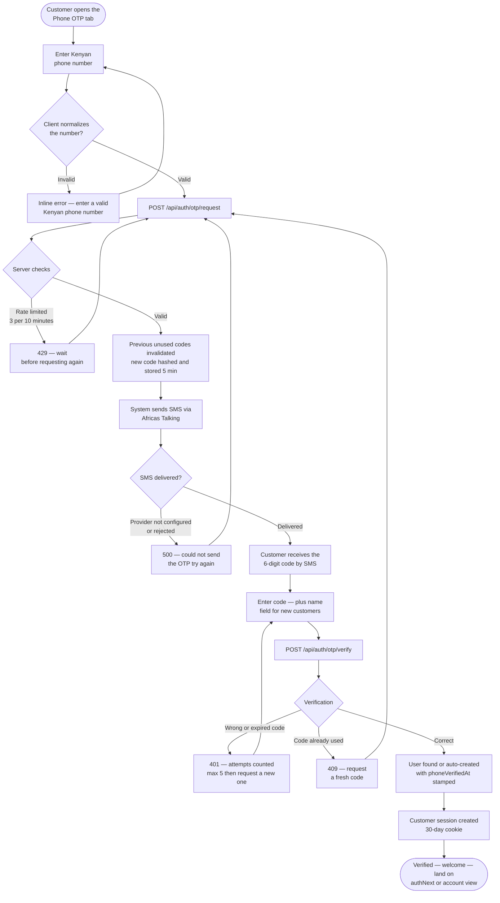

# C02 — Sign in with a phone code

The passwordless alternative: the customer enters a Kenyan phone number, the platform sends a six-digit code by SMS (Africa's Talking), and the customer types it back. New phones are auto-registered as accounts — the name field only appears for new customers — and the code is stored only as an HMAC hash, expires in five minutes, and is single-use. Exercising this flow end-to-end requires live Africa's Talking credentials; without them the code cannot be delivered (the code path itself is complete and statically tested against backdoors).

| Metadata | Value |
| --- | --- |
| Primary actor | Customer |
| Secondary actors | System (OTP generation, hashing and SMS dispatch) |
| Functional area | Accounts and authentication |
| Entry point | `/auth` Phone OTP tab — `AuthView` in `src/components/views/auth-view.tsx` |
| Status | Environment-dependent (requires live provider) — verified against code |
| End condition | Verified phone, customer session (30 days), user created or matched; client on `authNext ?? account` |
| Related journeys | C01 (password sign-in), C03 (sign-in return with a cart), C04 (profile and security), O06 (guest orders an OTP can claim), X02 (Rx ordering) |

## Journey map

## Journey steps

### Step 1 — Switch to the Phone OTP tab and enter the number

- **User action:** The customer clicks "Phone OTP" on the auth screen and types their Kenyan phone number (e.g. 0712 345 678).
- **Location:** OTP tab form in `src/components/views/auth-view.tsx` (`handleOtpRequest`).
- **Destination:** The request-a-code form.
- **Purpose:** Start passwordless sign-in.
- **System behaviour:** The client normalizes the input with `normalizePhone` (accepts 07…/01…, 254…, 7… forms and maps them to `254XXXXXXXX`); an unrecognizable number shows an inline error and blocks submission.
- **Outcome:** A normalized number ready to request a code for.
- **Next step:** Send the code.
- **Alternative paths:** The login tab's "sign in with your phone" link switches here directly; existing customers and brand-new phones both use the same tab.

### Step 2 — Request the code

- **User action:** The customer clicks "Send code".
- **Location:** `authApi.otpRequest` in `src/lib/api-client.ts`; endpoint `POST /api/auth/otp/request` (`src/app/api/auth/otp/request/route.ts`).
- **Destination:** The code-entry form with "Sent to <number>" and a "change number" link.
- **Purpose:** Trigger the SMS.
- **System behaviour:** The server re-validates the phone (`PHONE_RE`: `+254`/`0`/bare `7…`/`1…` with 8 digits, normalized to `+254XXXXXXXXX`) and rate limits to 3 requests per 10 minutes per IP+phone. It generates a six-digit code with `randomInt`, marks all previous unused codes for that phone as used, and stores a new `OtpCode` row: only the HMAC-SHA256 hash of `phone:code` (keyed by `OTP_HASH_SECRET`), an expiry of 5 minutes, `used: false`, `attempts: 0`. The plain code exists only inside the SMS message.
- **Outcome:** The customer sees "Verification code sent" and the input switches to the six-slot code field.
- **Next step:** Receive and enter the code.
- **Alternative paths:** "change number" resets to step 1 (the just-issued code is simply abandoned — it cannot be reused after a later one is requested).

### Step 3 — Receive the SMS

- **User action:** The customer reads the SMS on their phone.
- **Location:** `sendSms` in `src/lib/sms.ts`; provider Africa's Talking.
- **Destination:** The SMS inbox.
- **Purpose:** Deliver the one-time code out-of-band.
- **System behaviour:** The system calls the Africa's Talking messaging endpoint (sandbox or production based on the username) with the API key and optional sender ID, message capped at 480 characters ("Your Sphere Pharmacy verification code is … expires in 5 minutes. Do not share it."). A provider rejection (bad status or non-2xx) throws and the route returns a generic error. Without `AFRICAS_TALKING_USERNAME`/`API_KEY` the call throws outside test mode — this is the environment dependency. There is no demo or backdoor code path (statically tested).
- **Outcome:** The six-digit code is on the customer's phone.
- **Next step:** Enter it in the app.
- **Alternative paths:** If delivery fails, the customer can retry after the rate-limit window or fall back to password sign-in (journey C01).

### Step 4 — Enter the code (and a name for new customers)

- **User action:** The customer types the six digits into the one-time-code input; if the form shows "Your name (new customers)", they type their name.
- **Location:** OTP verify form in `auth-view.tsx` (InputOTP six slots with separators); `handleOtpVerify`.
- **Destination:** A complete verification submission.
- **Purpose:** Prove control of the phone number.
- **System behaviour:** The submit button stays disabled until six digits are entered; the name field is optional and only meaningful when no user exists for the phone (the server defaults it to "Customer"). The phone and code are POSTed together so the server matches the code to the same number it was issued for.
- **Outcome:** The verification request is ready.
- **Next step:** Verify.
- **Alternative paths:** A mistyped number is caught before requesting; after the code is sent the "change number" link restarts the flow.

### Step 5 — Verify the code

- **User action:** The customer clicks "Verify & continue".
- **Location:** `POST /api/auth/otp/verify` (`src/app/api/auth/otp/verify/route.ts`).
- **Destination:** A customer session.
- **Purpose:** Exchange the code for a session.
- **System behaviour:** The route rate limits to 8 verifications per 10 minutes per IP+phone and requires a `^\d{6}$` code. It loads the latest unused, unexpired `OtpCode` for the phone with fewer than 5 attempts and compares HMAC hashes with `timingSafeEqual`. A mismatch increments `attempts` and returns 401; a match is consumed atomically (`updateMany` guarded on `used: false, attempts < 5` — a replay returns 409). On success the user is found by phone or auto-created (stamping `phoneVerifiedAt`), existing accounts get `phoneVerifiedAt` stamped if missing, and a 30-day session is created. The route also supports claiming guest orders via a `claimToken` (matching `guestPhone` + token hash) — the server mechanism behind guest-order adoption.
- **Outcome:** The phone is verified and the customer is signed in.
- **Next step:** Land in the app.
- **Alternative paths:** Five failed attempts exhaust the code; the customer must request a new one (the old one is invalidated automatically on the next request).

### Step 6 — Land signed-in

- **User action:** None — the client completes the flow.
- **Location:** `finishAuth` in `auth-view.tsx`; session store `src/store/use-auth-store.ts`.
- **Destination:** `authNext ?? account` view with a "Verified — welcome!" toast.
- **Purpose:** Return the customer to what they were doing.
- **System behaviour:** The session payload is stored, `refresh()` re-reads `GET /api/auth/me`, and `replace()` navigates to the stored destination without leaving the auth view in the back-stack; `clearAuthIntent()` resets the detour state.
- **Outcome:** The customer is signed in with a phone-verified account.
- **Next step:** Continue shopping, checkout (journey C03), or account management (journey C04).
- **Alternative paths:** Customers created via OTP with no password can set one later from profile security (journey C04), or keep using OTP.

## Decision points

| Decision | Branches | Enforced by/where |
| --- | --- | --- |
| Phone valid Kenyan number? | Yes → normalized `+254…`; no → 400/inline error | `normalizePhone` (client) and `PHONE_RE` (server) |
| Request rate limit | ≤ 3 per 10 min per IP+phone → send; else → 429 | `enforceRateLimit("otp-request", 3, 600000)` in `POST /api/auth/otp/request` |
| Code fresh? | New request invalidates all previous unused codes for the phone | `updateMany used: true` before insert in the request route |
| Code correct and unexpired? | Match → consume; mismatch → 401 and `attempts + 1` (max 5) | HMAC compare + attempts guard in `POST /api/auth/otp/verify` |
| Single use | Atomic `updateMany` consumes once; replay → 409 | consumed-count check in the verify route |
| User exists for the phone? | Yes → sign in (stamp `phoneVerifiedAt`); no → auto-create with supplied or default name | `findUnique` / `create` in the verify route |
| SMS provider configured? | Yes → send; no → error (environment-dependent) | `sendSms` in `src/lib/sms.ts` |
| Return destination | `authNext` → original view; else account | `finishAuth` in `auth-view.tsx` |

## Error and recovery paths

- **Invalid phone (400):** the inline/server message shows the expected format; the customer corrects and retries — nothing was sent.
- **Request rate limited (429):** three codes per ten minutes per phone; the customer waits out the window. This bounds SMS cost and SIM-swap spam.
- **Wrong or expired code (401):** each wrong entry counts toward the 5-attempt ceiling on that code; after expiry or exhaustion the customer requests a new code (which invalidates the old one).
- **Replayed code (409):** a code that was already consumed cannot verify again — request a fresh one.
- **Verification rate limited (429):** eight verify attempts per ten minutes; wait, then retry or request a new code.
- **SMS delivery failure (500):** either the provider is unconfigured (environment-dependent — needs `AFRICAS_TALKING_*` credentials) or rejected the message; the customer can retry later or use password sign-in (journey C01). In test mode only, the SMS call is stubbed.
- **Code on the wrong device:** the code is tied to the phone number, not the browser — the customer can complete verification on any device where the SMS is readable.
- **No customer-facing OTP status view:** if the SMS is delayed, there is no resend timer in the UI — the customer re-requests within the rate limit; a documented simplicity trade-off.

## Traceability

| Concern | Implementation reference |
| --- | --- |
| OTP tab UI (request and verify forms) | `src/components/views/auth-view.tsx` (`handleOtpRequest`, `handleOtpVerify`, InputOTP input) |
| Code request endpoint | `POST /api/auth/otp/request` in `src/app/api/auth/otp/request/route.ts` |
| Code verify endpoint | `POST /api/auth/otp/verify` in `src/app/api/auth/otp/verify/route.ts` |
| Code generation and hashing | `otpCode` (randomInt) and `hashOtp` (HMAC-SHA256, `OTP_HASH_SECRET`) in `src/lib/hash.ts` |
| Constant-time comparison | `safeEqualHex` in `src/lib/hash.ts` |
| SMS delivery | `sendSms` in `src/lib/sms.ts` (Africa's Talking, sandbox/production endpoints) |
| Data model | `OtpCode` model (`prisma/schema.prisma`) — `phone`, `codeHash`, `expiresAt`, `used`, `attempts`; index `[phone, used, expiresAt, createdAt]` |
| Phone-verified accounts | `User.phoneVerifiedAt` stamping in the verify route |
| Guest-order claiming (server support) | `claimToken` branch in `POST /api/auth/otp/verify` (matches `guestPhone` + `guestAccessTokenHash`) |
| Session creation | `createSession` (30-day cookie) in `src/lib/session.ts` |
| Rate limits | `enforceRateLimit` — request 3/10min, verify 8/10min in the two routes |
| Architecture contract | `docs/architecture/authentication.md` (§4 OTP with guest order claiming) |

## Related journeys and documents

- **C01** — password registration and sign-in (the alternative path)
- **C03** — returning to checkout after this sign-in
- **C04** — setting a password on an OTP-created account
- **O06** — guest orders whose claiming this mechanism supports server-side
- **X02** — prescription ordering that the resulting account unlocks
- Docs: [authentication](../../architecture/authentication.md) · [user roles and permissions](../../product/user-roles-and-permissions.md) · [customer CRM](../../features/customer-crm.md)
