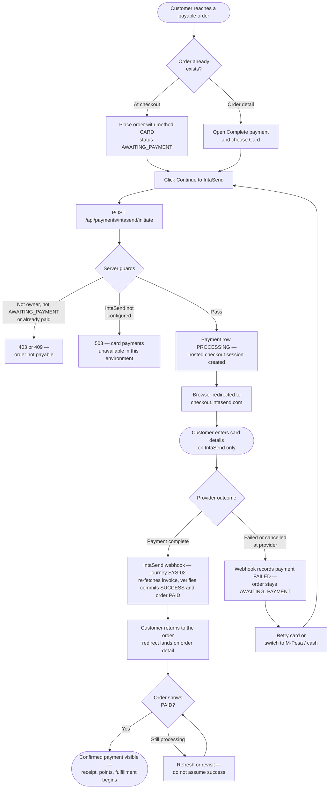

# O04 — Pay an order by card

A customer pays an order by card without ever entering card details into Sphere: the storefront creates an IntaSend hosted-checkout session server-side and redirects the customer to IntaSend's secure page. The outcome is trusted only when IntaSend's authenticated webhook (journey SYS-02) re-fetches the invoice from IntaSend's own API and confirms it is `COMPLETE` — returning to the site is not, by itself, proof of payment. The code path is complete, but exercising it end-to-end requires live (or sandbox) IntaSend credentials; without them the initiate route fails closed with 503.

| Metadata | Value |
| --- | --- |
| Primary actor | Customer (order owner, or guest holding the order access token) |
| Secondary actors | System (IntaSend webhook — SYS-02) |
| Functional area | Payments |
| Entry point | Checkout step 3 → Card, or order detail → "Complete payment" → Card |
| Status | Environment-dependent (requires live provider) — verified against code |
| End condition | `Payment` provider INTASEND status `SUCCESS`; order `PAID`; points credited; confirmed state visible on the order |
| Related journeys | O02 (order creation), O03 (M-Pesa variant), O06 (returning to pay later), SYS-02 (webhook), SYS-10 (notifications), A02 (fulfillment after payment) |

## Journey map

## Journey steps

### Step 1 — Reach a payable order

- **User action:** The customer selects Card at checkout step 3, or opens an existing `AWAITING_PAYMENT` order and switches the payment tabs to Card.
- **Location:** Checkout view step 3 — `src/components/views/checkout-view.tsx`; order detail — `src/components/views/order-detail-view.tsx` (payment panel tabs M-Pesa/Card).
- **Destination:** The card payment panel with the amount and a card-safety notice.
- **Purpose:** Get to an order that is ready to be paid and choose the card channel.
- **System behaviour:** At checkout, `startCard` first places the order (`placeOrder("CARD")`), creating it with status `AWAITING_PAYMENT`. The panel states that card details are entered only on IntaSend's secure hosted checkout and that Sphere never receives the card number or CVV. Guests authenticate with the `x-order-access` token.
- **Outcome:** A payable order with the Card option selected.
- **Next step:** Start the hosted checkout.
- **Alternative paths:** Orders that are not `AWAITING_PAYMENT` (under review, or awaiting availability confirmation) cannot be paid yet; M-Pesa (journey O03) is the alternative online channel.

### Step 2 — Create the checkout session and redirect

- **User action:** The customer clicks "Continue to IntaSend · KSh …".
- **Location:** `startCard` in `checkout-view.tsx` / `order-detail-view.tsx`; endpoint `POST /api/payments/intasend/initiate` (`src/app/api/payments/intasend/initiate/route.ts`); client `src/lib/intasend/client.ts`.
- **Destination:** The browser is redirected to the provider-hosted checkout page.
- **Purpose:** Hand the customer to a PCI-scoped hosted page without exposing card data to Sphere.
- **System behaviour:** The client calls `paymentsApi.cardCheckoutSession(orderId, idempotencyKey, accessToken)`. The route enforces: mode must be `checkout` (any other value is rejected — card details are only ever entered on IntaSend), a valid idempotency key, rate limit `intasend-initiate` 8 per 15 minutes per order, order ownership (owner session, staff, or guest token), status exactly `AWAITING_PAYMENT`, positive total, no existing `SUCCESS` payment, and `isIntaSendConfigured()` (fails closed with 503). It reserves a payment attempt (`reservePaymentAttempt` — a `PROCESSING` `Payment` with provider INTASEND, method HOSTED_CHECKOUT), then calls `createIntaSendCheckoutSession` with the order amount (KES), customer name/email/phone and `api_ref = payment.id`; the returned URL is validated to be HTTPS on IntaSend's domains and stored as the payment's `providerReference`. If a `PROCESSING` payment already holds a stored HTTPS checkout URL, the same session is returned instead of creating a new one. The browser then `window.location.assign`s the checkout URL.
- **Outcome:** The customer is on IntaSend's page with a Sphere payment row in `PROCESSING`.
- **Next step:** Complete the provider steps.
- **Alternative paths:** Uncertain provider responses leave the payment `PROCESSING` with a reconcile note and return 503 ("Card checkout is temporarily unavailable") — retrying returns the stored session rather than double-charging.

### Step 3 — Enter card details on IntaSend

- **User action:** The customer completes the provider's card form (and any 3-D Secure authentication) on the IntaSend page.
- **Location:** Entirely on IntaSend's hosted checkout — no Sphere screen.
- **Destination:** IntaSend records the payment outcome against the invoice whose `apiRef` is the Sphere payment id.
- **Purpose:** Authorize the payment.
- **System behaviour:** Sphere receives no card data at any point (the `Payment.cardLast4` column is never populated). IntaSend signals the outcome through the signed webhook `POST /api/payments/intasend/webhook` (journey SYS-02), which verifies the challenge/HMAC/secret, then re-fetches the invoice from IntaSend's payment-status API and requires the state `COMPLETE` before flipping the payment to `SUCCESS`, the order to `PAID`, crediting loyalty points and queueing notifications in one Serializable transaction. `FAILED` and `CANCELLED` invoices are recorded as terminal payment failures.
- **Outcome:** The payment outcome is durably recorded server-side, independent of the redirect.
- **Next step:** Return to Sphere.
- **Alternative paths:** The customer may abandon the hosted page; the payment simply remains `PROCESSING` until the webhook (or reconciliation) resolves it, and the order stays payable.

### Step 4 — Return and verify the outcome

- **User action:** After the provider flow, the customer is redirected back to Sphere and opens the same order.
- **Location:** IntaSend `redirect_url` (default `${appUrl}/orders/<orderId>`) → order detail view; `GET /api/orders/[id]`.
- **Destination:** The order detail view showing payments and status.
- **Purpose:** Confirm the payment on the order rather than trusting the redirect.
- **System behaviour:** The order detail loads the order (owner session or guest token) and shows the payment records; a completed payment displays as `SUCCESS` with the order status `PAID`. If the webhook has not landed yet, the order may still show a processing payment — refreshing or revisiting later resolves it. The checkout view's equivalent (`finalizeSuccess` path) applies only to the checkout entry; card checkout primarily ends on the order detail after the redirect.
- **Outcome:** The customer sees the verified, paid order with earned points.
- **Next step:** Fulfillment proceeds (journeys A02/A03).
- **Alternative paths:** If the result is pending, the guidance is explicit: refresh or revisit the order instead of assuming success — a redirect alone is not proof of payment.

### Step 5 — Recover from failure

- **User action:** If the card payment failed or was cancelled, the customer retries or switches methods.
- **Location:** Payment panel in `order-detail-view.tsx` (Card/M-Pesa tabs) or a fresh checkout after "Choose another method" (`changeMethod` in `checkout-view.tsx`).
- **Destination:** A new payment attempt on the still-payable order.
- **Purpose:** Complete payment despite a failed card attempt.
- **System behaviour:** A provider `FAILED`/`CANCELLED` outcome marks the payment `FAILED` ("Card payment was not completed") while the order remains `AWAITING_PAYMENT`, so both a card retry (a fresh idempotency key creates a fresh attempt) and a switch to M-Pesa (journey O03) work. `changeMethod` at checkout best-effort cancels the unpaid order and re-places it with the new method.
- **Outcome:** Payment completes through an available channel.
- **Next step:** The journey ends when the order is paid or cancelled.
- **Alternative paths:** Cash at pickup/delivery (journey O01) remains available for unpaid orders the staff can still process.

## Decision points

| Decision | Branches | Enforced by/where |
| --- | --- | --- |
| Entry point | Checkout (order created on pay) · order detail (existing payable order) | `startCard` in `checkout-view.tsx` and `order-detail-view.tsx` |
| Request mode | `checkout` → proceed; anything else → 400 (card details belong on IntaSend) | mode check in `POST /api/payments/intasend/initiate` |
| Order payable? | `AWAITING_PAYMENT` + positive total → proceed; else 409; already paid → 409 | status/total/payment guards in the initiate route |
| Payer authorized? | Owner session · staff · guest token → allowed; else 403 | `getSession` + `guestAccessTokenHash` comparison |
| Existing session? | `PROCESSING` payment with stored HTTPS URL → reuse; else create new | stored-checkout reuse branch in the initiate route |
| Provider configured? | `isIntaSendConfigured()` → session created; else 503 fail-closed | `src/lib/intasend/client.ts` |
| Provider outcome | Invoice `COMPLETE` → SYS-02 success path; `FAILED`/`CANCELLED` → payment FAILED, order stays payable; other → still processing | webhook route + invoice status normalization (journey SYS-02) |
| Redirect result | Order `PAID` → confirmed; still processing → refresh, never assume | order detail rendering of `Payment` records |

## Error and recovery paths

- **Order not ready for payment (409):** the order is not `AWAITING_PAYMENT`; wait for pharmacy confirmation and return via My orders (journey O06).
- **Already paid (409):** a `SUCCESS` payment exists; refresh the order instead of paying again.
- **Invalid request mode (400):** the API only supports hosted checkout — there is no Sphere page where card details could be entered, by design.
- **Provider not configured (503):** IntaSend credentials are missing in this environment; card payment is genuinely unavailable here — use M-Pesa/cash. This is why the journey is environment-dependent.
- **Checkout session could not be created (503):** the payment is left `PROCESSING` with a reconcile note; retrying returns the stored session (the reuse branch) rather than creating duplicate charges.
- **Payment failed or cancelled at the provider:** the payment is marked `FAILED` with "Card payment was not completed"; the order stays payable and the customer can retry or switch to M-Pesa.
- **Webhook delayed:** the redirect may land before the webhook; the order shows a processing payment — refresh or revisit rather than re-paying.
- **Abandoned hosted page:** the payment stays `PROCESSING` until reconciled; the customer can restart from the order detail (a fresh idempotency key) once the old attempt resolves.

## Traceability

| Concern | Implementation reference |
| --- | --- |
| Checkout card starter | `startCard` in `src/components/views/checkout-view.tsx` |
| Order-detail card starter | `startCard` in `src/components/views/order-detail-view.tsx` |
| Initiate endpoint | `POST /api/payments/intasend/initiate` (`src/app/api/payments/intasend/initiate/route.ts`) |
| IntaSend client | `src/lib/intasend/client.ts` (`createIntaSendCheckoutSession`, `isIntaSendConfigured`, hosted-URL validation) |
| Payment attempt reservation | `reservePaymentAttempt` in `src/lib/security/payment-attempt.ts` |
| Webhook completion | `POST /api/payments/intasend/webhook` — journey SYS-02 (`src/app/api/payments/intasend/webhook/route.ts`) |
| Guest payment access | `x-order-access` token handling in the initiate route |
| Payment statuses and methods | `PAYMENT_STATUSES` in `src/lib/constants.ts`; `Payment` model (`prisma/schema.prisma`) |
| Redirect target | `redirect_url` built by the IntaSend client (default order detail) |
| Money handling | `money` in `src/lib/security/payment.ts` |
| Provider documentation | `docs/integrations/intasend.md` |
| API contract | `openapi/sphere-api.yaml` — `POST /payments/intasend/initiate`, `POST /payments/intasend/webhook` |

## Related journeys and documents

- **O02** — placing the order this payment completes
- **O03** — the M-Pesa alternative for the same payable order
- **O06** — returning to payment later from the orders list
- **SYS-02** — the webhook that actually confirms the card payment (system side)
- **SYS-10** — how the payment-outcome notification reaches the customer
- **A02** — staff fulfillment once the order is PAID
- Docs: [IntaSend integration](../../integrations/intasend.md) · [payments and refunds](../../features/payments-and-refunds.md) · [payment lifecycle](../../workflows/payment-lifecycle.md)
