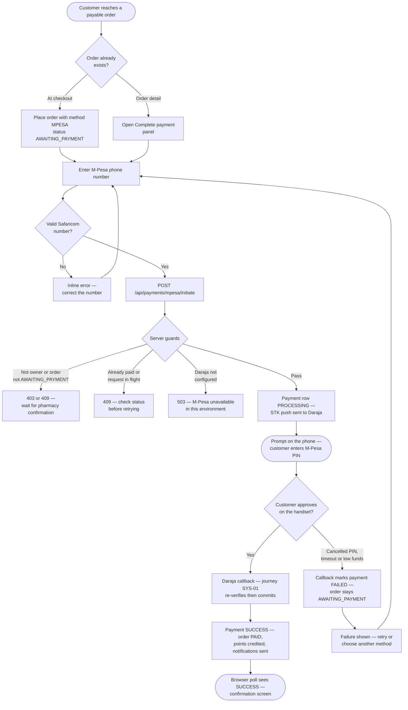

# O03 — Pay an order with M-Pesa

A customer pays an order using Safaricom's Lipa Na M-Pesa Online (STK Push): Sphere sends a payment request, the customer's phone shows a PIN prompt, and the outcome is only trusted once Safaricom's authenticated callback (journey SYS-01) has re-verified the transaction server-to-server. There is no PIN entry on the website — the customer's only actions are providing the phone number and approving the prompt on the handset. Exercising this journey end-to-end requires live (or sandbox) Daraja credentials; without them the initiate route fails closed with 503.

| Metadata | Value |
| --- | --- |
| Primary actor | Customer (order owner, or guest holding the order access token) |
| Secondary actors | System (Daraja callback — SYS-01), Staff (can trigger a push on payable orders) |
| Functional area | Payments |
| Entry point | Checkout step 3 → M-Pesa, or order detail → "Complete payment" → M-Pesa |
| Status | Environment-dependent (requires live provider) — verified against code |
| End condition | `Payment` provider MPESA status `SUCCESS` with receipt; order `PAID`; points credited |
| Related journeys | O02 (order creation), O04 (card variant), O06 (retry from order detail), SYS-01 (callback), SYS-10 (notifications), A02 (fulfillment after payment) |

## Journey map

## Journey steps

### Step 1 — Reach a payable order

- **User action:** The customer either selects M-Pesa at checkout step 3, or opens an existing order in My orders and uses the "Complete payment" entry (the order card highlights Awaiting payment).
- **Location:** Checkout view step 3 — `src/components/views/checkout-view.tsx`; orders list/detail — `src/components/views/orders-view.tsx`, `src/components/views/order-detail-view.tsx`.
- **Destination:** The M-Pesa payment form with the payable amount.
- **Purpose:** Get to an order that is ready to be paid.
- **System behaviour:** At checkout, `startMpesa` first places the order (`placeOrder("MPESA")`) which creates it with status `AWAITING_PAYMENT` (the online-method initial status; prescription orders start `UNDER_REVIEW` and cannot be paid until staff advance them). From the order detail, the payment panel only appears when the order status is `AWAITING_PAYMENT`; guests authenticate with the `x-order-access` token from `sessionStorage`.
- **Outcome:** An `AWAITING_PAYMENT` order is on screen with its total.
- **Next step:** Enter the M-Pesa phone number.
- **Alternative paths:** Orders not yet `AWAITING_PAYMENT` (e.g. `RECEIVED` cash orders awaiting confirmation, or `UNDER_REVIEW` Rx orders) are rejected by the initiate route with 409 — the customer must wait for pharmacy confirmation (journeys A02/X02).

### Step 2 — Enter the M-Pesa phone number

- **User action:** The customer types the Safaricom number that should receive the STK prompt (pre-filled with the account phone when signed in).
- **Location:** `mpesa-phone` input in `checkout-view.tsx` (step 3) or `order-detail-view.tsx` (payment panel).
- **Destination:** A normalized phone value.
- **Purpose:** Tell the provider which phone to push the payment request to.
- **System behaviour:** The client normalizes with `normalizePhone` (accepts 07…, 01…, 254…, 7…, 1… and rejects everything else) and blocks submission with an inline error for invalid input. The server independently validates the phone with its own `PHONE_RE` (`/^(?:\+?254|0)?(7\d{8}|1\d{8})$/`) and normalizes to `+254XXXXXXXXX`.
- **Outcome:** A valid phone number ready to submit.
- **Next step:** Start the payment request.
- **Alternative paths:** An invalid number never leaves the browser; the customer corrects it. Note the number can differ from the account phone — any Safaricom number works.

### Step 3 — Start the STK push

- **User action:** The customer clicks the pay button ("Pay KSh … with M-Pesa" / "Send M-Pesa request").
- **Location:** `startMpesa` in `checkout-view.tsx` or `order-detail-view.tsx`; endpoint `POST /api/payments/mpesa/initiate` (`src/app/api/payments/mpesa/initiate/route.ts`).
- **Destination:** A processing state; a toast tells the customer the STK push was sent and to enter the PIN only on the phone.
- **Purpose:** Ask Daraja to trigger the payment prompt.
- **System behaviour:** The client calls `paymentsApi.mpesaInitiate(orderId, phone, idempotencyKey, accessToken)`. The route enforces: request-size cap, a valid idempotency key (16–100 chars, client-generated UUID), rate limit `mpesa-initiate` 5 per 15 minutes keyed `orderId:phone`, order ownership (owner session, staff, or guest token matching `guestAccessTokenHash`), order status exactly `AWAITING_PAYMENT` with positive total, no existing `SUCCESS` payment, whole-KES amount, and `isDarajaConfigured()` (fails closed with 503 otherwise). It then either returns the existing attempt (idempotency key match) or reserves a new payment attempt (`reservePaymentAttempt`, `src/lib/security/payment-attempt.ts` — a `PROCESSING` `Payment` row with method `STK_PUSH`) and calls `initiateStkPush` in `src/lib/mpesa/daraja.ts`, storing the returned `checkoutRequestId`. An in-flight `PROCESSING` payment from the last 15 minutes blocks a second attempt (409).
- **Outcome:** A `PROCESSING` payment exists and Safaricom has been asked to push the prompt.
- **Next step:** Approve the prompt on the phone.
- **Alternative paths:** Uncertain provider responses leave the payment `PROCESSING` with a reconcile note and return 503 — the customer is told to check their phone and order status before retrying rather than blindly re-initiating.

### Step 4 — Approve on the phone

- **User action:** The customer enters their M-Pesa PIN on the handset prompt and submits.
- **Location:** Entirely on the customer's phone (Safaricom/M-Pesa); no Sphere screen.
- **Destination:** Daraja records the outcome and calls the Sphere callback.
- **Purpose:** Authorize the payment.
- **System behaviour:** No web action happens here. Safaricom delivers the outcome to `POST /api/payments/mpesa/callback` (journey SYS-01), which authenticates the token, replay-protects via `PaymentWebhookEvent`, re-queries Daraja's STK status API, verifies amount/phone/receipt, and only then flips payment to `SUCCESS`, order to `PAID` (with history and loyalty credit) — all in one Serializable transaction. A declined/cancelled/timed-out push is recorded as `FAILED` with a reason while the order stays `AWAITING_PAYMENT`.
- **Outcome:** The payment outcome is durably recorded server-side.
- **Next step:** The browser shows the result.
- **Alternative paths:** Common failures are cancelling the prompt, wrong PIN, insufficient balance or timeout; each yields a `FAILED` payment with a reason and a retryable order.

### Step 5 — Wait for confirmation

- **User action:** The customer keeps the page open; the UI polls for the outcome.
- **Location:** Polling loop in `startMpesa` (both views); endpoint `GET /api/payments/mpesa/query?checkoutRequestId=…` (`src/app/api/payments/mpesa/query/route.ts`).
- **Destination:** Either a success state or a failure message.
- **Purpose:** Reflect the authoritative server state without trusting the redirect alone.
- **System behaviour:** The client polls every 2.5 s with backoff (×1.5, capped at 10 s) against a 2-minute deadline, pausing while the document is hidden. The query route is read-only: it returns the local payment status (`SUCCESS`/`FAILED`/`PENDING`) after checking owner/staff/guest access — provider reconciliation happens only in the authenticated callback (SYS-01). On `SUCCESS`, checkout calls `finalizeSuccess` (refreshes the order and shows the confirmed screen) and order detail refetches the order; on `FAILED` the failure reason is displayed.
- **Outcome:** The customer sees the verified result; a paid order shows the receipt-linked state and earned points.
- **Next step:** Fulfillment proceeds (journeys A02/A03).
- **Alternative paths:** If the 2-minute deadline passes without a verdict, the UI shows a "taking longer than expected" message advising the customer to check their M-Pesa messages before retrying — the payment may still complete via the callback, and the order detail will show it on refresh.

### Step 6 — Recover from failure or switch method

- **User action:** After a failed or stalled attempt, the customer retries the push or picks another method.
- **Location:** Failure alert in `checkout-view.tsx` ("Choose another method" via `changeMethod`) or the payment panel in `order-detail-view.tsx`.
- **Destination:** A fresh payment attempt, a card payment (journey O04), or a cancelled order.
- **Purpose:** Turn a failed payment into a completed one without losing the order.
- **System behaviour:** The order remains `AWAITING_PAYMENT` after failure, so both retry and method switch are possible. `changeMethod` best-effort cancels the unpaid order (journey O06 rules) and returns the wizard to the method chooser so a new order can be placed with a different method. From the order detail, the customer can simply retry M-Pesa or switch to card on the same order.
- **Outcome:** The customer completes payment through an available channel.
- **Next step:** The journey ends when a payment succeeds (or the order is cancelled).
- **Alternative paths:** Staff can also trigger an STK push on payable orders via `POST /api/orders/[id]/request-payment` (e.g. over the phone). Repeated failures with "already paid" (409) mean a prior attempt actually succeeded — refresh the order instead of paying again.

## Decision points

| Decision | Branches | Enforced by/where |
| --- | --- | --- |
| Entry point | Checkout (order created on pay) · order detail (existing `AWAITING_PAYMENT` order) | `startMpesa` in `checkout-view.tsx` and `order-detail-view.tsx` |
| Phone valid? | Yes → normalize and submit; no → inline error | `normalizePhone` (client); `PHONE_RE` in `POST /api/payments/mpesa/initiate` |
| Order payable? | `AWAITING_PAYMENT` + positive total → proceed; else 409 | status/total guard in the initiate route |
| Payer authorized? | Owner session · staff · guest token → allowed; else 403 | `getSession` + `guestAccessTokenHash` comparison in the initiate route |
| Duplicate/in-flight attempt? | Same idempotency key → return existing; in-flight PROCESSING < 15 min → 409 | idempotency-key lookup and in-flight check in the initiate route |
| Provider configured? | `isDarajaConfigured()` → push; else 503 fail-closed | `src/lib/mpesa/daraja.ts` |
| Handset outcome | Approved → SYS-01 success path; cancelled/wrong PIN/timeout → payment FAILED, order stays payable | callback route branching (journey SYS-01) |
| Poll verdict | SUCCESS → confirmed; FAILED → reason shown; PENDING → keep polling to the 2-min deadline | polling loop + `GET /api/payments/mpesa/query` |

## Error and recovery paths

- **Invalid phone (client-blocked / 400):** the customer corrects the number; nothing was sent.
- **Order not ready for payment (409):** the order is not `AWAITING_PAYMENT` (still under review or awaiting confirmation); the customer waits for the pharmacy to advance the order, then returns via My orders.
- **Already paid (409):** a `SUCCESS` payment exists; refresh the order — do not pay again.
- **Request already awaiting confirmation (409):** an in-flight `PROCESSING` push exists; check its status (or the phone's M-Pesa messages) before starting another.
- **Provider not configured (503):** Daraja credentials are missing in this environment; M-Pesa is genuinely unavailable here — choose card/cash instead. This is why the journey is environment-dependent.
- **Uncertain provider response (503):** the payment stays `PROCESSING` with a reconcile note; the customer checks the phone and order status before retrying — uncertain outcomes are never silently reset.
- **Customer declines / wrong PIN / timeout:** the payment is recorded `FAILED` with the provider reason and the customer can retry immediately (the order is untouched).
- **Poll deadline exceeded:** the UI stops polling with guidance to check M-Pesa messages; the callback may still land and the order will show `PAID` on the next load.

## Traceability

| Concern | Implementation reference |
| --- | --- |
| Checkout M-Pesa starter | `startMpesa` in `src/components/views/checkout-view.tsx` |
| Order-detail M-Pesa starter | `startMpesa` in `src/components/views/order-detail-view.tsx` |
| Initiate endpoint | `POST /api/payments/mpesa/initiate` (`src/app/api/payments/mpesa/initiate/route.ts`) |
| Daraja client (STK push, query, phone format) | `src/lib/mpesa/daraja.ts` (`initiateStkPush`, `queryStkPush`, `formatDarajaPhone`, `isDarajaConfigured`) |
| Payment attempt reservation | `reservePaymentAttempt` in `src/lib/security/payment-attempt.ts` |
| Status polling | `paymentsApi.mpesaQuery` → `GET /api/payments/mpesa/query` (`src/app/api/payments/mpesa/query/route.ts`) |
| Callback completion | `POST /api/payments/mpesa/callback` — journey SYS-01 (`src/app/api/payments/mpesa/callback/route.ts`) |
| Guest payment access | `x-order-access` token handling in the initiate and query routes |
| Payment statuses | `PAYMENT_STATUSES` in `src/lib/constants.ts`; `Payment` model (`prisma/schema.prisma`) |
| Staff-triggered variant | `POST /api/orders/[id]/request-payment` (`src/app/api/orders/[id]/request-payment/route.ts`) |
| Money handling | `money` in `src/lib/security/payment.ts` (whole-KES requirement) |
| Provider documentation | `docs/integrations/mpesa-daraja.md` |
| API contract | `openapi/sphere-api.yaml` — `POST /payments/mpesa/initiate`, `GET /payments/mpesa/query` |

## Related journeys and documents

- **O02** — placing the order this payment completes
- **O04** — the card alternative for the same payable order
- **O06** — returning to payment later from the orders list
- **SYS-01** — the callback that actually confirms the payment (system side)
- **SYS-10** — how the payment-outcome notification reaches the customer
- **A02** — staff fulfillment once the order is PAID
- Docs: [M-Pesa Daraja integration](../../integrations/mpesa-daraja.md) · [payments and refunds](../../features/payments-and-refunds.md) · [payment lifecycle](../../workflows/payment-lifecycle.md)
