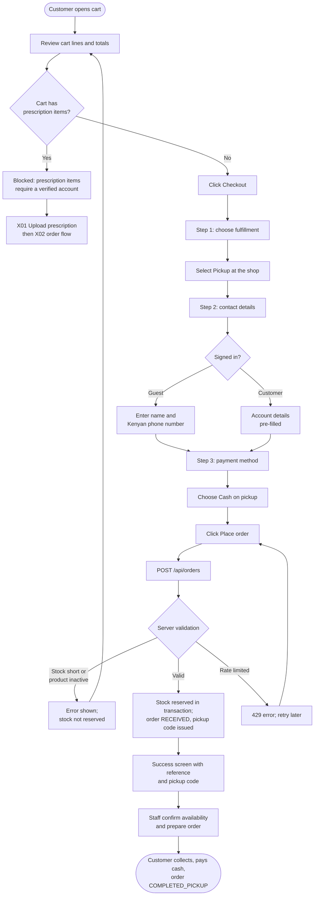

# O01 — Place a cash pickup order

A guest or signed-in customer checks out an over-the-counter cart, chooses store pickup, and commits to paying cash at the counter. The server re-validates stock, reserves it transactionally, issues a pickup code, and notifies the pharmacy; staff later confirm the cash payment when the customer collects.

| Metadata | Value |
| --- | --- |
| Primary actor | Customer (guest or signed-in) |
| Secondary actors | Staff (cash confirmation at pickup) |
| Functional area | Orders and fulfillment |
| Entry point | Cart view → Checkout |
| Status | Implemented — verified against code |
| End condition | Order status `COMPLETED_PICKUP` with a `SUCCESS` `CASH` payment |
| Related journeys | O02 (delivery variant), O03/O04 (online payment variants), O05 (reservation variant), A02 (staff side), C03 (guest cart) |

## Journey map

## Journey steps

### Step 1 — Open the cart and review contents

- **User action:** The customer opens the cart from the header cart icon or the "Review my bag" entry point and checks quantities, prices, and the running total.
- **Location:** Cart view — `src/components/views/cart-view.tsx` (rendered when the app-store view is `cart`).
- **Destination:** Stays on the cart view.
- **Purpose:** Confirm the order contents and subtotal before committing; adjust quantities or remove lines here.
- **System behaviour:** The cart is client-side state in `src/store/use-cart-store.ts` (persisted locally). Prices shown come from the product data the client last loaded; the server re-validates all prices and stock at order time.
- **Outcome:** The customer sees an accurate cart summary and the Checkout button.
- **Next step:** Click "Checkout".
- **Alternative paths:** If the cart contains prescription-only items and the customer is not signed in, checkout cannot proceed as a plain guest order — the server rejects it (see decision below); the customer is directed to sign in and upload the prescription first (journeys C01/X01/X02).

### Step 2 — Choose pickup fulfillment

- **User action:** On checkout step 1, the customer selects the "Pickup at the shop" card (Lumumba Drive, Roysambu, ready in ~2 hours) and clicks Next.
- **Location:** Checkout view, step 1 — `src/components/views/checkout-view.tsx`.
- **Destination:** Step 2 of the checkout wizard.
- **Purpose:** Tell the pharmacy the order will be collected in store, so no delivery address or fee applies and a pickup code is issued.
- **System behaviour:** The choice is stored as `fulfillment: "PICKUP"` in checkout state; the delivery-fee branch of the total calculation is skipped.
- **Outcome:** Checkout advances with pickup selected; the total contains no delivery fee.
- **Next step:** Provide contact details.
- **Alternative paths:** Choosing "Delivery to you" switches this journey to O02. Trying to continue without selecting a fulfillment shows "Select pickup or delivery first." and blocks step 2.

### Step 3 — Provide contact details

- **User action:** Signed-in customers confirm their pre-filled account details. Guests type their full name, Kenyan phone number (e.g. 0712 345 678), and optionally an email, then continue.
- **Location:** Checkout view, step 2 — `src/components/views/checkout-view.tsx`.
- **Destination:** Step 3, payment method.
- **Purpose:** Give the pharmacy a contact for order updates and, for guests, a token to track the order later.
- **System behaviour:** The client normalizes the phone to +254 format (`PHONE_RE` normalization exists on both client and server). Guests cannot continue if the name is under 2 characters or the phone is not a valid Kenyan number. Guests also cannot continue if the cart has prescription items — the message states an account is required.
- **Outcome:** Contact details are validated client-side and ready to submit.
- **Next step:** Choose the payment method.
- **Alternative paths:** Guests who want order history and loyalty points can follow the sign-in link (journeys C01/C02); returning to the cart preserves the guest cart (journey C03).

### Step 4 — Choose cash on pickup and place the order

- **User action:** The customer selects "Cash on pickup" and clicks the place-order button.
- **Location:** Checkout view, step 3 — `src/components/views/checkout-view.tsx`, `startCash()` handler.
- **Destination:** The request is submitted; on success the wizard shows the step-4 success screen.
- **Purpose:** Commit to the order and pay physically at the counter.
- **System behaviour:** `placeOrder("CASH")` builds the payload via `buildPayload` (items, `fulfillment`, `paymentMethod: "CASH"`, guest contact when signed out, optional promo code and loyalty redemption) and calls `ordersApi.create`, which POSTs to `/api/orders` (`src/app/api/orders/route.ts`). The route enforces the `order-create` rate limit (12 per 15 minutes per client), validates item count (1–50) and quantities (1–99), re-reads the products, rejects inactive/discontinued products or insufficient stock (409), re-validates the promo code and loyalty quote server-side, then in one transaction reserves stock (conditional bulk `UPDATE` on `Product` stock fields), creates the `Order` with status `RECEIVED` and type `OTC`, generates the reference and pickup code, records loyalty and promotion effects, and commits. After commit it notifies the customer (in-app + optional email) and staff (in-app `NEW_ORDER` to ADMIN/PHARMACIST/STAFF).
- **Outcome:** The order exists with status `RECEIVED`; stock is reserved; the success screen shows the order reference and the pickup code.
- **Next step:** The customer waits for the "ready for pickup" notification; staff process the order (journey A02).
- **Alternative paths:** Server-side validation failures surface as inline errors with retry (stock short → adjust cart; promo no longer valid → remove code; rate limited → 429 retry). Network failures show a generic error and the order is not created. If the customer placed the order but changes their mind before paying, they can cancel (journey O06) — reserved stock is released.

### Step 5 — Track the order until it is ready

- **User action:** The customer opens My orders and watches the status change (Received → Availability confirmed → Ready for pickup).
- **Location:** Orders view and order detail view — `src/components/views/orders-view.tsx`, `src/components/views/order-detail-view.tsx`. Guests use the order link/access token issued at checkout (`x-order-access` token stored in `sessionStorage`).
- **Destination:** Order detail view for the specific order.
- **Purpose:** Know when to travel to the shop.
- **System behaviour:** The detail view loads `GET /api/orders/[id]` (owner session or guest access token enforced server-side). Status transitions are made by staff through the admin order workflow and recorded in `OrderStatusHistory`. Notifications are sent on each meaningful transition.
- **Outcome:** The customer sees "Ready for pickup" and their pickup code.
- **Next step:** Travel to the shop and quote the reference/pickup code.
- **Alternative paths:** If the pharmacy cannot fulfill an item, staff mark the order `REJECTED` (with a reason) and reserved stock is released; the customer is notified. Customers can cancel while the order is still cancellable (journey O06).

### Step 6 — Pay cash and complete at the counter

- **User action:** At the counter, the customer quotes the order reference or pickup code; staff verify, take the cash, and confirm payment in the admin orders section.
- **Location:** Admin workspace orders section — `src/components/views/admin/sections/orders-section.tsx`; endpoint `POST /api/orders/[id]/cash-confirm` (`src/app/api/orders/[id]/cash-confirm/route.ts`).
- **Destination:** Order detail shows the successful cash payment.
- **Purpose:** Record the physical payment so accounting and order state stay truthful.
- **System behaviour:** The route requires a staff session (`requireStaff()`; riders are restricted to their own cash-on-delivery orders). It rejects confirmation when the order status is outside `AVAILABILITY_CONFIRMED`, `AWAITING_PAYMENT`, `READY_FOR_PICKUP`, `OUT_FOR_DELIVERY`; when any prescription on the order is still unreviewed; or when a successful payment already exists (409). It then creates a `Payment` row with provider `CASH` and status `SUCCESS` inside a transaction, moves the order to `COMPLETED_PICKUP` via the order workflow, and triggers payment-outcome notifications.
- **Outcome:** The order is `COMPLETED_PICKUP`; loyalty points are credited for the paid amount; both parties see the completed state.
- **Next step:** The journey ends. Loyalty balance can be used on the next order (journey C08).
- **Alternative paths:** If the customer never shows up, staff handle the order per the reservation/expiry policy (journey SYS-03 for reservations; cancelled orders release stock). If the order was accidentally left in a non-allowed state, the confirmation is rejected with an actionable error and staff must correct the order state first.

## Decision points

| Decision | Branches | Enforced by/where |
| --- | --- | --- |
| Cart contains prescription items? | Guest blocked (account required) → X01/X02; signed-in customer continues into the Rx flow | Client: `continueFrom2` in `checkout-view.tsx`; server: `POST /api/orders` (`Prescription items require a verified account.`) |
| Fulfillment selected? | Pickup → this journey; delivery → O02; none → blocked at step 1 | `checkout-view.tsx` step gating; `POST /api/orders` fulfillment validation |
| Stock available for every line? | Yes → reserve; no → 409 with product name | `POST /api/orders` stock re-check + conditional bulk reservation in transaction |
| Promo code valid at submit time? | Valid → discount applied; invalid/expired/limit-reached → 409, customer removes code and retries | `POST /api/orders` promotion re-validation (active, window, minimum spend, per-user/IP/browser limits) |
| Payment method | CASH (this journey) · MPESA → O03 · CARD → O04 · LATER → O05 | `paymentMethod` on the order; `initialStatus` logic in `POST /api/orders` |
| Cash confirmation state allowed? | Allowed statuses → SUCCESS cash payment + `COMPLETED_PICKUP`; otherwise 409 | `POST /api/orders/[id]/cash-confirm` `CASH_ALLOWED` list + guards |

## Error and recovery paths

- **Insufficient stock at submit time (409):** the error names the product; the customer adjusts quantities in the cart and retries. Stock that was available earlier may have been reserved by another order — the server is authoritative.
- **Product no longer exists (409):** the line must be removed; the catalog reflects the current catalogue.
- **Rate limited (429):** order creation is capped at 12 requests per 15 minutes per client; the customer waits and retries.
- **Promotion rejected (404/409):** the message instructs removing or replacing the code; checkout continues without discount.
- **Guest contact invalid (400):** the inline message asks for a valid name/phone; no order is created.
- **Cash confirmation conflicts (409):** if the order already has a successful payment or sits in a non-confirmable status, staff see the reason; the fix is to correct the order state (or void the duplicate attempt) before confirming.
- **Network failure during submit:** the client shows a generic error; no order was created unless the request actually reached the server — the customer can check My orders (or the guest order link) before retrying to avoid duplicates.

## Traceability

| Concern | Implementation reference |
| --- | --- |
| Cart state | `src/store/use-cart-store.ts` |
| Checkout wizard | `src/components/views/checkout-view.tsx` (`placeOrder`, `startCash`, `buildPayload`, `finalizeSuccess`) |
| Order creation endpoint | `src/app/api/orders/route.ts` (`POST`) |
| Stock reservation | transactional conditional bulk update in `POST /api/orders`; `src/lib/inventory-guard.ts` (`InventoryGuard.getAvailableStock`) |
| Pickup code generation | `src/lib/hash.ts` (`pickupCode`), stored on `Order.pickupCode` (`prisma/schema.prisma`) |
| Money handling | `src/lib/security/payment.ts` (`money`), KES `Decimal(12,2)` |
| Loyalty quote | `src/lib/loyalty.ts` (`redemptionQuote`), constants in `src/lib/constants.ts` (`LOYALTY`) |
| Notifications | `src/lib/notify.ts` (`notifyCustomer`, `notifyStaff`) |
| Cash confirmation | `src/app/api/orders/[id]/cash-confirm/route.ts` |
| Order status transitions | `src/lib/security/order-workflow.ts` (`canTransitionOrder`), statuses in `src/lib/constants.ts` |
| Guest access token | `x-order-access` token created in `POST /api/orders`, stored client-side in `sessionStorage` |
| API contract | `openapi/sphere-api.yaml` — `POST /orders`, `POST /orders/{id}/cash-confirm` |

## Related journeys and documents

- **O02** — the delivery variant of this checkout (address, zone fee, rider handoff)
- **O03 / O04** — pay the same order online with M-Pesa or card
- **O05** — reserve now, pay in store (the `LATER` branch)
- **A02** — the staff-side processing that moves this order to ready
- **C03** — guest cart handling and sign-in return
- Docs: [orders-and-fulfillment](../../features/orders-and-fulfillment.md) · [order lifecycle](../../workflows/order-lifecycle.md) · [payments and refunds](../../features/payments-and-refunds.md)
