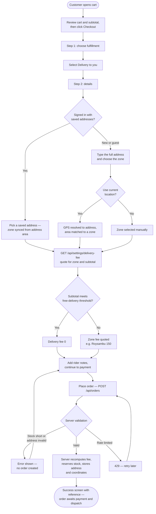

# O02 — Place a delivery order

A guest or signed-in customer checks out a cart and chooses delivery. The customer picks or creates an address, the delivery zone is derived from that address (or chosen directly by guests), and the zone-based fee is quoted live from the server. The fee the customer saw is re-computed server-side at order time — the server is authoritative — and the resulting order carries the address, zone, optional GPS coordinates and delivery notes that the dispatch board and rider (journeys A03/R01) use later.

| Metadata | Value |
| --- | --- |
| Primary actor | Customer (guest or signed-in) |
| Secondary actors | Staff (availability confirmation, dispatch), Rider (final delivery) |
| Functional area | Orders and fulfillment |
| Entry point | Cart view → Checkout → "Delivery to you" |
| Status | Implemented — verified against code |
| End condition | `Order` created with `fulfillment: "DELIVERY"`, `deliveryArea`/`deliveryAddress`/`deliveryFee` set, stock reserved (status depends on payment method) |
| Related journeys | O01 (pickup variant), O03/O04 (online payment), A03 (dispatch), R01 (rider), C05 (address book) |

## Journey map

## Journey steps

### Step 1 — Choose delivery fulfillment

- **User action:** The customer opens checkout from the cart and selects the "Delivery to you" card, then clicks Continue.
- **Location:** Checkout view, step 1 — `src/components/views/checkout-view.tsx`.
- **Destination:** Step 2 of the checkout wizard.
- **Purpose:** Tell the pharmacy the order must be delivered, so an address, a zone and a delivery fee become part of the order.
- **System behaviour:** The choice is stored as `fulfillment: "DELIVERY"` in checkout state. The card renders the live delivery settings from `settingsApi.get()` (fallback `DELIVERY_DEFAULTS`): the free-delivery threshold badge, the cheapest zone fee and whether night delivery is enabled. The view explains that the fee will be calculated from the address chosen next.
- **Outcome:** Checkout advances with delivery selected; the delivery-address section appears on step 2.
- **Next step:** Provide details and the delivery address.
- **Alternative paths:** Choosing "Pickup at the shop" switches to journey O01. Continuing without a selection is blocked ("Select pickup or delivery first.").

### Step 2 — Provide the delivery address

- **User action:** Signed-in customers pick a saved address (the default one is pre-selected) or "Deliver somewhere new"; guests type a full address and pick their delivery zone from the dropdown.
- **Location:** Checkout view, step 2 — `checkout-view.tsx`; address data via `addressesApi.list()` (`GET /api/addresses`).
- **Destination:** A selected address (saved) or address text plus zone (new/guest).
- **Purpose:** Set the delivery destination and derive the zone that drives the fee.
- **System behaviour:** Selecting a saved address (`selectSavedAddress`) syncs the zone from the address's `area` (case-insensitive match against the configured zones) and adopts the address's stored `latitude`/`longitude` as delivery coordinates. For a new address, the "Use current location" button (`UseCurrentLocationButton`, `src/components/shared/use-current-location-button.tsx`) calls the browser Geolocation API and resolves coordinates to an address and area via `POST /api/location/reverse-geocode` (Nominatim, Kenya-scoped), auto-matching the area to a zone. The customer can also pick the zone manually from the zone list with fees shown per zone.
- **Outcome:** An address, a zone and optional GPS coordinates are set.
- **Next step:** Review the quoted delivery fee.
- **Alternative paths:** If the saved address's area does not match a configured zone, the zone shows "Not recognised — choose a different address" and the customer must pick a zone or another address. Guests cannot leave the address shorter than 8 characters (guarded in `continueFrom2`).

### Step 3 — Review the delivery fee quote

- **User action:** The customer checks the quoted delivery fee and the running total shown next to the zone.
- **Location:** Checkout view, step 2 — `checkout-view.tsx`; quote from `settingsApi.deliveryFee(zone, subtotal, lat, lon)` → `GET /api/settings/delivery-fee`.
- **Destination:** Stays on step 2.
- **Purpose:** Know the delivery cost before committing.
- **System behaviour:** The quote endpoint calls `computeDeliveryFee` in `src/lib/settings.ts`: if the pre-discount subtotal meets `freeOver` (default KSh 3,000) the fee is 0; a `flat` mode returns the flat fee; a `distance` pricing mode with coordinates uses haversine distance bands; otherwise the zone fee is matched case-insensitively (unknown zone falls back to the last configured zone's fee, then the flat fee). The client mirrors the same rules as a fallback when the quote call fails.
- **Outcome:** The customer sees the fee (or "Free") and the total including delivery.
- **Next step:** Add rider notes and continue to payment.
- **Alternative paths:** If the quote request fails, the client falls back to the zone fee from the loaded settings, so the flow is not blocked; the server re-computes the authoritative fee at order time in any case.

### Step 4 — Rider notes and contact details

- **User action:** The customer optionally enters notes for the rider (gate code, call on arrival) and order notes, and confirms contact details (guests: name, Kenyan phone, optional email).
- **Location:** Checkout view, step 2 — `checkout-view.tsx` (`deliveryNotes`, `orderNotes`, guest fields).
- **Destination:** Continue to payment (step 3).
- **Purpose:** Give the rider everything needed to find the customer, and give the pharmacy a contact for order updates.
- **System behaviour:** `continueFrom2` enforces: zone required for delivery; saved-address mode requires a selected address; guest and new-address text must be at least 8 characters; guest name ≥ 2 characters and a valid Kenyan phone (`normalizePhone` accepts 07…/01…/254…/7…/1… formats); prescription items require a signed-in account (journey X02).
- **Outcome:** Step 3 (payment) is reached with a complete delivery payload.
- **Next step:** Choose the payment method.
- **Alternative paths:** Invalid input is blocked inline with an actionable message; nothing is submitted yet.

### Step 5 — Choose payment and place the order

- **User action:** The customer selects a payment method (M-Pesa, card, cash on delivery, or reserve) and clicks the place-order button.
- **Location:** Checkout view, step 3 — `checkout-view.tsx` (`startMpesa`/`startCard`/`startCash`/`startLater`, `placeOrder`, `buildPayload`).
- **Destination:** The order is submitted; on success the step-4 success screen shows the order reference.
- **Purpose:** Commit to the delivery order.
- **System behaviour:** For signed-in customers with a new address, `placeOrder` first persists it via `addressesApi.create` (label `Delivery · <zone>`, text, area, notes, coordinates). `buildPayload` assembles `fulfillment: "DELIVERY"`, `deliveryArea` (zone), `addressId` or `deliveryAddress`, `deliveryNotes`, `deliveryLatitude`/`deliveryLongitude`, plus items, guest contact, promo code and loyalty redemption. `POST /api/orders` (`src/app/api/orders/route.ts`) re-validates everything: address ownership when `addressId` is supplied, address text presence, coordinate ranges (lat −90…90, lon −180…180), then **re-computes** the delivery fee with `computeDeliveryFee` server-side. In one Serializable transaction it reserves stock, creates the `Order` (type OTC or RESERVATION; status `RECEIVED` for cash/later, `AWAITING_PAYMENT` for online methods; `CASH` + delivery is stored as `CASH_ON_DELIVERY`), issues the reference, and notifies customer and staff.
- **Outcome:** The order exists with the address, zone, fee and coordinates stored; stock is reserved; the success screen shows the reference and a Track order button.
- **Next step:** Track the order (journey O06) until it is out for delivery.
- **Alternative paths:** Stock shortfall returns 409 naming the product (adjust cart and retry); missing address returns 400; rate limiting (`order-create`, 12 per 15 minutes) returns 429; online payment continues in journeys O03/O04.

### Step 6 — Track the order to delivery

- **User action:** The customer opens My orders and watches the status change (Received → Availability confirmed → [payment] → Preparing → Out for delivery → Completed (delivered)).
- **Location:** Orders view and order detail view — `src/components/views/orders-view.tsx`, `src/components/views/order-detail-view.tsx`; data from `GET /api/orders` and `GET /api/orders/[id]` (guest access via the `x-order-access` token issued at checkout).
- **Destination:** Order detail view for the delivery order.
- **Purpose:** Know when the rider is coming and see the delivery address/notes on record.
- **System behaviour:** Staff process and confirm availability (journey A02), paid delivery orders appear on the dispatch board where a rider is assigned (journey A03), and the rider completes the drop-off (journey R01). Every transition writes `OrderStatusHistory` and triggers customer notifications; the detail view shows the delivery area, fee and rider information.
- **Outcome:** The order reaches `COMPLETED_DELIVERY` (cash orders are cash-confirmed by the rider; online orders were paid earlier).
- **Next step:** The journey ends; loyalty points are credited for paid amounts.
- **Alternative paths:** If the pharmacy cannot fulfill an item, staff reject the order with a reason and reserved stock is released. The customer can cancel while the order is still in an early status (journey O06); the unpaid-delivery progression is restricted until payment or staff action.

## Decision points

| Decision | Branches | Enforced by/where |
| --- | --- | --- |
| Fulfillment | PICKUP → journey O01; DELIVERY → this journey; none → blocked | `checkout-view.tsx` step gating; `POST /api/orders` fulfillment validation |
| Address source | Saved address (zone + coordinates synced) · new address (created at order time) · guest address text + manual zone | `selectSavedAddress`, `addressMode`, `placeOrder` in `checkout-view.tsx`; `addressId` ownership check in `POST /api/orders` |
| Zone known? | Matched zone → fee quoted; unmatched saved area → customer picks zone or address; guest without zone → blocked | `zones.find` matching in `checkout-view.tsx`; `continueFrom2` zone guard |
| Free delivery? | Subtotal ≥ `freeOver` → fee 0; else zone/flat/distance fee | `computeDeliveryFee` in `src/lib/settings.ts`; mirrored by `GET /api/settings/delivery-fee` |
| Payment method | MPESA → O03 · CARD → O04 · CASH → `CASH_ON_DELIVERY` status `RECEIVED` · LATER → `RESERVATION` type | `paymentMethod` mapping and `initialStatus` logic in `POST /api/orders` |
| Stock available? | Yes → reserved in transaction; no → 409 with product name, nothing reserved | conditional bulk stock `UPDATE` in `POST /api/orders` |
| Fee authoritative? | Client quote is display-only; server recomputes and stores the fee on the order | `computeDeliveryFee` call in `POST /api/orders` |

## Error and recovery paths

- **Zone not selected (blocked):** the customer cannot reach payment without a zone; the inline message asks for the delivery zone. Recovery is simply choosing a zone (or an address whose area matches one).
- **Address too short (blocked):** guest and new-address text must be ≥ 8 characters ("building, street and estate"); the customer types a fuller address.
- **Saved address not in any zone:** the UI shows "Not recognised — choose a different address"; the customer picks a zone manually via the new-address branch or selects another saved address.
- **Location lookup failure:** `POST /api/location/reverse-geocode` returns 502/500 when the geocoding provider is unavailable; the customer falls back to typing the address and zone — no data is lost.
- **Insufficient stock at submit (409):** the error names the product; adjust quantities in the cart and retry. The server is authoritative — displayed stock may have been reserved by another order.
- **Invalid coordinates (400):** latitude/longitude outside their ranges are rejected before the transaction; re-pick the location or continue without GPS.
- **Rate limited (429):** order creation is capped at 12 requests per 15 minutes per client; wait and retry.
- **Quote endpoint unavailable:** the client falls back to zone fees from the loaded settings; the order total is corrected by the server at placement, so a stale quote never overcharges.

## Traceability

| Concern | Implementation reference |
| --- | --- |
| Checkout wizard (delivery branch) | `src/components/views/checkout-view.tsx` (steps 1–2, `selectSavedAddress`, `continueFrom2`, `buildPayload`, `placeOrder`) |
| Delivery settings load | `settingsApi.get()` → `GET /api/settings` (`src/app/api/settings/route.ts`); `DELIVERY_DEFAULTS` in `src/lib/constants.ts` |
| Fee quote | `settingsApi.deliveryFee` → `GET /api/settings/delivery-fee` (`src/app/api/settings/delivery-fee/route.ts`) |
| Fee computation | `computeDeliveryFee`, `distanceKm` in `src/lib/settings.ts` |
| Current-location resolution | `src/components/shared/use-current-location-button.tsx` → `POST /api/location/reverse-geocode` (`src/app/api/location/reverse-geocode/route.ts`) |
| Address book usage | `addressesApi.list/create` → `GET/POST /api/addresses` (`src/app/api/addresses/route.ts`) |
| Order creation (delivery validation) | `POST /api/orders` (`src/app/api/orders/route.ts`) — address ownership, coordinate validation, server fee recompute |
| Stock reservation | transactional conditional bulk `UPDATE` in `POST /api/orders`; `src/lib/inventory-guard.ts` |
| Order status machine | `src/lib/security/order-workflow.ts`; statuses in `src/lib/constants.ts` |
| Guest access token | `guestAccessToken` created in `POST /api/orders`; stored client-side in `sessionStorage` as `sphere_order_access_<orderId>` |
| Delivery dispatch (later stages) | `GET /api/orders?scope=dispatch`; journeys A03 (assign) and R01 (deliver) |
| API contract | `openapi/sphere-api.yaml` — `POST /orders`, `GET /settings/delivery-fee` |

## Related journeys and documents

- **O01** — the pickup variant of the same checkout wizard
- **O03 / O04** — paying the delivery order online with M-Pesa or card
- **A03** — staff assign the paid delivery order to a rider
- **R01** — the rider completes the delivery (including cash on delivery)
- **C05** — managing the saved addresses used in step 2
- Docs: [orders-and-fulfillment](../../features/orders-and-fulfillment.md) · [order lifecycle](../../workflows/order-lifecycle.md) · [storefront and catalogue](../../features/storefront-and-catalogue.md)
